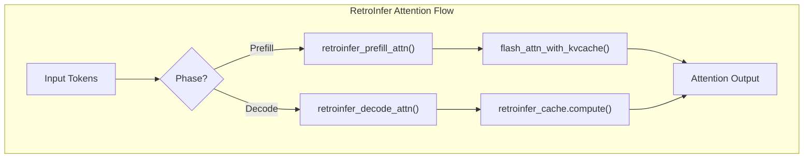
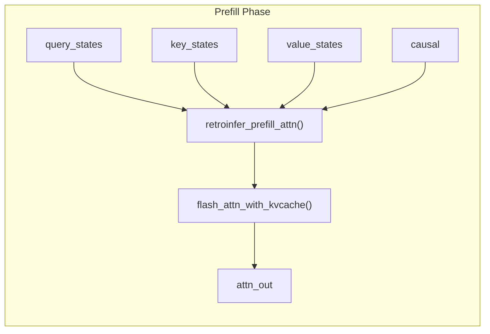
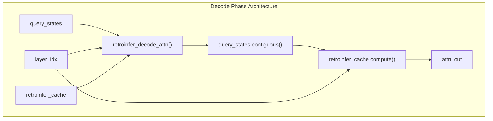
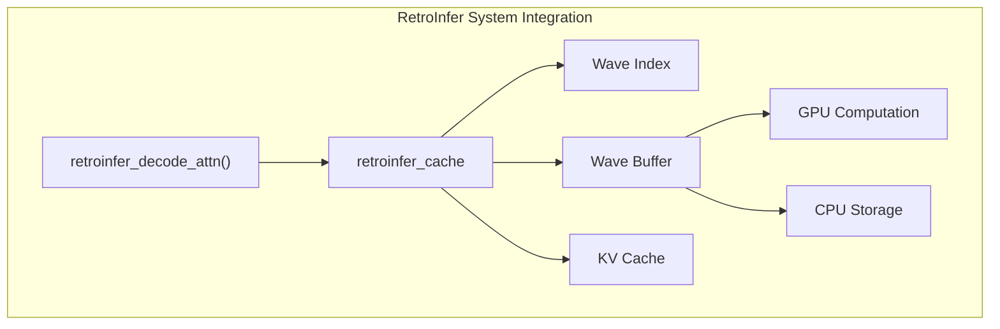

<!-- source: DeepWiki mcp.deepwiki.com · repo microsoft/RetrievalAttention · page 2.2 RetroInfer Attention · fetched 2026-10-26 -->

# RetroInfer Attention

<details>
<summary>Relevant source files</summary>

The following files were used as context for generating this wiki page:

- [attn_hub/retroinfer_attn.py](attn_hub/retroinfer_attn.py)

</details>


This document covers the RetroInfer attention implementation, which provides the core attention computation mechanism for the RetroInfer system. This includes both prefill and decode phase attention functions that work with the RetroInfer cache system to enable efficient long-context inference.

For information about the alternative Flash Attention implementation, see [Flash Attention](#2.1). For details about the overall attention mechanisms framework, see [Attention Mechanisms](#2).

## Overview

The RetroInfer attention system consists of two main phases implemented in [`attn_hub/retroinfer_attn.py`](attn_hub/retroinfer_attn.py:1-24)(). The prefill phase uses standard flash attention for parallel processing of the initial context, while the decode phase leverages the RetroInfer cache system for efficient sequential token generation.

### Architecture Flow



*Sources: attn_hub/retroinfer_attn.py*

## Prefill Phase Implementation

The prefill phase handles the initial processing of the full context sequence using parallel attention computation. This is implemented in the `retroinfer_prefill_attn` function.

### Function Signature and Usage

| Parameter | Type | Description |
|-----------|------|-------------|
| `query_states` | Tensor | Query tensor for attention computation |
| `key_states` | Tensor | Key tensor for attention computation |
| `value_states` | Tensor | Value tensor for attention computation |
| `causal` | bool | Whether to apply causal masking |

The prefill function delegates to the standard Flash Attention implementation:



*Sources: attn_hub/retroinfer_attn.py*

The implementation at [attn_hub/retroinfer_attn.py:4-13]() shows that prefill attention is a thin wrapper around `flash_attn_with_kvcache`, maintaining compatibility with the Flash Attention API while providing a consistent interface for the RetroInfer system.

## Decode Phase Implementation

The decode phase handles sequential token generation using the RetroInfer cache system for efficient attention computation. This is implemented in the `retroinfer_decode_attn` function.

### Function Signature and Cache Integration

| Parameter | Type | Description |
|-----------|------|-------------|
| `query_states` | Tensor | Query tensor for current token |
| `key_states` | Tensor | Key tensor (unused in decode) |
| `value_states` | Tensor | Value tensor (unused in decode) |
| `layer_idx` | int | Current transformer layer index |
| `retroinfer_cache` | Cache | RetroInfer cache instance |



*Sources: attn_hub/retroinfer_attn.py*

The decode implementation at [attn_hub/retroinfer_attn.py:17-23]() demonstrates how the RetroInfer system bypasses traditional key-value processing during decode, instead relying on the cache system's `compute` method which manages the wave index and buffer coordination internally.

## Integration with RetroInfer Components

The RetroInfer attention functions integrate with the broader RetroInfer system through several key interfaces:

### Cache System Integration



*Sources: attn_hub/retroinfer_attn.py*

### Memory Management

The attention functions are designed to work with the RetroInfer memory management system:

- **Prefill Phase**: Uses standard GPU memory allocation through Flash Attention
- **Decode Phase**: Leverages the wave buffer system for GPU-CPU memory coordination
- **Cache Management**: Relies on the RetroInfer cache to handle KV storage and retrieval

## API Reference

### retroinfer_prefill_attn

```python
def retroinfer_prefill_attn(query_states, key_states, value_states, causal)
```

Executes attention computation for the prefill phase using Flash Attention.

**Parameters:**
- `query_states`: Query tensor for attention computation
- `key_states`: Key tensor for attention computation  
- `value_states`: Value tensor for attention computation
- `causal`: Boolean flag for causal masking

**Returns:** Attention output tensor

### retroinfer_decode_attn

```python
def retroinfer_decode_attn(query_states, key_states, value_states, layer_idx, retroinfer_cache)
```

Executes attention computation for the decode phase using RetroInfer cache.

**Parameters:**
- `query_states`: Query tensor for current token
- `key_states`: Key tensor (unused)
- `value_states`: Value tensor (unused)
- `layer_idx`: Current transformer layer index
- `retroinfer_cache`: RetroInfer cache instance

**Returns:** Attention output tensor

*Sources: attn_hub/retroinfer_attn.py*

---

