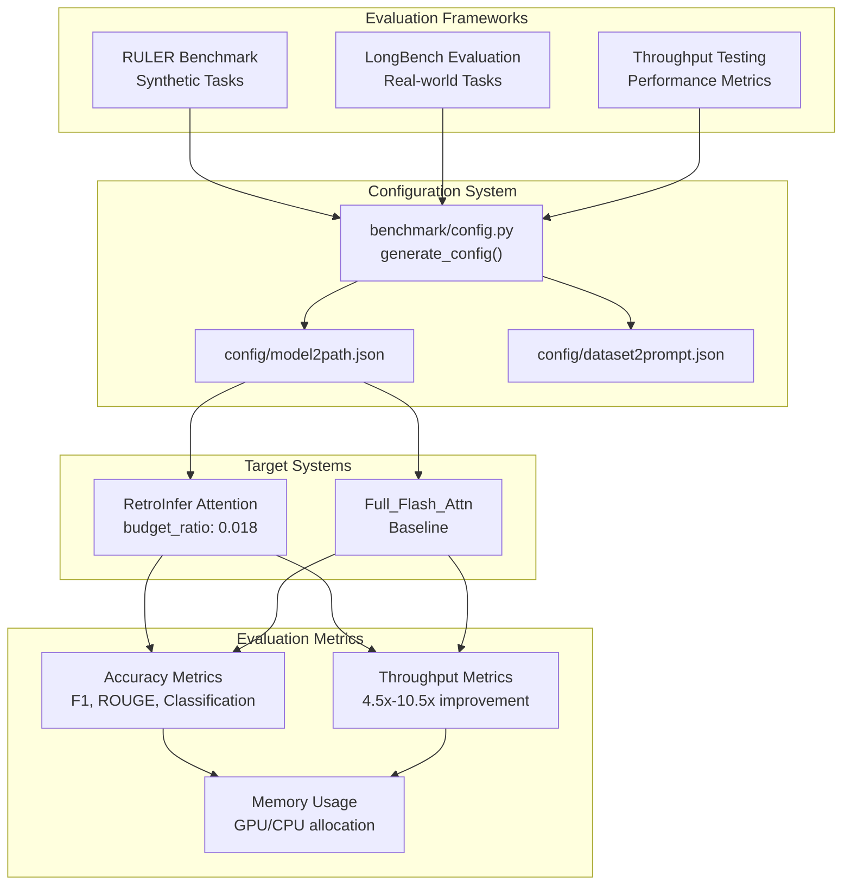
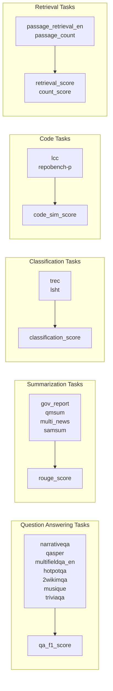
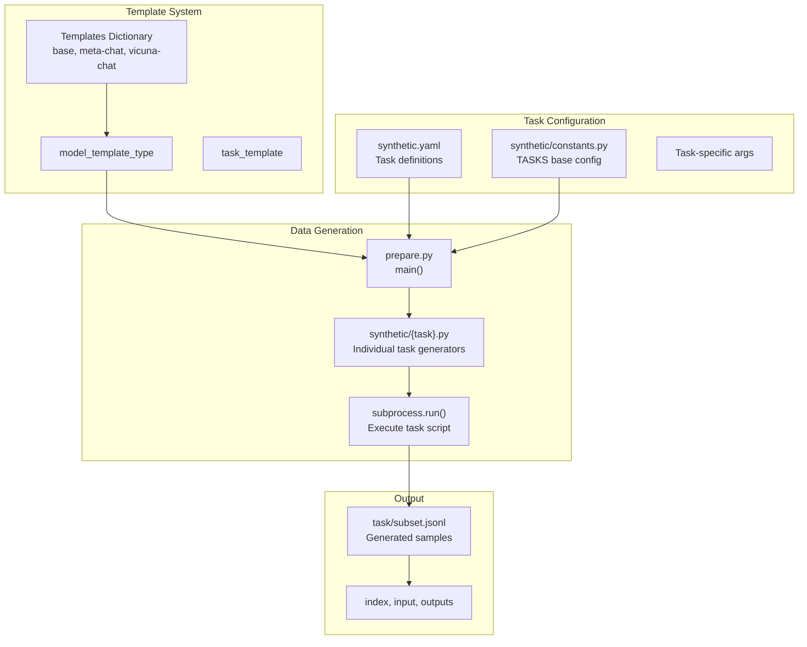
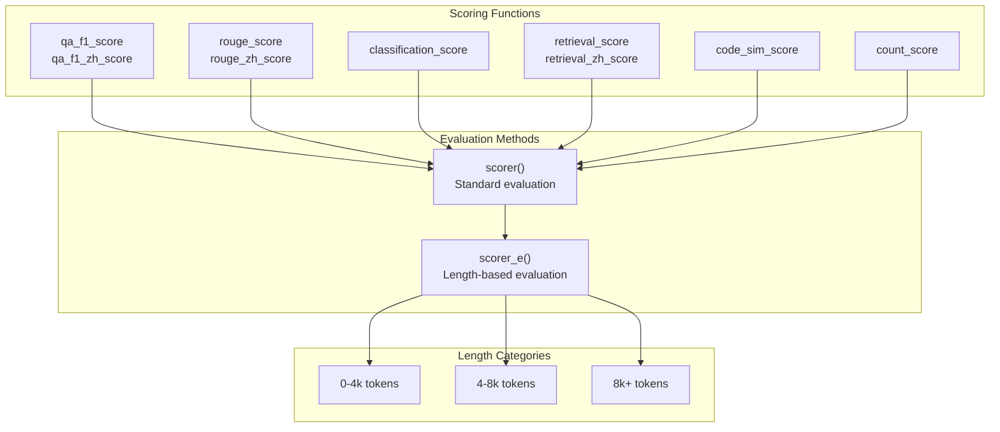
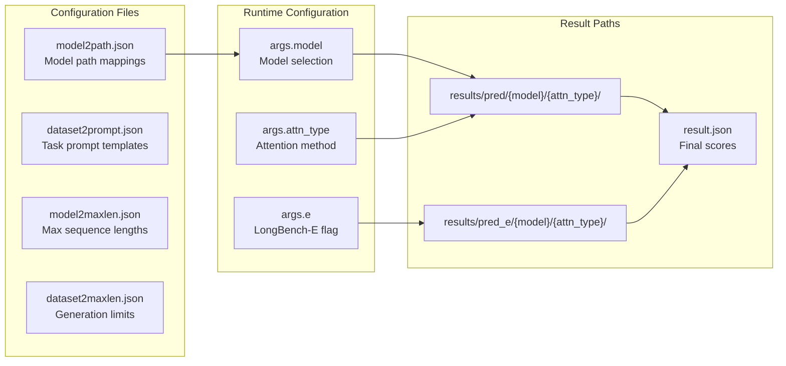
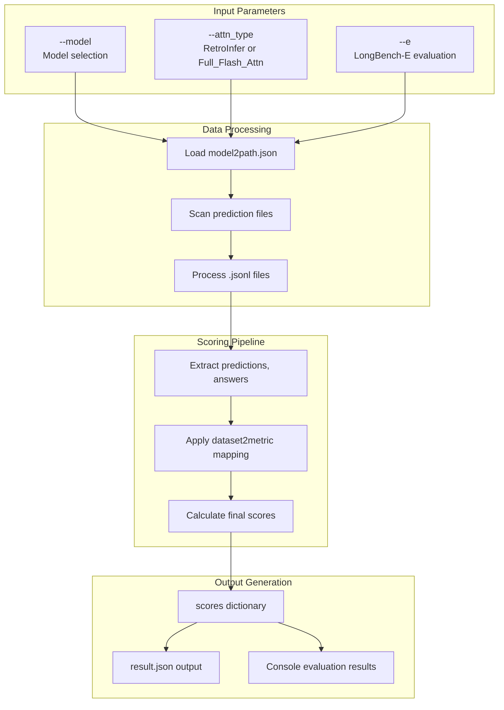

<!-- source: DeepWiki mcp.deepwiki.com · repo microsoft/RetrievalAttention · page 3 Benchmarking and Evaluation · fetched 2026-10-26 -->

# Benchmarking and Evaluation

Relevant source files

The following files were used as context for generating this wiki page:

- [benchmark/LongBench/eval.py](benchmark/LongBench/eval.py)
- [benchmark/ruler/data/prepare.py](benchmark/ruler/data/prepare.py)

This document covers the comprehensive benchmarking and evaluation system used to assess RetroInfer's performance compared to standard attention mechanisms. The system includes synthetic benchmarks, real-world task evaluations, and throughput measurements to validate both accuracy and efficiency improvements.

For information about the specific attention mechanisms being evaluated, see [Attention Mechanisms](#2). For setup instructions to run these benchmarks, see [Setup and Installation](#4).

## Overview

The RetroInfer benchmarking system consists of three primary evaluation frameworks that assess different aspects of the system's performance:

**Benchmark Architecture**

Sources: [benchmark/LongBench/eval.py:82-122](), [benchmark/ruler/data/prepare.py:67-141]()

## Supported Models and Attention Types

The benchmarking system supports evaluation across multiple model architectures and attention mechanisms:

| Model | Max Length | Attention Types |
|-------|------------|----------------|
| `llama-3-8b-1048k` | 1048576 | RetroInfer, Full_Flash_Attn |
| `llama-3.1-8b` | 131072 | RetroInfer, Full_Flash_Attn |
| `qwen2.5-7b` | 131072 | RetroInfer, Full_Flash_Attn |
| `qwen2.5-72b` | 131072 | RetroInfer, Full_Flash_Attn |

The system compares RetroInfer attention against Full Flash Attention as the baseline across all supported models.

Sources: [benchmark/LongBench/eval.py:44-48]()

## LongBench Evaluation System

LongBench provides real-world task evaluation through the `benchmark/LongBench/eval.py` script, which implements a comprehensive scoring system for various task types:

**Dataset to Metric Mapping**

The evaluation script processes prediction files from `results/pred/{model}/{attn_type}/` and generates comprehensive scores using the `dataset2metric` mapping defined in [benchmark/LongBench/eval.py:18-40]().

Sources: [benchmark/LongBench/eval.py:18-40](), [benchmark/LongBench/eval.py:82-122]()

## RULER Benchmark System

RULER generates synthetic benchmark data through the `benchmark/ruler/data/prepare.py` script, which supports multiple task types and model templates:

**RULER Data Generation Flow**

The system uses model-specific templates defined in [benchmark/ruler/data/prepare.py:50-64]() and generates data through task-specific Python scripts executed via subprocess calls.

Sources: [benchmark/ruler/data/prepare.py:50-64](), [benchmark/ruler/data/prepare.py:67-141]()

## Evaluation Metrics and Scoring

The benchmarking system implements multiple evaluation metrics imported from a metrics module:

**Metric Implementation**

The `scorer_e()` function in [benchmark/LongBench/eval.py:52-68]() provides length-based evaluation, categorizing performance by input length ranges for LongBench-E evaluation.

Sources: [benchmark/LongBench/eval.py:6-16](), [benchmark/LongBench/eval.py:52-68](), [benchmark/LongBench/eval.py:70-79]()

## Configuration Management

The benchmarking system relies on JSON configuration files to manage model paths, dataset prompts, and evaluation parameters:

**Configuration File Structure**

The configuration system loads model paths from JSON files and constructs result paths based on model and attention type selections, as implemented in [benchmark/LongBench/eval.py:87-93]().

Sources: [benchmark/LongBench/eval.py:87-93](), [benchmark/LongBench/eval.py:118-121]()

## Running Evaluations

The evaluation process involves executing the benchmark scripts with appropriate parameters:

**Evaluation Execution Flow**

The evaluation script processes all `.jsonl` files in the prediction directory, applies appropriate metrics, and outputs comprehensive results as shown in [benchmark/LongBench/eval.py:96-121]().

Sources: [benchmark/LongBench/eval.py:42-50](), [benchmark/LongBench/eval.py:96-121]()

---

