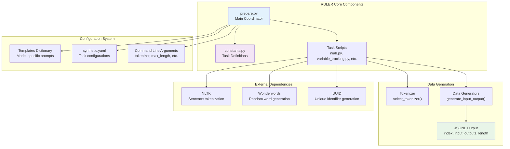
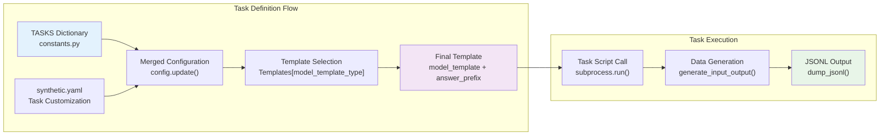
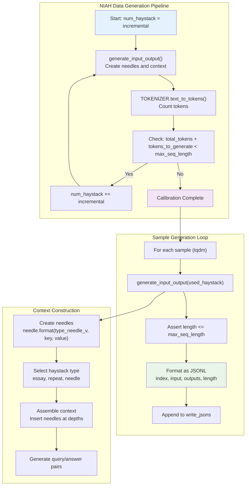
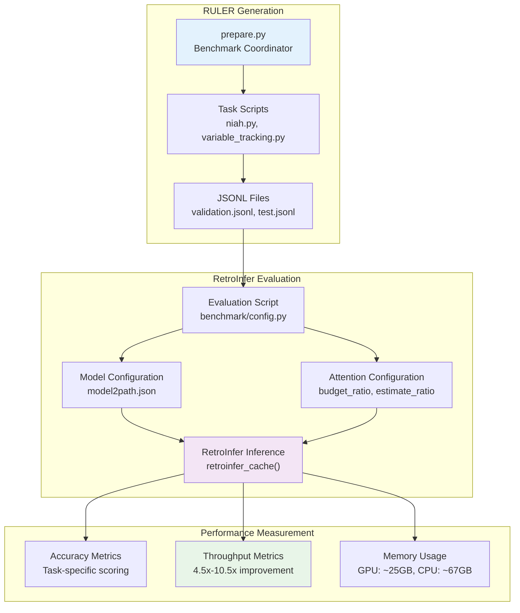

<!-- source: DeepWiki mcp.deepwiki.com · repo microsoft/RetrievalAttention · page 3.1 RULER Benchmark · fetched 2026-10-26 -->

# RULER Benchmark

<details>
<summary>Relevant source files</summary>

The following files were used as context for generating this wiki page:

- [benchmark/ruler/data/prepare.py](benchmark/ruler/data/prepare.py)
- [benchmark/ruler/data/synthetic/constants.py](benchmark/ruler/data/synthetic/constants.py)
- [benchmark/ruler/data/synthetic/niah.py](benchmark/ruler/data/synthetic/niah.py)

</details>


## Purpose and Scope

The RULER Benchmark is a synthetic evaluation framework designed to test long-context language models on controlled tasks with known ground truth answers. It generates artificial datasets that systematically evaluate specific capabilities like information retrieval, variable tracking, and reasoning over extended sequences. 

This document covers the RULER synthetic benchmark system, including its task definitions, data generation process, and integration with the RetroInfer evaluation pipeline. For information about real-world benchmarks, see [LongBench Evaluation](#3.2). For details on the synthetic data generation algorithms, see [Synthetic Data Generation](#3.1.1).

## RULER Architecture Overview

The RULER system consists of three main components: task definitions, data generation scripts, and a coordination layer that manages the benchmark preparation process.

### System Components



Sources: [benchmark/ruler/data/prepare.py:67-141](), [benchmark/ruler/data/synthetic/constants.py:24-54](), [benchmark/ruler/data/synthetic/niah.py:48-273]()

## Task Types and Definitions

RULER defines five core synthetic tasks in the `TASKS` dictionary, each designed to test specific long-context capabilities:

### Task Configuration Structure

| Task Name | Purpose | Tokens to Generate | Template Variables |
|-----------|---------|-------------------|-------------------|
| `niah` | Needle in a Haystack | 128 | `{type_needle_v}`, `{context}`, `{query}` |
| `variable_tracking` | Variable Assignment Tracking | 30 | `{context}`, `{query}`, `{num_v}` |
| `common_words_extraction` | Most Common Words | 120 | `{context}` |
| `freq_words_extraction` | Frequency Analysis | 50 | `{context}` |
| `qa` | Question Answering | 32 | `{context}`, `{query}` |

### Task Implementation Flow



Sources: [benchmark/ruler/data/synthetic/constants.py:24-54](), [benchmark/ruler/data/prepare.py:83-94](), [benchmark/ruler/data/prepare.py:104-120]()

## Data Generation Process

The data generation process follows a standardized pipeline that ensures consistent token length management and format across all tasks.

### Core Generation Algorithm

The `generate_samples` function in each task script follows this pattern:

1. **Length Calibration**: Incrementally increase context size until approaching `max_seq_length`
2. **Sample Generation**: Create specified number of samples with controlled randomness
3. **Token Validation**: Ensure each sample fits within length constraints
4. **Output Formatting**: Structure data as JSONL with required fields

### NIAH Task Generation Example



Sources: [benchmark/ruler/data/synthetic/niah.py:199-257](), [benchmark/ruler/data/synthetic/niah.py:126-196](), [benchmark/ruler/data/synthetic/niah.py:214-230]()

## Configuration and Templates

RULER uses a multi-layer configuration system that supports different model types and customizable task parameters.

### Template System

The `Templates` dictionary in `prepare.py` defines model-specific prompt formats:

| Template Type | Format | Usage |
|---------------|---------|-------|
| `base` | `{task_template}` | Raw task template |
| `meta-chat` | `[INST] {task_template} [/INST]` | Meta/Llama chat format |
| `vicuna-chat` | `A chat between...USER: {task_template} ASSISTANT:` | Vicuna conversation format |
| `lwm-chat` | `You are a helpful assistant. USER: {task_template} ASSISTANT:` | LWM chat format |
| `command-r-chat` | `<BOS_TOKEN><\|START_OF_TURN_TOKEN\|>...` | Command-R format |
| `chatglm-chat` | `[gMASK]sop<\|user\|> \n {task_template}...` | ChatGLM format |
| `RWKV` | `User: hi\n\nAssistant: Hi...` | RWKV conversation format |

### Configuration Workflow

```mermaid
graph LR
    subgraph "Configuration Assembly"
        cli_args["Command Line Arguments<br/>--task, --model_template_type"]
        yaml_load["Load synthetic.yaml<br/>yaml.safe_load()"]
        constants_merge["Merge with TASKS<br/>config.update(tasks_base[task])"]
        template_apply["Apply Model Template<br/>Templates[model_template_type]"]
        answer_prefix["Add Answer Prefix<br/>config['answer_prefix']"]
        final_config["Final Configuration<br/>Ready for task script"]
    end
    
    subgraph "Task Script Parameters"
        script_args["Script Arguments<br/>--save_dir, --tokenizer_path, etc."]
        additional_args["Additional Args<br/>config['args'].items()"]
        template_arg["Template Argument<br/>--template config['template']"]
        subprocess_call["subprocess.run(command)"]
    end
    
    cli_args --> yaml_load
    yaml_load --> constants_merge
    constants_merge --> template_apply
    template_apply --> answer_prefix
    answer_prefix --> final_config
    final_config --> script_args
    script_args --> additional_args
    additional_args --> template_arg
    template_arg --> subprocess_call
    
    style cli_args fill:#e3f2fd
    style final_config fill:#f3e5f5
    style subprocess_call fill:#e8f5e8
```



Sources: [benchmark/ruler/data/prepare.py:50-64](), [benchmark/ruler/data/prepare.py:77-94](), [benchmark/ruler/data/prepare.py:104-120]()

## Integration with RetroInfer

RULER integrates with the RetroInfer evaluation pipeline through standardized JSONL output format and configuration management.

### Output Format Specification

Each generated sample follows this structure:

```json
{
    "index": int,
    "input": str,
    "outputs": [str],
    "length": int
}
```

### Evaluation Pipeline Integration



Sources: [benchmark/ruler/data/prepare.py:138-141](), [benchmark/ruler/data/synthetic/niah.py:249-256](), [benchmark/ruler/data/prepare.py:15-32]()

---

