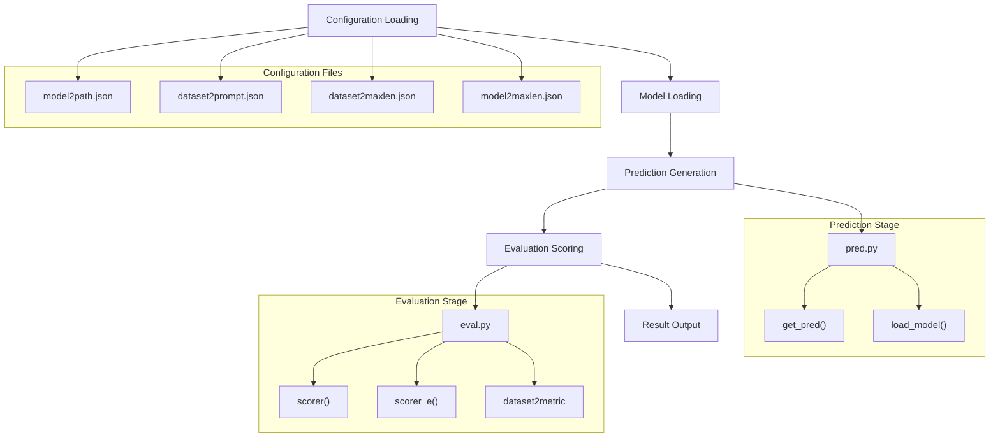
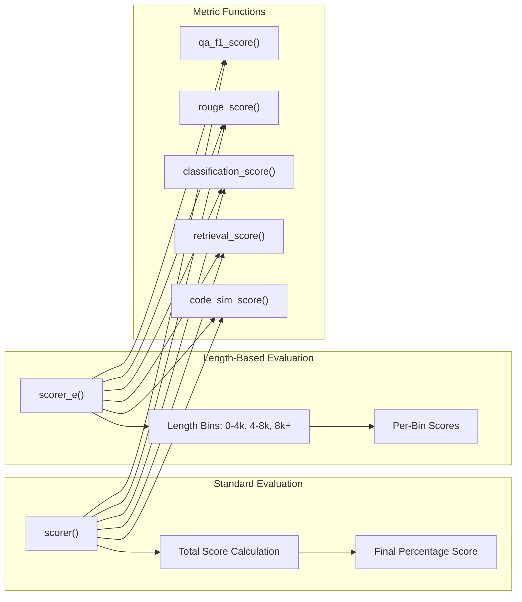
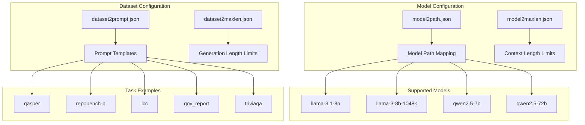
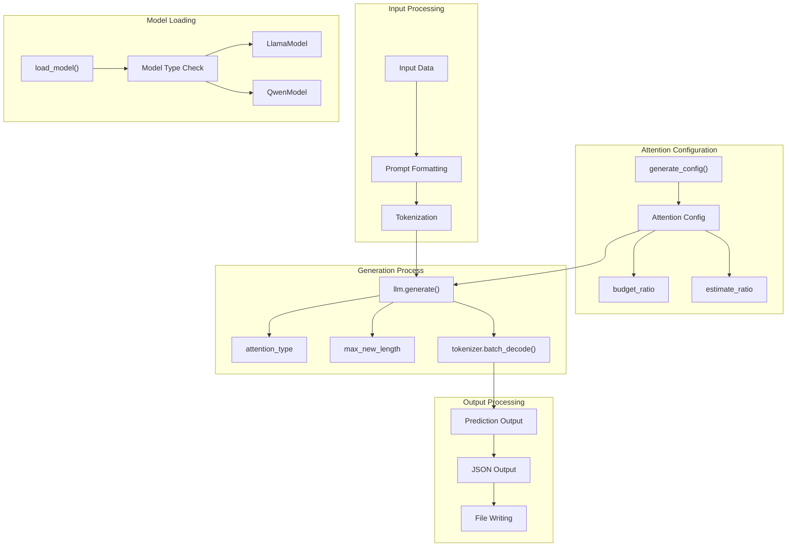
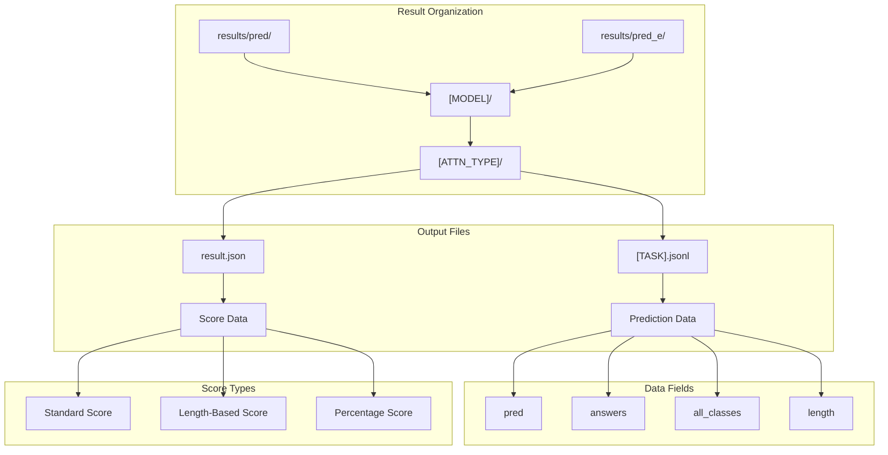

<!-- source: DeepWiki mcp.deepwiki.com · repo microsoft/RetrievalAttention · page 3.2 LongBench Evaluation · fetched 2026-10-26 -->

# LongBench Evaluation

Relevant source files

The following files were used as context for generating this wiki page:

- [benchmark/LongBench/eval.py](benchmark/LongBench/eval.py)
- [benchmark/LongBench/longbench_run.sh](benchmark/LongBench/longbench_run.sh)
- [benchmark/LongBench/pred.py](benchmark/LongBench/pred.py)

This document covers the LongBench evaluation system, which provides real-world benchmark testing for RetroInfer's long-context inference capabilities. LongBench evaluates models on practical tasks like question answering, summarization, and code completion to assess performance in realistic scenarios.

For synthetic benchmark evaluation using artificially generated tasks, see [RULER Benchmark](#3.1). For throughput-focused performance testing, see [Throughput Evaluation](#3.3).

## System Overview

LongBench is a comprehensive evaluation framework that tests language models on real-world long-context tasks. The system consists of three main components: prediction generation, evaluation scoring, and result analysis. It supports both standard LongBench tasks and LongBench-E (extended) variants with length-based performance breakdown.

## Evaluation Pipeline Architecture

The LongBench evaluation system follows a two-stage pipeline where predictions are first generated and then evaluated against ground truth answers using task-specific metrics.

### Pipeline Flow Diagram

Sources: [benchmark/LongBench/pred.py:1-177](), [benchmark/LongBench/eval.py:1-122](), [benchmark/LongBench/longbench_run.sh:1-30]()

## Task Categories and Metrics

LongBench evaluates models across diverse task categories, each using specialized metrics appropriate for the task type. The system maps each dataset to its corresponding evaluation metric through the `dataset2metric` dictionary.

### Task-Metric Mapping

| Task Category | Datasets | Metric Function | Description |
|---------------|----------|----------------|-------------|
| Question Answering | `narrativeqa`, `qasper`, `multifieldqa_en`, `hotpotqa`, `2wikimqa`, `musique`, `triviaqa` | `qa_f1_score` | F1 score for QA tasks |
| Chinese QA | `multifieldqa_zh` | `qa_f1_zh_score` | Chinese-specific F1 scoring |
| Summarization | `gov_report`, `qmsum`, `multi_news`, `samsum` | `rouge_score` | ROUGE metrics |
| Chinese Summarization | `dureader`, `vcsum` | `rouge_zh_score` | Chinese ROUGE metrics |
| Classification | `trec`, `lsht` | `classification_score` | Classification accuracy |
| Retrieval | `passage_retrieval_en` | `retrieval_score` | Retrieval accuracy |
| Chinese Retrieval | `passage_retrieval_zh` | `retrieval_zh_score` | Chinese retrieval accuracy |
| Counting | `passage_count` | `count_score` | Counting task accuracy |
| Code Tasks | `lcc`, `repobench-p` | `code_sim_score` | Code similarity scoring |

Sources: [benchmark/LongBench/eval.py:18-40]()

### Evaluation Functions

The evaluation system provides two main scoring functions depending on the evaluation mode:

Sources: [benchmark/LongBench/eval.py:52-79]()

## Configuration System

The LongBench evaluation system uses a JSON-based configuration system that maps models to paths, datasets to prompts, and defines generation parameters for each task.

### Configuration Files Structure

Sources: [benchmark/LongBench/pred.py:19-23]()

## Prediction Generation Process

The prediction generation stage processes input data through model inference to generate responses for evaluation. The `get_pred` function orchestrates the entire prediction pipeline.

### Prediction Pipeline Components

Sources: [benchmark/LongBench/pred.py:43-87](), [benchmark/LongBench/pred.py:98-115]()

## Evaluation Execution

The evaluation execution combines prediction generation and scoring through shell scripts that orchestrate the entire process.

### Execution Flow

The `longbench_run.sh` script demonstrates the complete evaluation workflow:

1. **Parameter Setup**: Model, attention type, budget ratio, estimate ratio, and dtype
2. **Task Execution**: Runs prediction generation for each task
3. **Evaluation**: Executes scoring using `eval.py`
4. **Result Display**: Outputs final results in JSON format

### Script Parameters

| Parameter | Description | Example Values |
|-----------|-------------|----------------|
| `MODEL` | Model identifier | `llama-3.1-8b`, `qwen2.5-7b` |
| `ATTN_TYPE` | Attention mechanism | `Full_Flash_Attn`, `RetroInfer` |
| `BUDGET_RATIO` | Budget allocation ratio | `0.018` |
| `ESTIMATE_RATIO` | Estimation ratio | `0.232` |
| `DTYPE` | Data type | `bf16`, `fp16` |

Sources: [benchmark/LongBench/longbench_run.sh:1-30]()

## Results Analysis

The evaluation system generates detailed results including per-task scores and overall performance metrics. Results are stored in JSON format with different output paths for standard and extended evaluations.

### Result Structure

Sources: [benchmark/LongBench/eval.py:90-121](), [benchmark/LongBench/pred.py:75-86]()

## Command Line Interface

The evaluation system provides command line interfaces for both prediction generation and evaluation scoring with comprehensive argument parsing.

### Prediction Arguments

The `pred.py` script accepts the following key arguments:

- `--attn_type`: Attention mechanism (`Full_Flash_Attn`, `RetroInfer`)
- `--model`: Model identifier from supported models list
- `--task`: Specific task name for evaluation
- `--dtype`: Data type (`fp16`, `bf16`)
- `--device`: Device configuration (`auto`)
- `--e`: Enable LongBench-E extended evaluation

### Evaluation Arguments

The `eval.py` script accepts:

- `--model`: Model identifier matching prediction generation
- `--attn_type`: Attention type matching prediction generation
- `--e`: Enable LongBench-E extended evaluation mode

Sources: [benchmark/LongBench/pred.py:25-40](), [benchmark/LongBench/eval.py:42-50]()

---

