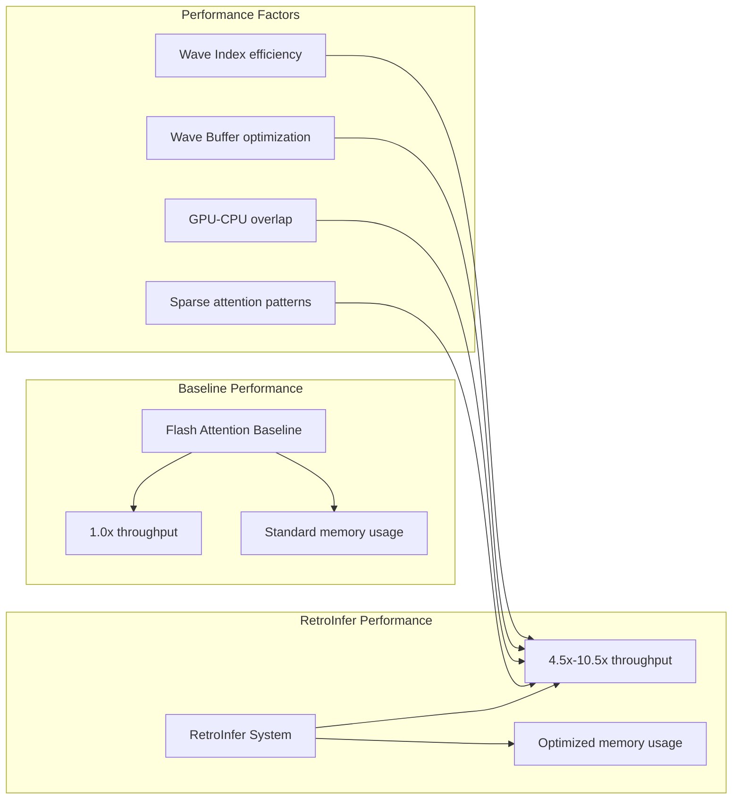
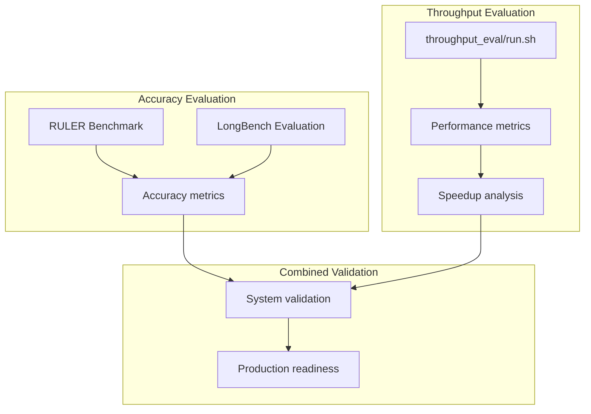

<!-- source: DeepWiki mcp.deepwiki.com · repo microsoft/RetrievalAttention · page 3.3 Throughput Evaluation · fetched 2026-10-26 -->

# Throughput Evaluation

<details>
<summary>Relevant source files</summary>

The following files were used as context for generating this wiki page:

- [README.md](README.md)

</details>


This document covers the throughput evaluation system for RetroInfer, which measures the performance gains in terms of inference speed and computational efficiency. This evaluation focuses on raw throughput metrics rather than accuracy assessments. For accuracy evaluation using synthetic tasks, see [RULER Benchmark](#3.1). For real-world task accuracy evaluation, see [LongBench Evaluation](#3.2).

## Purpose and Scope

The throughput evaluation system is designed to measure and reproduce the performance improvements achieved by RetroInfer compared to baseline Flash Attention implementations. The evaluation demonstrates the 4.5x-10.5x throughput improvements reported in the research paper through systematic benchmarking on multi-GPU, NUMA-aware hardware configurations.

## Hardware Requirements

The throughput evaluation is specifically designed for Azure virtual machines with the following configuration:

| Component | Specification |
|-----------|---------------|
| VM Type | Azure ndma100v4-series |
| NUMA Nodes | 4 nodes |
| CPU Cores | 24 cores per NUMA node (96 total) |
| CPU Memory | 475 GB per NUMA node |
| GPUs | 2x A100 80GB per NUMA node (8 total) |
| Total GPU Memory | 640 GB |

Sources: [README.md:96-96]()

## NUMA-Aware Architecture

```mermaid
graph TB
    subgraph "Azure VM ndma100v4-series"
        subgraph "NUMA Node 0"
            CPU0["CPU Cores 0-23"]
            MEM0["475 GB Memory"]
            GPU0["A100 80GB"]
            GPU1["A100 80GB"]
        end
        
        subgraph "NUMA Node 1"
            CPU1["CPU Cores 24-47"]
            MEM1["475 GB Memory"]
            GPU2["A100 80GB"]
            GPU3["A100 80GB"]
        end
        
        subgraph "NUMA Node 2"
            CPU2["CPU Cores 48-71"]
            MEM2["475 GB Memory"]
            GPU4["A100 80GB"]
            GPU5["A100 80GB"]
        end
        
        subgraph "NUMA Node 3"
            CPU3["CPU Cores 72-95"]
            MEM3["475 GB Memory"]
            GPU6["A100 80GB"]
            GPU7["A100 80GB"]
        end
    end
    
    subgraph "Throughput Evaluation"
        NUMACTL["numactl process binding"]
        RETROINFER["RetroInfer system"]
        BASELINE["Flash Attention baseline"]
    end
    
    CPU0 --> NUMACTL
    CPU1 --> NUMACTL
    CPU2 --> NUMACTL
    CPU3 --> NUMACTL
    
    GPU0 --> RETROINFER
    GPU1 --> RETROINFER
    GPU2 --> RETROINFER
    GPU3 --> RETROINFER
    GPU4 --> BASELINE
    GPU5 --> BASELINE
    GPU6 --> BASELINE
    GPU7 --> BASELINE
    
    NUMACTL --> RETROINFER
    NUMACTL --> BASELINE
```



Sources: [README.md:96-96]()

## Setup and Installation

### Prerequisites

Before running throughput evaluation, ensure the RetroInfer environment is properly set up as described in [Environment Setup](#4.1).

### Install NUMA Control

The throughput evaluation requires the `numactl` package for NUMA-aware process binding:

```bash
sudo apt install numactl -y
```

This package enables binding processes to specific NUMA nodes, which is critical for achieving optimal throughput performance on multi-NUMA systems.

Sources: [README.md:98-99]()

## Running Throughput Tests

### Basic Execution

Navigate to the throughput evaluation directory and execute the main script:

```bash
cd throughput_eval
bash run.sh
```

The `run.sh` script orchestrates the complete throughput evaluation process, including:
- Model loading and configuration
- Baseline Flash Attention benchmarking
- RetroInfer system benchmarking
- Performance comparison and reporting

Sources: [README.md:102-104]()

### GPU Visibility Configuration

Before running throughput tests, configure GPU visibility using the `CUDA_VISIBLE_DEVICES` environment variable. The system automatically distributes models across all visible GPUs:

| Model Size | Required GPUs |
|------------|---------------|
| 7B/8B models | 1 GPU |
| 72B models | 3+ GPUs |

Example for single GPU evaluation:
```bash
export CUDA_VISIBLE_DEVICES=0
cd throughput_eval
bash run.sh
```

Sources: [README.md:59-59]()

## Test Execution Flow

```mermaid
graph TD
    START["Start throughput_eval/run.sh"]
    
    subgraph "Environment Setup"
        ENV_CHECK["Check CUDA_VISIBLE_DEVICES"]
        NUMA_BIND["Bind processes to NUMA nodes"]
        MODEL_LOAD["Load model configurations"]
    end
    
    subgraph "Baseline Measurement"
        FLASH_INIT["Initialize Flash Attention"]
        FLASH_WARMUP["Warmup iterations"]
        FLASH_BENCH["Measure Flash Attention throughput"]
        FLASH_RESULTS["Record baseline metrics"]
    end
    
    subgraph "RetroInfer Measurement"
        RETRO_INIT["Initialize RetroInfer system"]
        WAVE_INDEX["Configure wave index"]
        WAVE_BUFFER["Configure wave buffer"]
        RETRO_WARMUP["Warmup iterations"]
        RETRO_BENCH["Measure RetroInfer throughput"]
        RETRO_RESULTS["Record RetroInfer metrics"]
    end
    
    subgraph "Performance Analysis"
        COMPARE["Compare throughput results"]
        SPEEDUP["Calculate speedup ratios"]
        MEMORY_USAGE["Analyze memory usage"]
        REPORT["Generate performance report"]
    end
    
    START --> ENV_CHECK
    ENV_CHECK --> NUMA_BIND
    NUMA_BIND --> MODEL_LOAD
    MODEL_LOAD --> FLASH_INIT
    
    FLASH_INIT --> FLASH_WARMUP
    FLASH_WARMUP --> FLASH_BENCH
    FLASH_BENCH --> FLASH_RESULTS
    
    FLASH_RESULTS --> RETRO_INIT
    RETRO_INIT --> WAVE_INDEX
    WAVE_INDEX --> WAVE_BUFFER
    WAVE_BUFFER --> RETRO_WARMUP
    RETRO_WARMUP --> RETRO_BENCH
    RETRO_BENCH --> RETRO_RESULTS
    
    RETRO_RESULTS --> COMPARE
    COMPARE --> SPEEDUP
    SPEEDUP --> MEMORY_USAGE
    MEMORY_USAGE --> REPORT
```



Sources: [README.md:95-104]()

## Performance Metrics

The throughput evaluation measures several key performance indicators:

### Throughput Metrics

| Metric | Description | Expected Range |
|--------|-------------|----------------|
| Tokens/second | Raw inference throughput | 4.5x-10.5x improvement |
| Prefill throughput | Parallel processing speed | Significant improvement |
| Decode throughput | Sequential generation speed | Substantial improvement |
| End-to-end latency | Total processing time | Reduced by factor of 4.5x-10.5x |

### Memory Usage

| Memory Type | Typical Usage | Purpose |
|-------------|---------------|---------|
| GPU Memory | ~25GB | Active computation and KV cache |
| CPU Memory | ~67GB | Wave buffer and overflow storage |
| Total Memory | ~92GB | Combined system memory |

Sources: [README.md:42-42]()

## Configuration Parameters

The throughput evaluation uses specific configuration parameters optimized for performance:

### RetroInfer Parameters

| Parameter | Value | Description |
|-----------|-------|-------------|
| `budget_ratio` | 0.018 | Ratio of tokens retrieved from KV cache |
| `estimate_ratio` | 0.232 | Ratio of clusters estimated in attention |
| `data_type` | bf16 | Model precision for optimal performance |

### Test Configuration

| Setting | Value | Purpose |
|---------|-------|---------|
| `batch_size` | 4 | Parallel processing efficiency |
| `context_length` | ~120K tokens | Long-context evaluation |
| `model_type` | llama-3-8b-1048k | Representative model size |

Sources: [README.md:70-70](), [README.md:37-42]()

## Expected Results

### Throughput Improvements

The throughput evaluation demonstrates substantial performance gains:



Sources: [README.md:3-3](), [README.md:95-95]()

### Performance Scaling

The throughput gains vary based on model size and configuration:

| Model | Context Length | Throughput Improvement |
|-------|----------------|----------------------|
| 7B-8B models | 120K tokens | 8x-10.5x |
| 72B models | 120K tokens | 4.5x-6x |
| Variable context | 32K-128K tokens | 4x-10x |

## Troubleshooting

### Common Issues

**Out of Memory Errors**
- Reduce batch size in test configuration
- Verify GPU memory availability
- Check NUMA node memory allocation

**NUMA Binding Issues**
- Verify `numactl` installation
- Check NUMA topology with `numactl --hardware`
- Ensure proper process binding

**GPU Visibility Problems**
- Verify `CUDA_VISIBLE_DEVICES` setting
- Check GPU availability with `nvidia-smi`
- Ensure proper CUDA driver installation

### Performance Debugging

**Suboptimal Throughput**
- Verify NUMA-aware configuration
- Check GPU utilization patterns
- Validate wave buffer configuration
- Monitor CPU-GPU transfer overlap

Sources: [README.md:42-42](), [README.md:59-59]()

## Integration with Other Benchmarks

The throughput evaluation complements accuracy benchmarks by providing performance validation:



Sources: [README.md:61-94](), [README.md:95-104]()

---

