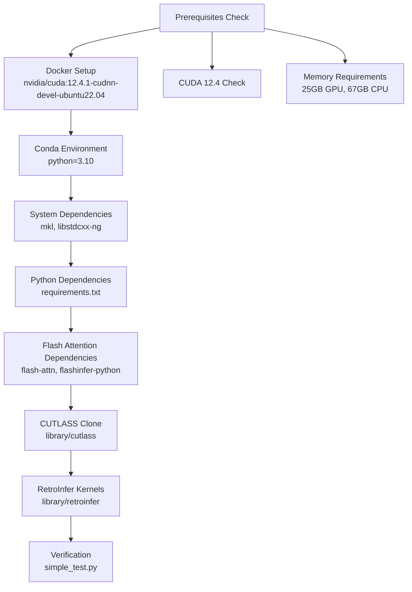
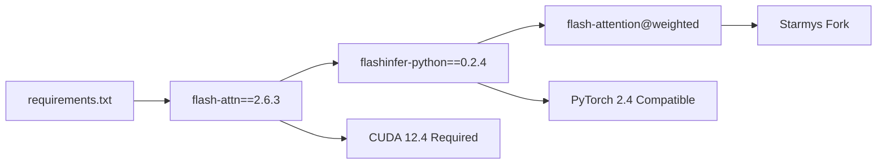
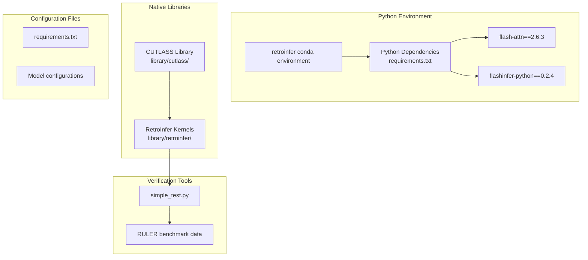

<!-- source: DeepWiki mcp.deepwiki.com · repo microsoft/RetrievalAttention · page 4 Setup and Installation · fetched 2026-10-26 -->

# Setup and Installation

<details>
<summary>Relevant source files</summary>

The following files were used as context for generating this wiki page:

- [README.md](README.md)

</details>


This document provides comprehensive instructions for setting up the RetroInfer environment and installing all required dependencies. The setup process involves configuring CUDA, Python environments, installing external dependencies, and building RetroInfer kernels.

For information about running benchmarks after installation, see [Benchmarking and Evaluation](#3). For basic usage examples, see [Usage Examples](#5).

## Installation Workflow

The RetroInfer setup follows a multi-stage process involving environment preparation, dependency installation, and kernel compilation:



*Sources: [README.md:7-42]()*

## Prerequisites

Before beginning the installation process, ensure your system meets the following requirements:

| Component | Requirement | Notes |
|-----------|-------------|-------|
| CUDA | 12.4.1 | Use Docker if system CUDA differs |
| Python | 3.10.16 | Managed via conda |
| GPU Memory | 25GB minimum | For simple test with batch_size=4 |
| CPU Memory | 67GB minimum | Required for KV cache storage |
| Operating System | Linux | Tested on Ubuntu 22.04 |

*Sources: [README.md:8-10, 42]()*

## Environment Setup

### Docker Environment (Optional)

If your system does not have CUDA 12.4 installed, use the provided Docker image:

```bash
docker run -it --gpus all nvidia/cuda:12.4.1-cudnn-devel-ubuntu22.04
```

### Conda Environment Creation

Create and activate a new conda environment with Python 3.10:

```bash
# Create new conda environment
conda create -n retroinfer python=3.10 -y
conda activate retroinfer

# Install system-level conda packages
conda install -y mkl
conda install -c conda-forge libstdcxx-ng -y
```

### Pip Version Management

Downgrade pip to avoid deprecation warnings during kernel installation:

```bash
python -m pip install pip==25.0
```

*Sources: [README.md:10-22]()*

## Dependency Installation

### Core Python Dependencies

Install the base Python packages from the requirements file:

```bash
pip install -r requirements.txt
```

### Flash Attention Dependencies

Install the specific versions of flash attention libraries required by RetroInfer:



Install these dependencies in sequence:

```bash
# Core flash attention
pip install flash-attn==2.6.3 --no-build-isolation

# FlashInfer for CUDA 12.4 and PyTorch 2.4
pip install flashinfer-python==0.2.4 -i https://flashinfer.ai/whl/cu124/torch2.4/

# Weighted flash attention variant
pip install git+https://github.com/Starmys/flash-attention.git@weighted
```

*Sources: [README.md:23-28]()*

## RetroInfer Kernels Installation

### CUTLASS Library Setup

RetroInfer kernels depend on NVIDIA's CUTLASS library for efficient CUDA kernel implementations:

```bash
cd library/
git clone https://github.com/NVIDIA/cutlass.git
```

### Kernel Compilation and Installation

Build and install the RetroInfer kernels:

```bash
cd retroinfer
pip install .
cd ../../
```

The kernel installation process compiles CUDA kernels that integrate with the CUTLASS library for optimized attention computations.

*Sources: [README.md:30-35]()*

## Installation Verification

### Simple Test Execution

Verify the installation by running the provided test script with RULER benchmark data:

```bash
python -u simple_test.py --batch_size 4
```

This test processes four contexts of approximately 120,000 tokens each and validates that:
- RetroInfer kernels are properly installed
- Memory allocation works correctly
- Attention mechanisms function as expected

### Memory Requirements

The simple test requires:
- **GPU Memory**: ~25GB
- **CPU Memory**: ~67GB

If you encounter out-of-memory errors, reduce the batch size:

```bash
python -u simple_test.py --batch_size 2
```

### Custom Data Testing

Test with custom input data by providing a JSON file:

```bash
python -u simple_test.py --data_path <your_json_file_path>
```

The JSON format should follow this structure:
```json
[
    {"input": "your_input_text", "outputs": "expected_output"}, 
    {"input": "another_input", "outputs": "another_output"}
]
```

*Sources: [README.md:37-55]()*

## System Components After Installation

After successful installation, the RetroInfer system consists of the following key components:



*Sources: [README.md:30-42]()*

## Common Issues and Troubleshooting

### CUDA Version Mismatch

If you encounter CUDA version conflicts, use the Docker environment:
```bash
docker run -it --gpus all nvidia/cuda:12.4.1-cudnn-devel-ubuntu22.04
```

### Memory Allocation Errors

Reduce batch size or ensure sufficient system memory:
```bash
python -u simple_test.py --batch_size 1
```

### Kernel Compilation Failures

Ensure CUTLASS is properly cloned and pip version is compatible:
```bash
cd library/
ls cutlass/  # Verify CUTLASS exists
python -m pip install pip==25.0
```

### FlashInfer Installation Issues

Verify the correct index URL for your CUDA and PyTorch versions:
```bash
pip install flashinfer-python==0.2.4 -i https://flashinfer.ai/whl/cu124/torch2.4/
```

*Sources: [README.md:8-42]()*

---

