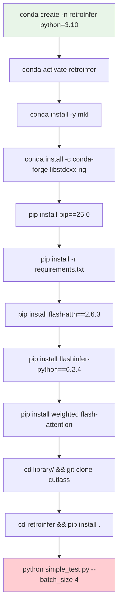
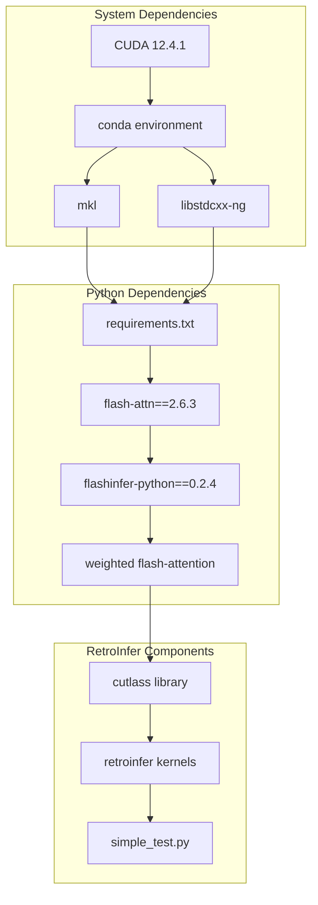
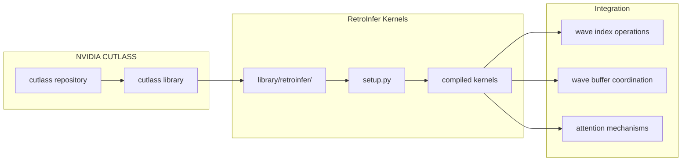
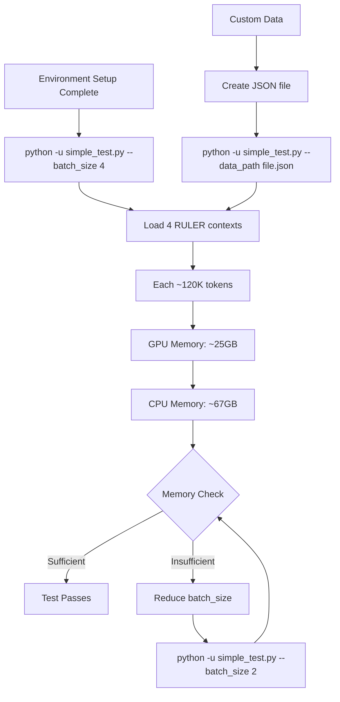

<!-- source: DeepWiki mcp.deepwiki.com · repo microsoft/RetrievalAttention · page 4.1 Environment Setup · fetched 2026-10-26 -->

# Environment Setup

<details>
<summary>Relevant source files</summary>

The following files were used as context for generating this wiki page:

- [README.md](README.md)

</details>


## Purpose and Scope

This document provides comprehensive instructions for setting up the RetroInfer development and runtime environment. It covers CUDA installation, Python environment configuration, dependency management, and kernel compilation required to run RetroInfer inference and benchmarking systems.

For information about model and dataset configuration, see [Configuration](#4.2). For usage examples and running benchmarks, see [Usage Examples](#5).

## CUDA Requirements

RetroInfer requires CUDA 12.4 for proper operation. The system was specifically tested and optimized for this version.

### Docker Environment Option

If your system does not have CUDA 12.4 installed, you can use the provided Docker image:

```bash
docker run -it --gpus all nvidia/cuda:12.4.1-cudnn-devel-ubuntu22.04
```

This Docker image includes CUDA 12.4.1 with cuDNN development libraries on Ubuntu 22.04.

**Sources:** [README.md:8-8]()

## Python Environment Setup

### Environment Creation

RetroInfer was tested with Python 3.10.16 and requires conda for environment management:

```bash
# Install miniconda if not already installed
conda create -n retroinfer python=3.10 -y
conda activate retroinfer
```

### System Dependencies

Install required system-level packages:

```bash
# Install conda packages
conda install -y mkl
conda install -c conda-forge libstdcxx-ng -y
```

### Pip Version Management

A specific pip version is required to avoid deprecation warnings during kernel installation:

```bash
# Downgrade pip to resolve installation issues
python -m pip install pip==25.0
```

**Sources:** [README.md:10-27]()

## Dependencies Installation

### Setup Process Flow



**Sources:** [README.md:12-41]()

### Core Dependencies

Install Python packages in the following order:

```bash
# Install base requirements
pip install -r requirements.txt

# Install flash attention with specific version
pip install flash-attn==2.6.3 --no-build-isolation

# Install flashinfer for CUDA 12.4 and PyTorch 2.4
pip install flashinfer-python==0.2.4 -i https://flashinfer.ai/whl/cu124/torch2.4/

# Install weighted flash attention variant
pip install git+https://github.com/Starmys/flash-attention.git@weighted
```

### Dependency Architecture



**Sources:** [README.md:23-27]()

## RetroInfer Kernels Installation

### Kernel Compilation Process

The RetroInfer kernels require NVIDIA CUTLASS library and must be compiled from source:

```bash
# Navigate to library directory
cd library/

# Clone CUTLASS repository
git clone https://github.com/NVIDIA/cutlass.git

# Install RetroInfer kernels
cd retroinfer && pip install . && cd ../../
```

### Kernel Dependencies



**Sources:** [README.md:30-35]()

## Verification and Testing

### Simple Test Execution

Verify the environment setup with the provided test script:

```bash
python -u simple_test.py --batch_size 4
```

The test runs on four different contexts from RULER, each containing approximately 120,000 tokens.

### Custom Data Testing

For custom input data, create a JSON file with the following format:

```json
[
    {"input": "your_input_text", "outputs": "expected_output"}, 
    {"input": "another_input", "outputs": "another_output"}
]
```

Run the test with custom data:

```bash
python -u simple_test.py --data_path <your_json_file_path>
```

### Verification Process



**Sources:** [README.md:37-55]()

## Memory Requirements

### System Resource Specifications

| Component | Memory Requirement | Notes |
|-----------|-------------------|--------|
| GPU Memory | ~25GB | For batch_size=4 with 120K tokens |
| CPU Memory | ~67GB | For KV cache storage and coordination |
| Recommended GPU | A100 80GB | For optimal performance |
| Multi-GPU Support | Automatic | Model splitting across visible GPUs |

### Memory Management

- Use `CUDA_VISIBLE_DEVICES` to control GPU visibility
- 7B/8B models require 1 GPU card with A100 80GB
- 72B models require at least 3 GPU cards
- Reduce `batch_size` if encountering out-of-memory errors

**Sources:** [README.md:42-42](), [README.md:59-59]()

## Troubleshooting

### Common Issues

1. **CUDA Version Mismatch**: Ensure CUDA 12.4 is installed or use the Docker image
2. **Memory Issues**: Reduce batch size or ensure sufficient GPU/CPU memory
3. **Pip Installation Warnings**: Downgrade pip to version 25.0
4. **Kernel Compilation Errors**: Verify CUTLASS clone and compilation environment

### Environment Validation

After setup completion, the environment should support:
- RetroInfer attention mechanisms
- RULER and LongBench benchmarks
- Multi-GPU model deployment
- Throughput evaluation scripts

**Sources:** [README.md:8-104]()

---

