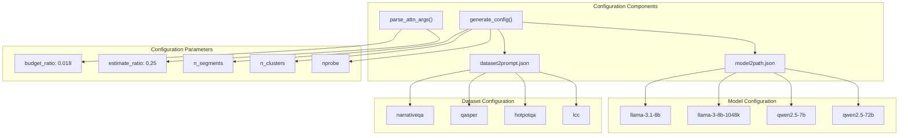
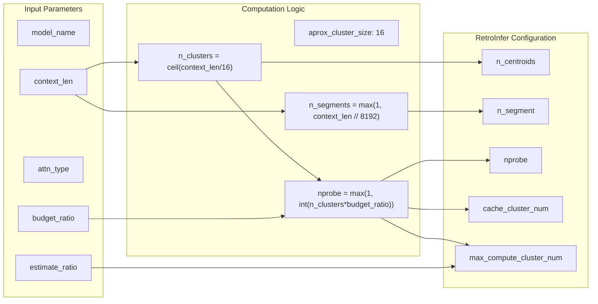

<!-- source: DeepWiki mcp.deepwiki.com · repo microsoft/RetrievalAttention · page 4.2 Configuration · fetched 2026-10-26 -->

# Configuration

<details>
<summary>Relevant source files</summary>

The following files were used as context for generating this wiki page:

- [benchmark/LongBench/config/dataset2prompt.json](benchmark/LongBench/config/dataset2prompt.json)
- [benchmark/LongBench/config/model2path.json](benchmark/LongBench/config/model2path.json)
- [benchmark/config.py](benchmark/config.py)

</details>


This document covers the configuration system for RetroInfer, including attention parameters, model mappings, and dataset configurations. It explains how to configure the system for different models, datasets, and attention mechanisms.

For detailed model-specific configurations, see [Model Configuration](#4.2.1). For dataset prompt templates and generation parameters, see [Dataset Configuration](#4.2.2). For environment setup, see [Environment Setup](#4.1).

## Configuration System Overview

The RetroInfer configuration system consists of three main components: attention parameters, model mappings, and dataset configurations. The system uses a combination of JSON configuration files and Python configuration generators to manage these settings.



Sources: [benchmark/config.py:10-57](), [benchmark/LongBench/config/model2path.json:1-6](), [benchmark/LongBench/config/dataset2prompt.json:1-23]()

## Attention Parameters Configuration

The attention configuration system manages parameters for RetroInfer's attention mechanisms. The `parse_attn_args()` function defines the core attention parameters that control the system's behavior.

| Parameter | Default Value | Description |
|-----------|---------------|-------------|
| `budget_ratio` | 0.018 | Ratio of budget for attention computation |
| `estimate_ratio` | 0.25 | Ratio of estimated clusters for RetroInfer |

The `generate_config()` function computes derived parameters based on the context length and attention type:



Sources: [benchmark/config.py:10-14](), [benchmark/config.py:17-57]()

### RetroInfer-Specific Configuration

When `attn_type` is set to `'RetroInfer'`, the system applies additional configuration logic:

- **Cluster alignment**: `n_clusters` is aligned to the nearest multiple of `(n_segments*32)` [benchmark/config.py:40-43]()
- **Cache cluster number**: Set to `int(nprobe*3)` [benchmark/config.py:52]()
- **Maximum compute clusters**: Set to `int(n_clusters*estimate_ratio) + nprobe` [benchmark/config.py:53]()

## Model and Dataset Configuration Files

### Model Path Mapping

The `model2path.json` file maps model names to their corresponding paths or identifiers:

```json
{
    "llama-3-8b-1048k": "gradientai/Llama-3-8B-Instruct-Gradient-1048k",
    "llama-3.1-8b": "meta-llama/Llama-3.1-8B-Instruct",
    "qwen2.5-7b": "Qwen/Qwen2.5-7B-Instruct",
    "qwen2.5-72b": "Qwen/Qwen2.5-72B-Instruct"
}
```

### Dataset Prompt Templates

The `dataset2prompt.json` file contains prompt templates for different evaluation datasets. Each template includes placeholders for `{context}` and `{input}`:

| Dataset | Template Type | Language |
|---------|---------------|----------|
| `narrativeqa` | Story Q&A | English |
| `qasper` | Scientific Article Q&A | English |
| `multifieldqa_en` | Multi-field Q&A | English |
| `multifieldqa_zh` | Multi-field Q&A | Chinese |
| `hotpotqa` | Multi-hop Q&A | English |
| `dureader` | Reading Comprehension | Chinese |
| `lcc` | Code Completion | Code |
| `repobench-p` | Repository Code | Code |

Sources: [benchmark/LongBench/config/model2path.json:1-6](), [benchmark/LongBench/config/dataset2prompt.json:1-23]()

## Configuration Generation Process

The configuration generation process follows these steps:

1. **Parse attention arguments** using `parse_attn_args()` [benchmark/config.py:10-14]()
2. **Load base configuration** from JSON files in the `config` directory [benchmark/config.py:28-32]()
3. **Calculate derived parameters** based on context length and attention type [benchmark/config.py:34-46]()
4. **Update configuration** with computed values for RetroInfer [benchmark/config.py:48-55]()

The system automatically computes optimal values for:
- Number of segments (`n_segments`)
- Number of clusters (`n_clusters`)
- Number of probes (`nprobe`)
- Cache and compute cluster limits

Sources: [benchmark/config.py:17-57]()

## Configuration File Locations

Configuration files are organized in the following structure:

```
benchmark/
├── config.py                    # Configuration generation logic
├── LongBench/
│   └── config/
│       ├── model2path.json     # Model path mappings
│       ├── dataset2prompt.json # Dataset prompt templates
│       ├── dataset2maxlen.json # Dataset length limits
│       └── model2maxlen.json   # Model length limits
└── config/                     # Model-specific config files
    ├── llama-3.1-8b.json
    ├── qwen2.5-7b.json
    └── [other model configs]
```

Sources: [benchmark/config.py:7-8](), [benchmark/config.py:28-31]()

---

