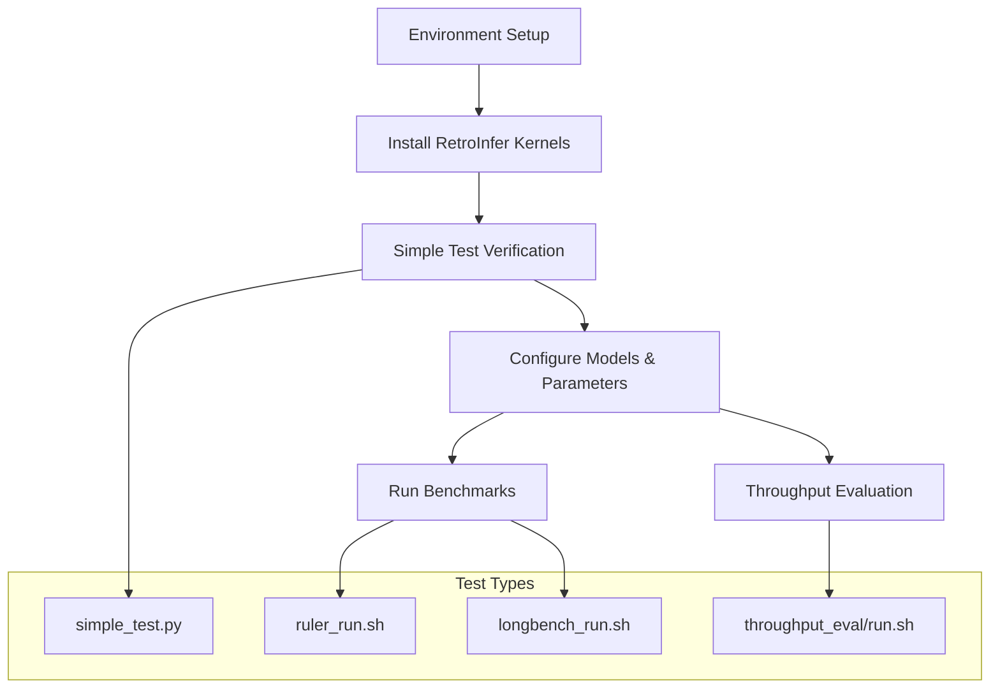
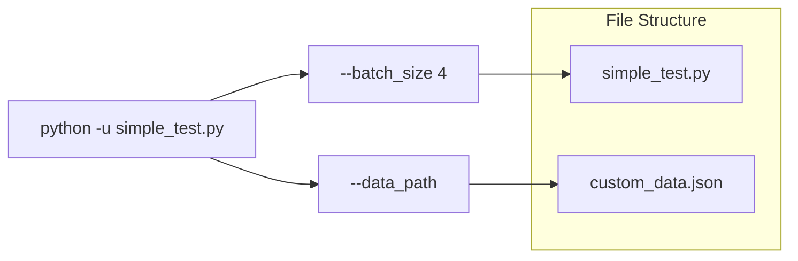
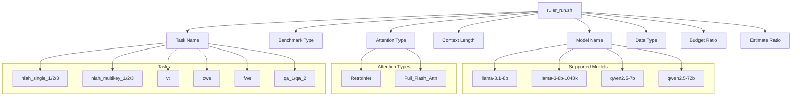
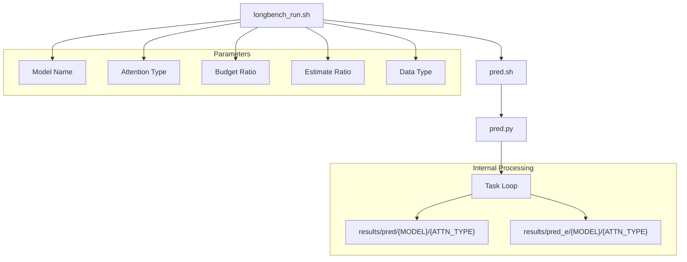
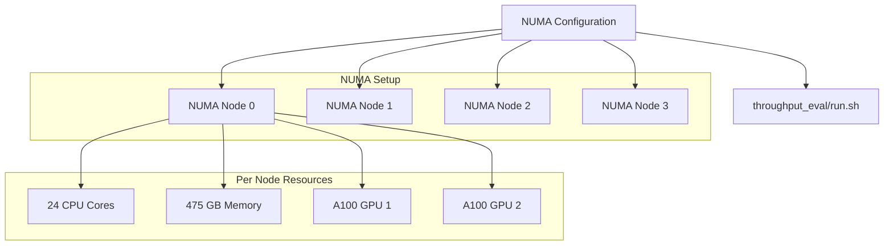
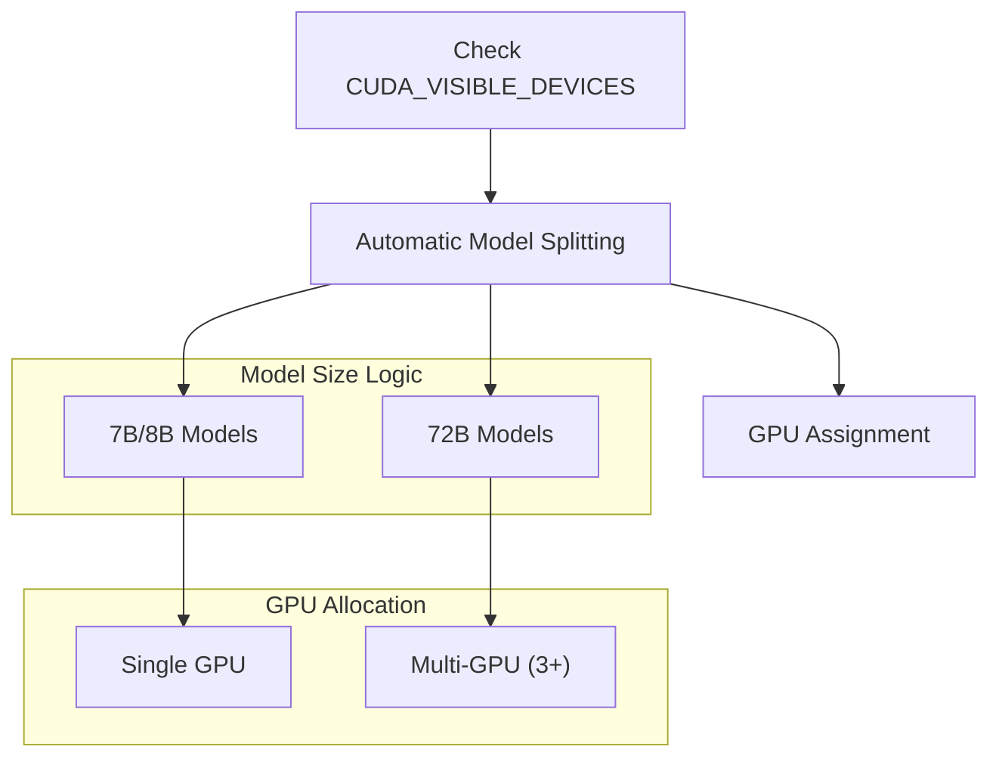

<!-- source: DeepWiki mcp.deepwiki.com · repo microsoft/RetrievalAttention · page 5 Usage Examples · fetched 2026-10-26 -->

# Usage Examples

<details>
<summary>Relevant source files</summary>

The following files were used as context for generating this wiki page:

- [README.md](README.md)
- [benchmark/LongBench/pred.sh](benchmark/LongBench/pred.sh)

</details>


This page provides practical examples of how to use RetroInfer for inference and evaluation tasks. It covers the three main usage scenarios: basic testing to verify installation, running benchmark evaluations, and conducting throughput measurements.

For detailed setup instructions, see [Setup and Installation](#4). For configuration details, see [Configuration](#4.2). For benchmark-specific information, see [Benchmarking and Evaluation](#3).

## Basic Usage Workflow

The typical RetroInfer usage follows this workflow:



Sources: [README.md:1-152]()

## Simple Test Verification

### Basic Test Command

The simplest way to verify RetroInfer is working correctly is using the provided test script:

```bash
python -u simple_test.py --batch_size 4
```

This command runs inference on four different contexts from RULER, each containing approximately 120,000 tokens.

### Resource Requirements

| Component | Requirement |
|-----------|-------------|
| GPU Memory | ~25GB |
| CPU Memory | ~67GB |
| Contexts | 4 × 120K tokens |

### Custom Input Data

You can provide custom input data using a JSON file format:

```json
[
    {"input": "your_input_text", "outputs": "expected_output"},
    {"input": "another_input", "outputs": "another_output"}
]
```

Then run with custom data:

```bash
python -u simple_test.py --data_path <your_json_file_path>
```

### Command Structure



Sources: [README.md:37-55]()

## RULER Benchmark Evaluation

### Data Preparation

Before running RULER benchmarks, download the required datasets:

```bash
cd benchmark/ruler
cd data/synthetic/json/ && python -u download_paulgraham_essay.py && bash download_qa_dataset.sh && cd ../../../
```

### Running RULER Evaluation

The RULER benchmark uses the `ruler_run.sh` script with specific parameters:

```bash
bash ruler_run.sh llama-3-8b-1048k synthetic RetroInfer 131072 vt bf16 0.018 0.232
```

### RULER Parameter Structure



### RULER Parameter Details

| Parameter | Description | Example Values |
|-----------|-------------|----------------|
| Model Name | Supported LLM models | `llama-3-8b-1048k`, `qwen2.5-7b` |
| Benchmark Type | Always `synthetic` for RULER | `synthetic` |
| Attention Type | RetroInfer or baseline | `RetroInfer`, `Full_Flash_Attn` |
| Context Length | Input sequence length | `131072` |
| Task Name | Specific evaluation task | `vt`, `niah_single_1`, `qa_1` |
| Data Type | Model precision | `bf16`, `fp16` |
| Budget Ratio | KV cache retrieval ratio | `0.018` |
| Estimate Ratio | Attention cluster ratio | `0.232` |

Sources: [README.md:61-81]()

## LongBench Evaluation

### LongBench Command Structure

```bash
cd benchmark/LongBench
bash longbench_run.sh llama-3-8b-1048k RetroInfer 0.018 0.232 bf16
```

### LongBench Parameter Flow



### LongBench Parameter Details

| Parameter | Description | Example |
|-----------|-------------|---------|
| Model Name | Target LLM model | `llama-3-8b-1048k` |
| Attention Type | Attention mechanism | `RetroInfer` |
| Budget Ratio | Retrieval budget | `0.018` |
| Estimate Ratio | Cluster estimation | `0.232` |
| Data Type | Model precision | `bf16` |

Sources: [README.md:82-94](), [benchmark/LongBench/pred.sh:1-32]()

## Throughput Evaluation

### Environment Requirements

Throughput evaluation requires NUMA-aware configuration and was tested on Azure virtual machines with specific hardware:

| Component | Specification |
|-----------|---------------|
| NUMA Nodes | 4 nodes |
| CPU Cores | 24 cores per node |
| CPU Memory | 475 GB per node |
| GPUs | 2 × 80GB A100 per node |

### Running Throughput Tests

```bash
# Install numactl package
sudo apt install numactl -y

# Run throughput evaluation
cd throughput_eval
bash run.sh
```

### Throughput Test Architecture



Sources: [README.md:95-104]()

## Multi-GPU Configuration

### Automatic GPU Detection

RetroInfer automatically detects and uses all visible GPUs. Control GPU usage with `CUDA_VISIBLE_DEVICES`:

```bash
# Use specific GPUs
export CUDA_VISIBLE_DEVICES=0,1,2

# For 7B/8B models (single GPU)
export CUDA_VISIBLE_DEVICES=0

# For 72B models (minimum 3 GPUs)
export CUDA_VISIBLE_DEVICES=0,1,2
```

### GPU Memory Requirements

| Model Size | GPU Requirement | Memory per GPU |
|------------|-----------------|----------------|
| 7B/8B | 1 × A100 80GB | ~25GB |
| 72B | 3+ × A100 80GB | ~25GB each |

### Multi-GPU Workflow



Sources: [README.md:59-60]()

## Configuration Examples

### Common Parameter Combinations

#### High Performance Configuration
```bash
# RULER with high performance settings
bash ruler_run.sh llama-3-8b-1048k synthetic RetroInfer 131072 vt bf16 0.018 0.232
```

#### Memory-Efficient Configuration
```bash
# Reduce batch size for memory constraints
python -u simple_test.py --batch_size 2
```

#### Baseline Comparison
```bash
# Compare against Full Flash Attention
bash ruler_run.sh llama-3-8b-1048k synthetic Full_Flash_Attn 131072 vt bf16 0.018 0.232
```

### Parameter Tuning Guidelines

| Parameter | Effect | Recommended Range |
|-----------|---------|-------------------|
| `budget_ratio` | KV cache retrieval efficiency | 0.01 - 0.05 |
| `estimate_ratio` | Attention approximation quality | 0.2 - 0.3 |
| `batch_size` | Memory vs throughput trade-off | 1 - 8 |
| `context_length` | Input sequence length | 32K - 128K |

Sources: [README.md:68-93]()

---

