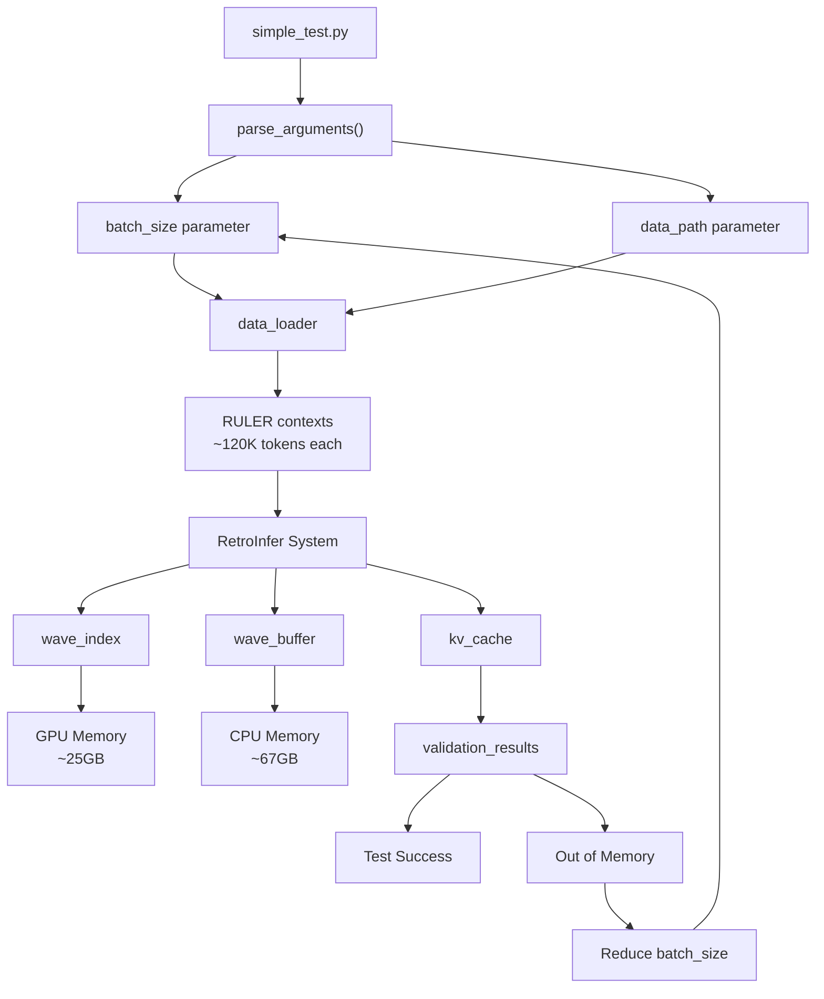
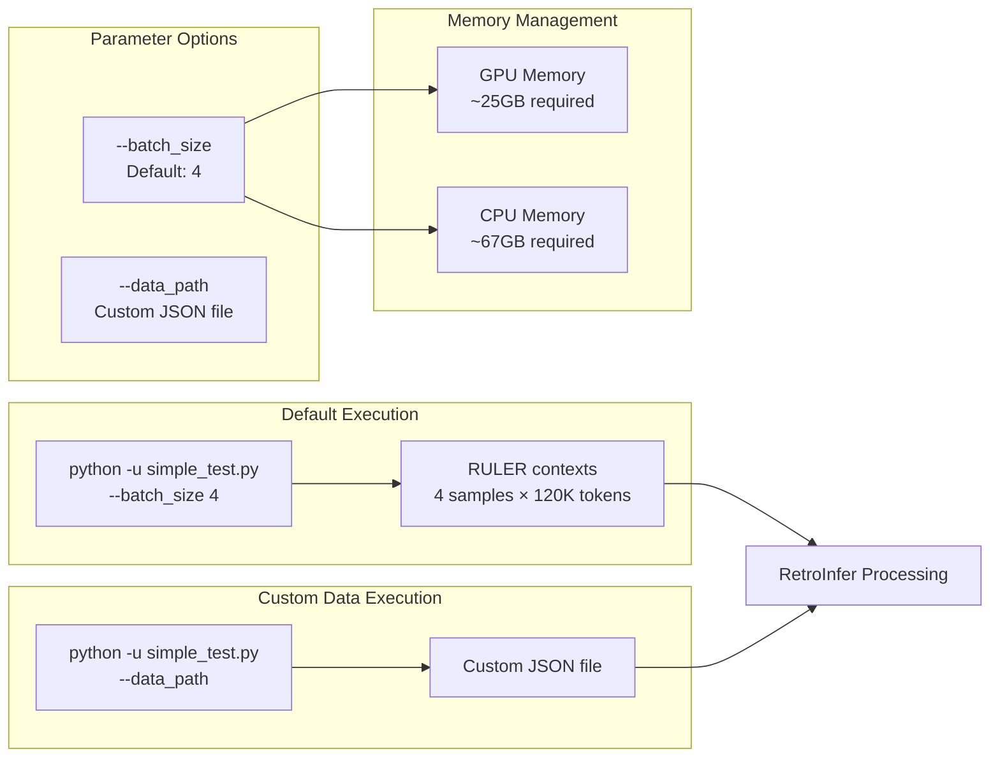
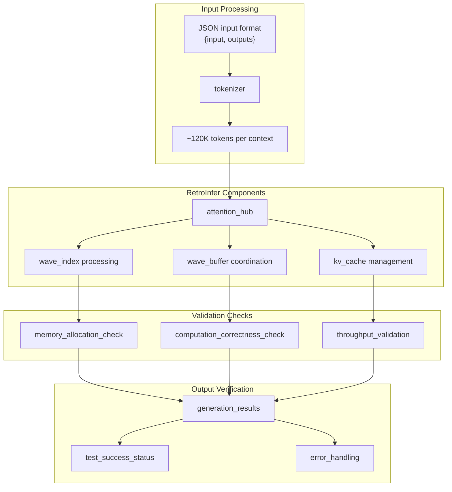

<!-- source: DeepWiki mcp.deepwiki.com · repo microsoft/RetrievalAttention · page 5.1 Simple Testing · fetched 2026-10-26 -->

# Simple Testing

<details>
<summary>Relevant source files</summary>

The following files were used as context for generating this wiki page:

- [README.md](README.md)

</details>


## Purpose and Scope

This document explains how to run basic tests to verify that RetroInfer is working correctly after installation. The simple testing system provides a lightweight verification mechanism using sample data from the RULER benchmark before proceeding to full evaluation workflows.

For comprehensive benchmarking workflows, see [Running Benchmarks](#5.2). For environment setup prerequisites, see [Environment Setup](#4.1).

## Overview

The simple testing system validates RetroInfer installation and basic functionality using a streamlined test runner that processes sample long-context inputs. The test uses four different contexts from the RULER benchmark, each containing approximately 120,000 tokens, to verify both the attention mechanisms and memory management components.

Sources: [README.md:37-55]()

## Test Execution Flow

The simple test follows a structured execution pipeline that validates core RetroInfer components:



Sources: [README.md:37-42]()

## Command Line Interface

The simple test provides a flexible command-line interface for different testing scenarios:



Sources: [README.md:38-55]()

## Memory Requirements and Troubleshooting

The simple test has specific memory requirements that must be met for successful execution:

| Component | Memory Type | Required Amount | Purpose |
|-----------|-------------|-----------------|---------|
| GPU Memory | VRAM | ~25GB | Wave index computation, KV cache storage |
| CPU Memory | RAM | ~67GB | Wave buffer operations, context storage |
| Batch Size | Configurable | Default: 4 | Controls memory usage scaling |

### Memory Optimization

When encountering out-of-memory errors, the recommended approach is to reduce the batch size:

```bash
# Reduce batch size for lower memory usage
python -u simple_test.py --batch_size 2
python -u simple_test.py --batch_size 1
```

The batch size directly impacts memory consumption, with linear scaling for both GPU and CPU memory requirements.

Sources: [README.md:42-42]()

## Custom Data Input Format

The simple test supports custom input data through a structured JSON format:

```json
[
    {"input": "string", "outputs": "string"}, 
    {"input": "string", "outputs": "string"},
    ...
]
```

### Custom Data Execution

```bash
python -u simple_test.py --data_path <your_json_file_path>
```

This format allows testing with domain-specific contexts while maintaining the same validation pipeline as the default RULER-based test.

Sources: [README.md:44-55]()

## Test Validation Flow

The simple test validates RetroInfer functionality through a multi-stage process:



Sources: [README.md:37-55]()

## Expected Test Behavior

A successful simple test execution should demonstrate:

1. **Environment Validation**: Confirms CUDA 12.4 compatibility and dependency resolution
2. **Memory Management**: Validates GPU-CPU memory coordination without OOM errors
3. **Attention Processing**: Verifies wave index and wave buffer functionality
4. **Context Handling**: Processes long contexts (~120K tokens) efficiently
5. **Generation Output**: Produces coherent text generation results

The test serves as a prerequisite validation step before proceeding to comprehensive benchmarking workflows described in [Running Benchmarks](#5.2).

Sources: [README.md:37-55]()

---

