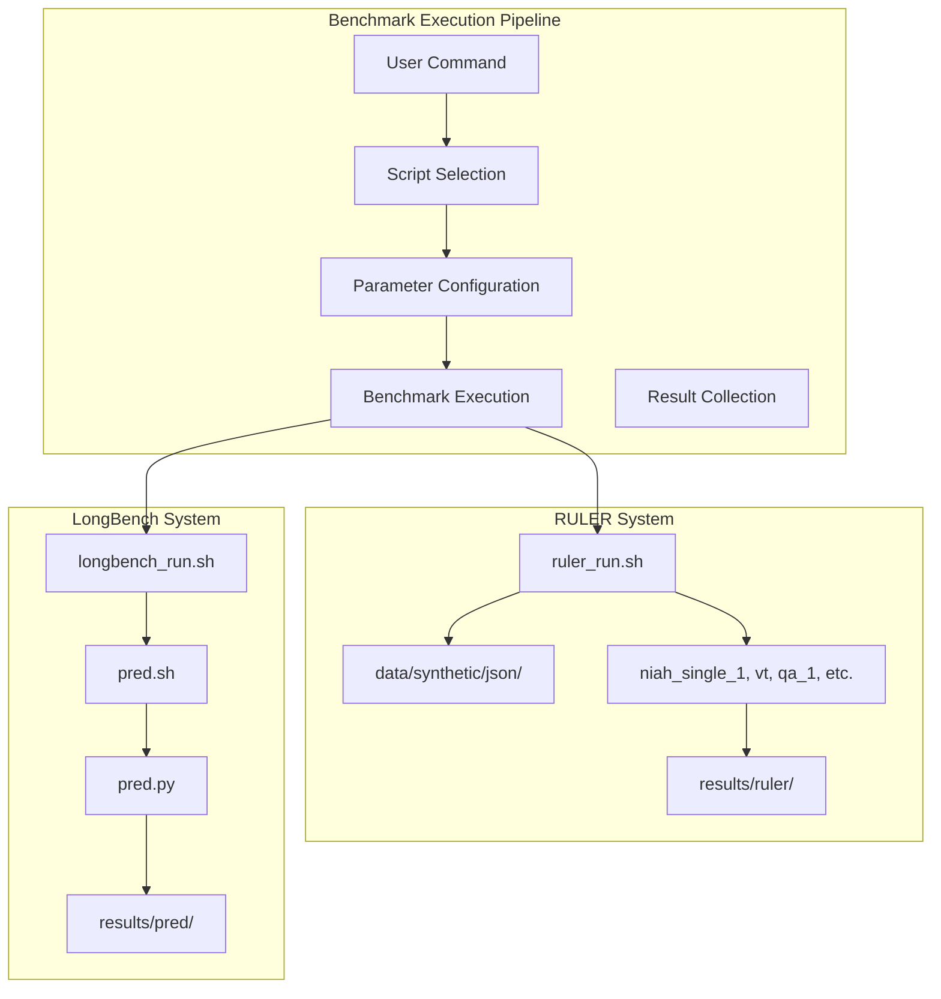
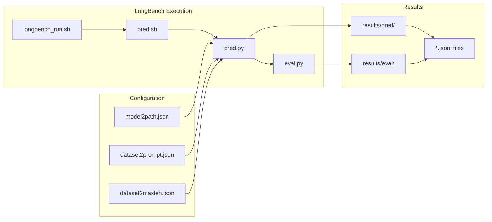
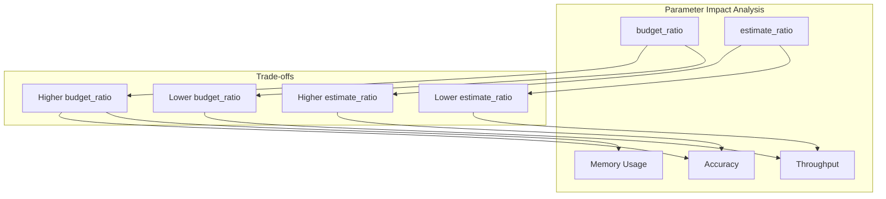

<!-- source: DeepWiki mcp.deepwiki.com · repo microsoft/RetrievalAttention · page 5.2 Running Benchmarks · fetched 2026-10-26 -->

# Running Benchmarks

<details>
<summary>Relevant source files</summary>

The following files were used as context for generating this wiki page:

- [README.md](README.md)
- [benchmark/LongBench/pred.sh](benchmark/LongBench/pred.sh)

</details>


This document provides a comprehensive guide for running benchmarks to evaluate RetroInfer's performance and accuracy. It covers the execution of both RULER synthetic benchmarks and LongBench real-world evaluations, including parameter configuration and result interpretation.

For information about benchmark setup and data preparation, see [RULER Benchmark](#3.1) and [LongBench Evaluation](#3.2). For performance-focused throughput testing, see [Throughput Evaluation](#3.3).

## Benchmark System Overview

RetroInfer supports two primary benchmark systems for comprehensive evaluation:

| Benchmark | Type | Purpose | Key Tasks |
|-----------|------|---------|-----------|
| RULER | Synthetic | Controlled evaluation on specific capabilities | NIAH, Variable Tracking, QA |
| LongBench | Real-world | Practical performance on diverse tasks | Multi-domain long-context tasks |

Both benchmarks support comparison between `RetroInfer` attention and `Full_Flash_Attn` baseline implementations.



**Sources:** [README.md:57-94]()

## RULER Benchmark Execution

The RULER benchmark evaluates model performance on synthetic tasks designed to test specific long-context capabilities. Before running evaluations, ensure the benchmark data is downloaded.

### Data Preparation

```bash
cd benchmark/ruler
cd data/synthetic/json/ && python -u download_paulgraham_essay.py && bash download_qa_dataset.sh && cd ../../../
```

### Running RULER Evaluation

The primary entry point is `ruler_run.sh` which accepts eight parameters:

```bash
bash ruler_run.sh <model_name> <benchmark_name> <attention_type> <context_length> <task_name> <data_type> <budget_ratio> <estimate_ratio>
```

**Example Command:**
```bash
bash ruler_run.sh llama-3-8b-1048k synthetic RetroInfer 131072 vt bf16 0.018 0.232
```

### RULER Parameter Configuration

| Parameter | Description | Supported Values |
|-----------|-------------|------------------|
| `model_name` | Target model for evaluation | `llama-3.1-8b`, `llama-3-8b-1048k`, `qwen2.5-7b`, `qwen2.5-72b` |
| `benchmark_name` | Benchmark type | `synthetic` |
| `attention_type` | Attention implementation | `RetroInfer`, `Full_Flash_Attn` |
| `context_length` | Input context length | Integer value (e.g., `131072`) |
| `task_name` | Specific evaluation task | See task table below |
| `data_type` | Model precision | `bf16`, `fp16` |
| `budget_ratio` | KV cache retrieval ratio | Float (e.g., `0.018`) |
| `estimate_ratio` | Attention cluster estimation ratio | Float (e.g., `0.232`) |

### Supported RULER Tasks

| Task Category | Task Names | Description |
|---------------|------------|-------------|
| Needle in Haystack | `niah_single_1`, `niah_single_2`, `niah_single_3` | Single needle retrieval |
| Multi-key NIAH | `niah_multikey_1`, `niah_multikey_2`, `niah_multikey_3` | Multiple key retrieval |
| Multi-value NIAH | `niah_multivalue` | Multiple value extraction |
| Multi-query NIAH | `niah_multiquery` | Multiple query processing |
| Variable Tracking | `vt` | Variable state tracking |
| Common Words | `cwe` | Common word extraction |
| Frequent Words | `fwe` | Frequent word identification |
| Question Answering | `qa_1`, `qa_2` | Question answering tasks |

**Sources:** [README.md:61-81]()

## LongBench Evaluation

LongBench provides real-world evaluation across multiple domains and tasks. The evaluation process uses a two-stage approach with prediction generation and result evaluation.

### Running LongBench Evaluation

The main entry point is `longbench_run.sh`:

```bash
cd benchmark/LongBench
bash longbench_run.sh <model_name> <attention_type> <budget_ratio> <estimate_ratio> <data_type>
```

**Example Command:**
```bash
bash longbench_run.sh llama-3-8b-1048k RetroInfer 0.018 0.232 bf16
```

### LongBench Parameter Configuration

| Parameter | Description | Supported Values |
|-----------|-------------|------------------|
| `model_name` | Target model for evaluation | `llama-3.1-8b`, `llama-3-8b-1048k`, `qwen2.5-7b`, `qwen2.5-72b` |
| `attention_type` | Attention implementation | `RetroInfer`, `Full_Flash_Attn` |
| `budget_ratio` | KV cache retrieval ratio | Float (e.g., `0.018`) |
| `estimate_ratio` | Attention cluster estimation ratio | Float (e.g., `0.232`) |
| `data_type` | Model precision | `bf16`, `fp16` |

### LongBench Execution Flow



**Sources:** [README.md:82-94](), [benchmark/LongBench/pred.sh:1-32]()

## GPU Configuration and Memory Requirements

Before running benchmarks, configure visible GPUs appropriately since the system automatically distributes models across available GPUs:

```bash
# For 7B/8B models (single GPU)
export CUDA_VISIBLE_DEVICES=0

# For 72B models (multiple GPUs required)
export CUDA_VISIBLE_DEVICES=0,1,2
```

### Memory Requirements

| Model Size | GPU Memory | CPU Memory | GPU Count |
|------------|------------|------------|-----------|
| 7B/8B | ~25GB | ~67GB | 1 |
| 72B | ~240GB | ~200GB | 3+ |

**Sources:** [README.md:42](), [README.md:59-60]()

## Benchmark Parameter Optimization

The `budget_ratio` and `estimate_ratio` parameters are critical for RetroInfer performance tuning:

### Budget Ratio Configuration

- **Purpose**: Controls the proportion of KV cache tokens retrieved during attention computation
- **Default**: `0.018` (1.8% of total tokens)
- **Impact**: Higher values increase accuracy but reduce speed

### Estimate Ratio Configuration  

- **Purpose**: Determines the number of attention clusters estimated during retrieval
- **Default**: `0.232` (23.2% of total clusters)
- **Impact**: Higher values improve retrieval quality but increase computation overhead



**Sources:** [README.md:79-80](), [README.md:91-92]()

---

