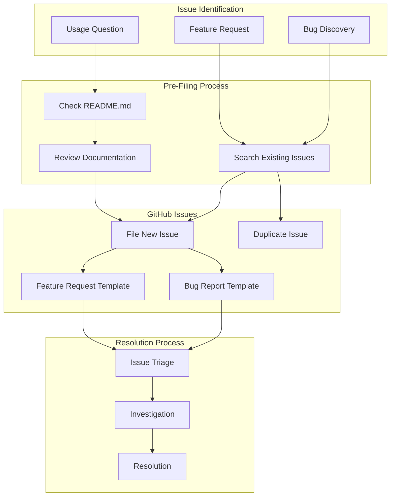
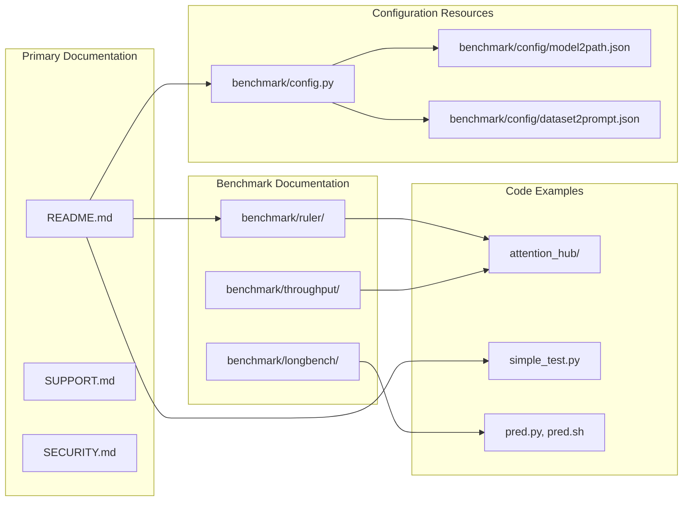
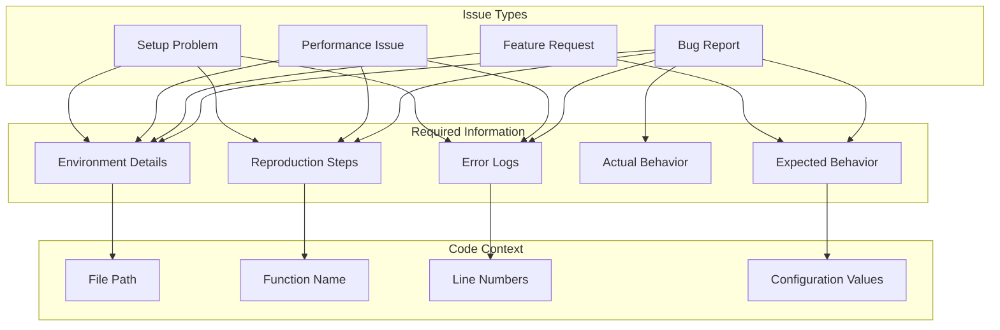

<!-- source: DeepWiki mcp.deepwiki.com · repo microsoft/RetrievalAttention · page 6.1 Getting Support · fetched 2026-10-26 -->

# Getting Support

Relevant source files

The following files were used as context for generating this wiki page:

- [SUPPORT.md](SUPPORT.md)

This document provides comprehensive guidance on how to get help with the RetroInfer system, including reporting bugs, requesting features, and finding solutions to common issues. It covers the official support channels, issue reporting procedures, and self-help resources available within the codebase.

For general usage instructions and setup procedures, see [Setup and Installation](#4). For security-related issues, see [Security](#6.2).

## Support Channels Overview

The RetroInfer project provides multiple support channels depending on the type of issue or question you have:

### Issue Reporting and Bug Tracking

**Sources:** [SUPPORT.md:1-14]()

### Primary Support Process

The project uses **GitHub Issues** as the primary mechanism for tracking bugs and feature requests. Before filing new issues, users must search existing issues to avoid duplicates as outlined in [SUPPORT.md:5-7]().

| Support Type | Channel | Response Time | Scope |
|-------------|---------|---------------|-------|
| Bug Reports | GitHub Issues | Community-driven | Code defects, crashes |
| Feature Requests | GitHub Issues | Community-driven | New functionality |
| Usage Questions | README.md reference | Self-service | Setup, configuration |
| Security Issues | Security reporting | Priority | Vulnerabilities |

**Sources:** [SUPPORT.md:5-7]()

## Self-Help Resources

### Documentation Navigation

**Sources:** [SUPPORT.md:9]()

### Common Issues and Solutions

The following table maps common issues to their corresponding code locations and solutions:

| Issue Type | Code Location | Solution Reference |
|------------|---------------|-------------------|
| Environment Setup | `README.md` | Docker/Conda setup instructions |
| Model Configuration | `benchmark/config/model2path.json` | Model path mapping |
| Attention Parameters | `benchmark/config.py` | `generate_config()` function |
| Benchmark Execution | `benchmark/ruler/`, `benchmark/longbench/` | Task-specific scripts |
| Performance Issues | `benchmark/throughput/` | NUMA and multi-GPU configuration |

**Sources:** [SUPPORT.md:9]()

## Issue Filing Guidelines

### Before Filing an Issue

1. **Search Existing Issues**: Check the GitHub Issues tab for similar problems or requests
2. **Review Documentation**: Consult [README.md]() for setup and usage guidance
3. **Test with Simple Examples**: Run `simple_test.py` to isolate the issue
4. **Check Configuration**: Verify model paths and parameters in `benchmark/config/`

### Issue Categories and Templates

**Sources:** [SUPPORT.md:5-7]()

### Bug Report Template

When filing a bug report, include:

- **Environment Information**: CUDA version, Python version, GPU specifications
- **Reproduction Steps**: Exact commands and input data used
- **Expected vs Actual Behavior**: What should happen vs what actually happens
- **Error Messages**: Full stack traces and error logs
- **Configuration Details**: Model paths, attention parameters, dataset configurations
- **Code Context**: Specific files, functions, or line numbers involved

### Feature Request Template

When requesting new features, include:

- **Use Case Description**: Problem the feature would solve
- **Proposed Solution**: How the feature should work
- **Alternative Solutions**: Other approaches considered
- **Code Integration Points**: Where the feature would fit in the codebase

**Sources:** [SUPPORT.md:5-7]()

## Microsoft Support Policy

### Support Scope and Limitations

The RetroInfer project follows Microsoft's standard support policy for open-source projects. As stated in [SUPPORT.md:13](), "Support for this **PROJECT or PRODUCT** is limited to the resources listed above."

### Support Boundaries

| Supported | Not Supported |
|-----------|---------------|
| GitHub Issues for bugs and features | Direct email support |
| Community-driven problem solving | Guaranteed response times |
| Documentation and examples | Custom implementation services |
| Security vulnerability reporting | Third-party integration issues |

### Escalation Process

For issues requiring escalation beyond community support:

1. **File detailed GitHub Issue** with comprehensive information
2. **Reference specific code sections** using file paths and line numbers
3. **Provide reproduction steps** with exact environment details
4. **Include relevant logs** and error messages

**Sources:** [SUPPORT.md:11-13]()

## Community Guidelines

### Issue Etiquette

- **Be specific**: Include exact error messages, file paths, and line numbers
- **Be respectful**: Follow professional communication standards
- **Be patient**: Allow time for community response
- **Be helpful**: Share solutions that work for you

### Contributing to Support

Users can contribute to the support ecosystem by:

- **Answering questions** in GitHub Issues
- **Improving documentation** through pull requests
- **Sharing troubleshooting tips** in issue discussions
- **Validating bug reports** by reproducing issues

### Code References for Support

When seeking or providing support, reference specific code entities:

- **Functions**: `generate_config()`, `retroinfer_cache()`, `flash_attn_with_kvcache()`
- **Classes**: `LlamaModel`, `QwenModel`, attention mechanism classes
- **Files**: Configuration files, benchmark scripts, attention implementations
- **Parameters**: `budget_ratio`, `estimate_ratio`, model paths

**Sources:** [SUPPORT.md:1-14]()

---

