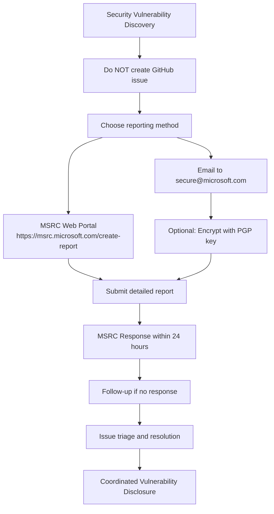
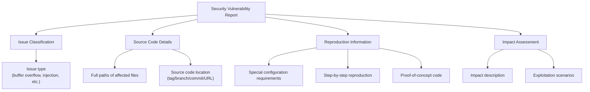
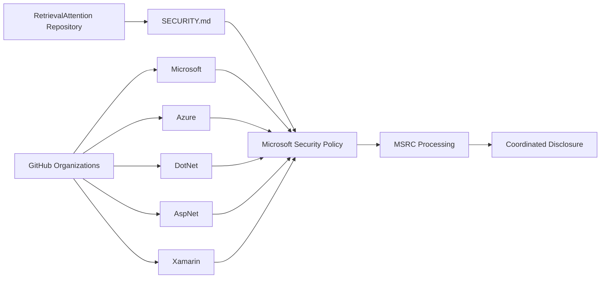

<!-- source: DeepWiki mcp.deepwiki.com · repo microsoft/RetrievalAttention · page 6.2 Security · fetched 2026-10-26 -->

# Security

Relevant source files

The following files were used as context for generating this wiki page:

- [SECURITY.md](SECURITY.md)

This document outlines the security policies and procedures for the RetrievalAttention project, specifically focusing on how to report security vulnerabilities and the associated response processes. This page covers vulnerability reporting procedures, required information for reports, and Microsoft's security response policies.

For information about getting general support or reporting non-security bugs, see [Getting Support](#6.1).

## Reporting Security Vulnerabilities

Microsoft takes security seriously for all repositories under its GitHub organizations. The RetrievalAttention project follows Microsoft's standard security vulnerability reporting process.

**Critical Rule**: Security vulnerabilities should never be reported through public GitHub issues. Instead, all security reports must be submitted through Microsoft's dedicated security channels.

### Security Reporting Process Flow

**Sources**: [SECURITY.md:11-17]()

### Preferred Reporting Methods

The project provides two primary channels for security vulnerability reporting:

| Method | Details | When to Use |
|--------|---------|-------------|
| **MSRC Web Portal** | [https://msrc.microsoft.com/create-report](https://msrc.microsoft.com/create-report) | Preferred method with account login |
| **Email** | secure@microsoft.com | When submitting without logging in |
| **PGP Encryption** | Available at Microsoft Security Response Center PGP Key page | For sensitive vulnerability details |

**Sources**: [SECURITY.md:13-15]()

## Required Information for Security Reports

When reporting a security vulnerability, comprehensive information helps Microsoft's security team triage and address the issue effectively. The following information should be included in all security reports:

### Vulnerability Report Information Structure

**Sources**: [SECURITY.md:19-27]()

### Information Categories

**Technical Details**:
- Type of issue (e.g., buffer overflow, SQL injection, cross-site scripting)
- Full paths of source files related to the vulnerability
- Location of affected source code with specific tag/branch/commit or direct URL

**Reproduction Requirements**:
- Any special configuration required to reproduce the issue
- Step-by-step instructions to reproduce the vulnerability
- Proof-of-concept or exploit code (if available)

**Impact Analysis**:
- Detailed impact assessment of the vulnerability
- Description of how an attacker might exploit the issue

**Sources**: [SECURITY.md:21-27]()

## Response Process and Timeline

Microsoft follows a structured response process for security vulnerability reports with defined timelines and escalation procedures.

### Security Response Timeline

```mermaid
gantt
    title Security Vulnerability Response Timeline
    dateFormat X
    axisFormat %d hours
    
    section Initial Response
    Report Submitted          :0, 0
    MSRC Response             :0, 24
    
    section Follow-up
    Follow-up if no response  :24, 48
    
    section Resolution
    Triage and Investigation  :24, 168
    Coordinated Disclosure    :168, 336
```

**Response Expectations**:
- **24 Hours**: Initial response from Microsoft Security Response Center
- **Follow-up**: If no response received within 24 hours, follow up via email
- **Additional Resources**: More information available at [microsoft.com/msrc](https://www.microsoft.com/msrc)

**Sources**: [SECURITY.md:17-18]()

## Security Policies and Programs

The RetrievalAttention project operates under Microsoft's broader security policies and participates in security programs that benefit the wider community.

### Microsoft Security Programs

**Bug Bounty Program**:
- More complete reports can contribute to higher bounty awards
- Details available at the Microsoft Bug Bounty Program page
- Rewards responsible disclosure and thorough vulnerability reports

**Coordinated Vulnerability Disclosure**:
- Microsoft follows the principle of Coordinated Vulnerability Disclosure
- Ensures proper coordination between researchers and Microsoft
- Protects users while allowing researchers appropriate recognition

**Communication Preferences**:
- All communications should be in English
- Clear, technical descriptions are preferred
- Detailed reproduction steps are essential

**Sources**: [SECURITY.md:31-39]()

### Repository Security Context

**Sources**: [SECURITY.md:5-6]()

The RetrievalAttention project is part of Microsoft's broader ecosystem of open-source projects, all of which follow the same security vulnerability reporting and response procedures. This ensures consistent security standards across all Microsoft-managed repositories.

---

