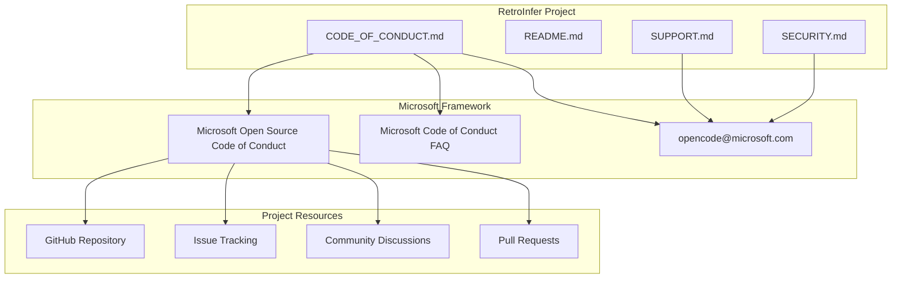
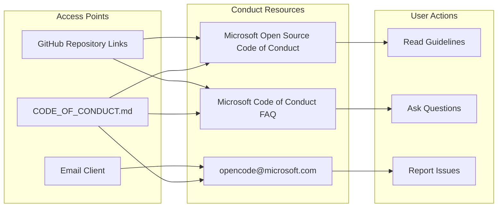

<!-- source: DeepWiki mcp.deepwiki.com · repo microsoft/RetrievalAttention · page 6.3 Code of Conduct · fetched 2026-10-26 -->

# Code of Conduct

<details>
<summary>Relevant source files</summary>

The following files were used as context for generating this wiki page:

- [CODE_OF_CONDUCT.md](CODE_OF_CONDUCT.md)

</details>


This document describes the behavioral expectations and community guidelines for contributors to the RetroInfer project. It covers the adopted code of conduct framework, available resources, and reporting mechanisms for conduct-related issues.

For information about getting technical support or reporting bugs, see [Getting Support](#6.1). For information about reporting security vulnerabilities, see [Security](#6.2).

## Purpose and Scope

The RetroInfer project has adopted the Microsoft Open Source Code of Conduct to establish clear expectations for community participation and maintain a welcoming, inclusive environment for all contributors. This framework applies to all project spaces, including code repositories, issue tracking, documentation, and communication channels.

**Sources:** [CODE_OF_CONDUCT.md:1-10]()

## Code of Conduct Framework

The project implements a standardized approach to community governance through Microsoft's established open source conduct framework. This provides consistency across Microsoft's open source ecosystem and leverages proven processes for handling conduct issues.



**Sources:** [CODE_OF_CONDUCT.md:3-9]()

## Key Components

### Microsoft Open Source Code of Conduct Adoption

The project references the Microsoft Open Source Code of Conduct as its primary governance framework. This adoption is declared in the main code of conduct file and provides the foundational rules for community interaction.

| Component | Location | Purpose |
|-----------|----------|---------|
| Primary Declaration | [CODE_OF_CONDUCT.md:3]() | Formal adoption statement |
| Framework Link | [CODE_OF_CONDUCT.md:7]() | Direct reference to Microsoft's conduct guidelines |
| FAQ Resource | [CODE_OF_CONDUCT.md:8]() | Common questions and clarifications |
| Contact Channel | [CODE_OF_CONDUCT.md:9]() | Reporting mechanism for conduct issues |

### Resource Structure



**Sources:** [CODE_OF_CONDUCT.md:5-9]()

## Implementation Details

### File Structure

The code of conduct implementation follows a minimal, reference-based approach that delegates to Microsoft's established framework rather than duplicating content:

```
CODE_OF_CONDUCT.md
├── Title: "Microsoft Open Source Code of Conduct"
├── Adoption Statement
├── Resources Section
│   ├── Microsoft Open Source Code of Conduct (external link)
│   ├── Microsoft Code of Conduct FAQ (external link)
│   └── Contact Email: opencode@microsoft.com
```

### Contact Mechanism

The primary contact mechanism for conduct-related issues is the `opencode@microsoft.com` email address, which is managed by Microsoft's open source program office. This provides:

- **Centralized Handling**: Consistent processing across Microsoft's open source projects
- **Expertise**: Dedicated team familiar with conduct issue resolution
- **Escalation Paths**: Established procedures for serious violations
- **Confidentiality**: Secure channel for sensitive reports

**Sources:** [CODE_OF_CONDUCT.md:9]()

## Integration with Project Governance

The code of conduct integrates with other project governance documents to provide comprehensive guidance for contributors:

```mermaid
graph TB
    subgraph "Project Governance"
        COC["CODE_OF_CONDUCT.md<br/>Community Standards"]
        SUPPORT["SUPPORT.md<br/>Technical Help"]
        SECURITY["SECURITY.md<br/>Vulnerability Reporting"]
        README["README.md<br/>Project Overview"]
    end
    
    subgraph "External Frameworks"
        MS_COC["Microsoft Open Source<br/>Code of Conduct"]
        MS_SECURITY["Microsoft Security<br/>Response Center"]
        GITHUB["GitHub Community<br/>Guidelines"]
    end
    
    subgraph "Communication Channels"
        ISSUES["GitHub Issues"]
        EMAIL["Email Contact"]
        DISCUSSIONS["Community Discussions"]
    end
    
    COC --> MS_COC
    COC --> EMAIL
    SUPPORT --> ISSUES
    SECURITY --> MS_SECURITY
    
    MS_COC --> DISCUSSIONS
    README --> ISSUES
    
    EMAIL --> "opencode@microsoft.com"
    ISSUES --> "GitHub Issue Tracker"
    DISCUSSIONS --> "Community Forums"
```

**Sources:** [CODE_OF_CONDUCT.md:1-10]()

This structure ensures that contributors have clear pathways for different types of concerns while maintaining consistency with Microsoft's broader open source governance approach.

---

