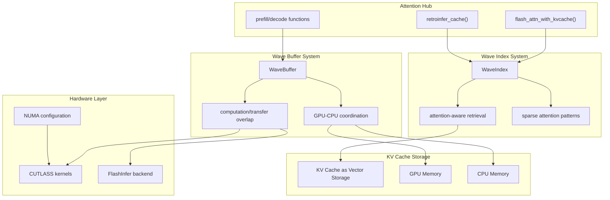
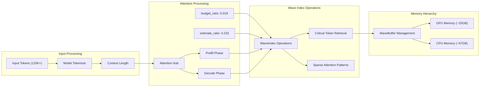
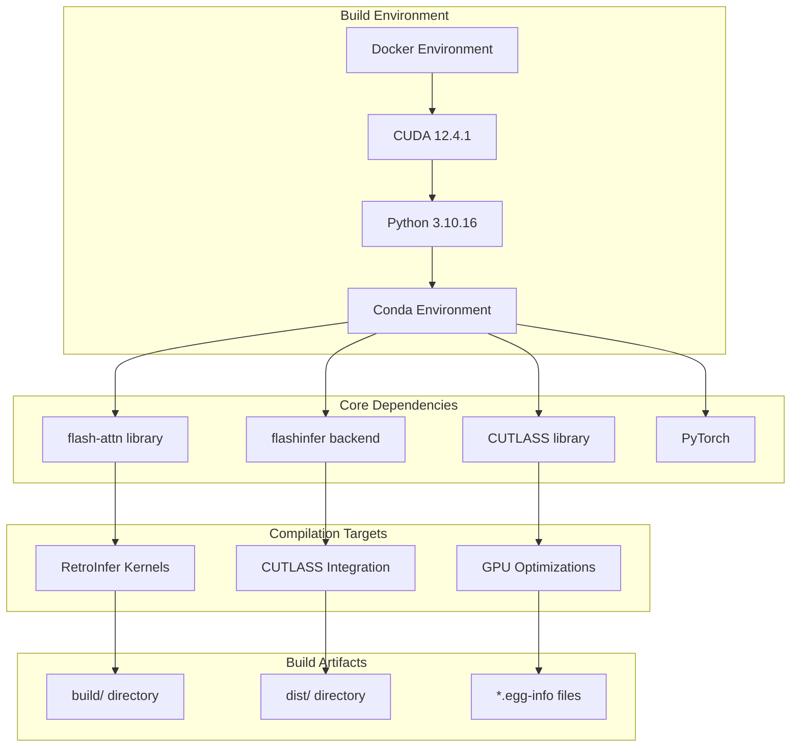
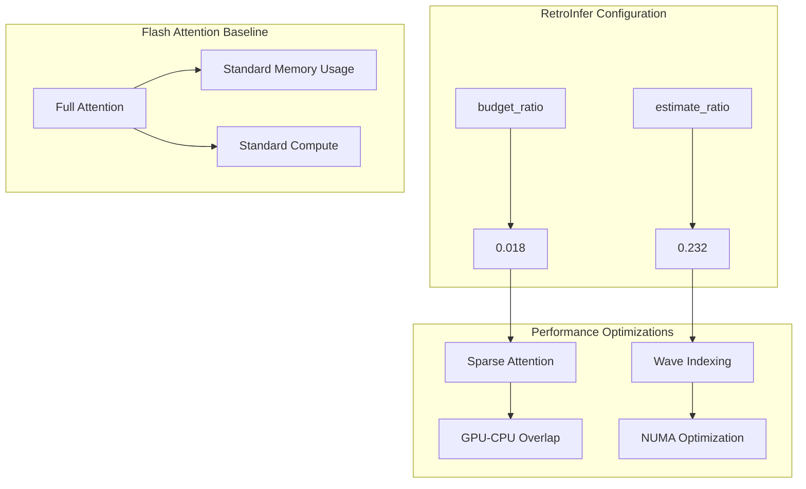
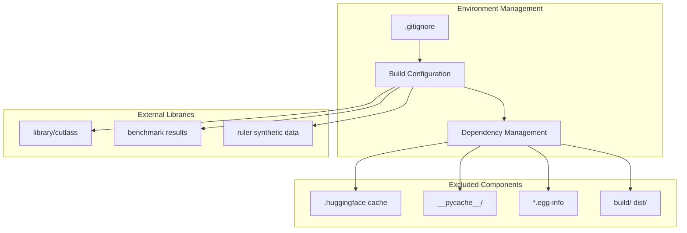
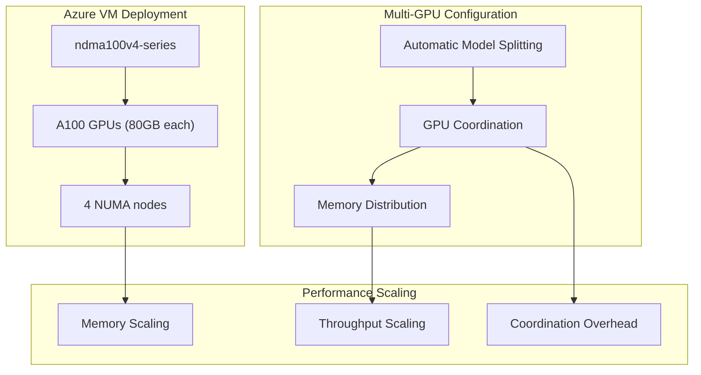

<!-- source: DeepWiki mcp.deepwiki.com · repo microsoft/RetrievalAttention · page 7 Technical Reference · fetched 2026-10-26 -->

# Technical Reference

Relevant source files

The following files were used as context for generating this wiki page:

- [.gitignore](.gitignore)
- [Transparency_FAQ.md](Transparency_FAQ.md)

This document provides technical implementation details, system architecture specifications, and advanced configuration information for the RetroInfer system. It is intended for developers, researchers, and system administrators who need to understand the low-level implementation details and performance characteristics.

For general usage instructions, see [Usage Examples](#5). For setup and installation procedures, see [Setup and Installation](#4). For benchmarking information, see [Benchmarking and Evaluation](#3).

## System Architecture Overview

RetroInfer implements a novel approach to long-context LLM inference acceleration through attention-aware vector indexing and GPU-CPU co-execution. The system rethinks the KV cache as vector storage and introduces specialized components for efficient retrieval and coordination.

### Core Components Architecture

Sources: [Transparency_FAQ.md:1-22]()

### Data Flow and Memory Management

Sources: [Transparency_FAQ.md:3-4]()

## Hardware Requirements and Deployment

### NUMA Architecture Configuration

The system is designed for high-performance multi-GPU environments with NUMA-aware memory management:

| Component | Specification | Purpose |
|-----------|---------------|---------|
| GPU Type | NVIDIA A100 (80GB) | Primary computation |
| CPU Architecture | 4 NUMA nodes, 24 cores each | Memory management and coordination |
| Memory Configuration | GPU: ~25GB, CPU: ~67GB | KV cache storage hierarchy |
| CUDA Version | 12.4.1 | Kernel compilation and execution |

### Build System and Dependencies

Sources: [.gitignore:400-407]()

## Performance Characteristics

### Throughput Improvements

The system achieves significant performance gains through several optimization strategies:

| Metric | FlashAttention Baseline | RetroInfer | Improvement |
|--------|-------------------------|------------|-------------|
| Decoding Throughput | 1.0x | 4.5x - 10.5x | 450% - 1050% |
| Memory Efficiency | Standard | Optimized | GPU-CPU coordination |
| Accuracy Impact | N/A | Almost no change | Maintained quality |

### Attention Mechanism Parameters

Sources: [Transparency_FAQ.md:21]()

## Build System Configuration

### Ignored Build Artifacts

The build system excludes several categories of files and directories:

| Category | Patterns | Purpose |
|----------|----------|---------|
| Build Outputs | `build/`, `dist/`, `*.egg-info` | Compiled artifacts |
| CUTLASS Library | `library/cutlass` | External dependency |
| Benchmark Results | `benchmark/LongBench/results/`, `benchmark/ruler/ruler_eval_result/` | Generated evaluation data |
| Cache Files | `.huggingface`, `__pycache__/` | Runtime caches |

### Development Environment Setup

Sources: [.gitignore:400-407]()

## System Limitations and Considerations

### Responsible AI Considerations

The system maintains the same responsible AI characteristics as the underlying LLM:

- **Bias and Fairness**: RetroInfer does not inherently mitigate or exacerbate bias in LLM responses
- **Harmful Content**: Potentially harmful, false, or biased responses are likely unchanged
- **Research Purpose**: Developed for research and experimental purposes, requiring further validation for production use

### Configuration Parameters

Users can adjust key parameters for optimal performance:

| Parameter | Default Value | Purpose | Impact |
|-----------|---------------|---------|---------|
| `budget_ratio` | 0.018 | Controls retrieval budget | Memory usage vs. accuracy tradeoff |
| `estimate_ratio` | 0.232 | Attention estimation threshold | Computational efficiency |
| Context Length | 120K+ tokens | Maximum supported context | Memory requirements |

### Multi-GPU Deployment

The system supports automatic model splitting across multiple GPUs:

Sources: [Transparency_FAQ.md:16-21]()

---

