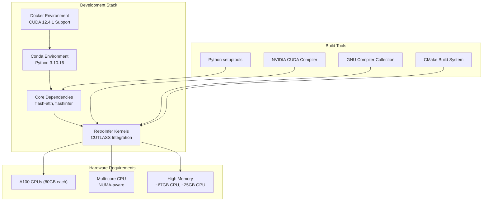
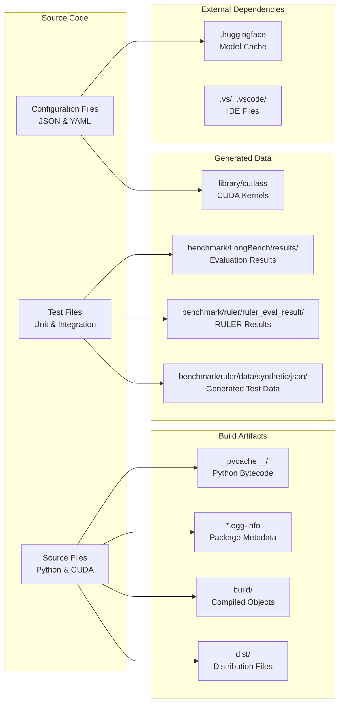
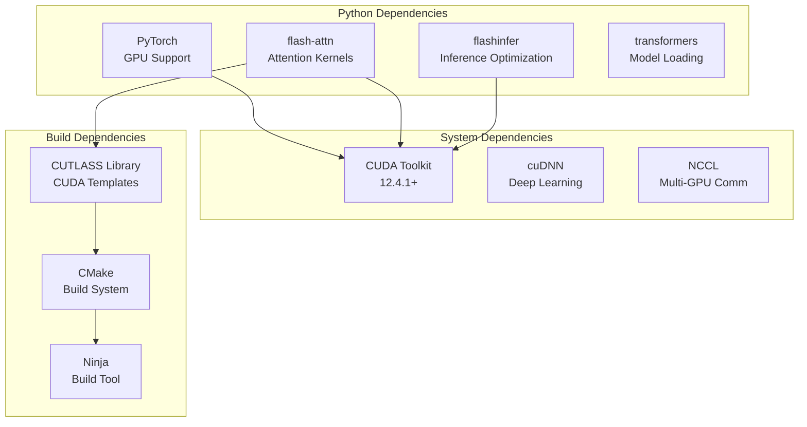
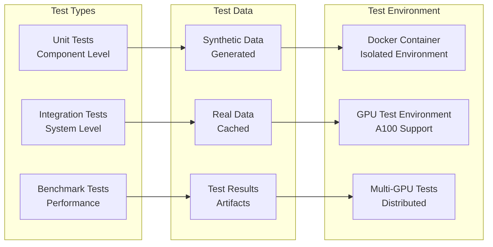

<!-- source: DeepWiki mcp.deepwiki.com · repo microsoft/RetrievalAttention · page 7.1 Development Environment · fetched 2026-10-26 -->

# Development Environment

Relevant source files

The following files were used as context for generating this wiki page:

- [.gitignore](.gitignore)

This document covers the development environment setup and build process for the RetroInfer system. It details the technical requirements, build dependencies, and development workflow for contributors working on the codebase. For installation instructions, see [Environment Setup](#4.1). For general usage examples, see [Usage Examples](#5).

## Development Setup Overview

The RetroInfer development environment requires a carefully configured stack with CUDA support, Python dependencies, and custom kernel compilation capabilities. The system is designed to work with high-performance GPU computing environments.

### Core Environment Requirements

**Development Environment Architecture**

Sources: [README.md](), [.gitignore:400-408]()

### Directory Structure and Build Artifacts

The development environment generates various build artifacts and temporary files that are managed through the build process:

**Build Artifacts and Generated Files**

Sources: [.gitignore:327-328](), [.gitignore:400-408](), [.gitignore:379-385]()

## Build Process

The RetroInfer build process involves compiling CUDA kernels, building Python packages, and managing complex dependencies.

### CUDA Kernel Compilation

| Component | Purpose | Build Requirements |
|-----------|---------|-------------------|
| `library/cutlass` | CUDA kernel implementations | NVCC, CUTLASS library |
| `flash-attn` | Flash attention kernels | CUDA toolkit, compatible GPU |
| `flashinfer` | Inference optimization | CUDA compute capability 8.0+ |

### Python Package Building

The build process generates several types of artifacts:

- **Python Bytecode**: `__pycache__/` directories containing compiled Python files
- **Package Metadata**: `*.egg-info` directories with package information
- **Build Artifacts**: `build/` directory with compiled extensions
- **Distribution Files**: `dist/` directory with installable packages

### Dependency Management

**Dependency Architecture**

Sources: [README.md](), [.gitignore:404]()

## Development Workflow

### File Organization

The development workflow follows a structured approach to managing code, tests, and build artifacts:

| Directory | Purpose | Git Tracking |
|-----------|---------|-------------|
| `benchmark/` | Evaluation scripts and data | Source tracked |
| `benchmark/LongBench/results/` | Generated benchmark results | Ignored |
| `benchmark/ruler/ruler_eval_result/` | RULER evaluation outputs | Ignored |
| `library/cutlass` | CUDA kernel implementations | Ignored (generated) |
| `build/`, `dist/` | Build artifacts | Ignored |
| `__pycache__/` | Python bytecode | Ignored |

### Testing Environment

The testing environment supports multiple configurations:

**Testing Environment Structure**

Sources: [.gitignore:405-407](), [README.md]()

### Debugging and Development Tools

The development environment supports debugging through:

- **IDE Integration**: VS Code and Visual Studio configurations
- **GPU Debugging**: NVIDIA Nsight GPU debugger support
- **Memory Profiling**: CUDA memory debugging tools
- **Performance Analysis**: Profiling and tracing capabilities

### Build Verification

Development builds can be verified through:

1. **Compilation Check**: Ensure CUDA kernels compile successfully
2. **Import Test**: Verify Python packages import correctly
3. **Simple Test**: Run basic functionality tests
4. **GPU Test**: Validate GPU kernel execution

Sources: [.gitignore:355-356](), [.gitignore:379-385]()

## Generated Files and Artifacts

The development environment produces several categories of generated files that are excluded from version control:

### Benchmark Data

- `benchmark/ruler/data/synthetic/json/*.json`: Generated synthetic test data
- `benchmark/ruler/ruler_eval_result/`: RULER benchmark evaluation results
- `benchmark/LongBench/results/`: LongBench evaluation outputs

### Build Artifacts

- `build/`: Compiled object files and intermediate build products
- `dist/`: Distribution packages and wheels
- `*.egg-info`: Python package metadata

### External Dependencies

- `.huggingface`: Cached model files and tokenizers
- `library/cutlass`: CUDA kernel implementations

Sources: [.gitignore:400-408]()

---

