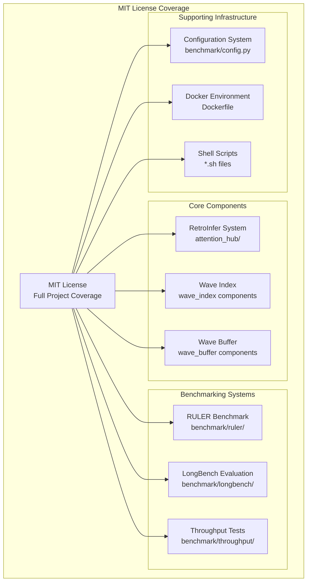
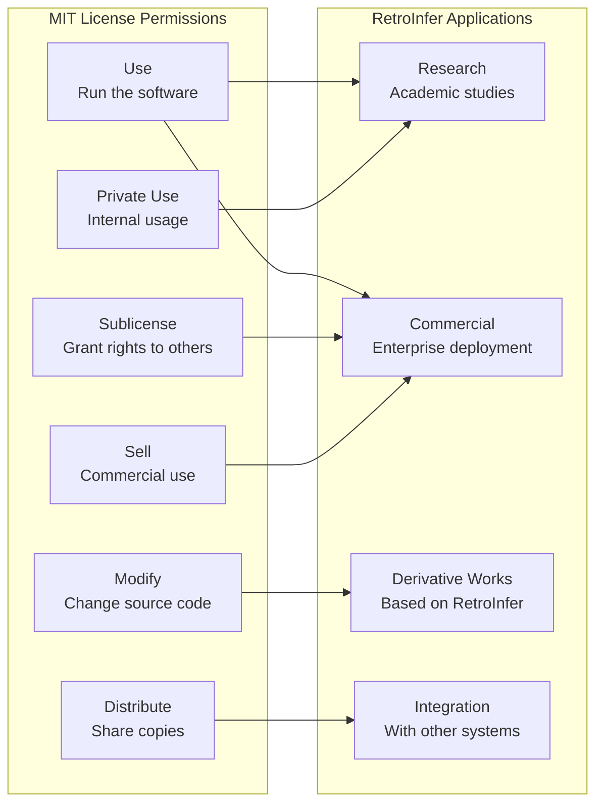
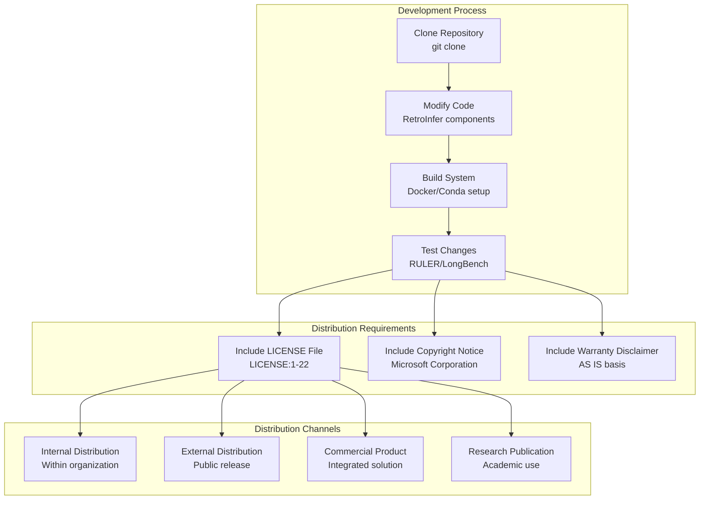

<!-- source: DeepWiki mcp.deepwiki.com · repo microsoft/RetrievalAttention · page 7.2 License · fetched 2026-10-26 -->

# License

Relevant source files

The following files were used as context for generating this wiki page:

- [LICENSE](LICENSE)

This document covers the licensing terms and copyright information for the RetrievalAttention codebase, including usage rights, distribution requirements, and legal implications for developers and users of the RetroInfer system.

## License Overview

The RetrievalAttention project is distributed under the MIT License, one of the most permissive open-source licenses available. This license governs all components of the system including the core RetroInfer attention mechanisms, benchmarking frameworks, and supporting utilities.

**License Structure and Scope**

Sources: [LICENSE:1-22]()

## Copyright Information

The project is copyrighted by Microsoft Corporation, as specified in the license header. This copyright applies to all original code, documentation, and associated materials within the repository.

| **Aspect** | **Details** |
|------------|-------------|
| **Copyright Holder** | Microsoft Corporation |
| **License Type** | MIT License |
| **License File** | [LICENSE:1-22]() |
| **Copyright Notice Requirement** | Must be included in all copies or substantial portions |

The copyright notice and license text must be preserved in all distributed versions of the software, whether modified or unmodified.

Sources: [LICENSE:3](), [LICENSE:12-13]()

## Usage Rights and Permissions

The MIT License grants extensive permissions to users and developers. The following rights are explicitly granted without restriction:

**Permitted Actions**

Sources: [LICENSE:5-10]()

## License Conditions and Requirements

While the MIT License is permissive, it includes specific conditions that must be met:

### Required Inclusions

1. **Copyright Notice**: The original copyright notice must be preserved
2. **License Text**: The full MIT License text must be included
3. **Attribution**: Credit to Microsoft Corporation must be maintained

### Warranty and Liability Disclaimer

The software is provided "AS IS" without warranty of any kind. Key disclaimers include:

- **No Express or Implied Warranties**: No guarantees about functionality or fitness for purpose
- **No Liability**: Microsoft Corporation is not liable for any damages arising from use
- **No Support Obligation**: No requirement to provide support or maintenance

Sources: [LICENSE:15-21]()

## Development and Distribution Implications

For developers working with or distributing the RetroInfer system, the following considerations apply:

**Development Workflow License Compliance**

Sources: [LICENSE:1-22]()

### Integration with Third-Party Systems

When integrating RetroInfer components with other systems, developers must:

1. **Preserve License Information**: Include the MIT License text in distributions
2. **Maintain Attribution**: Credit Microsoft Corporation in derivative works
3. **Comply with Downstream Licenses**: Ensure compatibility with other components' licenses

### Commercial Usage Guidelines

The MIT License explicitly permits commercial use, including:

- **Enterprise Deployment**: Using RetroInfer in production systems
- **Product Integration**: Incorporating RetroInfer into commercial products
- **Service Provision**: Offering services based on RetroInfer technology
- **Modification and Customization**: Adapting the system for specific commercial needs

All commercial usage must still comply with the license conditions regarding copyright notice preservation and warranty disclaimers.

Sources: [LICENSE:5-10](), [LICENSE:15-21]()