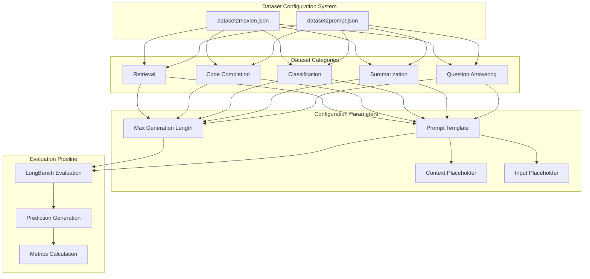
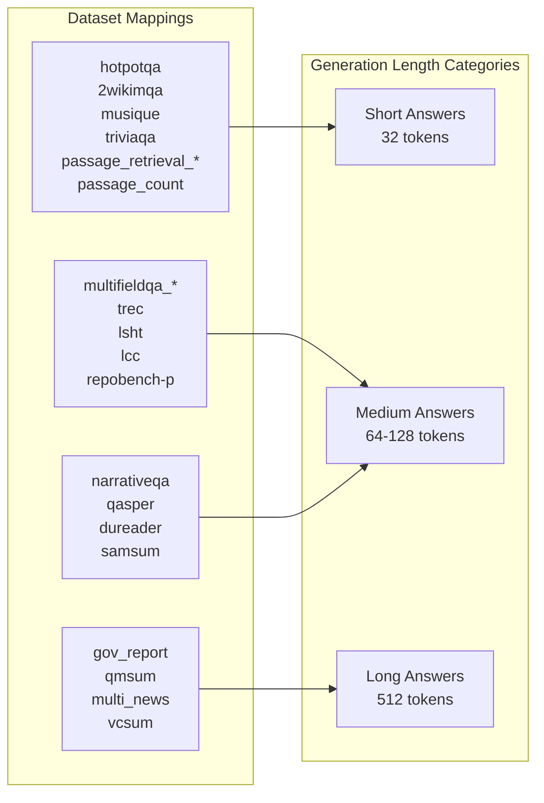
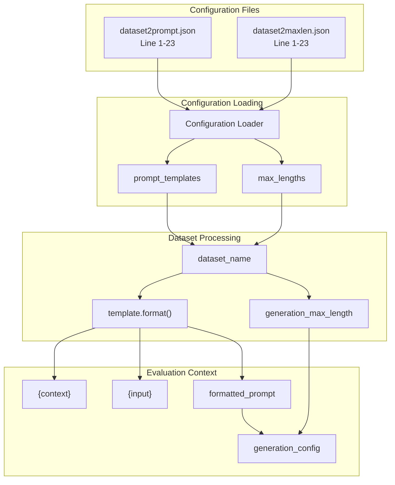

<!-- source: DeepWiki mcp.deepwiki.com · repo microsoft/RetrievalAttention · extra page Dataset Configuration · fetched 2026-10-26 -->

# Dataset Configuration

<details>
<summary>Relevant source files</summary>

The following files were used as context for generating this wiki page:

- [benchmark/LongBench/config/dataset2maxlen.json](benchmark/LongBench/config/dataset2maxlen.json)
- [benchmark/LongBench/config/dataset2prompt.json](benchmark/LongBench/config/dataset2prompt.json)

</details>


This document describes the dataset configuration system for the LongBench evaluation framework within RetroInfer. It covers the configuration files that define dataset-specific prompt templates and generation parameters used during benchmark evaluation.

For information about model configuration, see [Model Configuration](#4.2.1). For general configuration setup, see [Configuration](#4.2).

## Overview

The dataset configuration system manages two critical aspects of LongBench evaluation:
- **Prompt Templates**: Task-specific instruction formats stored in `dataset2prompt.json`
- **Generation Limits**: Maximum token generation lengths stored in `dataset2maxlen.json`

These configuration files enable the benchmarking system to handle diverse evaluation tasks with appropriate prompts and output constraints.

## Configuration Architecture



**Sources:** [benchmark/LongBench/config/dataset2prompt.json:1-23](), [benchmark/LongBench/config/dataset2maxlen.json:1-23]()

## Dataset Types and Generation Limits

The `dataset2maxlen.json` file defines maximum generation lengths for each dataset, organized by task type:

| Task Type | Datasets | Max Length (tokens) |
|-----------|----------|-------------------|
| **Question Answering** | `hotpotqa`, `2wikimqa`, `musique`, `triviaqa`, `passage_retrieval_en`, `passage_retrieval_zh`, `passage_count` | 32 |
| **Multi-field QA** | `multifieldqa_en`, `multifieldqa_zh` | 64 |
| **Reading Comprehension** | `narrativeqa`, `qasper`, `dureader`, `samsum` | 128 |
| **Summarization** | `gov_report`, `qmsum`, `multi_news`, `vcsum` | 512 |
| **Classification** | `trec`, `lsht` | 64 |
| **Code Completion** | `lcc`, `repobench-p` | 64 |



**Sources:** [benchmark/LongBench/config/dataset2maxlen.json:1-23]()

## Prompt Template System

The `dataset2prompt.json` file contains task-specific prompt templates with standardized placeholders:

### Template Structure

Each prompt template uses two primary placeholders:
- `{context}`: The long-context input document
- `{input}`: The specific question or instruction

### Question Answering Templates

Question answering datasets use concise, direct prompts:

```json
"hotpotqa": "Answer the question based on the given passages. Only give me the answer and do not output any other words.\n\nThe following are given passages.\n{context}\n\nAnswer the question based on the given passages. Only give me the answer and do not output any other words.\n\nQuestion: {input}\nAnswer:"
```

### Summarization Templates

Summarization tasks use more descriptive instructions:

```json
"gov_report": "You are given a report by a government agency. Write a one-page summary of the report.\n\nReport:\n{context}\n\nNow, write a one-page summary of the report.\n\nSummary:"
```

### Code Completion Templates

Code completion uses minimal context framing:

```json
"lcc": "Please complete the code given below. \n{context}Next line of code:\n"
```

**Sources:** [benchmark/LongBench/config/dataset2prompt.json:1-23]()

## Configuration File Integration



**Sources:** [benchmark/LongBench/config/dataset2prompt.json:1-23](), [benchmark/LongBench/config/dataset2maxlen.json:1-23]()

## Language-Specific Configuration

The system supports both English and Chinese datasets with appropriate prompt templates:

| Language | Datasets | Template Features |
|----------|----------|-------------------|
| **English** | `narrativeqa`, `qasper`, `multifieldqa_en`, `passage_retrieval_en` | Standard English instructions |
| **Chinese** | `multifieldqa_zh`, `dureader`, `vcsum`, `lsht`, `passage_retrieval_zh` | Chinese character instructions |

### Chinese Template Example

```json
"multifieldqa_zh": "阅读以下文字并用中文简短回答：\n\n{context}\n\n现在请基于上面的文章回答下面的问题，只告诉我答案，不要输出任何其他字词。\n\n问题：{input}\n回答："
```

**Sources:** [benchmark/LongBench/config/dataset2prompt.json:5](), [benchmark/LongBench/config/dataset2prompt.json:9](), [benchmark/LongBench/config/dataset2prompt.json:13](), [benchmark/LongBench/config/dataset2prompt.json:17](), [benchmark/LongBench/config/dataset2prompt.json:20]()

## Dataset Categories

### Reading Comprehension
- **narrativeqa**: Story-based question answering with concise responses
- **qasper**: Scientific article comprehension with yes/no/unanswerable options
- **dureader**: Chinese reading comprehension

### Multi-hop Question Answering
- **hotpotqa**: Multi-step reasoning over multiple passages
- **2wikimqa**: Wikipedia-based multi-hop questions
- **musique**: Complex reasoning tasks

### Summarization Tasks
- **gov_report**: Government document summarization (512 tokens)
- **qmsum**: Meeting transcript summarization (512 tokens)
- **multi_news**: Multi-document news summarization (512 tokens)
- **vcsum**: Chinese meeting summarization (512 tokens)

### Code Understanding
- **lcc**: Line-level code completion
- **repobench-p**: Repository-level code completion

**Sources:** [benchmark/LongBench/config/dataset2prompt.json:2-22](), [benchmark/LongBench/config/dataset2maxlen.json:2-22]()

---

