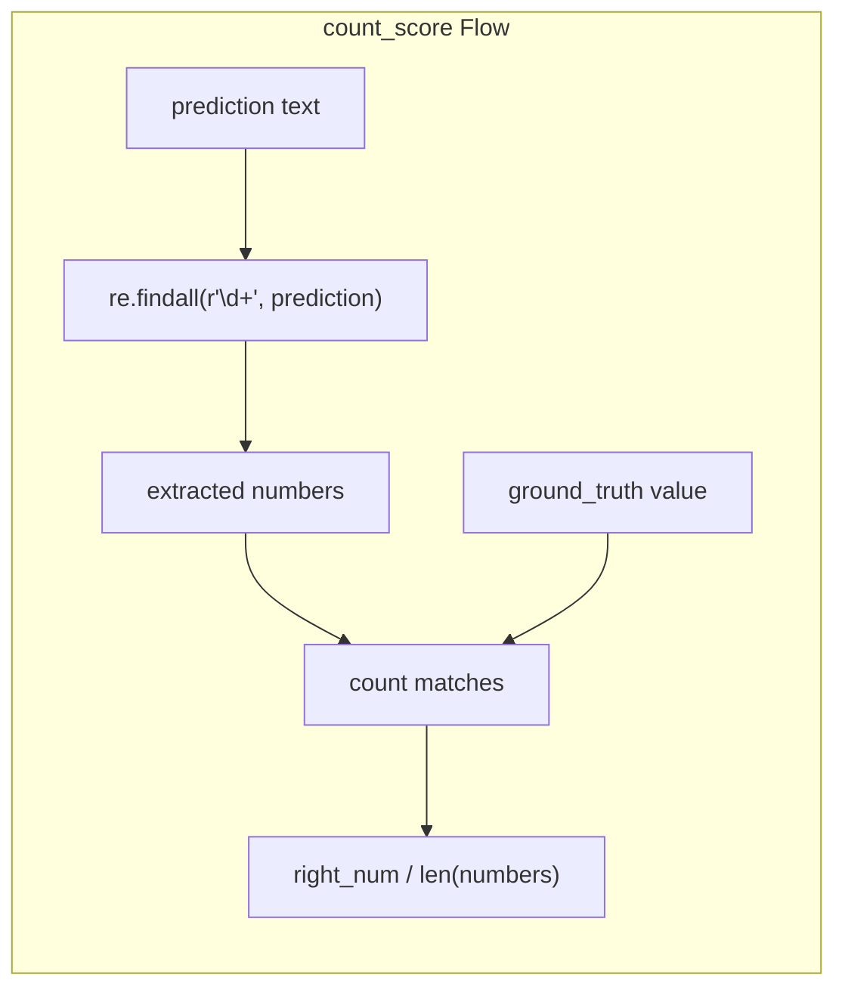
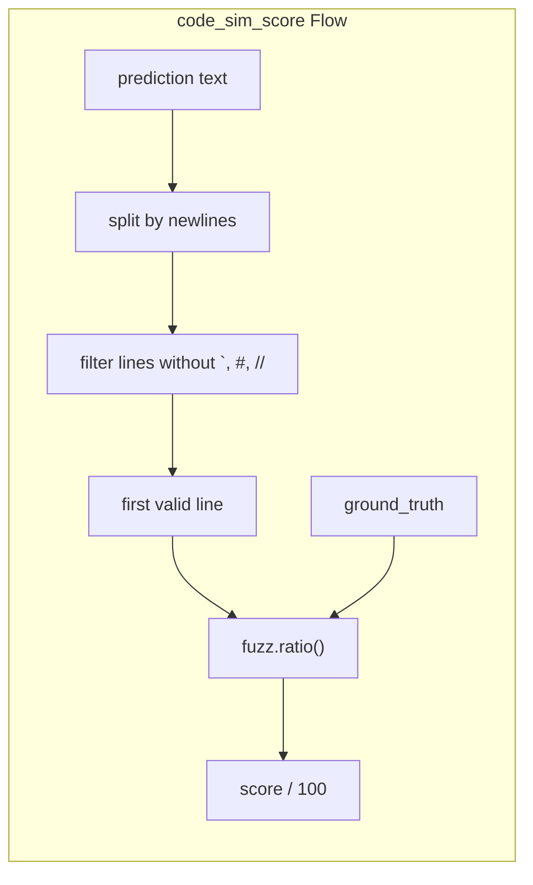
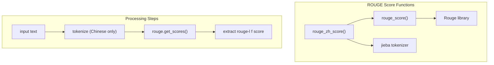

<!-- source: DeepWiki mcp.deepwiki.com · repo microsoft/RetrievalAttention · extra page Metrics and Scoring · fetched 2026-10-26 -->

# Metrics and Scoring

Relevant source files

The following files were used as context for generating this wiki page:

- [benchmark/LongBench/metrics.py](benchmark/LongBench/metrics.py)

This page documents the evaluation metrics and scoring functions used in the LongBench benchmark system. The metrics are implemented in the `benchmark/LongBench/metrics.py` file and provide task-specific scoring for various long-context evaluation tasks including question answering, retrieval, classification, and code completion.

For information about the overall LongBench evaluation framework, see [LongBench Evaluation](#3.2). For details about the RULER benchmark metrics, see [RULER Benchmark](#3.1).

## Scoring Function Architecture

The LongBench metrics system provides a comprehensive set of scoring functions organized by task type and language support:

```mermaid
graph TB
    subgraph "Text Normalization"
        normalize_answer["normalize_answer()"]
        normalize_zh_answer["normalize_zh_answer()"]
    end
    
    subgraph "Task-Specific Scoring"
        count_score["count_score()"]
        retrieval_score["retrieval_score()"]
        retrieval_zh_score["retrieval_zh_score()"]
        code_sim_score["code_sim_score()"]
        classification_score["classification_score()"]
    end
    
    subgraph "Text Similarity Metrics"
        rouge_score["rouge_score()"]
        rouge_zh_score["rouge_zh_score()"]
        f1_score["f1_score()"]
        qa_f1_score["qa_f1_score()"]
        qa_f1_zh_score["qa_f1_zh_score()"]
    end
    
    subgraph "External Dependencies"
        jieba["jieba tokenizer"]
        fuzzywuzzy["fuzzywuzzy.fuzz"]
        rouge["Rouge library"]
    end
    
    normalize_answer --> qa_f1_score
    normalize_zh_answer --> qa_f1_zh_score
    jieba --> rouge_zh_score
    jieba --> qa_f1_zh_score
    fuzzywuzzy --> code_sim_score
    rouge --> rouge_score
    rouge --> rouge_zh_score
    f1_score --> qa_f1_score
    f1_score --> qa_f1_zh_score
```

**Sources:** [benchmark/LongBench/metrics.py:1-145]()

## Text Normalization Functions

### English Text Normalization

The `normalize_answer()` function standardizes English text for consistent evaluation:

| Function | Purpose | Operations |
|----------|---------|------------|
| `normalize_answer()` | Standardize English text | Remove articles (a, an, the), punctuation, extra whitespace, convert to lowercase |
| `remove_articles()` | Remove English articles | Regex pattern: `\b(a|an|the)\b` |
| `white_space_fix()` | Normalize whitespace | Split and rejoin to remove extra spaces |
| `remove_punc()` | Remove punctuation | Filter out `string.punctuation` characters |
| `lower()` | Convert to lowercase | Standard lowercase transformation |

**Sources:** [benchmark/LongBench/metrics.py:12-28]()

### Chinese Text Normalization

The `normalize_zh_answer()` function handles Chinese text normalization:

| Function | Purpose | Operations |
|----------|---------|------------|
| `normalize_zh_answer()` | Standardize Chinese text | Remove Chinese/English punctuation, extra whitespace, convert to lowercase |
| `white_space_fix()` | Remove all whitespace | Join all characters without spaces |
| `remove_punc()` | Remove Chinese punctuation | Filter out Chinese punctuation set: `！？｡。＂＃＄％＆＇（）＊＋，－／：；＜＝＞＠［＼］＾＿｀｛｜｝～` |

**Sources:** [benchmark/LongBench/metrics.py:31-45]()

## Task-Specific Scoring Functions

### Numerical Counting Tasks

The `count_score()` function evaluates tasks where the model must identify specific numbers:

- **Input**: prediction text, ground truth number
- **Process**: Extract all numbers using regex `\d+`, count matches with ground truth
- **Output**: Proportion of correct numbers (right_num / total_numbers)
- **Edge case**: Returns 0.0 if no numbers found

**Sources:** [benchmark/LongBench/metrics.py:47-54]()

### Retrieval Tasks

Two retrieval scoring functions handle paragraph identification:

| Function | Language | Pattern | Purpose |
|----------|----------|---------|---------|
| `retrieval_score()` | English | `Paragraph (\d+)` | Extract paragraph numbers from English text |
| `retrieval_zh_score()` | Chinese | `段落(\d+)` | Extract paragraph numbers from Chinese text |

Both functions:
1. Extract the ground truth paragraph ID using regex
2. Find all numbers in the prediction
3. Count matches with the ground truth ID
4. Return the match proportion

**Sources:** [benchmark/LongBench/metrics.py:56-78]()

### Code Similarity Scoring

The `code_sim_score()` function evaluates code completion tasks:

- **Preprocessing**: Extract first line without backticks, comments, or code markers
- **Scoring**: Use `fuzzywuzzy.fuzz.ratio()` for fuzzy string matching
- **Output**: Normalized similarity score (0.0 to 1.0)

**Sources:** [benchmark/LongBench/metrics.py:80-87]()

### Classification Scoring

The `classification_score()` function handles multi-class classification with partial credit:

1. **Class Detection**: Find all classes mentioned in prediction
2. **Filtering**: Remove classes that appear in ground truth but aren't the target
3. **Scoring**: If ground truth class found, return `1.0 / number_of_matches`
4. **Edge case**: Return 0.0 if ground truth class not found

**Sources:** [benchmark/LongBench/metrics.py:89-102]()

## Text Similarity Metrics

### ROUGE Scoring

| Function | Language | Preprocessing | Score Type |
|----------|----------|---------------|------------|
| `rouge_score()` | English | None | ROUGE-L F1 score |
| `rouge_zh_score()` | Chinese | Jieba tokenization | ROUGE-L F1 score |

Both functions return the ROUGE-L F1 score, with Chinese text requiring tokenization using jieba.

**Sources:** [benchmark/LongBench/metrics.py:104-116]()

### F1 Score Calculations

The system provides multiple F1 score implementations:

| Function | Input Type | Normalization | Tokenization |
|----------|------------|---------------|--------------|
| `f1_score()` | Token lists | None | Pre-tokenized |
| `qa_f1_score()` | Raw text | `normalize_answer()` | Whitespace split |
| `qa_f1_zh_score()` | Raw text | `normalize_zh_answer()` | Jieba tokenization |

**F1 Calculation Process:**
1. **Common tokens**: `Counter(prediction) & Counter(ground_truth)`
2. **Precision**: `common_tokens / prediction_length`
3. **Recall**: `common_tokens / ground_truth_length`
4. **F1**: `2 * precision * recall / (precision + recall)`

**Sources:** [benchmark/LongBench/metrics.py:118-144]()

## Metric Application by Task Type

The following table shows which metrics are typically used for different LongBench task categories:

| Task Category | Primary Metric | Secondary Metrics | Language Support |
|---------------|----------------|-------------------|------------------|
| Question Answering | `qa_f1_score()` | `rouge_score()` | English, Chinese |
| Retrieval | `retrieval_score()` | - | English, Chinese |
| Classification | `classification_score()` | - | Universal |
| Code Completion | `code_sim_score()` | - | Universal |
| Counting | `count_score()` | - | Universal |
| Summarization | `rouge_score()` | `f1_score()` | English, Chinese |

**Sources:** [benchmark/LongBench/metrics.py:1-145]()

---

