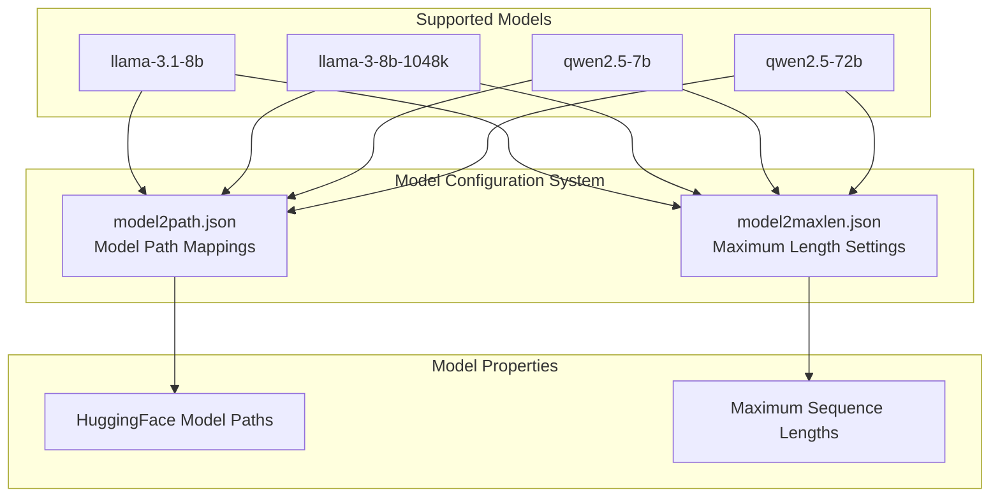
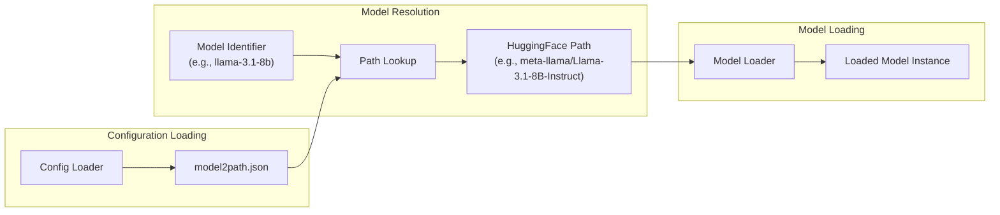
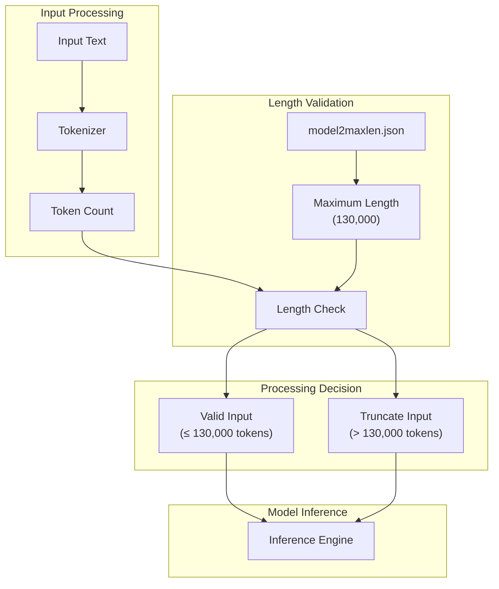
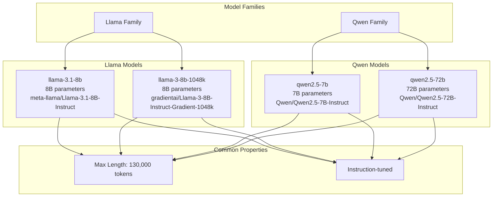
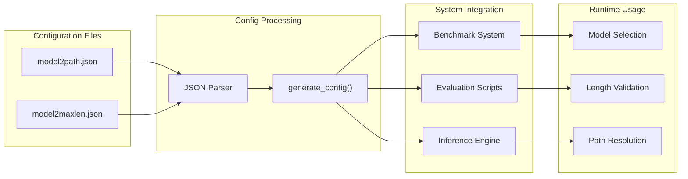

<!-- source: DeepWiki mcp.deepwiki.com · repo microsoft/RetrievalAttention · extra page Model Configuration · fetched 2026-10-26 -->

# Model Configuration

Relevant source files

The following files were used as context for generating this wiki page:

- [benchmark/LongBench/config/model2maxlen.json](benchmark/LongBench/config/model2maxlen.json)
- [benchmark/LongBench/config/model2path.json](benchmark/LongBench/config/model2path.json)

This document covers the model configuration system used by RetroInfer, which defines model path mappings and maximum sequence length settings for supported language models. The configuration enables the system to locate and properly configure different model variants for inference and evaluation.

For information about dataset-specific configurations, see [Dataset Configuration](#4.2.2). For general setup instructions, see [Environment Setup](#4.1).

## Configuration Files Overview

The model configuration system consists of two primary JSON configuration files that define model metadata and constraints:

Sources: [benchmark/LongBench/config/model2path.json:1-6](), [benchmark/LongBench/config/model2maxlen.json:1-6]()

## Model Path Configuration

The `model2path.json` file maps internal model identifiers to their corresponding HuggingFace model repository paths. This configuration enables the system to resolve model names to their actual locations for loading.

### Configuration Structure

| Model Identifier | HuggingFace Path |
|------------------|------------------|
| `llama-3-8b-1048k` | `gradientai/Llama-3-8B-Instruct-Gradient-1048k` |
| `llama-3.1-8b` | `meta-llama/Llama-3.1-8B-Instruct` |
| `qwen2.5-7b` | `Qwen/Qwen2.5-7B-Instruct` |
| `qwen2.5-72b` | `Qwen/Qwen2.5-72B-Instruct` |

### Path Resolution Flow

Sources: [benchmark/LongBench/config/model2path.json:1-6]()

## Maximum Length Configuration

The `model2maxlen.json` file defines the maximum sequence length for each model during inference and evaluation. This configuration ensures that input sequences do not exceed model-specific constraints.

### Length Specifications

All currently supported models are configured with a maximum sequence length of 130,000 tokens:

| Model | Maximum Length |
|-------|----------------|
| `llama-3-8b-1048k` | 130,000 |
| `llama-3.1-8b` | 130,000 |
| `qwen2.5-7b` | 130,000 |
| `qwen2.5-72b` | 130,000 |

### Length Validation Process

Sources: [benchmark/LongBench/config/model2maxlen.json:1-6]()

## Supported Models

The configuration system currently supports four language models across two model families:

### Llama Models

- **llama-3.1-8b**: Meta's Llama 3.1 8B Instruct model
- **llama-3-8b-1048k**: Gradient AI's extended-context Llama 3 8B model with 1M+ token support

### Qwen Models

- **qwen2.5-7b**: Qwen 2.5 7B Instruct model
- **qwen2.5-72b**: Qwen 2.5 72B Instruct model

### Model Characteristics

Sources: [benchmark/LongBench/config/model2path.json:1-6](), [benchmark/LongBench/config/model2maxlen.json:1-6]()

## Configuration Integration

The model configuration files are integrated into the broader RetroInfer system through the benchmarking and evaluation framework. The configuration system provides a centralized way to manage model metadata across different evaluation scenarios.

### Configuration Loading Workflow

Sources: [benchmark/LongBench/config/model2path.json:1-6](), [benchmark/LongBench/config/model2maxlen.json:1-6]()

## Usage Context

The model configuration system serves as the foundation for:

- **Benchmark Evaluation**: Defining which models to evaluate and their constraints
- **Inference Setup**: Resolving model paths for loading and initialization
- **Input Validation**: Ensuring input sequences respect model-specific length limits
- **Multi-model Support**: Enabling seamless switching between different model variants

The configuration files are located in the `benchmark/LongBench/config/` directory and are automatically loaded by the evaluation and inference systems when needed.

Sources: [benchmark/LongBench/config/model2path.json:1-6](), [benchmark/LongBench/config/model2maxlen.json:1-6]()

---

