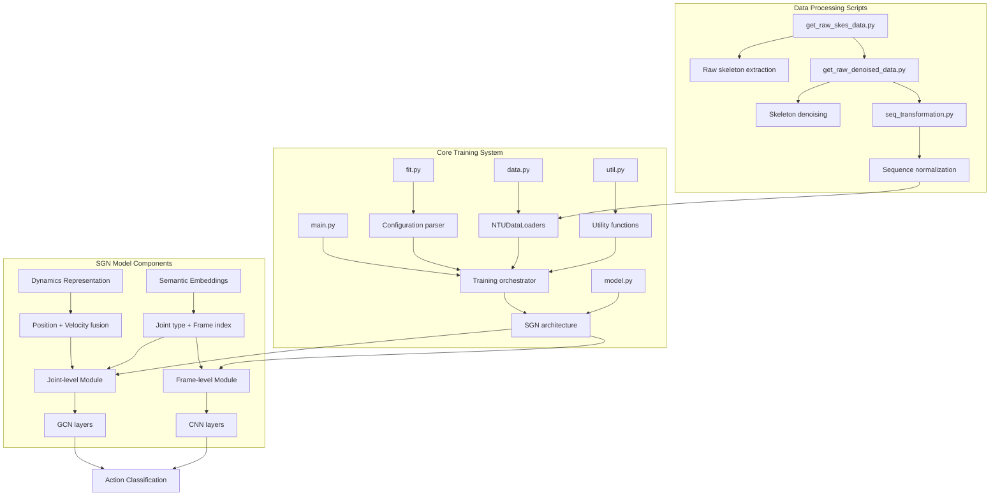
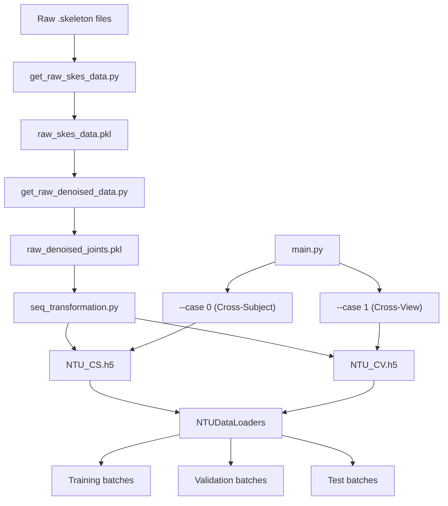

<!-- source: DeepWiki mcp.deepwiki.com · repo microsoft/SGN · page 1 Overview · fetched 2026-10-26 -->

# Overview

Relevant source files

The following files were used as context for generating this wiki page:

- [README.md](README.md)

## Purpose and Scope

This document provides a comprehensive overview of the Semantics-Guided Neural Networks (SGN) repository, a PyTorch-based implementation for skeleton-based human action recognition. SGN introduces semantic information (joint types and frame indices) alongside 3D coordinates to achieve state-of-the-art performance with significantly reduced model parameters compared to existing methods.

The overview covers the system's architecture, key innovations, data processing pipeline, and core components. For detailed information about specific subsystems, see [SGN Model Architecture](#2), [Data Pipeline](#3), [Training and Inference](#4), and [Pre-trained Models](#5).

Sources: [README.md:1-95]()

## What is SGN

SGN (Semantics-Guided Neural Networks) is a deep learning framework that addresses skeleton-based human action recognition by explicitly incorporating high-level semantic information into the neural network architecture. Unlike traditional approaches that rely solely on 3D joint coordinates, SGN enhances feature representation by integrating joint type semantics and temporal frame indices.

The system achieves state-of-the-art performance on the NTU-RGB+D dataset while maintaining an order of magnitude smaller model size than competing methods. SGN processes skeleton sequences through two hierarchical modules: a `joint-level module` for modeling spatial correlations between joints within frames, and a `frame-level module` for capturing temporal dependencies across frames.

Sources: [README.md:1-13]()

## System Architecture

The SGN system follows a modular architecture that separates data processing, model training, and inference into distinct components:

**System Architecture Overview**
Sources: [README.md:17-21](), [README.md:28-62]()

## Data Processing Pipeline

The data processing pipeline transforms raw NTU-RGB+D skeleton files into training-ready datasets through a three-stage process:

**Data Processing and Loading Pipeline**
Sources: [README.md:28-42]()

## Key Components

The SGN system consists of several interconnected components that work together to process skeleton data and perform action recognition:

| Component | File | Purpose |
|-----------|------|---------|
| Training Controller | `main.py` | Orchestrates training/testing process |
| Model Architecture | `model.py` | Implements SGN neural network |
| Data Loading | `data.py` | Handles dataset loading and batching |
| Configuration | `fit.py` | Parses command-line arguments |
| Utilities | `util.py` | Provides helper functions |
| Raw Data Extraction | `get_raw_skes_data.py` | Processes skeleton files |
| Data Denoising | `get_raw_denoised_data.py` | Removes noisy skeletons |
| Sequence Transform | `seq_transformation.py` | Normalizes and splits data |

The `main.py` script serves as the entry point, accepting parameters like `--network SGN`, `--train 1/0`, and `--case 0/1` to control training mode and evaluation protocol (Cross-Subject vs Cross-View).

Sources: [README.md:45-62]()

## SGN Model Innovation

SGN introduces two key innovations that distinguish it from coordinate-only approaches:

1. **Semantic Integration**: The model explicitly incorporates joint type semantics and frame index information alongside 3D coordinates, enhancing the network's understanding of spatial-temporal structure.

2. **Hierarchical Processing**: SGN uses a two-module approach:
   - **Joint-level Module**: Employs three Graph Convolutional Network (GCN) layers to model spatial correlations between joints within the same frame
   - **Frame-level Module**: Uses two Convolutional Neural Network (CNN) layers to capture temporal dependencies across frames

The **Dynamics Representation (DR)** component fuses position and velocity information to create richer joint representations, while semantic embeddings provide additional context about joint types and temporal positions.

Sources: [README.md:5-6](), [README.md:17-21]()

## Performance Characteristics

SGN achieves state-of-the-art performance on the NTU-RGB+D dataset while maintaining computational efficiency. The model requires an order of magnitude fewer parameters than most existing methods, making it suitable for resource-constrained environments.

The system supports two standard evaluation protocols:
- **Cross-Subject (CS)**: Training and testing on different subjects
- **Cross-View (CV)**: Training and testing on different camera viewpoints

Pre-trained models are available in the `./results/NTU/SGN/` directory for immediate inference without training.

Sources: [README.md:10-13](), [README.md:56-62]()

---

