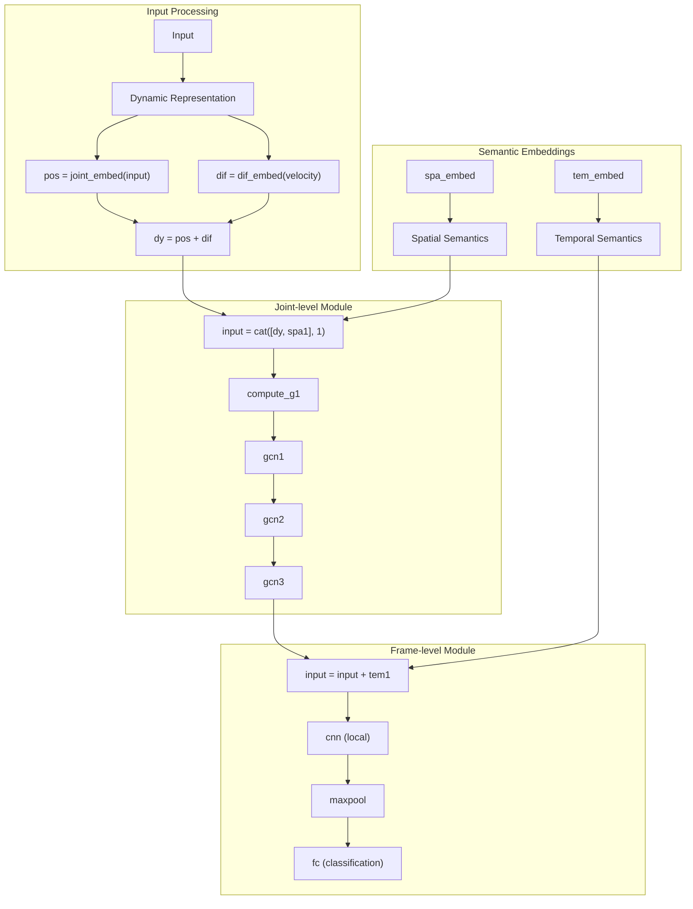
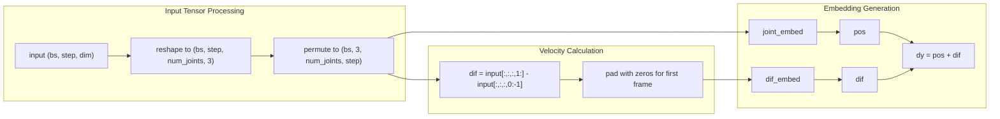
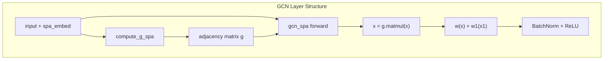
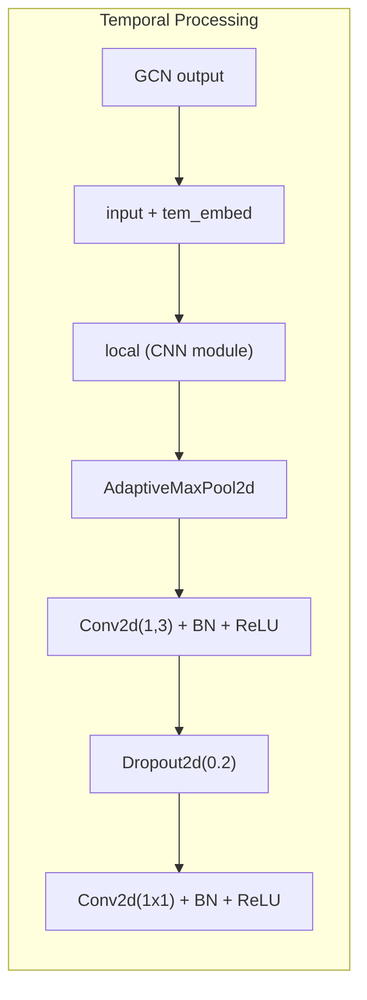
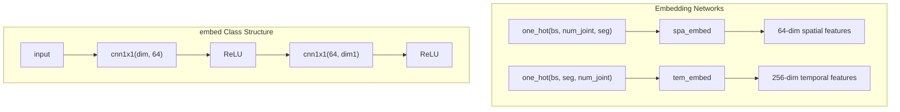
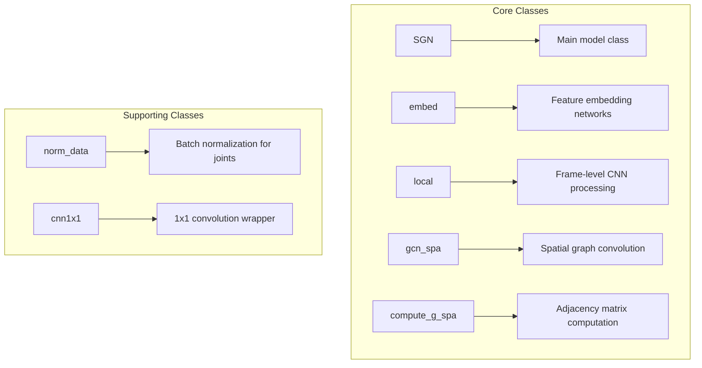

<!-- source: DeepWiki mcp.deepwiki.com · repo microsoft/SGN · page 2 SGN Model Architecture · fetched 2026-10-26 -->

# SGN Model Architecture

Relevant source files

The following files were used as context for generating this wiki page:

- [README.md](README.md)
- [images/framework.PNG](images/framework.PNG)
- [model.py](model.py)

This document provides a detailed technical explanation of the Semantics-Guided Neural Network (SGN) architecture implemented in the repository. It covers the core neural network components, data flow, and semantic embedding mechanisms that enable efficient skeleton-based human action recognition.

For information about training and inference procedures, see [Training and Inference](#4). For details about data preprocessing and loading, see [Data Pipeline](#3).

## Architecture Overview

The SGN model implements a two-stage hierarchical approach that processes skeleton sequences through joint-level and frame-level modules. The architecture explicitly incorporates semantic information alongside raw 3D coordinates to enhance feature representation capability.

**SGN Architecture Data Flow**

Sources: [model.py:49-77](), [README.md:17-21]()

## Dynamic Representation

The SGN model begins by computing a dynamic representation that fuses positional and velocity information for each joint. This creates a richer input representation compared to using only 3D coordinates.

**Dynamic Representation Computation**

The implementation extracts velocity information by computing frame-to-frame differences and pads the first frame with zeros. Both position and velocity are processed through separate embedding networks before fusion.

Sources: [model.py:51-62]()

## Joint-level Module

The joint-level module models spatial correlations between joints within the same frame using three Graph Convolutional Network (GCN) layers. It incorporates spatial semantic embeddings to provide joint type information.

| Component | Purpose | Implementation |
|-----------|---------|----------------|
| `compute_g1` | Computes adjacency matrix for GCN layers | [model.py:178-194]() |
| `gcn1` | First GCN layer (dim1//2 → dim1//2) | [model.py:34]() |
| `gcn2` | Second GCN layer (dim1//2 → dim1) | [model.py:35]() |
| `gcn3` | Third GCN layer (dim1 → dim1) | [model.py:36]() |

**GCN Layer Processing**

Each `gcn_spa` layer computes spatial relationships by matrix multiplication with a learned adjacency matrix, followed by linear transformations and normalization.

Sources: [model.py:64-68](), [model.py:161-176](), [model.py:178-194]()

## Frame-level Module

The frame-level module processes temporal dependencies by treating joints within each frame as a unified representation. It uses temporal semantic embeddings and convolutional layers to capture motion patterns.

**Frame-level Module Architecture**

The `local` class implements the frame-level processing with adaptive max pooling to handle variable sequence lengths, followed by temporal convolutions with batch normalization and dropout for regularization.

Sources: [model.py:69-71](), [model.py:138-159]()

## Semantic Embeddings

SGN incorporates two types of semantic information through dedicated embedding networks:

### Spatial Semantics (Joint Type)
- **Purpose**: Encodes which type of joint (e.g., head, hand, foot) is being processed
- **Implementation**: One-hot encoding with `spa_embed` network
- **Dimensions**: 25 joints → 64 features

### Temporal Semantics (Frame Index)  
- **Purpose**: Encodes temporal position information within the sequence
- **Implementation**: One-hot encoding with `tem_embed` network  
- **Dimensions**: Variable sequence length → 256 features

**Semantic Embedding Architecture**

Sources: [model.py:17-30](), [model.py:79-90](), [model.py:105-127]()

## Model Configuration

The SGN model is configured with the following key parameters:

| Parameter | Value | Purpose |
|-----------|-------|---------|
| `dim1` | 256 | Primary feature dimension |
| `num_joint` | 25 | Number of skeleton joints (NTU dataset) |
| `num_classes` | Variable | Action classes (60 for NTU60, 120 for NTU120) |

The model adapts batch sizes between training and testing modes, using the provided batch size during training and a fixed size of 160 (32×5) during inference.

## Implementation Classes

The SGN architecture consists of several specialized PyTorch modules:

**SGN Class Hierarchy**

| Class | Lines | Purpose |
|-------|-------|---------|
| `SGN` | [7-91]() | Main model orchestrating all components |
| `embed` | [105-127]() | Learnable embeddings with normalization |
| `local` | [138-159]() | Temporal CNN with adaptive pooling |
| `gcn_spa` | [161-176]() | Spatial graph convolution layer |
| `compute_g_spa` | [178-194]() | Dynamic adjacency matrix generation |

Sources: [model.py:1-195]()

---

