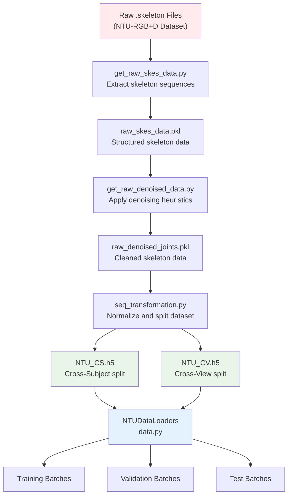
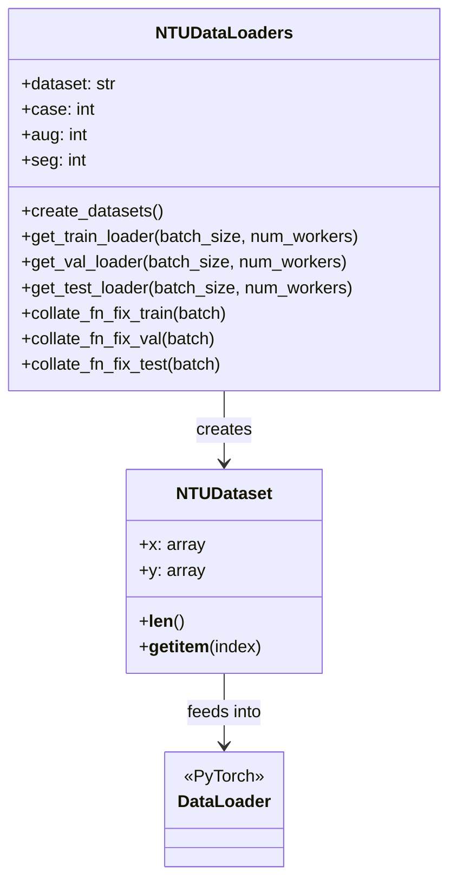

<!-- source: DeepWiki mcp.deepwiki.com · repo microsoft/SGN · page 3 Data Pipeline · fetched 2026-10-26 -->

# Data Pipeline

<details>
<summary>Relevant source files</summary>

The following files were used as context for generating this wiki page:

- [README.md](README.md)
- [data.py](data.py)

</details>


## Purpose and Scope

This document covers the complete data processing pipeline for the SGN (Semantics-Guided Neural Network) system, from raw NTU-RGB+D skeleton files to training-ready datasets. The pipeline transforms raw `.skeleton` files into structured HDF5 datasets optimized for skeleton-based action recognition training and evaluation.

For information about the SGN model architecture that consumes this processed data, see [SGN Model Architecture](#2). For details about the training process that uses these datasets, see [Training and Inference](#4).

## Pipeline Architecture

The data pipeline consists of four main stages: raw data extraction, denoising, sequence transformation, and data loading. Each stage produces intermediate artifacts that feed into the next stage.



**Sources:** [README.md:28-42](), [data.py:33-101]()

## Data Processing Stages

### Raw Data Extraction

The first stage extracts skeleton data from raw NTU-RGB+D `.skeleton` files using `get_raw_skes_data.py`. This script processes the binary skeleton files and structures them into a standardized format with skeleton sequences per performer.

**Key Operations:**
- Parse binary `.skeleton` file format
- Extract skeleton joint coordinates for each frame
- Group skeletons by performer and action sequence
- Output structured data to `raw_skes_data.pkl`

**Sources:** [README.md:36-37]()

### Data Denoising  

The `get_raw_denoised_data.py` script applies heuristic-based filtering to remove noisy skeleton data that could degrade model performance.

**Denoising Criteria:**
- Skeleton sequence length validation
- Joint coordinate spread analysis  
- Motion pattern consistency checks
- Output cleaned data to `raw_denoised_joints.pkl`

**Sources:** [README.md:38-39]()

### Sequence Transformation

The `seq_transformation.py` script performs the final preprocessing steps to create training-ready datasets:

**Transformations Applied:**
- Center skeleton sequences to first frame origin
- Normalize joint coordinates  
- Split dataset into Cross-Subject (CS) and Cross-View (CV) evaluation protocols
- Generate HDF5 files: `NTU_CS.h5` and `NTU_CV.h5`

**Sources:** [README.md:40-41](), [data.py:85]()

## Data Loading System

The data loading system is implemented through the `NTUDataLoaders` and `NTUDataset` classes, providing PyTorch-compatible data loaders with built-in augmentation and batch processing.



**Sources:** [data.py:22-43]()

### NTUDataLoaders Class

The `NTUDataLoaders` class [data.py:33-208]() serves as the main interface for loading NTU skeleton datasets. It handles dataset splitting, augmentation, and batch preparation.

**Key Parameters:**
- `dataset`: Dataset name (default: 'NTU')
- `case`: Evaluation protocol (0=Cross-Subject, 1=Cross-View)  
- `aug`: Data augmentation flag (0=disabled, 1=enabled)
- `seg`: Sequence segment length (default: 30 frames)

**Data Loader Methods:**
- `get_train_loader()` [data.py:44-52](): Returns training data loader with augmentation
- `get_val_loader()` [data.py:54-62](): Returns validation data loader  
- `get_test_loader()` [data.py:65-68](): Returns test data loader with multiple sampling

**Sources:** [data.py:33-77]()

### Dataset Creation and Loading

The `create_datasets()` method [data.py:79-101]() loads preprocessed HDF5 files and prepares train/validation/test splits:

```python
# Load HDF5 data based on evaluation protocol
if self.case == 0:
    self.metric = 'CS'  # Cross-Subject
elif self.case == 1: 
    self.metric = 'CV'  # Cross-View
path = osp.join('./data/ntu', 'NTU_' + self.metric + '.h5')
```

**Data Organization:**
- Training data: Combined original train + validation sets
- Validation data: Uses test set for validation during training
- Test data: Final evaluation set

**Sources:** [data.py:79-101]()

### Data Augmentation and Batch Processing

The system implements sophisticated batch processing with optional data augmentation through custom collate functions.

#### Training Batch Processing

The `collate_fn_fix_train()` method [data.py:102-132]() applies random rotations for data augmentation:

**Augmentation Parameters:**
- Cross-Subject (case=0): θ = 0.3 radians
- Cross-View (case=1): θ = 0.5 radians  

The `_transform()` function [data.py:262-273]() applies 3D rotations using rotation matrices computed by `_rot()` [data.py:239-260]().

**Sources:** [data.py:102-132](), [data.py:262-273]()

#### Sequence Processing

The `sub_seq()` method [data.py:177-207]() handles variable-length sequences:

**Processing Steps:**
1. Pad short sequences to minimum length (`seg` frames)
2. Sample fixed-length subsequences from longer sequences
3. Apply different sampling strategies for train/test phases

**Test-Time Augmentation:**
- Training: Single random sampling per sequence
- Testing: 5 different random samplings per sequence for ensemble prediction

**Sources:** [data.py:177-207]()

### Skeleton Data Format Processing  

The `turn_two_to_one()` function [data.py:227-237]() handles dual-person skeleton sequences by selecting the primary skeleton or splitting into separate sequences when both performers are active.

**Selection Logic:**
- If only one skeleton is active: Use the active skeleton
- If both skeletons are active: Use first skeleton or split into two sequences
- Zero-filled skeleton data is filtered out during processing

**Sources:** [data.py:227-237](), [data.py:161-175]()

## Data Storage and Formats

### HDF5 Dataset Structure

The processed datasets are stored in HDF5 format with the following structure:

| Dataset Key | Content | Shape |
|-------------|---------|-------|
| `x` | Training skeleton sequences | (N, T, 150) |
| `y` | Training action labels (one-hot) | (N, 60) |
| `valid_x` | Validation sequences | (M, T, 150) |
| `valid_y` | Validation labels | (M, 60) |
| `test_x` | Test sequences | (K, T, 150) |  
| `test_y` | Test labels | (K, 60) |

**Coordinate Format:**
- 150 dimensions = 2 skeletons × 25 joints × 3 coordinates (x,y,z)
- Variable sequence length T (padded/sampled to 30 frames)
- 60 action classes for NTU-RGB+D dataset

**Sources:** [data.py:87-94]()

### File Organization

The data pipeline expects and produces files in the following directory structure:

```
./data/ntu/
├── nturgb+d_skeletons/     # Raw .skeleton files
├── raw_skes_data.pkl       # Extracted skeleton data  
├── raw_denoised_joints.pkl # Denoised skeleton data
├── NTU_CS.h5              # Cross-Subject split
└── NTU_CV.h5              # Cross-View split
```

**Sources:** [README.md:32](), [data.py:85]()

---

