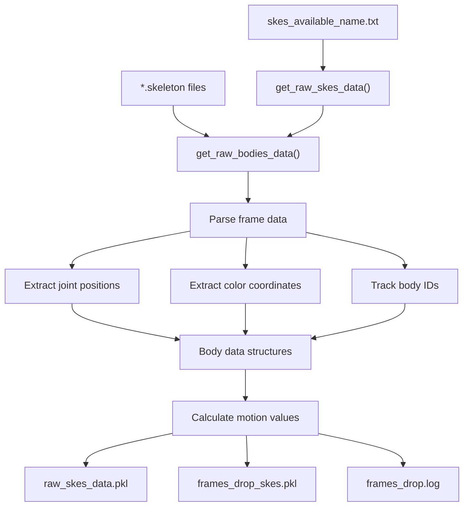
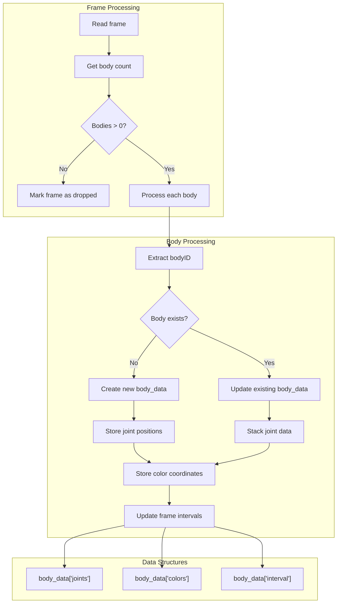
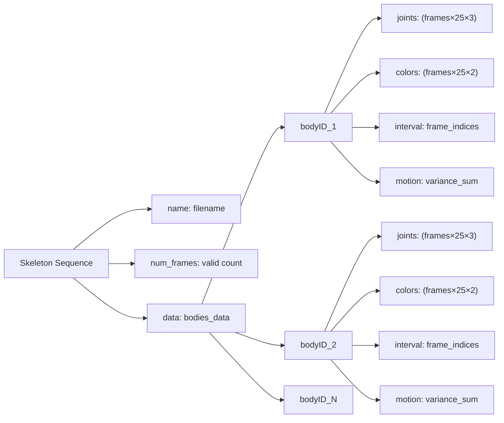
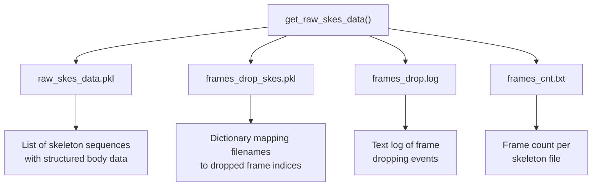

<!-- source: DeepWiki mcp.deepwiki.com · repo microsoft/SGN · page 3.1 Raw Data Extraction · fetched 2026-10-26 -->

# Raw Data Extraction

<details>
<summary>Relevant source files</summary>

The following files were used as context for generating this wiki page:

- [data/ntu/get_raw_skes_data.py](data/ntu/get_raw_skes_data.py)

</details>


This page documents the raw data extraction process that converts NTU-RGB+D `.skeleton` files into structured Python data for further processing. This is the first stage of the data pipeline that parses individual skeleton files, detects and tracks human bodies across frames, and creates organized data structures for subsequent denoising and transformation steps.

For information about cleaning the extracted data, see [Data Denoising](#3.2). For sequence processing and dataset creation, see [Sequence Transformation](#3.3).

## Process Overview

The raw data extraction system processes individual `.skeleton` files from the NTU-RGB+D dataset and converts them into structured Python dictionaries containing joint positions, color coordinates, and temporal information for each detected body.



Sources: [data/ntu/get_raw_skes_data.py:94-151]()

## Skeleton File Format

Each `.skeleton` file follows a specific text-based format containing frame-by-frame skeleton data:

| Component | Description | Data Type |
|-----------|-------------|-----------|
| Frame Count | Total number of frames in sequence | Integer |
| Body Count | Number of bodies detected per frame | Integer |
| Body ID | Unique identifier for tracked body | String |
| Joint Count | Number of joints per body (always 25) | Integer |
| Joint Data | 3D position (x,y,z) and 2D color coordinates | Float arrays |

The parser in `get_raw_bodies_data()` processes this format line by line, maintaining state to track bodies across frames.

Sources: [data/ntu/get_raw_skes_data.py:26-91]()

## Body Detection and Tracking



The system maintains continuity by tracking `bodyID` strings across frames. When a body appears in multiple frames, joint data is vertically stacked using `np.vstack()` to create temporal sequences.

Sources: [data/ntu/get_raw_skes_data.py:51-76]()

## Data Structure Organization

The extraction process creates nested dictionary structures for each skeleton sequence:



Each body's data contains:
- `joints`: 3D joint positions with shape `(num_frames, 25, 3)`
- `colors`: 2D color coordinates with shape `(num_frames, 25, 2)` 
- `interval`: List of frame indices where the body appears
- `motion`: Sum of joint position variances (for multi-body sequences only)

Sources: [data/ntu/get_raw_skes_data.py:14-25](), [data/ntu/get_raw_skes_data.py:64-76]()

## Motion Calculation

For sequences containing multiple bodies, the system calculates motion values to distinguish between more and less active performers:

```python
# Motion calculation for multi-body sequences
if len(bodies_data) > 1:
    for body_data in bodies_data.values():
        body_data['motion'] = np.sum(np.var(body_data['joints'], axis=0))
```

The motion metric computes the sum of variances across all joint positions over time, providing a scalar measure of movement intensity for each body.

Sources: [data/ntu/get_raw_skes_data.py:86-89]()

## Frame Dropping and Error Handling

The system handles missing or corrupted frame data through several mechanisms:

| Issue Type | Detection Method | Response |
|------------|------------------|----------|
| Empty Frames | `num_bodies == 0` | Add to `frames_drop` list |
| Missing Files | `osp.exists()` check | Assertion error with filename |
| All Frames Lost | `num_frames_drop < num_frames` | Assertion error with statistics |

Dropped frames are logged to `frames_drop.log` and stored in `frames_drop_skes.pkl` for analysis.

Sources: [data/ntu/get_raw_skes_data.py:43-84]()

## Output Files

The extraction process generates three primary output files:



- `raw_skes_data.pkl`: Main output containing structured skeleton data
- `frames_drop_skes.pkl`: Dictionary tracking dropped frames per file
- `frames_drop.log`: Detailed logging of frame dropping events
- `frames_cnt.txt`: Array of valid frame counts per skeleton file

Sources: [data/ntu/get_raw_skes_data.py:124-133](), [data/ntu/get_raw_skes_data.py:143-154]()

## Configuration and Execution

The extraction process requires several path configurations:

| Parameter | Default Value | Purpose |
|-----------|---------------|---------|
| `skes_path` | `./nturgb+d_skeletons/` | Directory containing `.skeleton` files |
| `save_data_pkl` | `./raw_data/raw_skes_data.pkl` | Output pickle file location |
| `frames_drop_pkl` | `./raw_data/frames_drop_skes.pkl` | Dropped frames output location |
| `skes_name_file` | `./statistics/skes_available_name.txt` | List of available skeleton files |

The main execution function `get_raw_skes_data()` processes all files listed in `skes_available_name.txt` and reports progress every 1000 files.

Sources: [data/ntu/get_raw_skes_data.py:135-151]()

---

