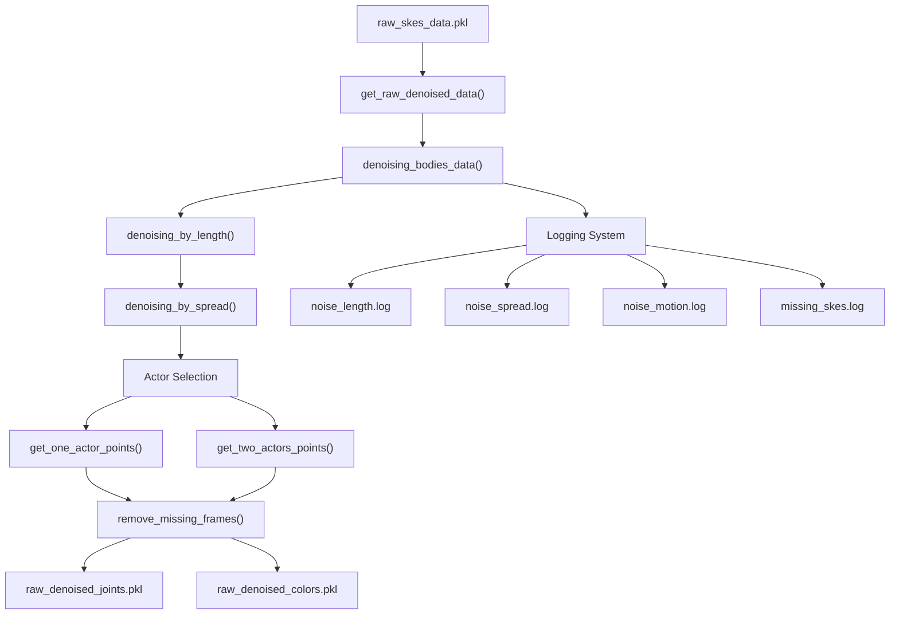
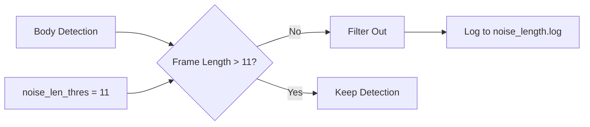
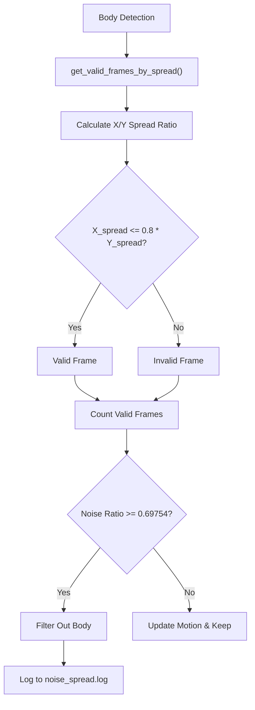
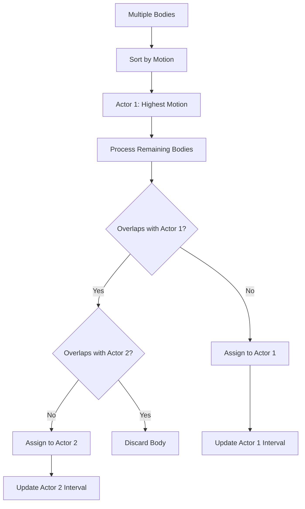

<!-- source: DeepWiki mcp.deepwiki.com · repo microsoft/SGN · page 3.2 Data Denoising · fetched 2026-10-26 -->

# Data Denoising

Relevant source files

The following files were used as context for generating this wiki page:

- [data/ntu/get_raw_denoised_data.py](data/ntu/get_raw_denoised_data.py)

This document describes the data denoising process that filters out noisy skeleton data from the NTU-RGB+D dataset using heuristic methods. The denoising step removes unreliable body detections and skeleton sequences based on frame length, coordinate spread patterns, and motion characteristics.

For information about raw data extraction that precedes this step, see [Raw Data Extraction](#3.1). For sequence transformation that follows denoising, see [Sequence Transformation](#3.3).

## Purpose and Scope

The denoising process addresses common issues in skeleton data extracted from depth sensors:
- False body detections with insufficient frame coverage
- Noisy skeleton tracks with unrealistic coordinate spreads  
- Static or overly dynamic body detections outside normal motion ranges
- Missing frame data that needs to be handled appropriately

The process takes structured skeleton data from `raw_skes_data.pkl` and produces cleaned skeleton sequences in `raw_denoised_joints.pkl` and `raw_denoised_colors.pkl`.

## Denoising Pipeline Overview

The denoising system in `get_raw_denoised_data.py` implements a multi-stage filtering approach:

Sources: [data/ntu/get_raw_denoised_data.py:367-436]()

## Denoising Methods

### Length-Based Filtering

The `denoising_by_length` function removes body detections with insufficient temporal coverage:

**Implementation Details:**
- Threshold: `noise_len_thres = 11` frames minimum
- Filters bodyID entries where `len(body_data['interval']) <= 11`
- Logs filtered detections with bodyID, motion value, and frame length

Sources: [data/ntu/get_raw_denoised_data.py:71-89](), [data/ntu/get_raw_denoised_data.py:25]()

### Spread-Based Filtering

The `denoising_by_spread` function analyzes coordinate spread patterns to identify unrealistic skeleton poses:

**Implementation Details:**
- Primary threshold: `noise_spr_thres1 = 0.8` for frame-level validation
- Secondary threshold: `noise_spr_thres2 = 0.69754` for body-level filtering
- Recalculates motion values for bodies that pass filtering
- Only applied when multiple bodies are present

Sources: [data/ntu/get_raw_denoised_data.py:92-146](), [data/ntu/get_raw_denoised_data.py:26-27]()

### Motion-Based Filtering (Currently Disabled)

The `denoising_by_motion` function filters based on motion thresholds but is currently disabled in the main pipeline:

**Threshold Configuration:**
- `noise_mot_thres_lo = 0.089925` (minimum motion)
- `noise_mot_thres_hi = 2` (maximum motion)
- Preserves the body with largest motion first
- Filters additional bodies outside the motion range

Sources: [data/ntu/get_raw_denoised_data.py:149-171](), [data/ntu/get_raw_denoised_data.py:28-29]()

## Actor Selection and Data Organization

The system handles single-actor and multi-actor scenarios differently:

### Single Actor Processing

For sequences with one body detection after denoising:
- Uses `get_one_actor_points()` to extract joint positions and color coordinates
- Creates 75-dimensional joint vectors (25 joints × 3 coordinates)
- Fills missing frames with zeros

### Multi-Actor Processing  

For sequences with multiple body detections:
- Selects up to two main actors based on motion and temporal overlap
- Uses `get_two_actors_points()` to organize data into 150-dimensional vectors
- Applies interval-based logic to avoid overlapping assignments
- Records detailed actor information in text files

Sources: [data/ntu/get_raw_denoised_data.py:290-364](), [data/ntu/get_raw_denoised_data.py:223-235]()

## Missing Frame Handling

The `remove_missing_frames` function processes sequences with incomplete data:

**Processing Logic:**
- Identifies frames where all joint coordinates are zero
- For two-actor sequences, logs missing frame statistics separately per actor
- Removes completely missing frames from the sequence
- Updates color coordinate arrays with NaN values for missing data

**Logging Categories:**
- `missing_skes.log`: General missing frame statistics
- `missing_skes_1.log`: Actor 1 missing frame details  
- `missing_skes_2.log`: Actor 2 missing frame details

Sources: [data/ntu/get_raw_denoised_data.py:238-278]()

## Output Files and Logging

### Data Output Files

| File | Content | Format |
|------|---------|--------|
| `raw_denoised_joints.pkl` | Joint coordinate sequences | List of numpy arrays (N×75 or N×150) |
| `raw_denoised_colors.pkl` | Color coordinate sequences | List of numpy arrays (N×1×25×2 or N×2×25×2) |
| `frames_cnt.txt` | Frame counts per sequence | Text file with integer counts |

### Logging Files

| File | Purpose | Content |
|------|---------|---------|
| `noise_length.log` | Length-based filtering | Skeleton name, bodyID, motion, length |
| `noise_spread.log` | Spread-based filtering | Skeleton name, bodyID, motion, noise ratio |
| `noise_motion.log` | Motion-based filtering | Skeleton name, bodyID, motion value |
| `missing_skes.log` | Missing frame summary | Skeleton name, total frames, missing count |
| `denoised_failed_1.log` | Single-actor denoising failures | Skeleton names |
| `denoised_failed_2.log` | Multi-actor denoising failures | Skeleton names |

### Actor Information Files

Individual text files in `actors_info/` directory contain detailed information for each sequence including:
- Body IDs and their temporal intervals
- Motion values for each body
- Applied filtering operations
- Final actor assignments

Sources: [data/ntu/get_raw_denoised_data.py:420-433](), [data/ntu/get_raw_denoised_data.py:31-68](), [data/ntu/get_raw_denoised_data.py:361-362]()

---

