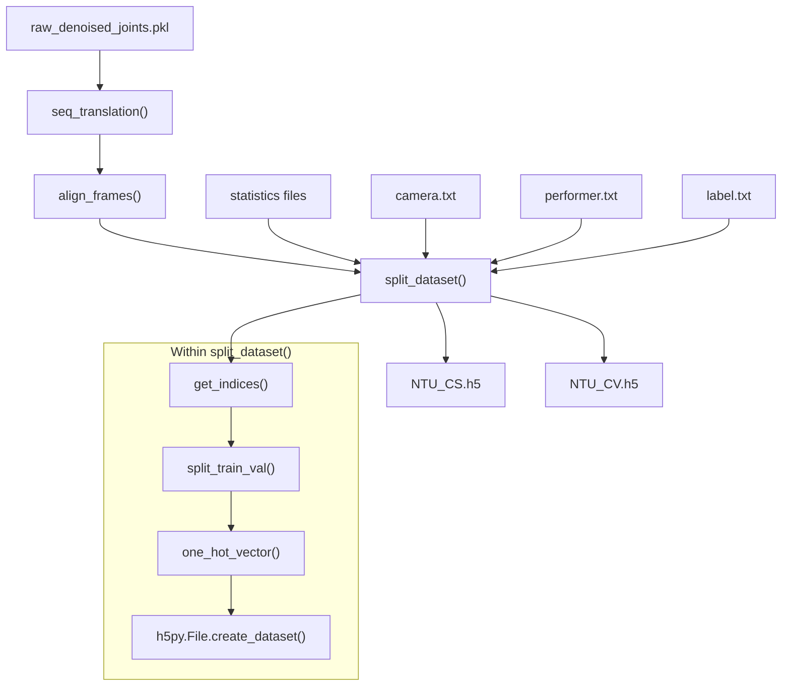
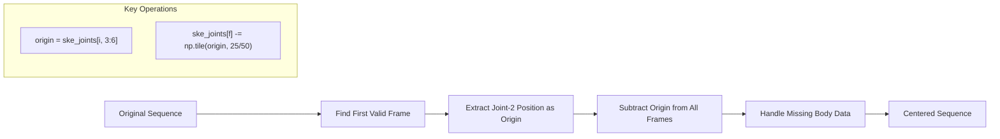
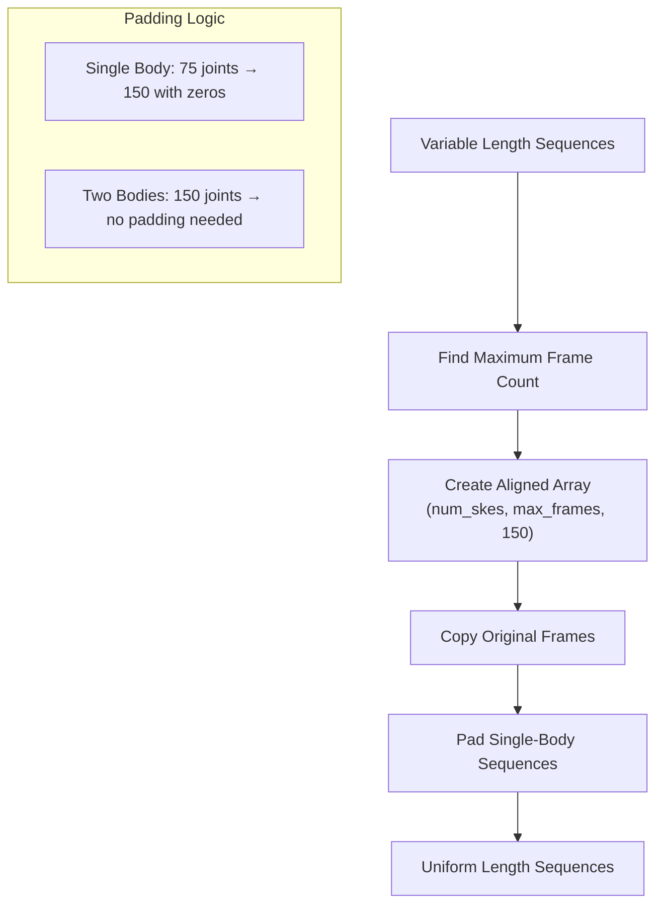
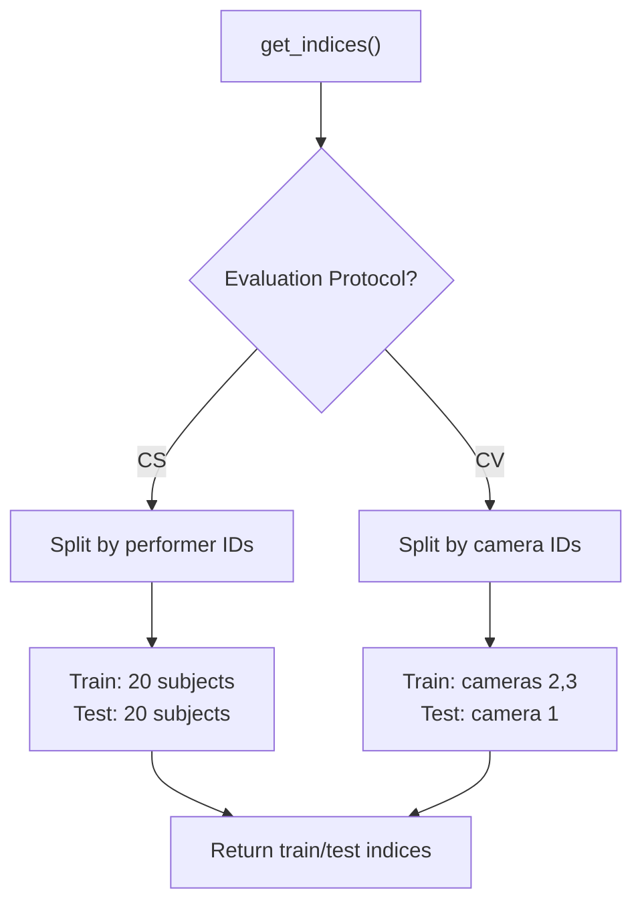
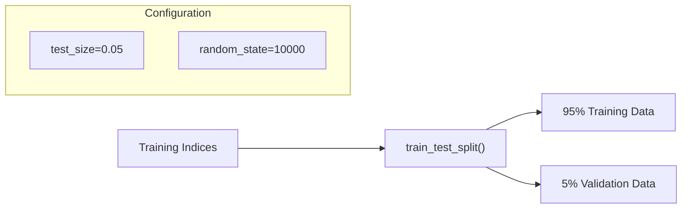

<!-- source: DeepWiki mcp.deepwiki.com · repo microsoft/SGN · page 3.3 Sequence Transformation · fetched 2026-10-26 -->

# Sequence Transformation

Relevant source files

The following files were used as context for generating this wiki page:

- [data/ntu/seq_transformation.py](data/ntu/seq_transformation.py)

## Purpose and Scope

This page documents the sequence transformation stage of the data pipeline, which takes denoised skeleton data and applies normalization, centering, and frame alignment operations to prepare it for training. The transformation process also handles dataset splitting into Cross-Subject (CS) and Cross-View (CV) evaluation protocols, producing the final HDF5 datasets used by the training system.

For information about the preceding denoising stage, see [Data Denoising](#3.2). For details about how the processed data is loaded during training, see [Data Loading System](#3.4).

## Transformation Pipeline Overview

The sequence transformation process implements a multi-stage pipeline that converts denoised skeleton sequences into training-ready datasets. The main script coordinates several transformation operations before splitting and saving the data.

**Sources:** [data/ntu/seq_transformation.py:219-236]()

## Sequence Centering and Translation

The transformation pipeline applies two types of centering operations to normalize skeleton sequences and remove positional variance that would interfere with action recognition.

### Sequence-Level Translation

The `seq_translation()` function centers entire sequences by translating all frames relative to the spine base joint (joint-2) position from the first valid frame. This removes global positional differences between sequences.

**Sources:** [data/ntu/seq_transformation.py:44-76]()

### Frame-Level Translation

The `frame_translation()` function applies per-frame normalization by scaling each frame based on the distance between spine base (joint-1) and spine (joint-21) joints. This normalizes for body size and posture variations.

| Operation | Description | Code Reference |
|-----------|-------------|----------------|
| Distance Calculation | Compute spine length per frame | `dist = np.sqrt(((j1 - j21) ** 2).sum(axis=1))` |
| Origin Setting | Use joint-2 as frame origin | `origin = ske_joints[f, 3:6]` |
| Scaling | Normalize by spine distance | `(ske_joints[f] - origin) / dist[f] + origin` |
| NaN Handling | Remove invalid frames | `remove_nan_frames()` |

**Sources:** [data/ntu/seq_transformation.py:79-106]()

## Frame Alignment

The `align_frames()` function ensures all sequences have uniform length by padding shorter sequences and maintaining the maximum frame count across the dataset.

The alignment process creates a standardized `(num_sequences, max_frames, 150)` tensor where each sequence has 150 joint coordinates (75 per body × 2 bodies) and the same temporal length.

**Sources:** [data/ntu/seq_transformation.py:109-127]()

## Dataset Splitting Protocols

The system implements two standard evaluation protocols used in skeleton-based action recognition research, each requiring different train/test data splits.

### Cross-Subject (CS) Protocol

The Cross-Subject protocol splits data based on performer IDs, ensuring that subjects in the test set never appear in the training set.

| Split | Subject IDs |
|-------|-------------|
| Training | 1, 2, 4, 5, 8, 9, 13, 14, 15, 16, 17, 18, 19, 25, 27, 28, 31, 34, 35, 38 |
| Testing | 3, 6, 7, 10, 11, 12, 20, 21, 22, 23, 24, 26, 29, 30, 32, 33, 36, 37, 39, 40 |

### Cross-View (CV) Protocol

The Cross-View protocol splits data based on camera angles, testing the model's ability to generalize across different viewpoints.

| Split | Camera IDs |
|-------|------------|
| Training | 2, 3 |
| Testing | 1 |

**Sources:** [data/ntu/seq_transformation.py:185-216]()

## Output Format and Data Organization

The transformation process creates HDF5 files containing organized datasets for training, validation, and testing. Each protocol generates a separate file with standardized structure.

### HDF5 Dataset Structure

| Dataset Key | Description | Shape | Data Type |
|-------------|-------------|-------|-----------|
| `x` | Training sequences | `(n_train, max_frames, 150)` | float32 |
| `y` | Training labels (one-hot) | `(n_train, 60)` | float32 |
| `valid_x` | Validation sequences | `(n_val, max_frames, 150)` | float32 |
| `valid_y` | Validation labels (one-hot) | `(n_val, 60)` | float32 |
| `test_x` | Test sequences | `(n_test, max_frames, 150)` | float32 |
| `test_y` | Test labels (one-hot) | `(n_test, 60)` | float32 |

### Validation Set Creation

The system creates a validation set by randomly sampling 5% of the training data using `split_train_val()` with a fixed random seed for reproducibility.

**Sources:** [data/ntu/seq_transformation.py:139-153](), [data/ntu/seq_transformation.py:156-183]()

## Execution Workflow

The main execution block coordinates the entire transformation pipeline:

1. **Load Metadata**: Read camera IDs, performer IDs, labels, and frame counts from statistics files
2. **Load Skeleton Data**: Deserialize denoised skeleton sequences from pickle file
3. **Apply Transformations**: Execute sequence translation and frame alignment
4. **Generate Datasets**: Create both CS and CV protocol datasets with train/validation/test splits
5. **Save Results**: Write HDF5 files containing processed data ready for training

**Sources:** [data/ntu/seq_transformation.py:219-236]()

---

