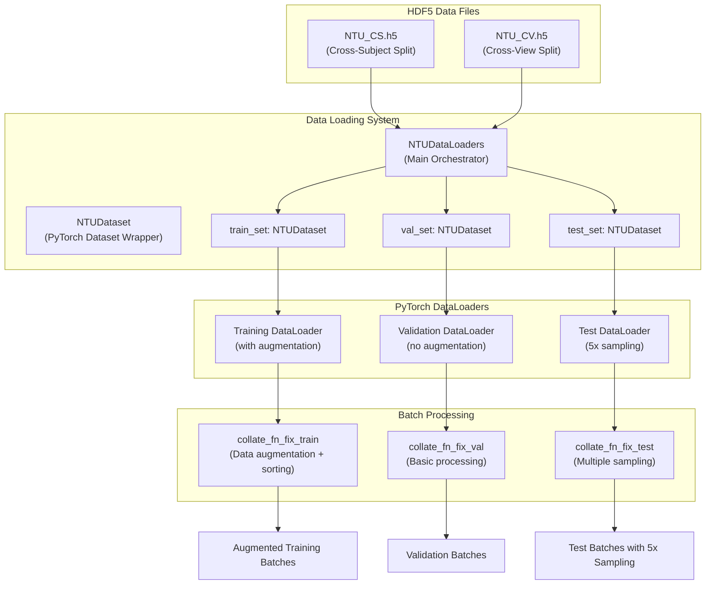
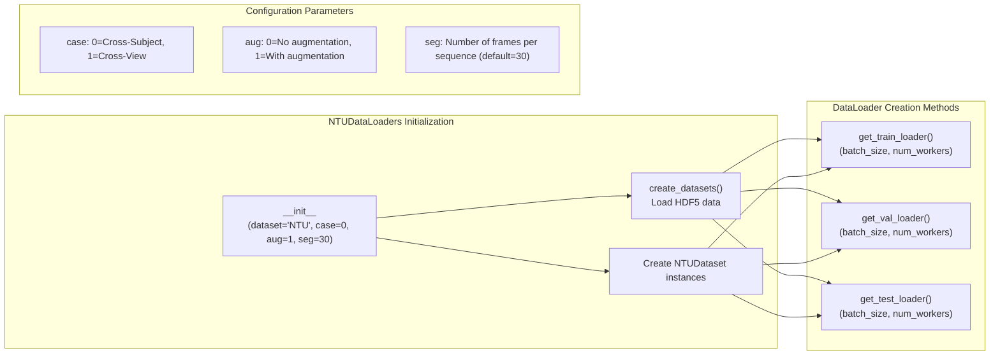
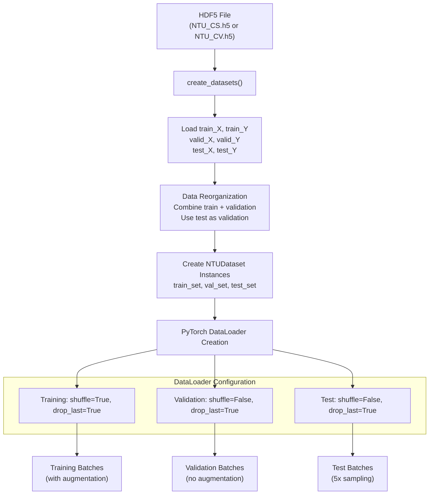
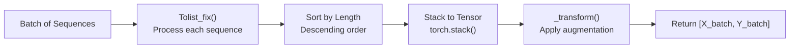

<!-- source: DeepWiki mcp.deepwiki.com · repo microsoft/SGN · page 3.4 Data Loading System · fetched 2026-10-26 -->

# Data Loading System

<details>
<summary>Relevant source files</summary>

The following files were used as context for generating this wiki page:

- [data.py](data.py)

</details>


## Purpose and Scope

The Data Loading System is responsible for creating PyTorch DataLoaders that efficiently feed processed skeleton data to the SGN model during training and evaluation. This system takes the transformed HDF5 files produced by the data pipeline and converts them into batched tensors with appropriate data augmentation and preprocessing.

For information about the data processing steps that precede this system, see [Raw Data Extraction](#3.1), [Data Denoising](#3.2), and [Sequence Transformation](#3.3). For details about how this data is consumed during training, see [Training Process](#4.2).

## System Architecture Overview

The data loading system consists of two main classes that work together to provide training-ready data batches:



**Sources:** [data.py:1-274]()

## Core Components

### NTUDataset Class

The `NTUDataset` class is a lightweight PyTorch Dataset wrapper that stores skeleton sequences and their corresponding labels:

| Method | Purpose | Return Type |
|--------|---------|-------------|
| `__init__(x, y)` | Initialize with skeleton data `x` and labels `y` | - |
| `__len__()` | Return dataset size | `int` |
| `__getitem__(index)` | Get sample at index | `[sequence, label]` |

The class performs minimal processing, simply storing the data and converting labels to integers.

**Sources:** [data.py:22-31]()

### NTUDataLoaders Class

The `NTUDataLoaders` class is the main orchestrator that manages data loading configuration and creates PyTorch DataLoaders:



**Sources:** [data.py:33-77]()

## Data Loading Pipeline

The data loading process follows this sequence:



The system reorganizes the original train/validation/test splits by combining the original training and validation sets into a new training set, and using the original test set as the validation set during training.

**Sources:** [data.py:79-101]()

## Data Processing and Augmentation

### Sequence Processing Pipeline

Each skeleton sequence undergoes several processing steps before being fed to the model:

```mermaid
graph TD
    A["Raw Sequence<br/>Shape: (frames, 150)"] --> B["Remove Zero Rows<br/>Filter out empty frames"]
    B --> C["turn_two_to_one()<br/>Handle dual-person sequences"]
    C --> D["sub_seq()<br/>Temporal segmentation"]
    
    subgraph "Sequence Segmentation (sub_seq)"
        E["Pad short sequences<br/>to minimum length"]
        F["Calculate frame offsets<br/>based on segment count"]
        G{"Training Mode?"}
        G -->|Yes| H["Single random sampling<br/>per segment"]
        G -->|No (Test)| I["5x random sampling<br/>per segment"]
    end
    
    D --> E
    E --> F
    F --> G
    H --> J["Single Segmented Sequence"]
    I --> K["5 Segmented Sequences<br/>(Test-time augmentation)"]
```

**Sources:** [data.py:161-207](), [data.py:227-237]()

### Data Augmentation Transform

During training, sequences undergo 3D rotation augmentation:

| Component | Function | Purpose |
|-----------|----------|---------|
| `_transform(x, theta)` | Apply random 3D rotations | Data augmentation for training |
| `_rot(rot)` | Generate rotation matrices | Create 3D rotation transformations |
| `theta` | Rotation range parameter | 0.3 for Cross-Subject, 0.5 for Cross-View |

The augmentation applies random rotations around all three axes (X, Y, Z) to increase data diversity and improve model generalization.

**Sources:** [data.py:239-273]()

## Batch Processing and Collation

The system uses different collate functions for different data splits:

### Training Collation (`collate_fn_fix_train`)



- Sorts sequences by length in descending order for efficient RNN processing
- Applies data augmentation with rotation parameter `theta`
- Uses `pin_memory=True` for faster GPU transfer

**Sources:** [data.py:102-132]()

### Validation Collation (`collate_fn_fix_val`)

- No sequence sorting by length
- No data augmentation applied  
- Maintains original sequence order
- Used for both validation and some test scenarios

**Sources:** [data.py:134-145]()

### Test Collation (`collate_fn_fix_test`)

- Generates 5 different samplings per sequence for test-time augmentation
- No data augmentation (rotation) applied
- Used for final model evaluation

**Sources:** [data.py:147-159]()

## Configuration Parameters

The `NTUDataLoaders` class accepts several configuration parameters:

| Parameter | Values | Description |
|-----------|--------|-------------|
| `dataset` | `'NTU'` | Dataset type (currently supports NTU) |
| `case` | `0` or `1` | 0: Cross-Subject split, 1: Cross-View split |
| `aug` | `0` or `1` | 0: No augmentation, 1: With augmentation |
| `seg` | `int` (default: 30) | Number of frames per sequence segment |

The system automatically determines the appropriate HDF5 file path and augmentation parameters based on these settings.

**Sources:** [data.py:34-38](), [data.py:80-85](), [data.py:119-126]()

---

