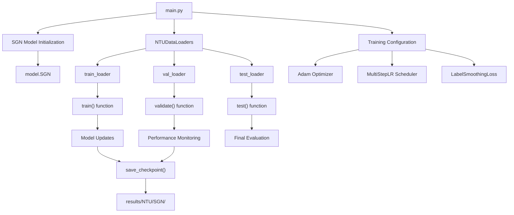
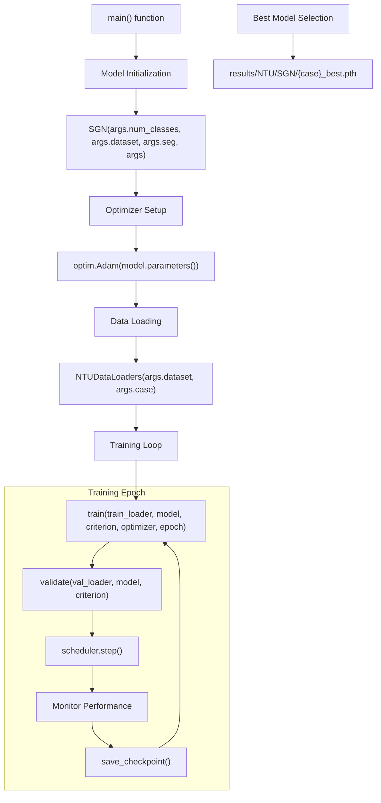
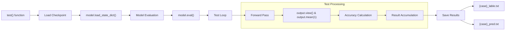
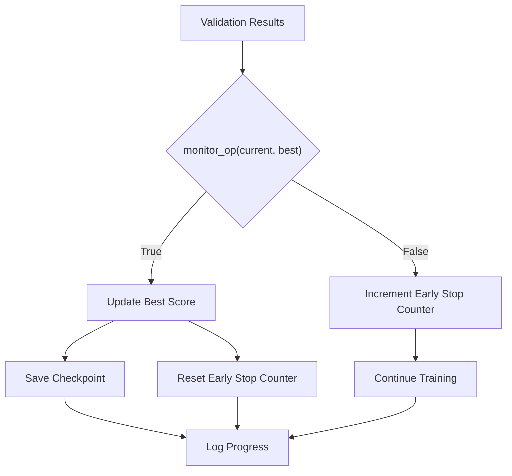

<!-- source: DeepWiki mcp.deepwiki.com · repo microsoft/SGN · page 4 Training and Inference · fetched 2026-10-26 -->

# Training and Inference

<details>
<summary>Relevant source files</summary>

The following files were used as context for generating this wiki page:

- [README.md](README.md)
- [main.py](main.py)

</details>


This document covers the training and inference processes for SGN (Semantics-Guided Neural Networks) models, including command-line usage, training workflows, model evaluation, and checkpointing mechanisms. The training process transforms preprocessed skeleton data into trained action recognition models, while inference applies these models to classify new skeleton sequences.

For detailed configuration parameters, see [Configuration System](#4.1). For step-by-step training procedures, see [Training Process](#4.2). For evaluation protocols and testing procedures, see [Model Evaluation and Testing](#4.3).

## Training and Inference Pipeline Overview

The SGN training and inference system is orchestrated through the `main.py` script, which coordinates data loading, model training, validation, and testing phases. The system supports both Cross-Subject (CS) and Cross-View (CV) evaluation protocols on the NTU-RGB+D dataset.



**Training and Inference Architecture**

Sources: [main.py:1-277](), [README.md:45-62]()

## Command-Line Interface

The system provides a unified command-line interface through `main.py` with support for both training and testing modes:

### Training Commands

| Protocol | Command |
|----------|---------|
| Cross-Subject (CS) | `python main.py --network SGN --train 1 --case 0` |
| Cross-View (CV) | `python main.py --network SGN --train 1 --case 1` |

### Testing Commands

| Protocol | Command |
|----------|---------|
| Cross-Subject (CS) | `python main.py --network SGN --train 0 --case 0` |
| Cross-View (CV) | `python main.py --network SGN --train 0 --case 1` |

The `--train` parameter controls the execution mode: `1` for training, `0` for testing. The `--case` parameter selects the evaluation protocol: `0` for Cross-Subject, `1` for Cross-View.

Sources: [README.md:45-62](), [main.py:23-40]()

## Training Workflow

The training process follows a structured workflow implemented in the `main()` function, with separate training and validation loops:



**Training Workflow Components**

### Core Training Components

The training system consists of several key components:

- **Model**: `SGN` class instantiated with dataset-specific parameters
- **Loss Function**: `LabelSmoothingLoss` with 0.1 smoothing factor
- **Optimizer**: Adam optimizer with learning rate 0.001 and weight decay 0.0001
- **Scheduler**: `MultiStepLR` with milestones at epochs 60, 90, 110 and gamma 0.1
- **Monitoring**: Validation accuracy (`val_acc`) or validation loss (`val_loss`)

### Training Loop Implementation

The `train()` function implements the core training logic:

```python
# Key training steps from main.py
def train(train_loader, model, criterion, optimizer, epoch):
    # Forward pass: output = model(inputs.cuda())
    # Loss calculation: loss = criterion(output, target)
    # Backward pass: loss.backward()
    # Parameter update: optimizer.step()
```

Sources: [main.py:42-151](), [main.py:153-180]()

## Inference Workflow

The inference process loads trained model checkpoints and evaluates them on test data:



**Inference Pipeline**

The `test()` function performs model evaluation by:

1. Loading the best checkpoint from validation: `torch.load(checkpoint)['state_dict']`
2. Setting model to evaluation mode: `model.eval()`
3. Processing test batches with gradient computation disabled: `torch.no_grad()`
4. Averaging predictions across multiple views: `output.mean(1)`
5. Computing accuracy metrics: `accuracy(output.data, target)`
6. Saving predictions and labels to text files

Sources: [main.py:203-233]()

## Model Checkpointing and Evaluation Protocols

### Checkpoint Management

The system implements comprehensive model checkpointing through the `save_checkpoint()` function:

| Checkpoint Component | Description |
|---------------------|-------------|
| `epoch` | Current training epoch |
| `state_dict` | Model parameters |
| `best` | Best validation metric |
| `monitor` | Monitoring metric name |
| `optimizer` | Optimizer state |

Checkpoints are saved to `results/NTU/SGN/{case}_best.pth` when validation performance improves.

### Evaluation Protocols

The system supports two standard evaluation protocols for NTU-RGB+D:

| Protocol | Case | Description | Data Split |
|----------|------|-------------|------------|
| Cross-Subject (CS) | `case=0` | Train/test split by subject ID | Subjects 1-20 (train), 21-40 (test) |
| Cross-View (CV) | `case=1` | Train/test split by camera view | Views 2,3 (train), View 1 (test) |

### Performance Monitoring

The training process monitors validation metrics and implements early stopping logic:



**Performance Monitoring Logic**

The system tracks training progress through CSV logs (`{case}_log.csv`) containing:
- Training loss and accuracy
- Validation loss and accuracy  
- Per-epoch performance metrics

Sources: [main.py:84-144](), [main.py:244-247]()

## Label Smoothing and Accuracy Calculation

The training process uses a custom `LabelSmoothingLoss` implementation with 0.1 smoothing factor to improve generalization. The `accuracy()` function computes top-1 accuracy by comparing predicted class indices with ground truth labels.

The system's modular design separates concerns between data loading ([Data Loading System](#3.4)), model architecture ([SGN Model Architecture](#2)), and training orchestration, enabling flexible experimentation with different configurations and evaluation protocols.

Sources: [main.py:258-272](), [main.py:235-242]()

---

