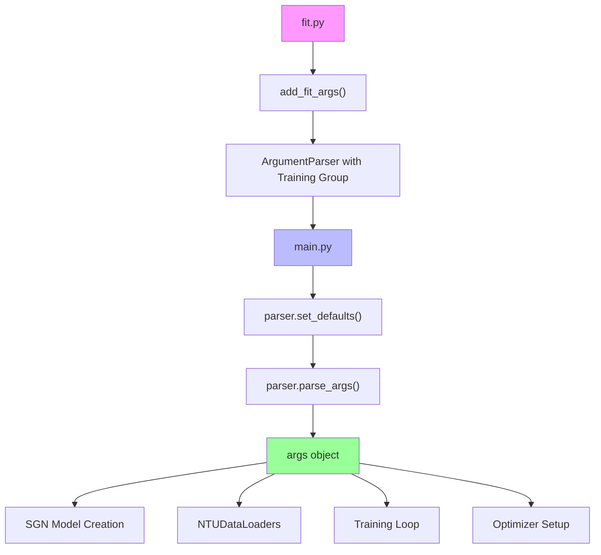
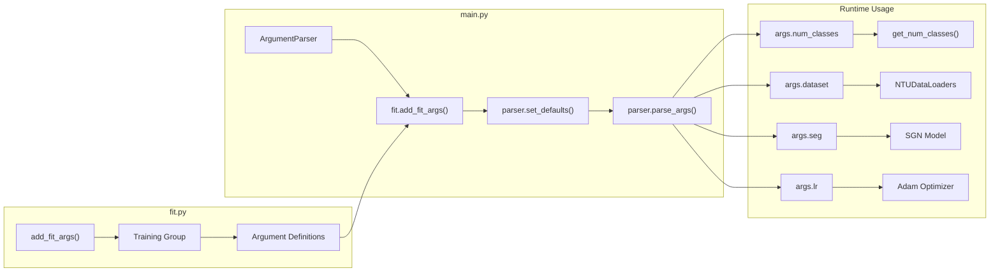
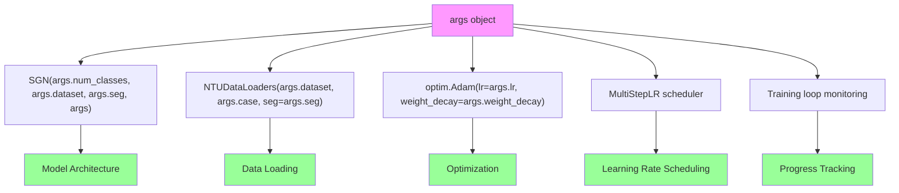

<!-- source: DeepWiki mcp.deepwiki.com · repo microsoft/SGN · page 4.1 Configuration System · fetched 2026-10-26 -->

# Configuration System

<details>
<summary>Relevant source files</summary>

The following files were used as context for generating this wiki page:

- [fit.py](fit.py)
- [main.py](main.py)

</details>


## Purpose and Scope

The Configuration System manages command-line arguments and training parameters for the SGN model. It provides a centralized way to configure training hyperparameters, dataset selection, model architecture settings, and system resources. This system bridges user-specified training configurations with the internal training pipeline.

For information about the actual training process that uses these configurations, see [Training Process](#4.2). For details about model evaluation parameters, see [Model Evaluation and Testing](#4.3).

## Configuration Architecture

The configuration system follows a two-tier architecture where argument definitions are separated from default value assignment:

**Configuration Flow Diagram**



Sources: [fit.py:3-39](), [main.py:23-40]()

## Configuration Parameter Categories

The system organizes configuration parameters into logical groups:

### Training Parameters

| Parameter | Type | Default | Purpose |
|-----------|------|---------|---------|
| `--network` | str | 'SGN' | Neural network architecture to use |
| `--max-epochs` | int | 120 | Maximum number of training epochs |
| `--lr` | float | 0.001 | Initial learning rate |
| `--weight-decay` | float | 0.0001 | Weight decay for regularization |
| `--lr-factor` | float | 0.1 | Learning rate reduction factor |
| `--batch-size` | int | 64 | Mini-batch size for training |
| `--monitor` | str | 'val_acc' | Metric to monitor for model selection |

### Dataset Parameters

| Parameter | Type | Default | Purpose |
|-----------|------|---------|---------|
| `--dataset` | str | 'NTU' | Dataset to use for training/evaluation |
| `--case` | int | 0 | Evaluation protocol (0=Cross-Subject, 1=Cross-View) |
| `--seg` | int | 20 | Number of frame segments per sequence |
| `--num-classes` | int | Dynamic | Number of action classes (auto-detected) |

### System Parameters

| Parameter | Type | Default | Purpose |
|-----------|------|---------|---------|
| `--workers` | int | 16 | Number of data loading worker processes |
| `--print-freq` | int | 20 | Training progress print frequency |
| `--train` | int | 0 | Mode flag (0=test, 1=train) |
| `--start-epoch` | int | 0 | Starting epoch for resumed training |

Sources: [fit.py:8-38](), [main.py:25-39]()

## Argument Definition and Processing

**Configuration Processing Pipeline**



The `add_fit_args()` function in [fit.py:3-39]() defines all training-related arguments with their types, defaults, and help descriptions. The main script then overrides specific defaults and parses the final configuration.

Sources: [fit.py:3-39](), [main.py:23-40]()

## Default Value Override System

The system implements a two-stage default value assignment:

1. **Primary Defaults**: Defined in `fit.py` argument definitions
2. **Override Defaults**: Set in `main.py` using `parser.set_defaults()`

**Key Override Examples**:

```python
parser.set_defaults(
    network='SGN',
    dataset='NTU', 
    case=0,
    batch_size=64,
    max_epochs=120,
    lr=0.001,
    weight_decay=0.0001
)
```

This pattern allows the argument definitions to remain generic while the main script specifies SGN-specific optimal defaults.

Sources: [main.py:25-39]()

## Configuration Usage in Training Pipeline

The parsed arguments flow through multiple system components:

**Configuration Usage Map**



The configuration object is passed directly to major components like the SGN model constructor and used throughout the training process for monitoring and scheduling decisions.

Sources: [main.py:44-84]()

## GPU Configuration

The system includes hardcoded GPU configuration that sets the visible CUDA devices:

```python
os.environ["CUDA_VISIBLE_DEVICES"] = '1'
```

This setting is applied at [main.py:7]() before any CUDA operations. The system automatically detects GPU availability and moves models to CUDA if available at [main.py:52-54]().

## Configuration Validation

The system performs dynamic configuration validation:

- **Number of Classes**: Auto-detected using `get_num_classes(args.dataset)` from the util module
- **Monitor Mode**: Automatically determines optimization direction based on `args.monitor` value
- **Directory Creation**: Automatically creates output directories based on dataset and network names

Sources: [main.py:44](), [main.py:59-68](), [main.py:84-88]()

---

