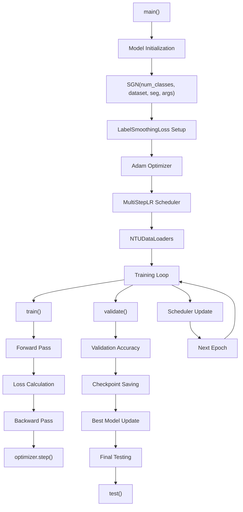
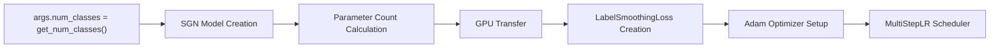
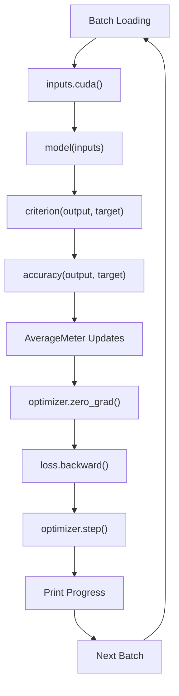
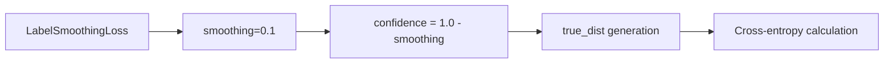
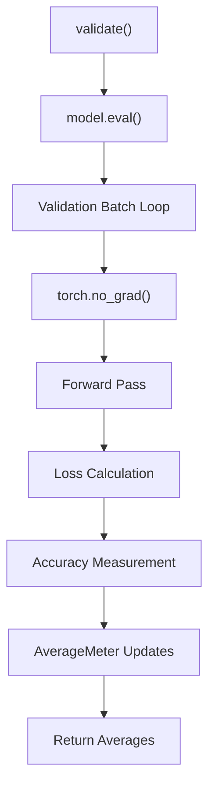
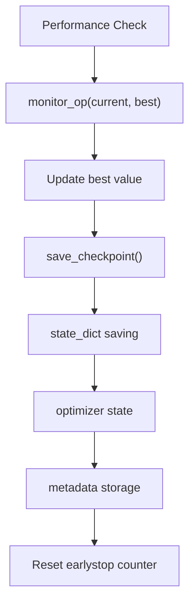

<!-- source: DeepWiki mcp.deepwiki.com · repo microsoft/SGN · page 4.2 Training Process · fetched 2026-10-26 -->

# Training Process

<details>
<summary>Relevant source files</summary>

The following files were used as context for generating this wiki page:

- [README.md](README.md)
- [main.py](main.py)

</details>


This document covers the step-by-step training process for SGN models, including the training loop implementation, loss computation, optimization, and model checkpointing. This page focuses on the actual training mechanics and workflow orchestration.

For configuration parameters and command-line arguments, see [Configuration System](#4.1). For model evaluation and testing procedures, see [Model Evaluation and Testing](#4.3). For data loading details, see [Data Loading System](#3.4).

## Training Workflow Overview

The SGN training process is orchestrated by the `main()` function in `main.py`, which coordinates model initialization, data loading, training loops, validation, and checkpointing. The training follows a standard supervised learning workflow with specialized components for skeleton-based action recognition.

### Training Flow Diagram



Sources: [main.py:42-151]()

## Configuration and Model Initialization

The training process begins with argument parsing and model setup. The system uses default hyperparameters that can be overridden via command-line arguments.

### Default Training Parameters

| Parameter | Default Value | Purpose |
|-----------|---------------|---------|
| `batch_size` | 64 | Training batch size |
| `max_epochs` | 120 | Maximum training epochs |
| `lr` | 0.001 | Initial learning rate |
| `weight_decay` | 0.0001 | L2 regularization coefficient |
| `lr_factor` | 0.1 | Learning rate reduction factor |
| `monitor` | 'val_acc' | Metric to monitor for best model |

The model initialization process includes:



Sources: [main.py:44-70]()

## Training Loop Implementation

The core training loop is implemented in the `train()` function, which processes batches sequentially and updates model parameters using backpropagation.

### Training Step Details



The training function maintains running averages of loss and accuracy using `AverageMeter` objects and prints progress every `print_freq` batches.

Sources: [main.py:153-180]()

## Loss Function and Optimization

### Label Smoothing Loss

SGN uses a custom `LabelSmoothingLoss` implementation instead of standard cross-entropy loss. Label smoothing helps prevent overfitting by softening the target distribution.



The loss function redistributes probability mass from the true class to other classes according to the smoothing parameter (0.1 by default).

### Optimization Strategy

The training uses Adam optimizer with a multi-step learning rate schedule:

- **Optimizer**: Adam with initial lr=0.001, weight_decay=0.0001
- **Scheduler**: MultiStepLR with milestones at epochs [60, 90, 110] and gamma=0.1
- **Gradient Updates**: Standard backpropagation with `optimizer.zero_grad()` and `optimizer.step()`

Sources: [main.py:56-70](), [main.py:258-272]()

## Validation and Model Monitoring

### Validation Process

The `validate()` function runs after each training epoch to assess model performance on the validation set. Validation uses the same forward pass as training but with `model.eval()` and `torch.no_grad()` contexts.



### Performance Monitoring

The training process monitors validation accuracy (`val_acc`) by default to determine the best model. The monitoring system supports two modes:

- **Maximize mode**: For accuracy metrics (monitor_op = `np.greater`)
- **Minimize mode**: For loss metrics (monitor_op = `np.less`)

Sources: [main.py:183-200](), [main.py:59-68]()

## Checkpointing and Model Persistence

### Checkpoint Management

The system automatically saves model checkpoints when validation performance improves. Checkpoint saving includes:

- Model state dictionary
- Optimizer state dictionary  
- Best performance value
- Current epoch number
- Monitoring metric name



### File Organization

Training outputs are organized in a structured directory hierarchy:

- **Base directory**: `./results/{dataset}/{network}/`
- **Checkpoint file**: `{case}_best.pth`
- **Training log**: `{case}_log.csv`
- **Predictions**: `{case}_pred.txt` and `{case}_lable.txt`

Sources: [main.py:119-131](), [main.py:244-247]()

## Training Execution Commands

### Cross-Subject Training
```bash
python main.py --network SGN --train 1 --case 0
```

### Cross-View Training  
```bash
python main.py --network SGN --train 1 --case 1
```

The training process automatically transitions to testing after completion, loading the best checkpoint and evaluating on the test set.

Sources: [README.md:45-52](), [main.py:147-150]()

## Training Monitoring and Logging

The training process provides comprehensive logging and monitoring capabilities:

### Progress Tracking
- **Epoch-level**: Training/validation loss and accuracy per epoch
- **Batch-level**: Running averages printed every `print_freq` batches  
- **Best model tracking**: Automatic identification and saving of best-performing models

### Output Files
- **CSV logs**: Complete training history saved to `{case}_log.csv`
- **Console output**: Real-time training progress and performance metrics
- **Model checkpoints**: Best model states preserved for inference

The training loop continues until `max_epochs` is reached, with automatic early stopping based on validation performance monitoring.

Sources: [main.py:100-144]()

---

