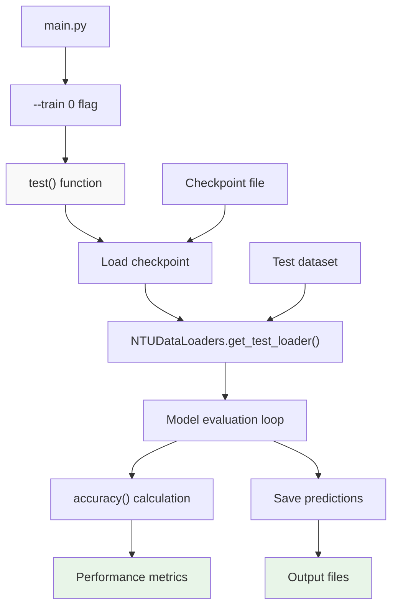
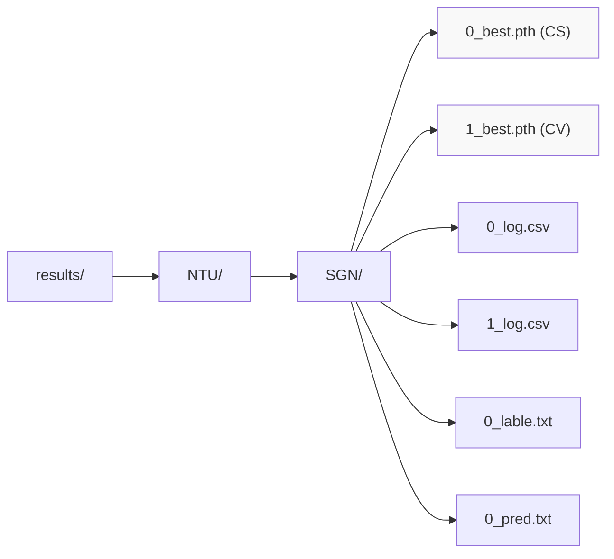
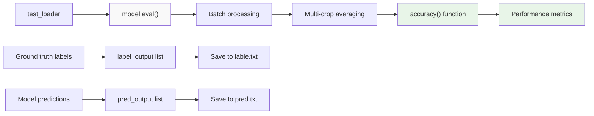
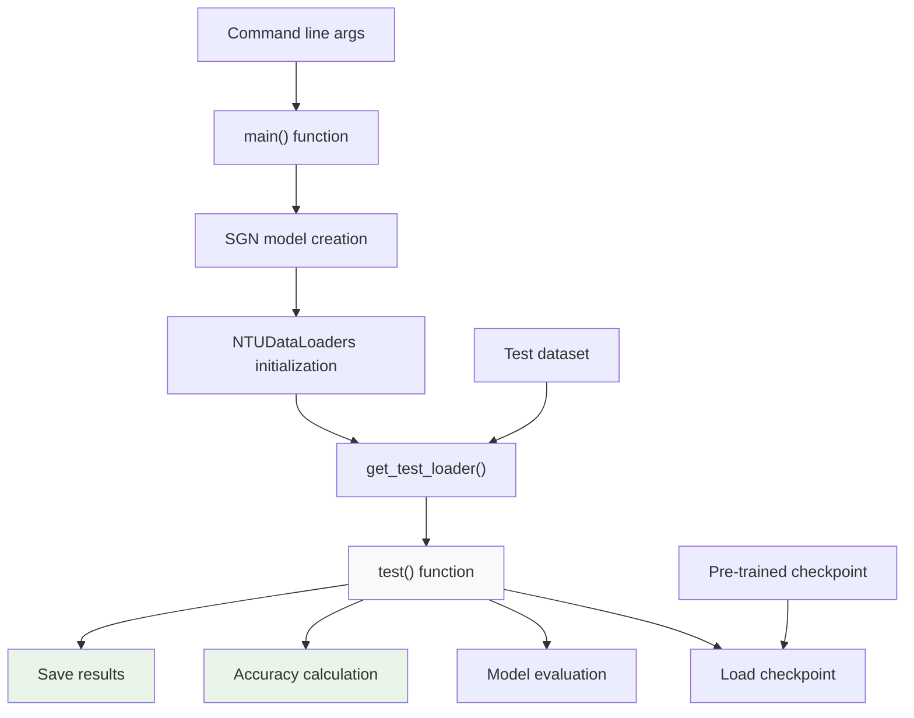

<!-- source: DeepWiki mcp.deepwiki.com · repo microsoft/SGN · page 4.3 Model Evaluation and Testing · fetched 2026-10-26 -->

# Model Evaluation and Testing

<details>
<summary>Relevant source files</summary>

The following files were used as context for generating this wiki page:

- [README.md](README.md)
- [main.py](main.py)

</details>


This document covers the evaluation and testing procedures for trained SGN models, including performance measurement, checkpoint loading, and result interpretation. The testing system supports both Cross-Subject (CS) and Cross-View (CV) evaluation protocols commonly used in skeleton-based action recognition research.

For information about the training process, see [Training Process](#4.2). For details about pre-trained model checkpoints and their usage, see [Pre-trained Models](#5).

## Evaluation Protocols

The SGN system implements two standard evaluation protocols for the NTU-RGB+D dataset:

| Protocol | Description | Case ID | Purpose |
|----------|-------------|---------|---------|
| Cross-Subject (CS) | Training and testing use different subjects | `case=0` | Evaluates generalization across different people |
| Cross-View (CV) | Training and testing use different camera views | `case=1` | Evaluates robustness to viewpoint changes |

The evaluation protocols are configured through the `case` parameter in [main.py:28](), which determines the data split used by the `NTUDataLoaders` class.

**Testing Workflow**


Sources: [main.py:146-151](), [main.py:203-233]()

## Model Loading and Checkpoint Management

The testing system loads trained models from checkpoint files stored in the results directory structure. The checkpoint loading process is handled in the `test` function.

**Checkpoint File Structure**


The checkpoint path is constructed using the pattern: `{output_dir}/SGN/{case}_best.pth` where `case` is either 0 (CS) or 1 (CV). Each checkpoint contains:

- Model state dictionary (`state_dict`)
- Training epoch information
- Best validation performance
- Optimizer state

Sources: [main.py:86-96](), [main.py:206]()

## Testing Process

The core testing functionality is implemented in the `test` function, which performs the following operations:

### Model Evaluation Loop

```python
def test(test_loader, model, checkpoint, lable_path, pred_path):
    # Load best model checkpoint
    model.load_state_dict(torch.load(checkpoint)['state_dict'])
    model.eval()
    
    # Process test samples
    for inputs, target in enumerate(test_loader):
        with torch.no_grad():
            output = model(inputs.cuda())
            # Handle multi-crop averaging
            output = output.view((-1, inputs.size(0)//target.size(0), output.size(1)))
            output = output.mean(1)
```

The testing process includes several key steps:

1. **Checkpoint Loading**: The best model weights are loaded from the saved checkpoint file
2. **Evaluation Mode**: Model is set to evaluation mode using `model.eval()`
3. **Batch Processing**: Test samples are processed in batches without gradient computation
4. **Multi-crop Averaging**: Multiple crops per sample are averaged for final prediction
5. **Accuracy Calculation**: Top-1 accuracy is computed using the `accuracy` function

Sources: [main.py:203-233]()

**Test Data Flow**


Sources: [main.py:213-229]()

## Performance Metrics and Output

### Accuracy Calculation

The system uses top-1 accuracy as the primary evaluation metric, implemented in the `accuracy` function:

```python
def accuracy(output, target):
    batch_size = target.size(0)
    _, pred = output.topk(1, 1, True, True)  # Get top-1 predictions
    pred = pred.t()
    correct = pred.eq(target.view(1, -1).expand_as(pred))
    correct = correct.view(-1).float().sum(0, keepdim=True)
    return correct.mul_(100.0 / batch_size)
```

The accuracy calculation:
- Extracts top-1 predictions using `topk(1, 1, True, True)`
- Compares predictions with ground truth labels
- Returns percentage accuracy

Sources: [main.py:235-242]()

### Output Files

The testing process generates several output files in the model directory:

| File | Content | Format |
|------|---------|--------|
| `{case}_lable.txt` | Ground truth labels | Integer labels, one per line |
| `{case}_pred.txt` | Model predictions | Float probabilities, one prediction per line |
| `{case}_log.csv` | Training/validation logs | CSV with loss and accuracy history |

The output files enable detailed analysis of model performance and can be used for:
- Error analysis by comparing labels and predictions
- Confidence score analysis using prediction probabilities
- Performance visualization using the training logs

Sources: [main.py:95-96](), [main.py:227-229]()

## Command-Line Testing Interface

### Basic Testing Commands

The testing interface is accessed through `main.py` with the `--train 0` flag:

```bash
# Test Cross-Subject (CS) model
python main.py --network SGN --train 0 --case 0

# Test Cross-View (CV) model  
python main.py --network SGN --train 0 --case 1
```

### Configuration Parameters

Key testing parameters controlled through command-line arguments:

| Parameter | Default | Description |
|-----------|---------|-------------|
| `--train` | 0 | Set to 0 for testing mode |
| `--case` | 0 | Evaluation protocol (0=CS, 1=CV) |
| `--network` | SGN | Model architecture |
| `--batch_size` | 64 | Test batch size |
| `--workers` | 16 | Data loading workers |

The test batch size is hardcoded to 32 in the `get_test_loader` call on [main.py:79](), regardless of the `--batch_size` parameter setting.

Sources: [main.py:23-39](), [README.md:54-62]()

**Complete Testing Pipeline**


Sources: [main.py:42-151](), [main.py:203-233]()

The testing system provides a complete evaluation framework that loads trained models, processes test data, computes performance metrics, and saves detailed results for further analysis. The dual protocol support (CS/CV) enables comprehensive evaluation following established benchmarks in skeleton-based action recognition research.

---

