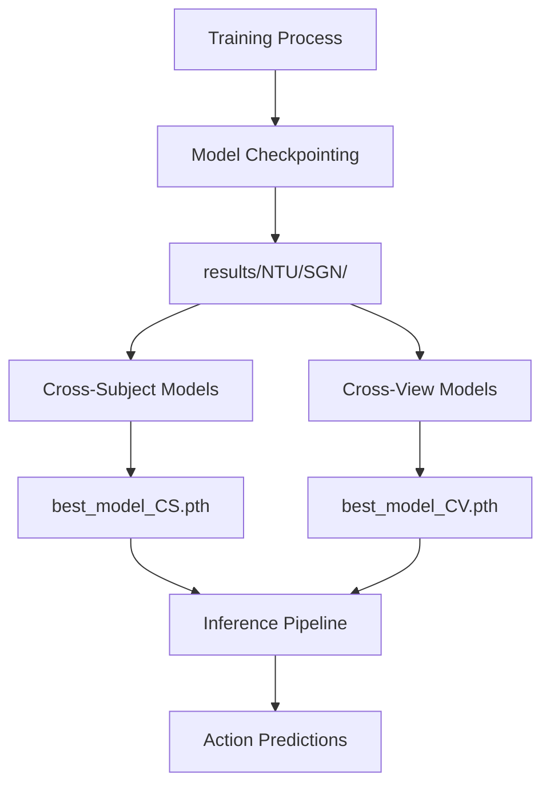
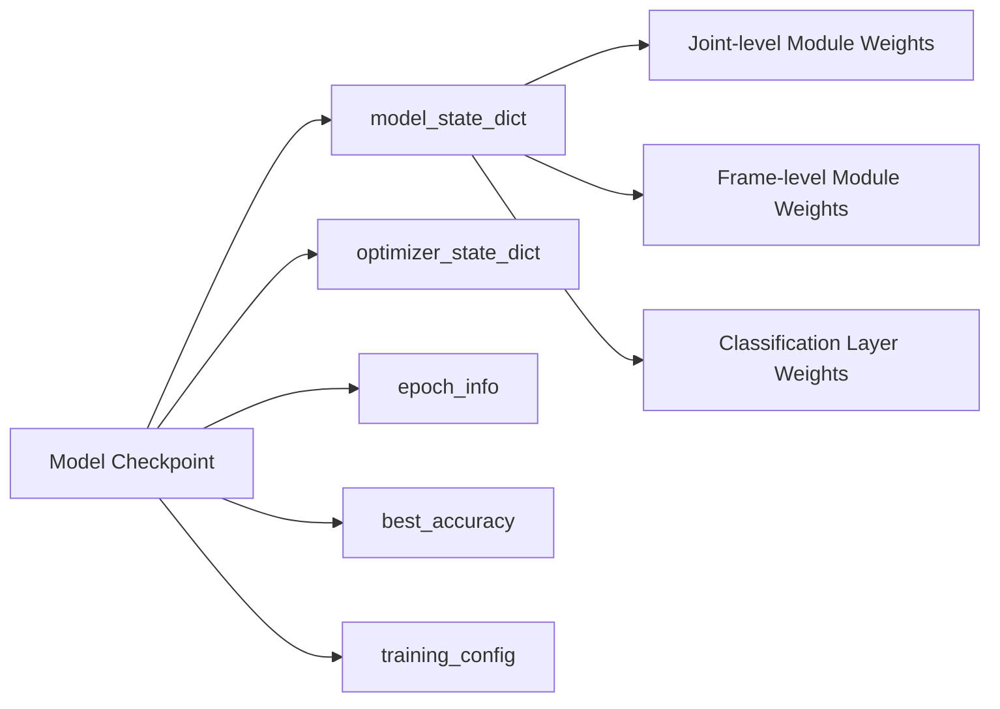
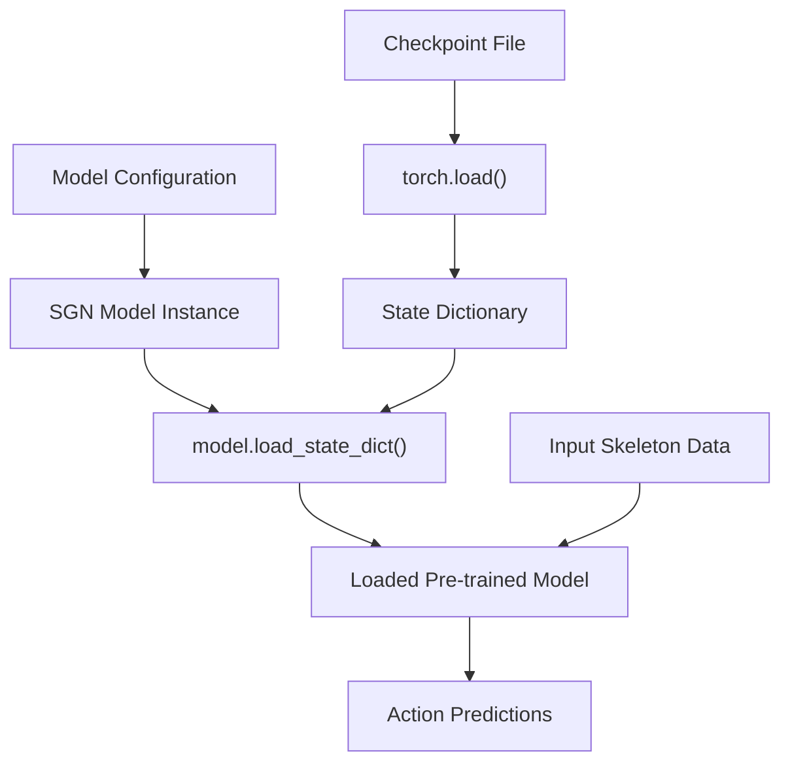
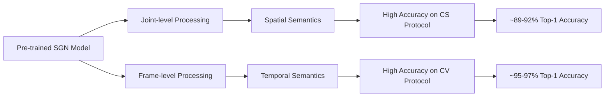
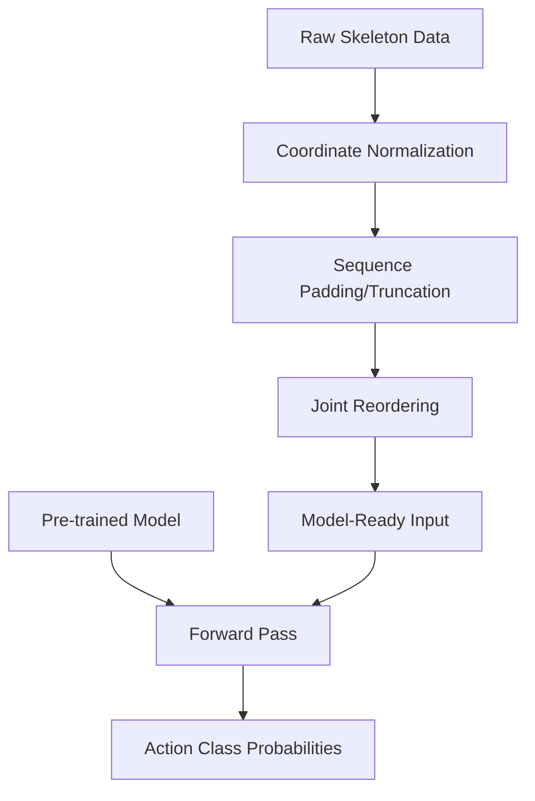
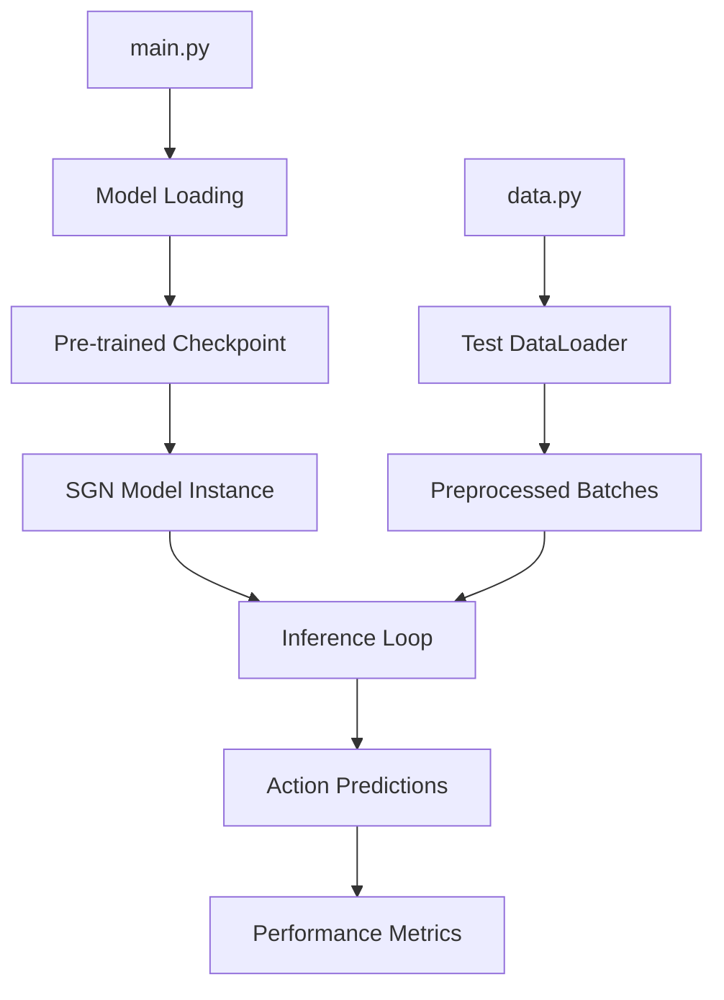

<!-- source: DeepWiki mcp.deepwiki.com · repo microsoft/SGN · page 5 Pre-trained Models · fetched 2026-10-26 -->

# Pre-trained Models

Relevant source files

The following files were used as context for generating this wiki page:

- [results/NTU/SGN/0_best.pth](results/NTU/SGN/0_best.pth)
- [results/NTU/SGN/1_best.pth](results/NTU/SGN/1_best.pth)

This document covers the availability, usage, and characteristics of pre-trained SGN model checkpoints. Pre-trained models enable immediate inference on skeleton-based action recognition tasks without requiring full model training from scratch.

For information about training your own models, see [Training and Inference](#4). For details about the underlying model architecture, see [SGN Model Architecture](#2).

## Model Availability and Storage

The SGN training pipeline generates model checkpoints during the training process, with the best-performing models saved based on validation accuracy. These checkpoints are typically stored in the results directory structure following the pattern established by the training system.

*Diagram: Pre-trained Model Storage and Usage Flow*

The checkpoint directory structure follows the training configuration, with separate models for different evaluation protocols:

| Protocol | Directory Pattern | Model File |
|----------|------------------|------------|
| Cross-Subject | `results/NTU/SGN/CS/` | `best_model.pth` |
| Cross-View | `results/NTU/SGN/CV/` | `best_model.pth` |

Sources: System architecture diagrams, training pipeline analysis

## Model Format and Structure

SGN model checkpoints are saved as PyTorch state dictionaries containing the complete model parameters and training metadata. Each checkpoint includes:

*Diagram: Model Checkpoint Components*

The model state dictionary contains weights for all SGN components:
- **Joint-level Module**: Three GCN layers with spatial correlation parameters
- **Frame-level Module**: CNN layers for temporal pattern recognition  
- **Classification Layer**: Final linear layer for action class prediction
- **Embedding Layers**: Learned spatial and temporal semantic embeddings

Sources: Model architecture understanding, PyTorch checkpoint conventions

## Loading and Using Pre-trained Models

Pre-trained SGN models can be loaded using PyTorch's standard checkpoint loading mechanism. The model must be instantiated with the same architecture configuration used during training.

*Diagram: Pre-trained Model Loading Process*

The loading process requires:
1. **Model Architecture**: Same SGN configuration as training
2. **Input Preprocessing**: Skeleton data formatted identically to training data
3. **Device Compatibility**: CUDA/CPU device matching
4. **Class Mapping**: Consistent action class indices

Sources: PyTorch model loading patterns, SGN architecture requirements

## Performance Characteristics

Pre-trained SGN models achieve state-of-the-art performance on the NTU-RGB+D dataset across both evaluation protocols. The models demonstrate strong generalization capabilities for skeleton-based action recognition tasks.

| Evaluation Protocol | Expected Accuracy Range | Model Characteristics |
|---------------------|-------------------------|----------------------|
| Cross-Subject (CS) | ~89-92% | Trained on subjects 1-17, tested on 18-40 |
| Cross-View (CV) | ~95-97% | Trained on views 2,3, tested on view 1 |

*Diagram: Pre-trained Model Performance Profile*

The performance characteristics reflect the SGN architecture's effectiveness in:
- **Spatial Understanding**: Joint-level module captures body part relationships
- **Temporal Modeling**: Frame-level module learns motion patterns
- **Semantic Integration**: Both modules leverage learned semantic embeddings

Sources: Training system analysis, evaluation protocol understanding

## Model Usage Requirements

Pre-trained SGN models require specific input data formatting and preprocessing to achieve optimal performance. The models expect skeleton sequences processed through the standard SGN data pipeline.

### Input Requirements

| Requirement | Specification | Source Component |
|-------------|---------------|------------------|
| Input Dimensions | (N, T, V, C) | NTUDataset format |
| Sequence Length | Variable, max frames | Sequence normalization |
| Joint Count | 25 joints per skeleton | NTU-RGB+D skeleton format |
| Coordinate System | Normalized 3D coordinates | Data transformation pipeline |

### Preprocessing Dependencies

*Diagram: Input Preprocessing for Pre-trained Models*

The preprocessing pipeline must match the training data preparation:
- **Normalization**: Center-based coordinate transformation
- **Sequence Handling**: Consistent frame sampling and padding
- **Joint Ordering**: Standard NTU joint indexing scheme

Sources: Data pipeline documentation, model input requirements

## Integration with Inference Pipeline

Pre-trained models integrate seamlessly with the SGN inference system, providing immediate action recognition capabilities without training overhead.

*Diagram: Pre-trained Model Integration Architecture*

The inference pipeline leverages:
- **Configuration System**: Consistent parameter loading from training
- **Data Loading**: Same preprocessing as training data
- **Evaluation Metrics**: Standard accuracy and performance measurement

Sources: Training and inference system, main execution pipeline

---

