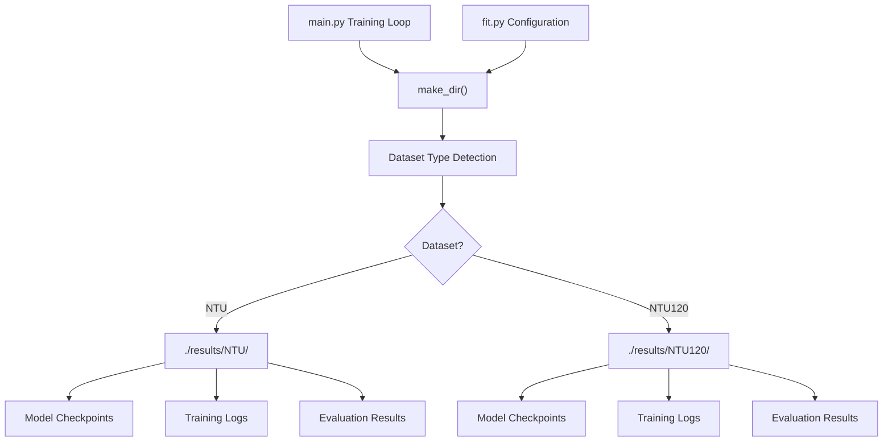
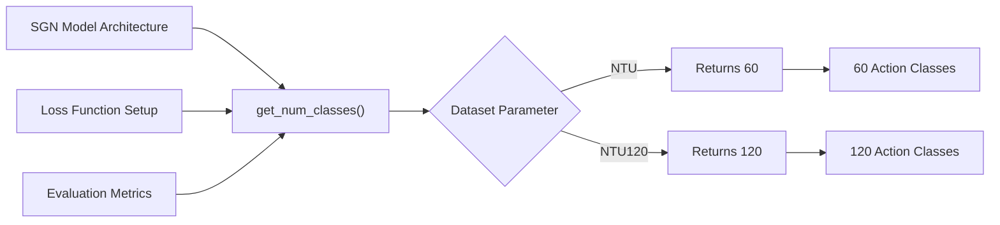
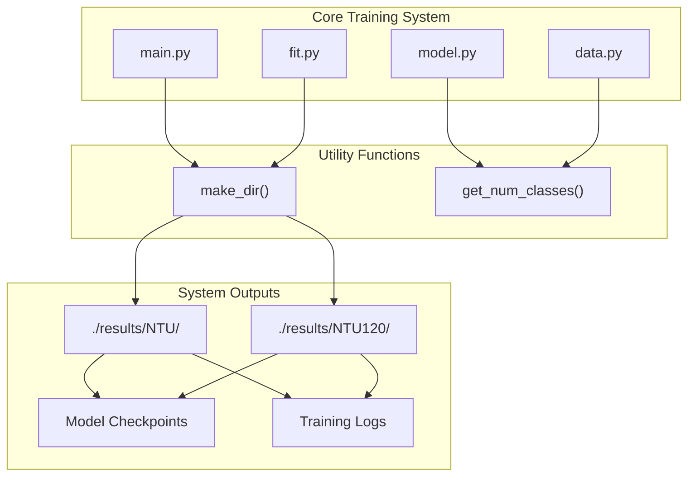

<!-- source: DeepWiki mcp.deepwiki.com · repo microsoft/SGN · page 6 Utilities and Helpers · fetched 2026-10-26 -->

# Utilities and Helpers

Relevant source files

The following files were used as context for generating this wiki page:

- [util.py](util.py)

This document covers the utility functions and helper modules that support the SGN system's core functionality. The utilities provide essential services for directory management, dataset configuration, and system-wide constants used throughout the training and inference pipeline.

For information about the main training orchestration, see [Training and Inference](#4). For details about the data processing pipeline that uses these utilities, see [Data Pipeline](#3).

## Purpose and Scope

The utilities module serves as a foundational layer that provides:
- Directory structure management for experiment results
- Dataset-specific configuration constants
- Common helper functions used across the SGN system

These utilities ensure consistent behavior across different components of the system and simplify dataset-specific operations.

## Directory Management System

The SGN system uses a structured approach to organizing experiment results and outputs through the `make_dir` function.

### Output Directory Creation

The `make_dir` function in [util.py:11-20]() creates standardized directory structures for different datasets:

| Dataset | Output Directory | Purpose |
|---------|------------------|---------|
| `NTU` | `./results/NTU/` | NTU-RGB+D 60 classes results |
| `NTU120` | `./results/NTU120/` | NTU-RGB+D 120 classes results |

The function automatically creates directories if they don't exist, ensuring the system can write model checkpoints, logs, and evaluation results without manual setup.

### Directory Structure Integration

Sources: [util.py:11-20]()

## Dataset Configuration Utilities

### Class Number Management

The `get_num_classes` function provides dataset-specific configuration constants used throughout the system:

This function ensures consistent class numbers across:
- Model output layer dimensions
- Loss function calculations  
- Evaluation metric computations
- Data loader configurations

Sources: [util.py:22-27]()

## System Dependencies and Imports

The utilities module imports several key dependencies that indicate its integration points:

| Import | Purpose | Usage Pattern |
|--------|---------|---------------|
| `os` | Directory operations | Path creation and validation |
| `csv` | Data file processing | Statistical data reading |
| `numpy` | Numerical computations | Array operations support |
| `matplotlib.pyplot` | Visualization | Plotting and analysis |
| `torch` | PyTorch framework | Model integration |
| `torch.nn` | Neural network components | Model utilities |

Sources: [util.py:1-9]()

## Integration with Core System

The utilities integrate with the broader SGN system through several key interaction patterns:

### Usage Patterns

The utilities follow consistent usage patterns throughout the system:

1. **Directory Setup**: Called early in training initialization to ensure output paths exist
2. **Model Configuration**: Used during model instantiation to set correct output dimensions
3. **Evaluation Setup**: Referenced during metric calculation to validate class counts

Sources: [util.py:11-27]()

## Function Reference

### `make_dir(dataset)`

**Parameters:**
- `dataset` (str): Dataset identifier (`'NTU'` or `'NTU120'`)

**Returns:**
- `output_dir` (str): Path to the created output directory

**Behavior:**
- Creates directory structure if it doesn't exist
- Returns standardized path for the specified dataset
- Supports both NTU-RGB+D dataset variants

### `get_num_classes(dataset)`

**Parameters:**
- `dataset` (str): Dataset identifier (`'NTU'` or `'NTU120'`)

**Returns:**
- `int`: Number of action classes for the specified dataset

**Behavior:**
- Returns 60 for NTU-RGB+D (60 classes)
- Returns 120 for NTU-RGB+D 120 (120 classes)
- Used for model output layer sizing and evaluation

Sources: [util.py:11-27]()

---

