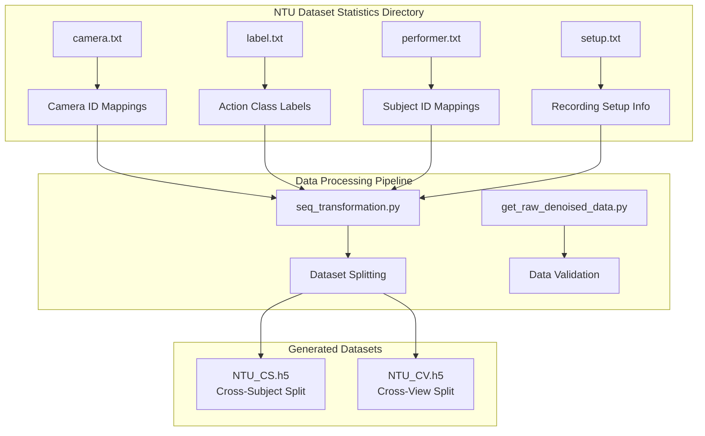
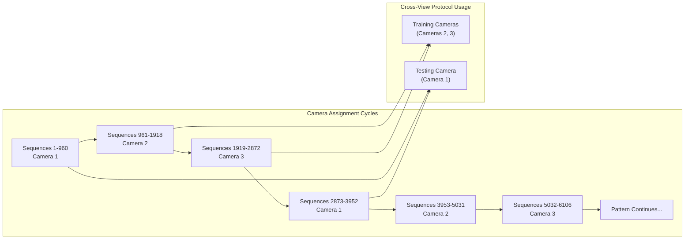
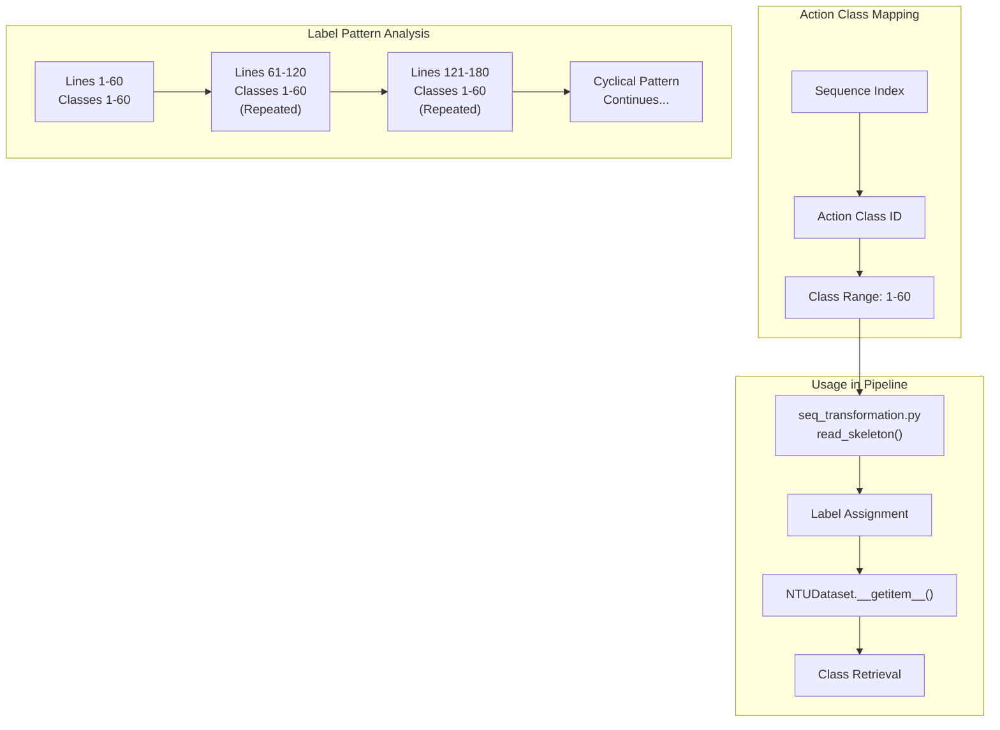
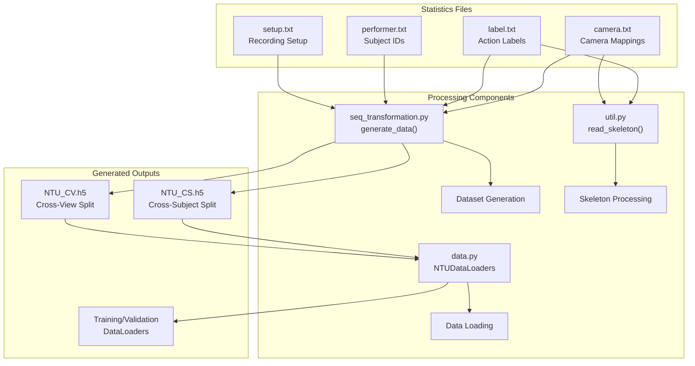

<!-- source: DeepWiki mcp.deepwiki.com · repo microsoft/SGN · page 7 Dataset Statistics and Metadata · fetched 2026-10-26 -->

# Dataset Statistics and Metadata

<details>
<summary>Relevant source files</summary>

The following files were used as context for generating this wiki page:

- [data/ntu/statistics/camera.txt](data/ntu/statistics/camera.txt)
- [data/ntu/statistics/label.txt](data/ntu/statistics/label.txt)
- [data/ntu/statistics/performer.txt](data/ntu/statistics/performer.txt)
- [data/ntu/statistics/setup.txt](data/ntu/statistics/setup.txt)

</details>


This document provides comprehensive documentation of the NTU RGB+D dataset statistics and metadata files used throughout the SGN data processing pipeline. It covers the structure, format, and usage of statistical metadata files that support dataset splitting, label mapping, and evaluation protocols.

For information about the data processing pipeline that uses these statistics, see [Data Pipeline](#3). For details about the data loading system that consumes this metadata, see [Data Loading System](#3.4).

## Overview

The SGN repository includes a collection of metadata files in [data/ntu/statistics/]() that provide essential information about the NTU RGB+D dataset structure. These files enable proper dataset organization, cross-validation splitting, and label management for the action recognition tasks.



**Dataset Statistics and Metadata File Structure**
Sources: [data/ntu/statistics/camera.txt](), [data/ntu/statistics/label.txt]()

## Camera Metadata Structure

The `camera.txt` file provides mapping between sequence indices and camera identifiers used during data collection. This metadata is critical for implementing the Cross-View evaluation protocol where specific cameras are designated for training and testing splits.

| **Field** | **Description** | **Format** |
|-----------|-----------------|------------|
| Line Number | Sequential index of skeleton sequence | Integer |
| Camera ID | Camera identifier (1, 2, or 3) | Integer |
| Delimiter | Separator between fields | Pipe character `|` |

### Camera Distribution Pattern



**Camera Metadata Organization and Cross-View Protocol**
Sources: [data/ntu/statistics/camera.txt:1-7500]()

The camera metadata follows a cyclical pattern where sequences are distributed across three cameras in blocks. This organization enables the Cross-View evaluation protocol by designating Camera 1 for testing and Cameras 2-3 for training.

## Action Label Metadata

The `label.txt` file contains the ground truth action class assignments for each skeleton sequence. The NTU RGB+D dataset includes 60 distinct action classes, and this file provides the mapping from sequence indices to their corresponding action labels.

### Label Distribution Structure



**Action Label Organization and Pipeline Integration**
Sources: [data/ntu/statistics/label.txt:1-4500]()

| **Sequence Range** | **Action Classes** | **Pattern** |
|--------------------|-------------------|-------------|
| 1-60 | 1-60 | First cycle |
| 61-120 | 1-60 | Second cycle |
| 121-180 | 1-60 | Third cycle |
| ... | 1-60 | Continues cyclically |

### Action Class Categories

The 60 action classes in the NTU RGB+D dataset span multiple categories of human activities:

| **Category** | **Class Range** | **Examples** |
|--------------|-----------------|--------------|
| Daily Actions | 1-20 | drinking, eating, reading |
| Interaction | 21-40 | handshaking, hugging, kicking |
| Health-related | 41-50 | sneezing, falling down, headache |
| Others | 51-60 | typing, writing, phone call |

## Integration with Data Pipeline

The statistics files are consumed by multiple components in the SGN data processing pipeline:



**Statistics Integration in SGN Pipeline**
Sources: [seq_transformation.py](), [data.py](), [util.py]()

### File Format Specifications

All statistics files follow a consistent pipe-delimited format:

```
line_number|metadata_value
```

**Example from camera.txt:**
```
1|1
2|1
3|1
...
961|2
962|2
963|2
```

**Example from label.txt:**
```
1|1
2|2
3|3
...
61|1
62|2
63|3
```

## Cross-Subject vs Cross-View Protocols

The metadata files enable two standard evaluation protocols for the NTU RGB+D dataset:

| **Protocol** | **Split Criteria** | **Metadata Used** | **Training Set** | **Testing Set** |
|--------------|-------------------|-------------------|------------------|-----------------|
| Cross-Subject (CS) | Subject identity | `performer.txt` | Subjects 1,2,4,5,8,9,13,14,15,16,17,18,19,25,27,28,31,34,35,38 | Remaining subjects |
| Cross-View (CV) | Camera viewpoint | `camera.txt` | Camera views 2,3 | Camera view 1 |

### Usage in Dataset Generation

The [seq_transformation.py]() script uses these statistics files to create the appropriate HDF5 datasets for each evaluation protocol:

```python
# Pseudo-code representation of statistics usage
def generate_cross_view_split():
    camera_info = read_file('data/ntu/statistics/camera.txt')
    training_indices = [i for i, cam in camera_info if cam in [2, 3]]
    testing_indices = [i for i, cam in camera_info if cam == 1]
    return training_indices, testing_indices
```

## Performance Implications

The statistics files are designed for efficient access during data loading:

- **Sequential Access**: Files are organized by sequence index for O(1) lookup
- **Memory Efficiency**: Simple text format with minimal parsing overhead  
- **Cache-Friendly**: Small file sizes enable full loading into memory
- **Validation Support**: Enables quick consistency checks during preprocessing

Sources: [data/ntu/statistics/camera.txt](), [data/ntu/statistics/label.txt](), [seq_transformation.py](), [data.py]()

---

