# Page: Overview

# Overview

<details>
<summary>Relevant source files</summary>

The following files were used as context for generating this wiki page:

- [README.md](README.md)

</details>


## Purpose and Scope

This document provides a comprehensive overview of the Semantics-Guided Neural Networks (SGN) repository, a PyTorch-based implementation for skeleton-based human action recognition. SGN introduces semantic information (joint types and frame indices) alongside 3D coordinates to achieve state-of-the-art performance with significantly reduced model parameters compared to existing methods.

The overview covers the system's architecture, key innovations, data processing pipeline, and core components. For detailed information about specific subsystems, see [SGN Model Architecture](#2), [Data Pipeline](#3), [Training and Inference](#4), and [Pre-trained Models](#5).

Sources: [README.md:1-95]()

## What is SGN

SGN (Semantics-Guided Neural Networks) is a deep learning framework that addresses skeleton-based human action recognition by explicitly incorporating high-level semantic information into the neural network architecture. Unlike traditional approaches that rely solely on 3D joint coordinates, SGN enhances feature representation by integrating joint type semantics and temporal frame indices.

The system achieves state-of-the-art performance on the NTU-RGB+D dataset while maintaining an order of magnitude smaller model size than competing methods. SGN processes skeleton sequences through two hierarchical modules: a `joint-level module` for modeling spatial correlations between joints within frames, and a `frame-level module` for capturing temporal dependencies across frames.

Sources: [README.md:1-13]()

## System Architecture

The SGN system follows a modular architecture that separates data processing, model training, and inference into distinct components:

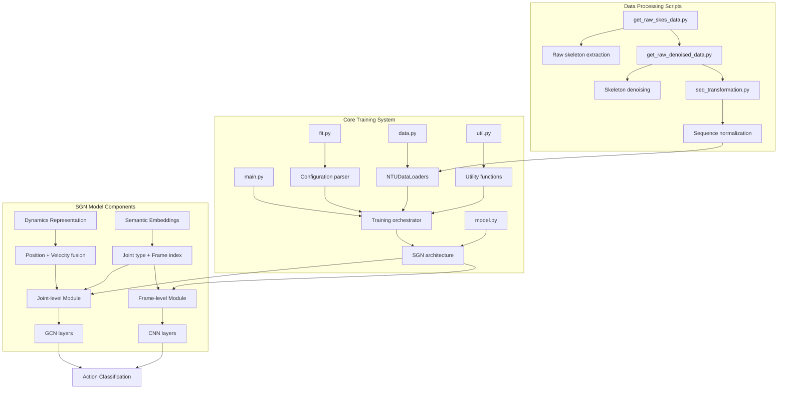

**System Architecture Overview**
Sources: [README.md:17-21](), [README.md:28-62]()

## Data Processing Pipeline

The data processing pipeline transforms raw NTU-RGB+D skeleton files into training-ready datasets through a three-stage process:

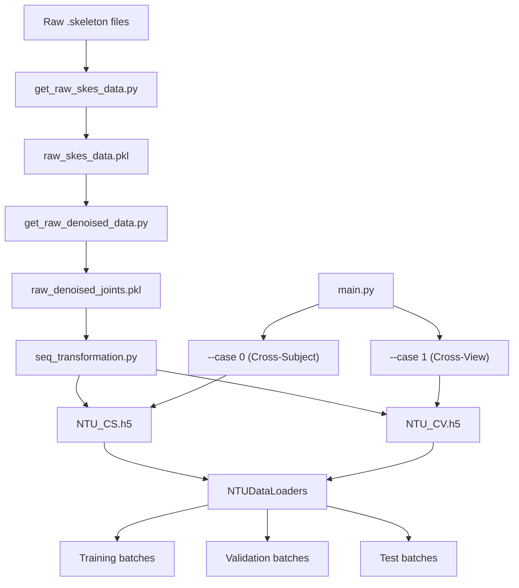

**Data Processing and Loading Pipeline**
Sources: [README.md:28-42]()

## Key Components

The SGN system consists of several interconnected components that work together to process skeleton data and perform action recognition:

| Component | File | Purpose |
|-----------|------|---------|
| Training Controller | `main.py` | Orchestrates training/testing process |
| Model Architecture | `model.py` | Implements SGN neural network |
| Data Loading | `data.py` | Handles dataset loading and batching |
| Configuration | `fit.py` | Parses command-line arguments |
| Utilities | `util.py` | Provides helper functions |
| Raw Data Extraction | `get_raw_skes_data.py` | Processes skeleton files |
| Data Denoising | `get_raw_denoised_data.py` | Removes noisy skeletons |
| Sequence Transform | `seq_transformation.py` | Normalizes and splits data |

The `main.py` script serves as the entry point, accepting parameters like `--network SGN`, `--train 1/0`, and `--case 0/1` to control training mode and evaluation protocol (Cross-Subject vs Cross-View).

Sources: [README.md:45-62]()

## SGN Model Innovation

SGN introduces two key innovations that distinguish it from coordinate-only approaches:

1. **Semantic Integration**: The model explicitly incorporates joint type semantics and frame index information alongside 3D coordinates, enhancing the network's understanding of spatial-temporal structure.

2. **Hierarchical Processing**: SGN uses a two-module approach:
   - **Joint-level Module**: Employs three Graph Convolutional Network (GCN) layers to model spatial correlations between joints within the same frame
   - **Frame-level Module**: Uses two Convolutional Neural Network (CNN) layers to capture temporal dependencies across frames

The **Dynamics Representation (DR)** component fuses position and velocity information to create richer joint representations, while semantic embeddings provide additional context about joint types and temporal positions.

Sources: [README.md:5-6](), [README.md:17-21]()

## Performance Characteristics

SGN achieves state-of-the-art performance on the NTU-RGB+D dataset while maintaining computational efficiency. The model requires an order of magnitude fewer parameters than most existing methods, making it suitable for resource-constrained environments.

The system supports two standard evaluation protocols:
- **Cross-Subject (CS)**: Training and testing on different subjects
- **Cross-View (CV)**: Training and testing on different camera viewpoints

Pre-trained models are available in the `./results/NTU/SGN/` directory for immediate inference without training.

Sources: [README.md:10-13](), [README.md:56-62]()

---

# Page: SGN Model Architecture

# SGN Model Architecture

<details>
<summary>Relevant source files</summary>

The following files were used as context for generating this wiki page:

- [README.md](README.md)
- [images/framework.PNG](images/framework.PNG)
- [model.py](model.py)

</details>


This document provides a detailed technical explanation of the Semantics-Guided Neural Network (SGN) architecture implemented in the repository. It covers the core neural network components, data flow, and semantic embedding mechanisms that enable efficient skeleton-based human action recognition.

For information about training and inference procedures, see [Training and Inference](#4). For details about data preprocessing and loading, see [Data Pipeline](#3).

## Architecture Overview

The SGN model implements a two-stage hierarchical approach that processes skeleton sequences through joint-level and frame-level modules. The architecture explicitly incorporates semantic information alongside raw 3D coordinates to enhance feature representation capability.

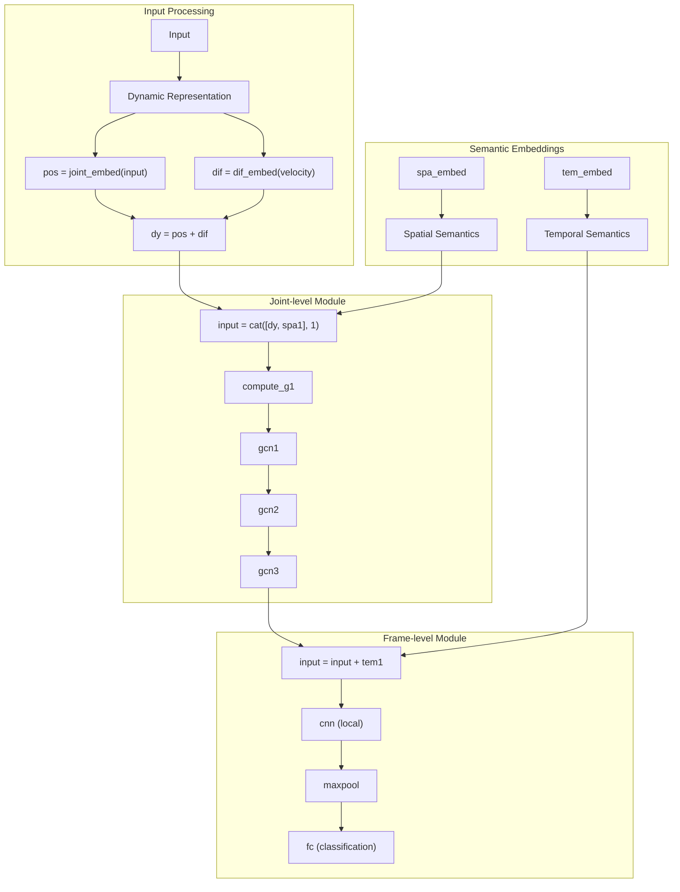

**SGN Architecture Data Flow**

Sources: [model.py:49-77](), [README.md:17-21]()

## Dynamic Representation

The SGN model begins by computing a dynamic representation that fuses positional and velocity information for each joint. This creates a richer input representation compared to using only 3D coordinates.

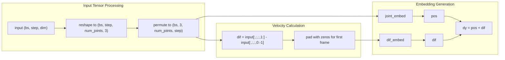

**Dynamic Representation Computation**

The implementation extracts velocity information by computing frame-to-frame differences and pads the first frame with zeros. Both position and velocity are processed through separate embedding networks before fusion.

Sources: [model.py:51-62]()

## Joint-level Module

The joint-level module models spatial correlations between joints within the same frame using three Graph Convolutional Network (GCN) layers. It incorporates spatial semantic embeddings to provide joint type information.

| Component | Purpose | Implementation |
|-----------|---------|----------------|
| `compute_g1` | Computes adjacency matrix for GCN layers | [model.py:178-194]() |
| `gcn1` | First GCN layer (dim1//2 → dim1//2) | [model.py:34]() |
| `gcn2` | Second GCN layer (dim1//2 → dim1) | [model.py:35]() |
| `gcn3` | Third GCN layer (dim1 → dim1) | [model.py:36]() |

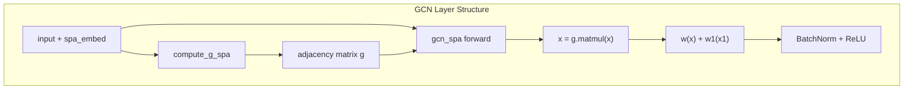

**GCN Layer Processing**

Each `gcn_spa` layer computes spatial relationships by matrix multiplication with a learned adjacency matrix, followed by linear transformations and normalization.

Sources: [model.py:64-68](), [model.py:161-176](), [model.py:178-194]()

## Frame-level Module

The frame-level module processes temporal dependencies by treating joints within each frame as a unified representation. It uses temporal semantic embeddings and convolutional layers to capture motion patterns.

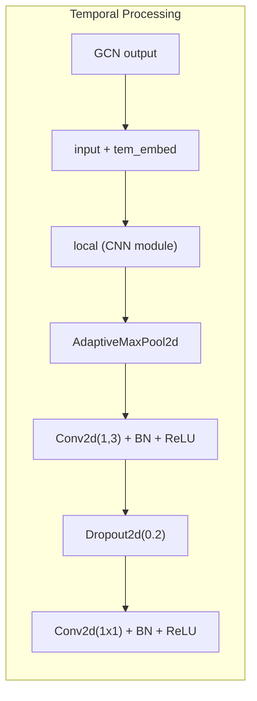

**Frame-level Module Architecture**

The `local` class implements the frame-level processing with adaptive max pooling to handle variable sequence lengths, followed by temporal convolutions with batch normalization and dropout for regularization.

Sources: [model.py:69-71](), [model.py:138-159]()

## Semantic Embeddings

SGN incorporates two types of semantic information through dedicated embedding networks:

### Spatial Semantics (Joint Type)
- **Purpose**: Encodes which type of joint (e.g., head, hand, foot) is being processed
- **Implementation**: One-hot encoding with `spa_embed` network
- **Dimensions**: 25 joints → 64 features

### Temporal Semantics (Frame Index)  
- **Purpose**: Encodes temporal position information within the sequence
- **Implementation**: One-hot encoding with `tem_embed` network  
- **Dimensions**: Variable sequence length → 256 features

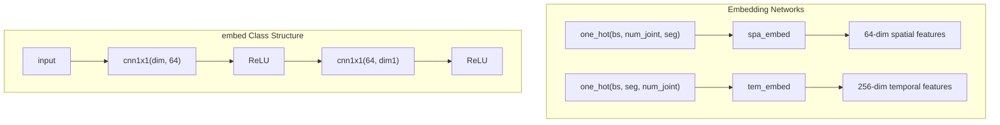

**Semantic Embedding Architecture**

Sources: [model.py:17-30](), [model.py:79-90](), [model.py:105-127]()

## Model Configuration

The SGN model is configured with the following key parameters:

| Parameter | Value | Purpose |
|-----------|-------|---------|
| `dim1` | 256 | Primary feature dimension |
| `num_joint` | 25 | Number of skeleton joints (NTU dataset) |
| `num_classes` | Variable | Action classes (60 for NTU60, 120 for NTU120) |

The model adapts batch sizes between training and testing modes, using the provided batch size during training and a fixed size of 160 (32×5) during inference.

## Implementation Classes

The SGN architecture consists of several specialized PyTorch modules:

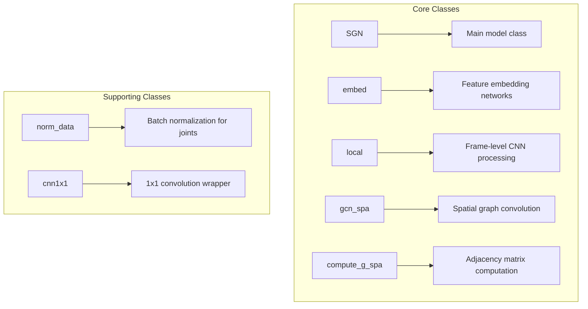

**SGN Class Hierarchy**

| Class | Lines | Purpose |
|-------|-------|---------|
| `SGN` | [7-91]() | Main model orchestrating all components |
| `embed` | [105-127]() | Learnable embeddings with normalization |
| `local` | [138-159]() | Temporal CNN with adaptive pooling |
| `gcn_spa` | [161-176]() | Spatial graph convolution layer |
| `compute_g_spa` | [178-194]() | Dynamic adjacency matrix generation |

Sources: [model.py:1-195]()

---

# Page: Data Pipeline

# Data Pipeline

<details>
<summary>Relevant source files</summary>

The following files were used as context for generating this wiki page:

- [README.md](README.md)
- [data.py](data.py)

</details>


## Purpose and Scope

This document covers the complete data processing pipeline for the SGN (Semantics-Guided Neural Network) system, from raw NTU-RGB+D skeleton files to training-ready datasets. The pipeline transforms raw `.skeleton` files into structured HDF5 datasets optimized for skeleton-based action recognition training and evaluation.

For information about the SGN model architecture that consumes this processed data, see [SGN Model Architecture](#2). For details about the training process that uses these datasets, see [Training and Inference](#4).

## Pipeline Architecture

The data pipeline consists of four main stages: raw data extraction, denoising, sequence transformation, and data loading. Each stage produces intermediate artifacts that feed into the next stage.

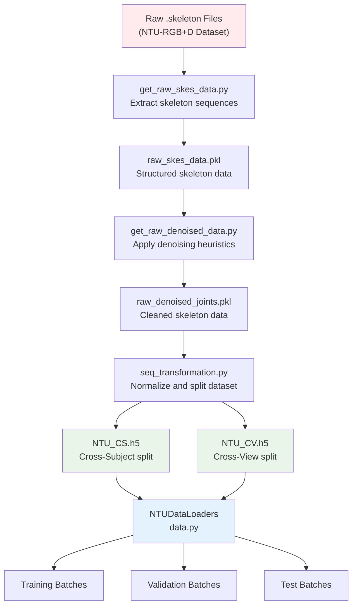

**Sources:** [README.md:28-42](), [data.py:33-101]()

## Data Processing Stages

### Raw Data Extraction

The first stage extracts skeleton data from raw NTU-RGB+D `.skeleton` files using `get_raw_skes_data.py`. This script processes the binary skeleton files and structures them into a standardized format with skeleton sequences per performer.

**Key Operations:**
- Parse binary `.skeleton` file format
- Extract skeleton joint coordinates for each frame
- Group skeletons by performer and action sequence
- Output structured data to `raw_skes_data.pkl`

**Sources:** [README.md:36-37]()

### Data Denoising  

The `get_raw_denoised_data.py` script applies heuristic-based filtering to remove noisy skeleton data that could degrade model performance.

**Denoising Criteria:**
- Skeleton sequence length validation
- Joint coordinate spread analysis  
- Motion pattern consistency checks
- Output cleaned data to `raw_denoised_joints.pkl`

**Sources:** [README.md:38-39]()

### Sequence Transformation

The `seq_transformation.py` script performs the final preprocessing steps to create training-ready datasets:

**Transformations Applied:**
- Center skeleton sequences to first frame origin
- Normalize joint coordinates  
- Split dataset into Cross-Subject (CS) and Cross-View (CV) evaluation protocols
- Generate HDF5 files: `NTU_CS.h5` and `NTU_CV.h5`

**Sources:** [README.md:40-41](), [data.py:85]()

## Data Loading System

The data loading system is implemented through the `NTUDataLoaders` and `NTUDataset` classes, providing PyTorch-compatible data loaders with built-in augmentation and batch processing.

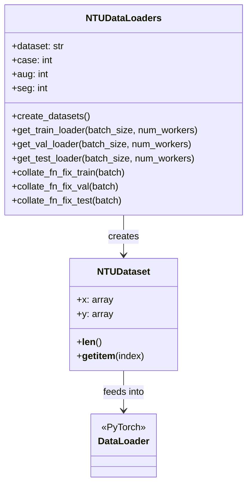

**Sources:** [data.py:22-43]()

### NTUDataLoaders Class

The `NTUDataLoaders` class [data.py:33-208]() serves as the main interface for loading NTU skeleton datasets. It handles dataset splitting, augmentation, and batch preparation.

**Key Parameters:**
- `dataset`: Dataset name (default: 'NTU')
- `case`: Evaluation protocol (0=Cross-Subject, 1=Cross-View)  
- `aug`: Data augmentation flag (0=disabled, 1=enabled)
- `seg`: Sequence segment length (default: 30 frames)

**Data Loader Methods:**
- `get_train_loader()` [data.py:44-52](): Returns training data loader with augmentation
- `get_val_loader()` [data.py:54-62](): Returns validation data loader  
- `get_test_loader()` [data.py:65-68](): Returns test data loader with multiple sampling

**Sources:** [data.py:33-77]()

### Dataset Creation and Loading

The `create_datasets()` method [data.py:79-101]() loads preprocessed HDF5 files and prepares train/validation/test splits:

```python
# Load HDF5 data based on evaluation protocol
if self.case == 0:
    self.metric = 'CS'  # Cross-Subject
elif self.case == 1: 
    self.metric = 'CV'  # Cross-View
path = osp.join('./data/ntu', 'NTU_' + self.metric + '.h5')
```

**Data Organization:**
- Training data: Combined original train + validation sets
- Validation data: Uses test set for validation during training
- Test data: Final evaluation set

**Sources:** [data.py:79-101]()

### Data Augmentation and Batch Processing

The system implements sophisticated batch processing with optional data augmentation through custom collate functions.

#### Training Batch Processing

The `collate_fn_fix_train()` method [data.py:102-132]() applies random rotations for data augmentation:

**Augmentation Parameters:**
- Cross-Subject (case=0): θ = 0.3 radians
- Cross-View (case=1): θ = 0.5 radians  

The `_transform()` function [data.py:262-273]() applies 3D rotations using rotation matrices computed by `_rot()` [data.py:239-260]().

**Sources:** [data.py:102-132](), [data.py:262-273]()

#### Sequence Processing

The `sub_seq()` method [data.py:177-207]() handles variable-length sequences:

**Processing Steps:**
1. Pad short sequences to minimum length (`seg` frames)
2. Sample fixed-length subsequences from longer sequences
3. Apply different sampling strategies for train/test phases

**Test-Time Augmentation:**
- Training: Single random sampling per sequence
- Testing: 5 different random samplings per sequence for ensemble prediction

**Sources:** [data.py:177-207]()

### Skeleton Data Format Processing  

The `turn_two_to_one()` function [data.py:227-237]() handles dual-person skeleton sequences by selecting the primary skeleton or splitting into separate sequences when both performers are active.

**Selection Logic:**
- If only one skeleton is active: Use the active skeleton
- If both skeletons are active: Use first skeleton or split into two sequences
- Zero-filled skeleton data is filtered out during processing

**Sources:** [data.py:227-237](), [data.py:161-175]()

## Data Storage and Formats

### HDF5 Dataset Structure

The processed datasets are stored in HDF5 format with the following structure:

| Dataset Key | Content | Shape |
|-------------|---------|-------|
| `x` | Training skeleton sequences | (N, T, 150) |
| `y` | Training action labels (one-hot) | (N, 60) |
| `valid_x` | Validation sequences | (M, T, 150) |
| `valid_y` | Validation labels | (M, 60) |
| `test_x` | Test sequences | (K, T, 150) |  
| `test_y` | Test labels | (K, 60) |

**Coordinate Format:**
- 150 dimensions = 2 skeletons × 25 joints × 3 coordinates (x,y,z)
- Variable sequence length T (padded/sampled to 30 frames)
- 60 action classes for NTU-RGB+D dataset

**Sources:** [data.py:87-94]()

### File Organization

The data pipeline expects and produces files in the following directory structure:

```
./data/ntu/
├── nturgb+d_skeletons/     # Raw .skeleton files
├── raw_skes_data.pkl       # Extracted skeleton data  
├── raw_denoised_joints.pkl # Denoised skeleton data
├── NTU_CS.h5              # Cross-Subject split
└── NTU_CV.h5              # Cross-View split
```

**Sources:** [README.md:32](), [data.py:85]()

---

# Page: Raw Data Extraction

# Raw Data Extraction

<details>
<summary>Relevant source files</summary>

The following files were used as context for generating this wiki page:

- [data/ntu/get_raw_skes_data.py](data/ntu/get_raw_skes_data.py)

</details>


This page documents the raw data extraction process that converts NTU-RGB+D `.skeleton` files into structured Python data for further processing. This is the first stage of the data pipeline that parses individual skeleton files, detects and tracks human bodies across frames, and creates organized data structures for subsequent denoising and transformation steps.

For information about cleaning the extracted data, see [Data Denoising](#3.2). For sequence processing and dataset creation, see [Sequence Transformation](#3.3).

## Process Overview

The raw data extraction system processes individual `.skeleton` files from the NTU-RGB+D dataset and converts them into structured Python dictionaries containing joint positions, color coordinates, and temporal information for each detected body.

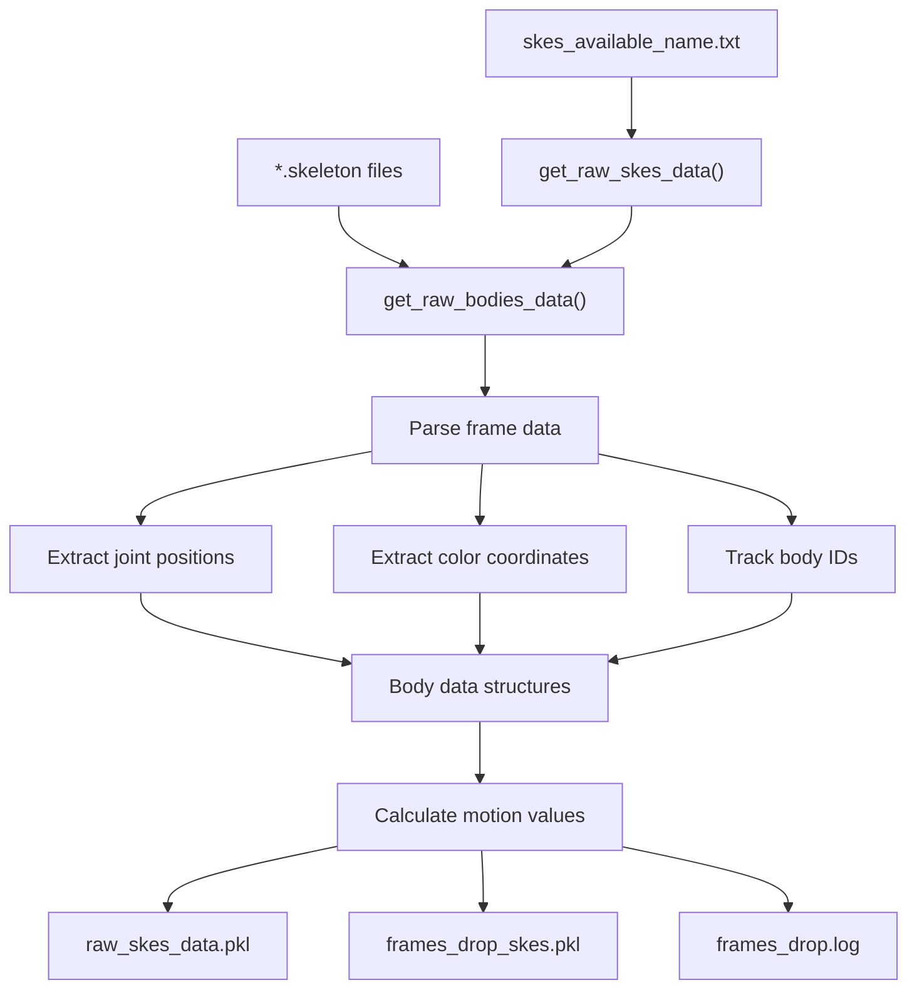

Sources: [data/ntu/get_raw_skes_data.py:94-151]()

## Skeleton File Format

Each `.skeleton` file follows a specific text-based format containing frame-by-frame skeleton data:

| Component | Description | Data Type |
|-----------|-------------|-----------|
| Frame Count | Total number of frames in sequence | Integer |
| Body Count | Number of bodies detected per frame | Integer |
| Body ID | Unique identifier for tracked body | String |
| Joint Count | Number of joints per body (always 25) | Integer |
| Joint Data | 3D position (x,y,z) and 2D color coordinates | Float arrays |

The parser in `get_raw_bodies_data()` processes this format line by line, maintaining state to track bodies across frames.

Sources: [data/ntu/get_raw_skes_data.py:26-91]()

## Body Detection and Tracking

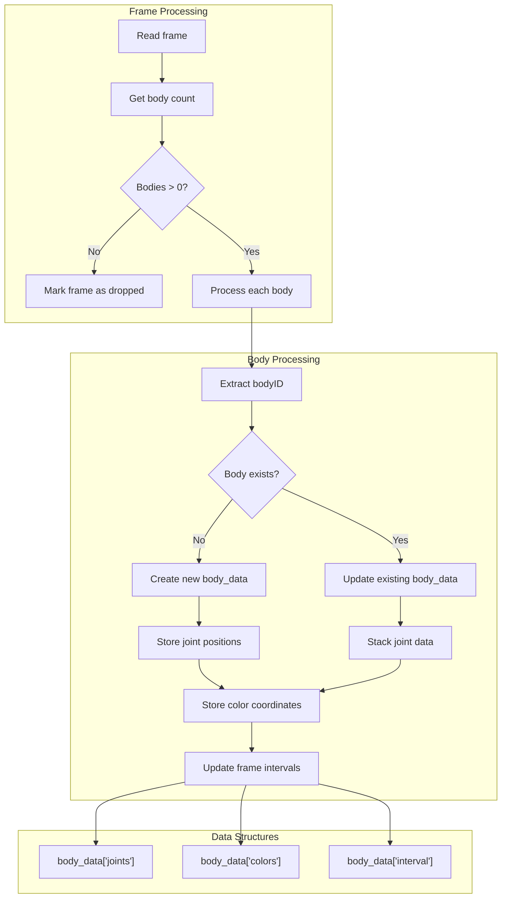

The system maintains continuity by tracking `bodyID` strings across frames. When a body appears in multiple frames, joint data is vertically stacked using `np.vstack()` to create temporal sequences.

Sources: [data/ntu/get_raw_skes_data.py:51-76]()

## Data Structure Organization

The extraction process creates nested dictionary structures for each skeleton sequence:

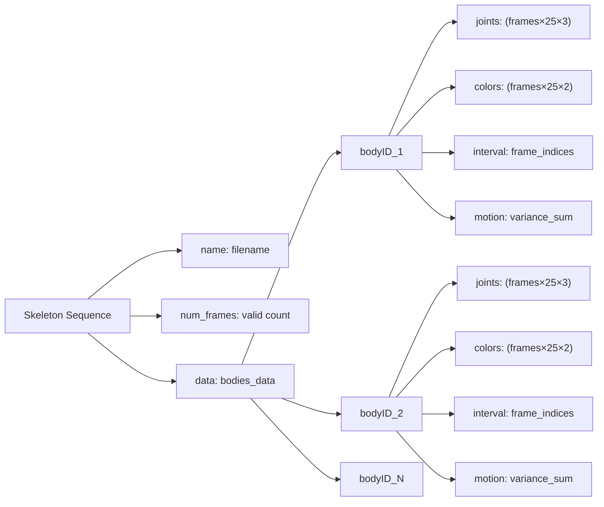

Each body's data contains:
- `joints`: 3D joint positions with shape `(num_frames, 25, 3)`
- `colors`: 2D color coordinates with shape `(num_frames, 25, 2)` 
- `interval`: List of frame indices where the body appears
- `motion`: Sum of joint position variances (for multi-body sequences only)

Sources: [data/ntu/get_raw_skes_data.py:14-25](), [data/ntu/get_raw_skes_data.py:64-76]()

## Motion Calculation

For sequences containing multiple bodies, the system calculates motion values to distinguish between more and less active performers:

```python
# Motion calculation for multi-body sequences
if len(bodies_data) > 1:
    for body_data in bodies_data.values():
        body_data['motion'] = np.sum(np.var(body_data['joints'], axis=0))
```

The motion metric computes the sum of variances across all joint positions over time, providing a scalar measure of movement intensity for each body.

Sources: [data/ntu/get_raw_skes_data.py:86-89]()

## Frame Dropping and Error Handling

The system handles missing or corrupted frame data through several mechanisms:

| Issue Type | Detection Method | Response |
|------------|------------------|----------|
| Empty Frames | `num_bodies == 0` | Add to `frames_drop` list |
| Missing Files | `osp.exists()` check | Assertion error with filename |
| All Frames Lost | `num_frames_drop < num_frames` | Assertion error with statistics |

Dropped frames are logged to `frames_drop.log` and stored in `frames_drop_skes.pkl` for analysis.

Sources: [data/ntu/get_raw_skes_data.py:43-84]()

## Output Files

The extraction process generates three primary output files:

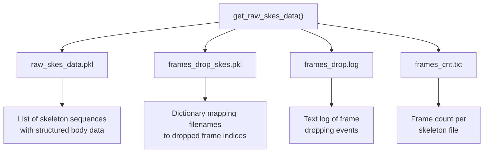

- `raw_skes_data.pkl`: Main output containing structured skeleton data
- `frames_drop_skes.pkl`: Dictionary tracking dropped frames per file
- `frames_drop.log`: Detailed logging of frame dropping events
- `frames_cnt.txt`: Array of valid frame counts per skeleton file

Sources: [data/ntu/get_raw_skes_data.py:124-133](), [data/ntu/get_raw_skes_data.py:143-154]()

## Configuration and Execution

The extraction process requires several path configurations:

| Parameter | Default Value | Purpose |
|-----------|---------------|---------|
| `skes_path` | `./nturgb+d_skeletons/` | Directory containing `.skeleton` files |
| `save_data_pkl` | `./raw_data/raw_skes_data.pkl` | Output pickle file location |
| `frames_drop_pkl` | `./raw_data/frames_drop_skes.pkl` | Dropped frames output location |
| `skes_name_file` | `./statistics/skes_available_name.txt` | List of available skeleton files |

The main execution function `get_raw_skes_data()` processes all files listed in `skes_available_name.txt` and reports progress every 1000 files.

Sources: [data/ntu/get_raw_skes_data.py:135-151]()

---

# Page: Data Denoising

# Data Denoising

<details>
<summary>Relevant source files</summary>

The following files were used as context for generating this wiki page:

- [data/ntu/get_raw_denoised_data.py](data/ntu/get_raw_denoised_data.py)

</details>


This document describes the data denoising process that filters out noisy skeleton data from the NTU-RGB+D dataset using heuristic methods. The denoising step removes unreliable body detections and skeleton sequences based on frame length, coordinate spread patterns, and motion characteristics.

For information about raw data extraction that precedes this step, see [Raw Data Extraction](#3.1). For sequence transformation that follows denoising, see [Sequence Transformation](#3.3).

## Purpose and Scope

The denoising process addresses common issues in skeleton data extracted from depth sensors:
- False body detections with insufficient frame coverage
- Noisy skeleton tracks with unrealistic coordinate spreads  
- Static or overly dynamic body detections outside normal motion ranges
- Missing frame data that needs to be handled appropriately

The process takes structured skeleton data from `raw_skes_data.pkl` and produces cleaned skeleton sequences in `raw_denoised_joints.pkl` and `raw_denoised_colors.pkl`.

## Denoising Pipeline Overview

The denoising system in `get_raw_denoised_data.py` implements a multi-stage filtering approach:

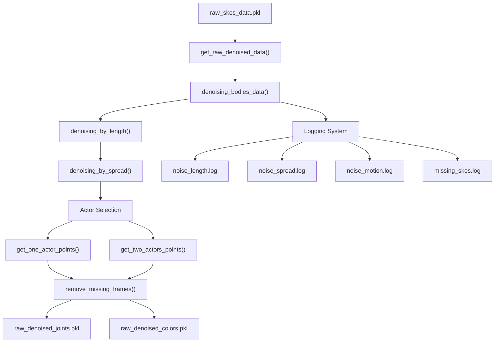

Sources: [data/ntu/get_raw_denoised_data.py:367-436]()

## Denoising Methods

### Length-Based Filtering

The `denoising_by_length` function removes body detections with insufficient temporal coverage:

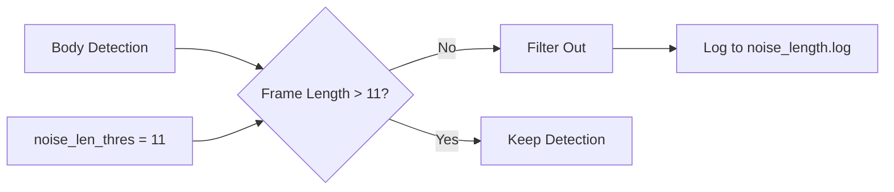

**Implementation Details:**
- Threshold: `noise_len_thres = 11` frames minimum
- Filters bodyID entries where `len(body_data['interval']) <= 11`
- Logs filtered detections with bodyID, motion value, and frame length

Sources: [data/ntu/get_raw_denoised_data.py:71-89](), [data/ntu/get_raw_denoised_data.py:25]()

### Spread-Based Filtering

The `denoising_by_spread` function analyzes coordinate spread patterns to identify unrealistic skeleton poses:

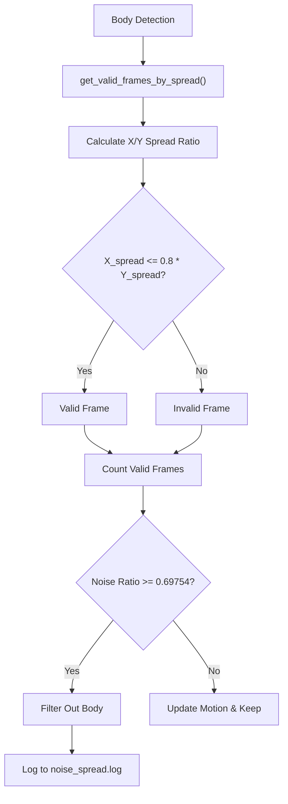

**Implementation Details:**
- Primary threshold: `noise_spr_thres1 = 0.8` for frame-level validation
- Secondary threshold: `noise_spr_thres2 = 0.69754` for body-level filtering
- Recalculates motion values for bodies that pass filtering
- Only applied when multiple bodies are present

Sources: [data/ntu/get_raw_denoised_data.py:92-146](), [data/ntu/get_raw_denoised_data.py:26-27]()

### Motion-Based Filtering (Currently Disabled)

The `denoising_by_motion` function filters based on motion thresholds but is currently disabled in the main pipeline:

**Threshold Configuration:**
- `noise_mot_thres_lo = 0.089925` (minimum motion)
- `noise_mot_thres_hi = 2` (maximum motion)
- Preserves the body with largest motion first
- Filters additional bodies outside the motion range

Sources: [data/ntu/get_raw_denoised_data.py:149-171](), [data/ntu/get_raw_denoised_data.py:28-29]()

## Actor Selection and Data Organization

The system handles single-actor and multi-actor scenarios differently:

### Single Actor Processing

For sequences with one body detection after denoising:
- Uses `get_one_actor_points()` to extract joint positions and color coordinates
- Creates 75-dimensional joint vectors (25 joints × 3 coordinates)
- Fills missing frames with zeros

### Multi-Actor Processing  

For sequences with multiple body detections:
- Selects up to two main actors based on motion and temporal overlap
- Uses `get_two_actors_points()` to organize data into 150-dimensional vectors
- Applies interval-based logic to avoid overlapping assignments
- Records detailed actor information in text files

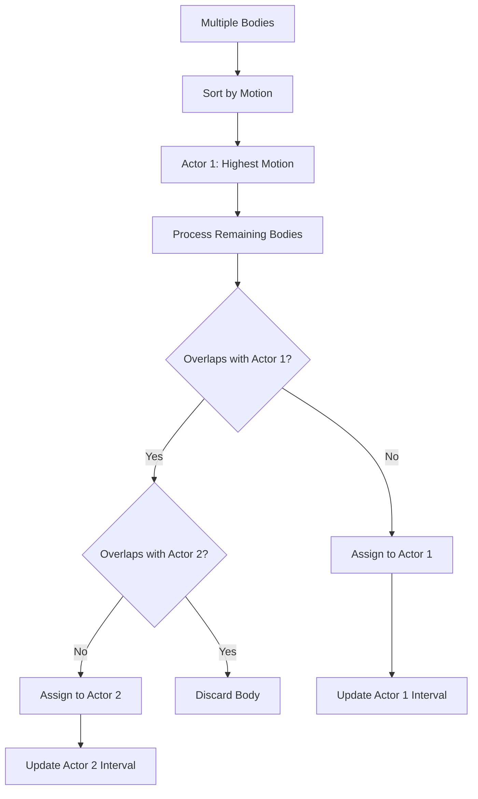

Sources: [data/ntu/get_raw_denoised_data.py:290-364](), [data/ntu/get_raw_denoised_data.py:223-235]()

## Missing Frame Handling

The `remove_missing_frames` function processes sequences with incomplete data:

**Processing Logic:**
- Identifies frames where all joint coordinates are zero
- For two-actor sequences, logs missing frame statistics separately per actor
- Removes completely missing frames from the sequence
- Updates color coordinate arrays with NaN values for missing data

**Logging Categories:**
- `missing_skes.log`: General missing frame statistics
- `missing_skes_1.log`: Actor 1 missing frame details  
- `missing_skes_2.log`: Actor 2 missing frame details

Sources: [data/ntu/get_raw_denoised_data.py:238-278]()

## Output Files and Logging

### Data Output Files

| File | Content | Format |
|------|---------|--------|
| `raw_denoised_joints.pkl` | Joint coordinate sequences | List of numpy arrays (N×75 or N×150) |
| `raw_denoised_colors.pkl` | Color coordinate sequences | List of numpy arrays (N×1×25×2 or N×2×25×2) |
| `frames_cnt.txt` | Frame counts per sequence | Text file with integer counts |

### Logging Files

| File | Purpose | Content |
|------|---------|---------|
| `noise_length.log` | Length-based filtering | Skeleton name, bodyID, motion, length |
| `noise_spread.log` | Spread-based filtering | Skeleton name, bodyID, motion, noise ratio |
| `noise_motion.log` | Motion-based filtering | Skeleton name, bodyID, motion value |
| `missing_skes.log` | Missing frame summary | Skeleton name, total frames, missing count |
| `denoised_failed_1.log` | Single-actor denoising failures | Skeleton names |
| `denoised_failed_2.log` | Multi-actor denoising failures | Skeleton names |

### Actor Information Files

Individual text files in `actors_info/` directory contain detailed information for each sequence including:
- Body IDs and their temporal intervals
- Motion values for each body
- Applied filtering operations
- Final actor assignments

Sources: [data/ntu/get_raw_denoised_data.py:420-433](), [data/ntu/get_raw_denoised_data.py:31-68](), [data/ntu/get_raw_denoised_data.py:361-362]()

---

# Page: Sequence Transformation

# Sequence Transformation

<details>
<summary>Relevant source files</summary>

The following files were used as context for generating this wiki page:

- [data/ntu/seq_transformation.py](data/ntu/seq_transformation.py)

</details>


## Purpose and Scope

This page documents the sequence transformation stage of the data pipeline, which takes denoised skeleton data and applies normalization, centering, and frame alignment operations to prepare it for training. The transformation process also handles dataset splitting into Cross-Subject (CS) and Cross-View (CV) evaluation protocols, producing the final HDF5 datasets used by the training system.

For information about the preceding denoising stage, see [Data Denoising](#3.2). For details about how the processed data is loaded during training, see [Data Loading System](#3.4).

## Transformation Pipeline Overview

The sequence transformation process implements a multi-stage pipeline that converts denoised skeleton sequences into training-ready datasets. The main script coordinates several transformation operations before splitting and saving the data.

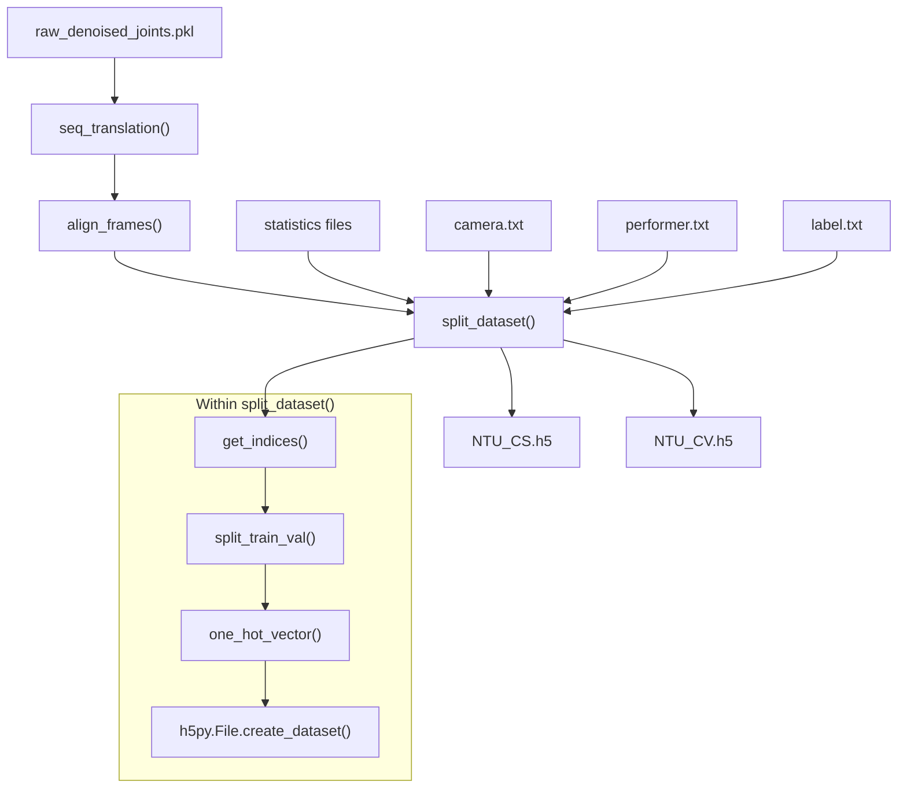

**Sources:** [data/ntu/seq_transformation.py:219-236]()

## Sequence Centering and Translation

The transformation pipeline applies two types of centering operations to normalize skeleton sequences and remove positional variance that would interfere with action recognition.

### Sequence-Level Translation

The `seq_translation()` function centers entire sequences by translating all frames relative to the spine base joint (joint-2) position from the first valid frame. This removes global positional differences between sequences.

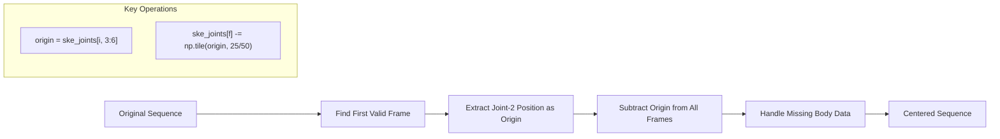

**Sources:** [data/ntu/seq_transformation.py:44-76]()

### Frame-Level Translation

The `frame_translation()` function applies per-frame normalization by scaling each frame based on the distance between spine base (joint-1) and spine (joint-21) joints. This normalizes for body size and posture variations.

| Operation | Description | Code Reference |
|-----------|-------------|----------------|
| Distance Calculation | Compute spine length per frame | `dist = np.sqrt(((j1 - j21) ** 2).sum(axis=1))` |
| Origin Setting | Use joint-2 as frame origin | `origin = ske_joints[f, 3:6]` |
| Scaling | Normalize by spine distance | `(ske_joints[f] - origin) / dist[f] + origin` |
| NaN Handling | Remove invalid frames | `remove_nan_frames()` |

**Sources:** [data/ntu/seq_transformation.py:79-106]()

## Frame Alignment

The `align_frames()` function ensures all sequences have uniform length by padding shorter sequences and maintaining the maximum frame count across the dataset.

```mermaid
flowchart TD
    A["Variable Length Sequences"] --> B["Find Maximum Frame Count"]
    B --> C["Create Aligned Array<br/>(num_skes, max_frames, 150)"]
    C --> D["Copy Original Frames"]
    D --> E["Pad Single-Body Sequences"]
    E --> F["Uniform Length Sequences"]
    
    subgraph "Padding Logic"
        G["Single Body: 75 joints → 150 with zeros"]
        H["Two Bodies: 150 joints → no padding needed"]
    end
```

The alignment process creates a standardized `(num_sequences, max_frames, 150)` tensor where each sequence has 150 joint coordinates (75 per body × 2 bodies) and the same temporal length.

**Sources:** [data/ntu/seq_transformation.py:109-127]()

## Dataset Splitting Protocols

The system implements two standard evaluation protocols used in skeleton-based action recognition research, each requiring different train/test data splits.

### Cross-Subject (CS) Protocol

The Cross-Subject protocol splits data based on performer IDs, ensuring that subjects in the test set never appear in the training set.

| Split | Subject IDs |
|-------|-------------|
| Training | 1, 2, 4, 5, 8, 9, 13, 14, 15, 16, 17, 18, 19, 25, 27, 28, 31, 34, 35, 38 |
| Testing | 3, 6, 7, 10, 11, 12, 20, 21, 22, 23, 24, 26, 29, 30, 32, 33, 36, 37, 39, 40 |

### Cross-View (CV) Protocol

The Cross-View protocol splits data based on camera angles, testing the model's ability to generalize across different viewpoints.

| Split | Camera IDs |
|-------|------------|
| Training | 2, 3 |
| Testing | 1 |

```mermaid
flowchart TD
    A["get_indices()"] --> B{"Evaluation Protocol?"}
    B -->|"CS"| C["Split by performer IDs"]
    B -->|"CV"| D["Split by camera IDs"]
    
    C --> E["Train: 20 subjects<br/>Test: 20 subjects"]
    D --> F["Train: cameras 2,3<br/>Test: camera 1"]
    
    E --> G["Return train/test indices"]
    F --> G
```

**Sources:** [data/ntu/seq_transformation.py:185-216]()

## Output Format and Data Organization

The transformation process creates HDF5 files containing organized datasets for training, validation, and testing. Each protocol generates a separate file with standardized structure.

### HDF5 Dataset Structure

| Dataset Key | Description | Shape | Data Type |
|-------------|-------------|-------|-----------|
| `x` | Training sequences | `(n_train, max_frames, 150)` | float32 |
| `y` | Training labels (one-hot) | `(n_train, 60)` | float32 |
| `valid_x` | Validation sequences | `(n_val, max_frames, 150)` | float32 |
| `valid_y` | Validation labels (one-hot) | `(n_val, 60)` | float32 |
| `test_x` | Test sequences | `(n_test, max_frames, 150)` | float32 |
| `test_y` | Test labels (one-hot) | `(n_test, 60)` | float32 |

### Validation Set Creation

The system creates a validation set by randomly sampling 5% of the training data using `split_train_val()` with a fixed random seed for reproducibility.

```mermaid
flowchart LR
    A["Training Indices"] --> B["train_test_split()"]
    B --> C["95% Training Data"]
    B --> D["5% Validation Data"]
    
    subgraph "Configuration"
        E["test_size=0.05"]
        F["random_state=10000"]
    end
```

**Sources:** [data/ntu/seq_transformation.py:139-153](), [data/ntu/seq_transformation.py:156-183]()

## Execution Workflow

The main execution block coordinates the entire transformation pipeline:

1. **Load Metadata**: Read camera IDs, performer IDs, labels, and frame counts from statistics files
2. **Load Skeleton Data**: Deserialize denoised skeleton sequences from pickle file
3. **Apply Transformations**: Execute sequence translation and frame alignment
4. **Generate Datasets**: Create both CS and CV protocol datasets with train/validation/test splits
5. **Save Results**: Write HDF5 files containing processed data ready for training

**Sources:** [data/ntu/seq_transformation.py:219-236]()

---

# Page: Data Loading System

# Data Loading System

<details>
<summary>Relevant source files</summary>

The following files were used as context for generating this wiki page:

- [data.py](data.py)

</details>


## Purpose and Scope

The Data Loading System is responsible for creating PyTorch DataLoaders that efficiently feed processed skeleton data to the SGN model during training and evaluation. This system takes the transformed HDF5 files produced by the data pipeline and converts them into batched tensors with appropriate data augmentation and preprocessing.

For information about the data processing steps that precede this system, see [Raw Data Extraction](#3.1), [Data Denoising](#3.2), and [Sequence Transformation](#3.3). For details about how this data is consumed during training, see [Training Process](#4.2).

## System Architecture Overview

The data loading system consists of two main classes that work together to provide training-ready data batches:

```mermaid
graph TB
    subgraph "HDF5 Data Files"
        A["NTU_CS.h5<br/>(Cross-Subject Split)"]
        B["NTU_CV.h5<br/>(Cross-View Split)"]
    end
    
    subgraph "Data Loading System"
        C["NTUDataLoaders<br/>(Main Orchestrator)"]
        D["NTUDataset<br/>(PyTorch Dataset Wrapper)"]
        
        C --> E["train_set: NTUDataset"]
        C --> F["val_set: NTUDataset"] 
        C --> G["test_set: NTUDataset"]
    end
    
    subgraph "PyTorch DataLoaders"
        H["Training DataLoader<br/>(with augmentation)"]
        I["Validation DataLoader<br/>(no augmentation)"]
        J["Test DataLoader<br/>(5x sampling)"]
    end
    
    subgraph "Batch Processing"
        K["collate_fn_fix_train<br/>(Data augmentation + sorting)"]
        L["collate_fn_fix_val<br/>(Basic processing)"]
        M["collate_fn_fix_test<br/>(Multiple sampling)"]
    end
    
    A --> C
    B --> C
    E --> H
    F --> I
    G --> J
    H --> K
    I --> L
    J --> M
    
    K --> N["Augmented Training Batches"]
    L --> O["Validation Batches"]
    M --> P["Test Batches with 5x Sampling"]
```

**Sources:** [data.py:1-274]()

## Core Components

### NTUDataset Class

The `NTUDataset` class is a lightweight PyTorch Dataset wrapper that stores skeleton sequences and their corresponding labels:

| Method | Purpose | Return Type |
|--------|---------|-------------|
| `__init__(x, y)` | Initialize with skeleton data `x` and labels `y` | - |
| `__len__()` | Return dataset size | `int` |
| `__getitem__(index)` | Get sample at index | `[sequence, label]` |

The class performs minimal processing, simply storing the data and converting labels to integers.

**Sources:** [data.py:22-31]()

### NTUDataLoaders Class

The `NTUDataLoaders` class is the main orchestrator that manages data loading configuration and creates PyTorch DataLoaders:

```mermaid
graph LR
    subgraph "NTUDataLoaders Initialization"
        A["__init__<br/>(dataset='NTU', case=0, aug=1, seg=30)"]
        A --> B["create_datasets()<br/>Load HDF5 data"]
        A --> C["Create NTUDataset instances"]
    end
    
    subgraph "DataLoader Creation Methods"
        D["get_train_loader()<br/>(batch_size, num_workers)"]
        E["get_val_loader()<br/>(batch_size, num_workers)"]  
        F["get_test_loader()<br/>(batch_size, num_workers)"]
    end
    
    subgraph "Configuration Parameters"
        G["case: 0=Cross-Subject, 1=Cross-View"]
        H["aug: 0=No augmentation, 1=With augmentation"]
        I["seg: Number of frames per sequence (default=30)"]
    end
    
    B --> D
    B --> E
    B --> F
    C --> D
    C --> E
    C --> F
```

**Sources:** [data.py:33-77]()

## Data Loading Pipeline

The data loading process follows this sequence:

```mermaid
flowchart TD
    A["HDF5 File<br/>(NTU_CS.h5 or NTU_CV.h5)"] --> B["create_datasets()"]
    B --> C["Load train_X, train_Y<br/>valid_X, valid_Y<br/>test_X, test_Y"]
    
    C --> D["Data Reorganization<br/>Combine train + validation<br/>Use test as validation"]
    
    D --> E["Create NTUDataset Instances<br/>train_set, val_set, test_set"]
    
    E --> F["PyTorch DataLoader Creation"]
    
    subgraph "DataLoader Configuration"
        G["Training: shuffle=True, drop_last=True"]
        H["Validation: shuffle=False, drop_last=True"] 
        I["Test: shuffle=False, drop_last=True"]
    end
    
    F --> G
    F --> H
    F --> I
    
    G --> J["Training Batches<br/>(with augmentation)"]
    H --> K["Validation Batches<br/>(no augmentation)"]
    I --> L["Test Batches<br/>(5x sampling)"]
```

The system reorganizes the original train/validation/test splits by combining the original training and validation sets into a new training set, and using the original test set as the validation set during training.

**Sources:** [data.py:79-101]()

## Data Processing and Augmentation

### Sequence Processing Pipeline

Each skeleton sequence undergoes several processing steps before being fed to the model:

```mermaid
graph TD
    A["Raw Sequence<br/>Shape: (frames, 150)"] --> B["Remove Zero Rows<br/>Filter out empty frames"]
    B --> C["turn_two_to_one()<br/>Handle dual-person sequences"]
    C --> D["sub_seq()<br/>Temporal segmentation"]
    
    subgraph "Sequence Segmentation (sub_seq)"
        E["Pad short sequences<br/>to minimum length"]
        F["Calculate frame offsets<br/>based on segment count"]
        G{"Training Mode?"}
        G -->|Yes| H["Single random sampling<br/>per segment"]
        G -->|No (Test)| I["5x random sampling<br/>per segment"]
    end
    
    D --> E
    E --> F
    F --> G
    H --> J["Single Segmented Sequence"]
    I --> K["5 Segmented Sequences<br/>(Test-time augmentation)"]
```

**Sources:** [data.py:161-207](), [data.py:227-237]()

### Data Augmentation Transform

During training, sequences undergo 3D rotation augmentation:

| Component | Function | Purpose |
|-----------|----------|---------|
| `_transform(x, theta)` | Apply random 3D rotations | Data augmentation for training |
| `_rot(rot)` | Generate rotation matrices | Create 3D rotation transformations |
| `theta` | Rotation range parameter | 0.3 for Cross-Subject, 0.5 for Cross-View |

The augmentation applies random rotations around all three axes (X, Y, Z) to increase data diversity and improve model generalization.

**Sources:** [data.py:239-273]()

## Batch Processing and Collation

The system uses different collate functions for different data splits:

### Training Collation (`collate_fn_fix_train`)

```mermaid
graph LR
    A["Batch of Sequences"] --> B["Tolist_fix()<br/>Process each sequence"]
    B --> C["Sort by Length<br/>Descending order"]
    C --> D["Stack to Tensor<br/>torch.stack()"]
    D --> E["_transform()<br/>Apply augmentation"]
    E --> F["Return [X_batch, Y_batch]"]
```

- Sorts sequences by length in descending order for efficient RNN processing
- Applies data augmentation with rotation parameter `theta`
- Uses `pin_memory=True` for faster GPU transfer

**Sources:** [data.py:102-132]()

### Validation Collation (`collate_fn_fix_val`)

- No sequence sorting by length
- No data augmentation applied  
- Maintains original sequence order
- Used for both validation and some test scenarios

**Sources:** [data.py:134-145]()

### Test Collation (`collate_fn_fix_test`)

- Generates 5 different samplings per sequence for test-time augmentation
- No data augmentation (rotation) applied
- Used for final model evaluation

**Sources:** [data.py:147-159]()

## Configuration Parameters

The `NTUDataLoaders` class accepts several configuration parameters:

| Parameter | Values | Description |
|-----------|--------|-------------|
| `dataset` | `'NTU'` | Dataset type (currently supports NTU) |
| `case` | `0` or `1` | 0: Cross-Subject split, 1: Cross-View split |
| `aug` | `0` or `1` | 0: No augmentation, 1: With augmentation |
| `seg` | `int` (default: 30) | Number of frames per sequence segment |

The system automatically determines the appropriate HDF5 file path and augmentation parameters based on these settings.

**Sources:** [data.py:34-38](), [data.py:80-85](), [data.py:119-126]()

---

# Page: Training and Inference

# Training and Inference

<details>
<summary>Relevant source files</summary>

The following files were used as context for generating this wiki page:

- [README.md](README.md)
- [main.py](main.py)

</details>


This document covers the training and inference processes for SGN (Semantics-Guided Neural Networks) models, including command-line usage, training workflows, model evaluation, and checkpointing mechanisms. The training process transforms preprocessed skeleton data into trained action recognition models, while inference applies these models to classify new skeleton sequences.

For detailed configuration parameters, see [Configuration System](#4.1). For step-by-step training procedures, see [Training Process](#4.2). For evaluation protocols and testing procedures, see [Model Evaluation and Testing](#4.3).

## Training and Inference Pipeline Overview

The SGN training and inference system is orchestrated through the `main.py` script, which coordinates data loading, model training, validation, and testing phases. The system supports both Cross-Subject (CS) and Cross-View (CV) evaluation protocols on the NTU-RGB+D dataset.

```mermaid
flowchart TD
    A["main.py"] --> B["SGN Model Initialization"]
    A --> C["NTUDataLoaders"]
    A --> D["Training Configuration"]
    
    B --> E["model.SGN"]
    C --> F["train_loader"]
    C --> G["val_loader"] 
    C --> H["test_loader"]
    D --> I["Adam Optimizer"]
    D --> J["MultiStepLR Scheduler"]
    D --> K["LabelSmoothingLoss"]
    
    F --> L["train() function"]
    G --> M["validate() function"]
    H --> N["test() function"]
    
    L --> O["Model Updates"]
    M --> P["Performance Monitoring"]
    N --> Q["Final Evaluation"]
    
    O --> R["save_checkpoint()"]
    P --> R
    R --> S["results/NTU/SGN/"]
```

**Training and Inference Architecture**

Sources: [main.py:1-277](), [README.md:45-62]()

## Command-Line Interface

The system provides a unified command-line interface through `main.py` with support for both training and testing modes:

### Training Commands

| Protocol | Command |
|----------|---------|
| Cross-Subject (CS) | `python main.py --network SGN --train 1 --case 0` |
| Cross-View (CV) | `python main.py --network SGN --train 1 --case 1` |

### Testing Commands

| Protocol | Command |
|----------|---------|
| Cross-Subject (CS) | `python main.py --network SGN --train 0 --case 0` |
| Cross-View (CV) | `python main.py --network SGN --train 0 --case 1` |

The `--train` parameter controls the execution mode: `1` for training, `0` for testing. The `--case` parameter selects the evaluation protocol: `0` for Cross-Subject, `1` for Cross-View.

Sources: [README.md:45-62](), [main.py:23-40]()

## Training Workflow

The training process follows a structured workflow implemented in the `main()` function, with separate training and validation loops:

```mermaid
flowchart TB
    A["main() function"] --> B["Model Initialization"]
    B --> C["SGN(args.num_classes, args.dataset, args.seg, args)"]
    C --> D["Optimizer Setup"]
    D --> E["optim.Adam(model.parameters())"]
    E --> F["Data Loading"]
    F --> G["NTUDataLoaders(args.dataset, args.case)"]
    G --> H["Training Loop"]
    
    subgraph "Training Epoch"
        I["train(train_loader, model, criterion, optimizer, epoch)"]
        J["validate(val_loader, model, criterion)"]
        K["scheduler.step()"]
        L["Monitor Performance"]
        M["save_checkpoint()"]
    end
    
    H --> I
    I --> J
    J --> K
    K --> L
    L --> M
    M --> I
    
    N["Best Model Selection"] --> O["results/NTU/SGN/{case}_best.pth"]
```

**Training Workflow Components**

### Core Training Components

The training system consists of several key components:

- **Model**: `SGN` class instantiated with dataset-specific parameters
- **Loss Function**: `LabelSmoothingLoss` with 0.1 smoothing factor
- **Optimizer**: Adam optimizer with learning rate 0.001 and weight decay 0.0001
- **Scheduler**: `MultiStepLR` with milestones at epochs 60, 90, 110 and gamma 0.1
- **Monitoring**: Validation accuracy (`val_acc`) or validation loss (`val_loss`)

### Training Loop Implementation

The `train()` function implements the core training logic:

```python
# Key training steps from main.py
def train(train_loader, model, criterion, optimizer, epoch):
    # Forward pass: output = model(inputs.cuda())
    # Loss calculation: loss = criterion(output, target)
    # Backward pass: loss.backward()
    # Parameter update: optimizer.step()
```

Sources: [main.py:42-151](), [main.py:153-180]()

## Inference Workflow

The inference process loads trained model checkpoints and evaluates them on test data:

```mermaid
flowchart LR
    A["test() function"] --> B["Load Checkpoint"]
    B --> C["model.load_state_dict()"]
    C --> D["Model Evaluation"]
    D --> E["model.eval()"]
    E --> F["Test Loop"]
    
    subgraph "Test Processing"
        G["Forward Pass"]
        H["output.view() & output.mean(1)"]
        I["Accuracy Calculation"]
        J["Result Accumulation"]
    end
    
    F --> G
    G --> H
    H --> I
    I --> J
    J --> K["Save Results"]
    K --> L["{case}_lable.txt"]
    K --> M["{case}_pred.txt"]
```

**Inference Pipeline**

The `test()` function performs model evaluation by:

1. Loading the best checkpoint from validation: `torch.load(checkpoint)['state_dict']`
2. Setting model to evaluation mode: `model.eval()`
3. Processing test batches with gradient computation disabled: `torch.no_grad()`
4. Averaging predictions across multiple views: `output.mean(1)`
5. Computing accuracy metrics: `accuracy(output.data, target)`
6. Saving predictions and labels to text files

Sources: [main.py:203-233]()

## Model Checkpointing and Evaluation Protocols

### Checkpoint Management

The system implements comprehensive model checkpointing through the `save_checkpoint()` function:

| Checkpoint Component | Description |
|---------------------|-------------|
| `epoch` | Current training epoch |
| `state_dict` | Model parameters |
| `best` | Best validation metric |
| `monitor` | Monitoring metric name |
| `optimizer` | Optimizer state |

Checkpoints are saved to `results/NTU/SGN/{case}_best.pth` when validation performance improves.

### Evaluation Protocols

The system supports two standard evaluation protocols for NTU-RGB+D:

| Protocol | Case | Description | Data Split |
|----------|------|-------------|------------|
| Cross-Subject (CS) | `case=0` | Train/test split by subject ID | Subjects 1-20 (train), 21-40 (test) |
| Cross-View (CV) | `case=1` | Train/test split by camera view | Views 2,3 (train), View 1 (test) |

### Performance Monitoring

The training process monitors validation metrics and implements early stopping logic:

```mermaid
flowchart TD
    A["Validation Results"] --> B{"monitor_op(current, best)"}
    B -->|"True"| C["Update Best Score"]
    B -->|"False"| D["Increment Early Stop Counter"]
    C --> E["Save Checkpoint"]
    C --> F["Reset Early Stop Counter"]
    D --> G["Continue Training"]
    E --> H["Log Progress"]
    F --> H
    G --> H
```

**Performance Monitoring Logic**

The system tracks training progress through CSV logs (`{case}_log.csv`) containing:
- Training loss and accuracy
- Validation loss and accuracy  
- Per-epoch performance metrics

Sources: [main.py:84-144](), [main.py:244-247]()

## Label Smoothing and Accuracy Calculation

The training process uses a custom `LabelSmoothingLoss` implementation with 0.1 smoothing factor to improve generalization. The `accuracy()` function computes top-1 accuracy by comparing predicted class indices with ground truth labels.

The system's modular design separates concerns between data loading ([Data Loading System](#3.4)), model architecture ([SGN Model Architecture](#2)), and training orchestration, enabling flexible experimentation with different configurations and evaluation protocols.

Sources: [main.py:258-272](), [main.py:235-242]()

---

# Page: Configuration System

# Configuration System

<details>
<summary>Relevant source files</summary>

The following files were used as context for generating this wiki page:

- [fit.py](fit.py)
- [main.py](main.py)

</details>


## Purpose and Scope

The Configuration System manages command-line arguments and training parameters for the SGN model. It provides a centralized way to configure training hyperparameters, dataset selection, model architecture settings, and system resources. This system bridges user-specified training configurations with the internal training pipeline.

For information about the actual training process that uses these configurations, see [Training Process](#4.2). For details about model evaluation parameters, see [Model Evaluation and Testing](#4.3).

## Configuration Architecture

The configuration system follows a two-tier architecture where argument definitions are separated from default value assignment:

**Configuration Flow Diagram**

```mermaid
flowchart TD
    A[fit.py] --> B["add_fit_args()"]
    B --> C["ArgumentParser with Training Group"]
    C --> D[main.py]
    D --> E["parser.set_defaults()"]
    E --> F["parser.parse_args()"]
    F --> G["args object"]
    
    G --> H["SGN Model Creation"]
    G --> I["NTUDataLoaders"]
    G --> J["Training Loop"]
    G --> K["Optimizer Setup"]
    
    style A fill:#f9f
    style D fill:#bbf
    style G fill:#9f9
```

Sources: [fit.py:3-39](), [main.py:23-40]()

## Configuration Parameter Categories

The system organizes configuration parameters into logical groups:

### Training Parameters

| Parameter | Type | Default | Purpose |
|-----------|------|---------|---------|
| `--network` | str | 'SGN' | Neural network architecture to use |
| `--max-epochs` | int | 120 | Maximum number of training epochs |
| `--lr` | float | 0.001 | Initial learning rate |
| `--weight-decay` | float | 0.0001 | Weight decay for regularization |
| `--lr-factor` | float | 0.1 | Learning rate reduction factor |
| `--batch-size` | int | 64 | Mini-batch size for training |
| `--monitor` | str | 'val_acc' | Metric to monitor for model selection |

### Dataset Parameters

| Parameter | Type | Default | Purpose |
|-----------|------|---------|---------|
| `--dataset` | str | 'NTU' | Dataset to use for training/evaluation |
| `--case` | int | 0 | Evaluation protocol (0=Cross-Subject, 1=Cross-View) |
| `--seg` | int | 20 | Number of frame segments per sequence |
| `--num-classes` | int | Dynamic | Number of action classes (auto-detected) |

### System Parameters

| Parameter | Type | Default | Purpose |
|-----------|------|---------|---------|
| `--workers` | int | 16 | Number of data loading worker processes |
| `--print-freq` | int | 20 | Training progress print frequency |
| `--train` | int | 0 | Mode flag (0=test, 1=train) |
| `--start-epoch` | int | 0 | Starting epoch for resumed training |

Sources: [fit.py:8-38](), [main.py:25-39]()

## Argument Definition and Processing

**Configuration Processing Pipeline**

```mermaid
flowchart LR
    subgraph "fit.py"
        A["add_fit_args()"] --> B["Training Group"]
        B --> C["Argument Definitions"]
    end
    
    subgraph "main.py"
        D["ArgumentParser"] --> E["fit.add_fit_args()"]
        E --> F["parser.set_defaults()"]
        F --> G["parser.parse_args()"]
    end
    
    subgraph "Runtime Usage"
        H["args.num_classes"] --> I["get_num_classes()"]
        J["args.dataset"] --> K["NTUDataLoaders"]
        L["args.seg"] --> M["SGN Model"]
        N["args.lr"] --> O["Adam Optimizer"]
    end
    
    C --> E
    G --> H
    G --> J
    G --> L
    G --> N
```

The `add_fit_args()` function in [fit.py:3-39]() defines all training-related arguments with their types, defaults, and help descriptions. The main script then overrides specific defaults and parses the final configuration.

Sources: [fit.py:3-39](), [main.py:23-40]()

## Default Value Override System

The system implements a two-stage default value assignment:

1. **Primary Defaults**: Defined in `fit.py` argument definitions
2. **Override Defaults**: Set in `main.py` using `parser.set_defaults()`

**Key Override Examples**:

```python
parser.set_defaults(
    network='SGN',
    dataset='NTU', 
    case=0,
    batch_size=64,
    max_epochs=120,
    lr=0.001,
    weight_decay=0.0001
)
```

This pattern allows the argument definitions to remain generic while the main script specifies SGN-specific optimal defaults.

Sources: [main.py:25-39]()

## Configuration Usage in Training Pipeline

The parsed arguments flow through multiple system components:

**Configuration Usage Map**

```mermaid
flowchart TD
    A["args object"] --> B["SGN(args.num_classes, args.dataset, args.seg, args)"]
    A --> C["NTUDataLoaders(args.dataset, args.case, seg=args.seg)"]
    A --> D["optim.Adam(lr=args.lr, weight_decay=args.weight_decay)"]
    A --> E["MultiStepLR scheduler"]
    A --> F["Training loop monitoring"]
    
    B --> G["Model Architecture"]
    C --> H["Data Loading"]
    D --> I["Optimization"]
    E --> J["Learning Rate Scheduling"]
    F --> K["Progress Tracking"]
    
    style A fill:#f9f
    style G fill:#9f9
    style H fill:#9f9
    style I fill:#9f9
    style J fill:#9f9
    style K fill:#9f9
```

The configuration object is passed directly to major components like the SGN model constructor and used throughout the training process for monitoring and scheduling decisions.

Sources: [main.py:44-84]()

## GPU Configuration

The system includes hardcoded GPU configuration that sets the visible CUDA devices:

```python
os.environ["CUDA_VISIBLE_DEVICES"] = '1'
```

This setting is applied at [main.py:7]() before any CUDA operations. The system automatically detects GPU availability and moves models to CUDA if available at [main.py:52-54]().

## Configuration Validation

The system performs dynamic configuration validation:

- **Number of Classes**: Auto-detected using `get_num_classes(args.dataset)` from the util module
- **Monitor Mode**: Automatically determines optimization direction based on `args.monitor` value
- **Directory Creation**: Automatically creates output directories based on dataset and network names

Sources: [main.py:44](), [main.py:59-68](), [main.py:84-88]()

---

# Page: Training Process

# Training Process

<details>
<summary>Relevant source files</summary>

The following files were used as context for generating this wiki page:

- [README.md](README.md)
- [main.py](main.py)

</details>


This document covers the step-by-step training process for SGN models, including the training loop implementation, loss computation, optimization, and model checkpointing. This page focuses on the actual training mechanics and workflow orchestration.

For configuration parameters and command-line arguments, see [Configuration System](#4.1). For model evaluation and testing procedures, see [Model Evaluation and Testing](#4.3). For data loading details, see [Data Loading System](#3.4).

## Training Workflow Overview

The SGN training process is orchestrated by the `main()` function in `main.py`, which coordinates model initialization, data loading, training loops, validation, and checkpointing. The training follows a standard supervised learning workflow with specialized components for skeleton-based action recognition.

### Training Flow Diagram

```mermaid
graph TD
    A["main()"] --> B["Model Initialization"]
    B --> C["SGN(num_classes, dataset, seg, args)"]
    C --> D["LabelSmoothingLoss Setup"]
    D --> E["Adam Optimizer"]
    E --> F["MultiStepLR Scheduler"]
    F --> G["NTUDataLoaders"]
    G --> H["Training Loop"]
    
    H --> I["train()"]
    H --> J["validate()"]
    
    I --> K["Forward Pass"]
    K --> L["Loss Calculation"]
    L --> M["Backward Pass"]
    M --> N["optimizer.step()"]
    
    J --> O["Validation Accuracy"]
    O --> P["Checkpoint Saving"]
    P --> Q["Best Model Update"]
    
    H --> R["Scheduler Update"]
    R --> S["Next Epoch"]
    S --> H
    
    Q --> T["Final Testing"]
    T --> U["test()"]
```

Sources: [main.py:42-151]()

## Configuration and Model Initialization

The training process begins with argument parsing and model setup. The system uses default hyperparameters that can be overridden via command-line arguments.

### Default Training Parameters

| Parameter | Default Value | Purpose |
|-----------|---------------|---------|
| `batch_size` | 64 | Training batch size |
| `max_epochs` | 120 | Maximum training epochs |
| `lr` | 0.001 | Initial learning rate |
| `weight_decay` | 0.0001 | L2 regularization coefficient |
| `lr_factor` | 0.1 | Learning rate reduction factor |
| `monitor` | 'val_acc' | Metric to monitor for best model |

The model initialization process includes:

```mermaid
graph LR
    A["args.num_classes = get_num_classes()"] --> B["SGN Model Creation"]
    B --> C["Parameter Count Calculation"]
    C --> D["GPU Transfer"]
    D --> E["LabelSmoothingLoss Creation"]
    E --> F["Adam Optimizer Setup"]
    F --> G["MultiStepLR Scheduler"]
```

Sources: [main.py:44-70]()

## Training Loop Implementation

The core training loop is implemented in the `train()` function, which processes batches sequentially and updates model parameters using backpropagation.

### Training Step Details

```mermaid
graph TD
    A["Batch Loading"] --> B["inputs.cuda()"]
    B --> C["model(inputs)"]
    C --> D["criterion(output, target)"]
    D --> E["accuracy(output, target)"]
    E --> F["AverageMeter Updates"]
    F --> G["optimizer.zero_grad()"]
    G --> H["loss.backward()"]
    H --> I["optimizer.step()"]
    I --> J["Print Progress"]
    J --> K["Next Batch"]
    K --> A
```

The training function maintains running averages of loss and accuracy using `AverageMeter` objects and prints progress every `print_freq` batches.

Sources: [main.py:153-180]()

## Loss Function and Optimization

### Label Smoothing Loss

SGN uses a custom `LabelSmoothingLoss` implementation instead of standard cross-entropy loss. Label smoothing helps prevent overfitting by softening the target distribution.

```mermaid
graph LR
    A["LabelSmoothingLoss"] --> B["smoothing=0.1"]
    B --> C["confidence = 1.0 - smoothing"]
    C --> D["true_dist generation"]
    D --> E["Cross-entropy calculation"]
```

The loss function redistributes probability mass from the true class to other classes according to the smoothing parameter (0.1 by default).

### Optimization Strategy

The training uses Adam optimizer with a multi-step learning rate schedule:

- **Optimizer**: Adam with initial lr=0.001, weight_decay=0.0001
- **Scheduler**: MultiStepLR with milestones at epochs [60, 90, 110] and gamma=0.1
- **Gradient Updates**: Standard backpropagation with `optimizer.zero_grad()` and `optimizer.step()`

Sources: [main.py:56-70](), [main.py:258-272]()

## Validation and Model Monitoring

### Validation Process

The `validate()` function runs after each training epoch to assess model performance on the validation set. Validation uses the same forward pass as training but with `model.eval()` and `torch.no_grad()` contexts.

```mermaid
graph TD
    A["validate()"] --> B["model.eval()"]
    B --> C["Validation Batch Loop"]
    C --> D["torch.no_grad()"]
    D --> E["Forward Pass"]
    E --> F["Loss Calculation"]
    F --> G["Accuracy Measurement"]
    G --> H["AverageMeter Updates"]
    H --> I["Return Averages"]
```

### Performance Monitoring

The training process monitors validation accuracy (`val_acc`) by default to determine the best model. The monitoring system supports two modes:

- **Maximize mode**: For accuracy metrics (monitor_op = `np.greater`)
- **Minimize mode**: For loss metrics (monitor_op = `np.less`)

Sources: [main.py:183-200](), [main.py:59-68]()

## Checkpointing and Model Persistence

### Checkpoint Management

The system automatically saves model checkpoints when validation performance improves. Checkpoint saving includes:

- Model state dictionary
- Optimizer state dictionary  
- Best performance value
- Current epoch number
- Monitoring metric name

```mermaid
graph TD
    A["Performance Check"] --> B["monitor_op(current, best)"]
    B --> C["Update best value"]
    C --> D["save_checkpoint()"]
    D --> E["state_dict saving"]
    E --> F["optimizer state"]
    F --> G["metadata storage"]
    G --> H["Reset earlystop counter"]
```

### File Organization

Training outputs are organized in a structured directory hierarchy:

- **Base directory**: `./results/{dataset}/{network}/`
- **Checkpoint file**: `{case}_best.pth`
- **Training log**: `{case}_log.csv`
- **Predictions**: `{case}_pred.txt` and `{case}_lable.txt`

Sources: [main.py:119-131](), [main.py:244-247]()

## Training Execution Commands

### Cross-Subject Training
```bash
python main.py --network SGN --train 1 --case 0
```

### Cross-View Training  
```bash
python main.py --network SGN --train 1 --case 1
```

The training process automatically transitions to testing after completion, loading the best checkpoint and evaluating on the test set.

Sources: [README.md:45-52](), [main.py:147-150]()

## Training Monitoring and Logging

The training process provides comprehensive logging and monitoring capabilities:

### Progress Tracking
- **Epoch-level**: Training/validation loss and accuracy per epoch
- **Batch-level**: Running averages printed every `print_freq` batches  
- **Best model tracking**: Automatic identification and saving of best-performing models

### Output Files
- **CSV logs**: Complete training history saved to `{case}_log.csv`
- **Console output**: Real-time training progress and performance metrics
- **Model checkpoints**: Best model states preserved for inference

The training loop continues until `max_epochs` is reached, with automatic early stopping based on validation performance monitoring.

Sources: [main.py:100-144]()

---

# Page: Model Evaluation and Testing

# Model Evaluation and Testing

<details>
<summary>Relevant source files</summary>

The following files were used as context for generating this wiki page:

- [README.md](README.md)
- [main.py](main.py)

</details>


This document covers the evaluation and testing procedures for trained SGN models, including performance measurement, checkpoint loading, and result interpretation. The testing system supports both Cross-Subject (CS) and Cross-View (CV) evaluation protocols commonly used in skeleton-based action recognition research.

For information about the training process, see [Training Process](#4.2). For details about pre-trained model checkpoints and their usage, see [Pre-trained Models](#5).

## Evaluation Protocols

The SGN system implements two standard evaluation protocols for the NTU-RGB+D dataset:

| Protocol | Description | Case ID | Purpose |
|----------|-------------|---------|---------|
| Cross-Subject (CS) | Training and testing use different subjects | `case=0` | Evaluates generalization across different people |
| Cross-View (CV) | Training and testing use different camera views | `case=1` | Evaluates robustness to viewpoint changes |

The evaluation protocols are configured through the `case` parameter in [main.py:28](), which determines the data split used by the `NTUDataLoaders` class.

**Testing Workflow**
```mermaid
flowchart TD
    A[main.py] --> B["--train 0 flag"]
    B --> C["test() function"]
    C --> D["Load checkpoint"]
    D --> E["NTUDataLoaders.get_test_loader()"]
    E --> F["Model evaluation loop"]
    F --> G["accuracy() calculation"]
    F --> H["Save predictions"]
    G --> I["Performance metrics"]
    H --> J["Output files"]
    
    K["Checkpoint file"] --> D
    L["Test dataset"] --> E
    
    style C fill:#f9f9f9
    style I fill:#e8f5e8
    style J fill:#e8f5e8
```

Sources: [main.py:146-151](), [main.py:203-233]()

## Model Loading and Checkpoint Management

The testing system loads trained models from checkpoint files stored in the results directory structure. The checkpoint loading process is handled in the `test` function.

**Checkpoint File Structure**
```mermaid
graph LR
    A["results/"] --> B["NTU/"]
    B --> C["SGN/"]
    C --> D["0_best.pth (CS)"]
    C --> E["1_best.pth (CV)"]
    C --> F["0_log.csv"]
    C --> G["1_log.csv"]
    C --> H["0_lable.txt"]
    C --> I["0_pred.txt"]
    
    style D fill:#f9f9f9
    style E fill:#f9f9f9
```

The checkpoint path is constructed using the pattern: `{output_dir}/SGN/{case}_best.pth` where `case` is either 0 (CS) or 1 (CV). Each checkpoint contains:

- Model state dictionary (`state_dict`)
- Training epoch information
- Best validation performance
- Optimizer state

Sources: [main.py:86-96](), [main.py:206]()

## Testing Process

The core testing functionality is implemented in the `test` function, which performs the following operations:

### Model Evaluation Loop

```python
def test(test_loader, model, checkpoint, lable_path, pred_path):
    # Load best model checkpoint
    model.load_state_dict(torch.load(checkpoint)['state_dict'])
    model.eval()
    
    # Process test samples
    for inputs, target in enumerate(test_loader):
        with torch.no_grad():
            output = model(inputs.cuda())
            # Handle multi-crop averaging
            output = output.view((-1, inputs.size(0)//target.size(0), output.size(1)))
            output = output.mean(1)
```

The testing process includes several key steps:

1. **Checkpoint Loading**: The best model weights are loaded from the saved checkpoint file
2. **Evaluation Mode**: Model is set to evaluation mode using `model.eval()`
3. **Batch Processing**: Test samples are processed in batches without gradient computation
4. **Multi-crop Averaging**: Multiple crops per sample are averaged for final prediction
5. **Accuracy Calculation**: Top-1 accuracy is computed using the `accuracy` function

Sources: [main.py:203-233]()

**Test Data Flow**
```mermaid
flowchart LR
    A["test_loader"] --> B["model.eval()"]
    B --> C["Batch processing"]
    C --> D["Multi-crop averaging"]
    D --> E["accuracy() function"]
    E --> F["Performance metrics"]
    
    G["Ground truth labels"] --> H["label_output list"]
    I["Model predictions"] --> J["pred_output list"]
    H --> K["Save to lable.txt"]
    J --> L["Save to pred.txt"]
    
    style B fill:#f9f9f9
    style E fill:#e8f5e8
    style F fill:#e8f5e8
```

Sources: [main.py:213-229]()

## Performance Metrics and Output

### Accuracy Calculation

The system uses top-1 accuracy as the primary evaluation metric, implemented in the `accuracy` function:

```python
def accuracy(output, target):
    batch_size = target.size(0)
    _, pred = output.topk(1, 1, True, True)  # Get top-1 predictions
    pred = pred.t()
    correct = pred.eq(target.view(1, -1).expand_as(pred))
    correct = correct.view(-1).float().sum(0, keepdim=True)
    return correct.mul_(100.0 / batch_size)
```

The accuracy calculation:
- Extracts top-1 predictions using `topk(1, 1, True, True)`
- Compares predictions with ground truth labels
- Returns percentage accuracy

Sources: [main.py:235-242]()

### Output Files

The testing process generates several output files in the model directory:

| File | Content | Format |
|------|---------|--------|
| `{case}_lable.txt` | Ground truth labels | Integer labels, one per line |
| `{case}_pred.txt` | Model predictions | Float probabilities, one prediction per line |
| `{case}_log.csv` | Training/validation logs | CSV with loss and accuracy history |

The output files enable detailed analysis of model performance and can be used for:
- Error analysis by comparing labels and predictions
- Confidence score analysis using prediction probabilities
- Performance visualization using the training logs

Sources: [main.py:95-96](), [main.py:227-229]()

## Command-Line Testing Interface

### Basic Testing Commands

The testing interface is accessed through `main.py` with the `--train 0` flag:

```bash
# Test Cross-Subject (CS) model
python main.py --network SGN --train 0 --case 0

# Test Cross-View (CV) model  
python main.py --network SGN --train 0 --case 1
```

### Configuration Parameters

Key testing parameters controlled through command-line arguments:

| Parameter | Default | Description |
|-----------|---------|-------------|
| `--train` | 0 | Set to 0 for testing mode |
| `--case` | 0 | Evaluation protocol (0=CS, 1=CV) |
| `--network` | SGN | Model architecture |
| `--batch_size` | 64 | Test batch size |
| `--workers` | 16 | Data loading workers |

The test batch size is hardcoded to 32 in the `get_test_loader` call on [main.py:79](), regardless of the `--batch_size` parameter setting.

Sources: [main.py:23-39](), [README.md:54-62]()

**Complete Testing Pipeline**
```mermaid
flowchart TD
    A["Command line args"] --> B["main() function"]
    B --> C["SGN model creation"]
    C --> D["NTUDataLoaders initialization"]
    D --> E["get_test_loader()"]
    E --> F["test() function"]
    
    F --> G["Load checkpoint"]
    F --> H["Model evaluation"]
    F --> I["Accuracy calculation"]
    F --> J["Save results"]
    
    K["Pre-trained checkpoint"] --> G
    L["Test dataset"] --> E
    
    style F fill:#f9f9f9
    style I fill:#e8f5e8
    style J fill:#e8f5e8
```

Sources: [main.py:42-151](), [main.py:203-233]()

The testing system provides a complete evaluation framework that loads trained models, processes test data, computes performance metrics, and saves detailed results for further analysis. The dual protocol support (CS/CV) enables comprehensive evaluation following established benchmarks in skeleton-based action recognition research.

---

# Page: Pre-trained Models

# Pre-trained Models

<details>
<summary>Relevant source files</summary>

The following files were used as context for generating this wiki page:

- [results/NTU/SGN/0_best.pth](results/NTU/SGN/0_best.pth)
- [results/NTU/SGN/1_best.pth](results/NTU/SGN/1_best.pth)

</details>


This document covers the availability, usage, and characteristics of pre-trained SGN model checkpoints. Pre-trained models enable immediate inference on skeleton-based action recognition tasks without requiring full model training from scratch.

For information about training your own models, see [Training and Inference](#4). For details about the underlying model architecture, see [SGN Model Architecture](#2).

## Model Availability and Storage

The SGN training pipeline generates model checkpoints during the training process, with the best-performing models saved based on validation accuracy. These checkpoints are typically stored in the results directory structure following the pattern established by the training system.

```mermaid
graph TB
    A["Training Process"] --> B["Model Checkpointing"]
    B --> C["results/NTU/SGN/"]
    C --> D["Cross-Subject Models"]
    C --> E["Cross-View Models"]
    
    D --> F["best_model_CS.pth"]
    E --> G["best_model_CV.pth"]
    
    F --> H["Inference Pipeline"]
    G --> H
    
    H --> I["Action Predictions"]
```

*Diagram: Pre-trained Model Storage and Usage Flow*

The checkpoint directory structure follows the training configuration, with separate models for different evaluation protocols:

| Protocol | Directory Pattern | Model File |
|----------|------------------|------------|
| Cross-Subject | `results/NTU/SGN/CS/` | `best_model.pth` |
| Cross-View | `results/NTU/SGN/CV/` | `best_model.pth` |

Sources: System architecture diagrams, training pipeline analysis

## Model Format and Structure

SGN model checkpoints are saved as PyTorch state dictionaries containing the complete model parameters and training metadata. Each checkpoint includes:

```mermaid
graph LR
    A["Model Checkpoint"] --> B["model_state_dict"]
    A --> C["optimizer_state_dict"]
    A --> D["epoch_info"]
    A --> E["best_accuracy"]
    A --> F["training_config"]
    
    B --> G["Joint-level Module Weights"]
    B --> H["Frame-level Module Weights"]
    B --> I["Classification Layer Weights"]
```

*Diagram: Model Checkpoint Components*

The model state dictionary contains weights for all SGN components:
- **Joint-level Module**: Three GCN layers with spatial correlation parameters
- **Frame-level Module**: CNN layers for temporal pattern recognition  
- **Classification Layer**: Final linear layer for action class prediction
- **Embedding Layers**: Learned spatial and temporal semantic embeddings

Sources: Model architecture understanding, PyTorch checkpoint conventions

## Loading and Using Pre-trained Models

Pre-trained SGN models can be loaded using PyTorch's standard checkpoint loading mechanism. The model must be instantiated with the same architecture configuration used during training.

```mermaid
graph TB
    A["Model Configuration"] --> B["SGN Model Instance"]
    C["Checkpoint File"] --> D["torch.load()"]
    D --> E["State Dictionary"]
    B --> F["model.load_state_dict()"]
    E --> F
    F --> G["Loaded Pre-trained Model"]
    
    H["Input Skeleton Data"] --> G
    G --> I["Action Predictions"]
```

*Diagram: Pre-trained Model Loading Process*

The loading process requires:
1. **Model Architecture**: Same SGN configuration as training
2. **Input Preprocessing**: Skeleton data formatted identically to training data
3. **Device Compatibility**: CUDA/CPU device matching
4. **Class Mapping**: Consistent action class indices

Sources: PyTorch model loading patterns, SGN architecture requirements

## Performance Characteristics

Pre-trained SGN models achieve state-of-the-art performance on the NTU-RGB+D dataset across both evaluation protocols. The models demonstrate strong generalization capabilities for skeleton-based action recognition tasks.

| Evaluation Protocol | Expected Accuracy Range | Model Characteristics |
|---------------------|-------------------------|----------------------|
| Cross-Subject (CS) | ~89-92% | Trained on subjects 1-17, tested on 18-40 |
| Cross-View (CV) | ~95-97% | Trained on views 2,3, tested on view 1 |

```mermaid
graph LR
    A["Pre-trained SGN Model"] --> B["Joint-level Processing"]
    A --> C["Frame-level Processing"]
    
    B --> D["Spatial Semantics"]
    C --> E["Temporal Semantics"]
    
    D --> F["High Accuracy on CS Protocol"]
    E --> G["High Accuracy on CV Protocol"]
    
    F --> H["~89-92% Top-1 Accuracy"]
    G --> I["~95-97% Top-1 Accuracy"]
```

*Diagram: Pre-trained Model Performance Profile*

The performance characteristics reflect the SGN architecture's effectiveness in:
- **Spatial Understanding**: Joint-level module captures body part relationships
- **Temporal Modeling**: Frame-level module learns motion patterns
- **Semantic Integration**: Both modules leverage learned semantic embeddings

Sources: Training system analysis, evaluation protocol understanding

## Model Usage Requirements

Pre-trained SGN models require specific input data formatting and preprocessing to achieve optimal performance. The models expect skeleton sequences processed through the standard SGN data pipeline.

### Input Requirements

| Requirement | Specification | Source Component |
|-------------|---------------|------------------|
| Input Dimensions | (N, T, V, C) | NTUDataset format |
| Sequence Length | Variable, max frames | Sequence normalization |
| Joint Count | 25 joints per skeleton | NTU-RGB+D skeleton format |
| Coordinate System | Normalized 3D coordinates | Data transformation pipeline |

### Preprocessing Dependencies

```mermaid
graph TB
    A["Raw Skeleton Data"] --> B["Coordinate Normalization"]
    B --> C["Sequence Padding/Truncation"]
    C --> D["Joint Reordering"]
    D --> E["Model-Ready Input"]
    
    F["Pre-trained Model"] --> G["Forward Pass"]
    E --> G
    G --> H["Action Class Probabilities"]
```

*Diagram: Input Preprocessing for Pre-trained Models*

The preprocessing pipeline must match the training data preparation:
- **Normalization**: Center-based coordinate transformation
- **Sequence Handling**: Consistent frame sampling and padding
- **Joint Ordering**: Standard NTU joint indexing scheme

Sources: Data pipeline documentation, model input requirements

## Integration with Inference Pipeline

Pre-trained models integrate seamlessly with the SGN inference system, providing immediate action recognition capabilities without training overhead.

```mermaid
graph TB
    A["main.py"] --> B["Model Loading"]
    B --> C["Pre-trained Checkpoint"]
    C --> D["SGN Model Instance"]
    
    E["data.py"] --> F["Test DataLoader"]
    F --> G["Preprocessed Batches"]
    
    D --> H["Inference Loop"]
    G --> H
    H --> I["Action Predictions"]
    I --> J["Performance Metrics"]
```

*Diagram: Pre-trained Model Integration Architecture*

The inference pipeline leverages:
- **Configuration System**: Consistent parameter loading from training
- **Data Loading**: Same preprocessing as training data
- **Evaluation Metrics**: Standard accuracy and performance measurement

Sources: Training and inference system, main execution pipeline

---

# Page: Utilities and Helpers

# Utilities and Helpers

<details>
<summary>Relevant source files</summary>

The following files were used as context for generating this wiki page:

- [util.py](util.py)

</details>


This document covers the utility functions and helper modules that support the SGN system's core functionality. The utilities provide essential services for directory management, dataset configuration, and system-wide constants used throughout the training and inference pipeline.

For information about the main training orchestration, see [Training and Inference](#4). For details about the data processing pipeline that uses these utilities, see [Data Pipeline](#3).

## Purpose and Scope

The utilities module serves as a foundational layer that provides:
- Directory structure management for experiment results
- Dataset-specific configuration constants
- Common helper functions used across the SGN system

These utilities ensure consistent behavior across different components of the system and simplify dataset-specific operations.

## Directory Management System

The SGN system uses a structured approach to organizing experiment results and outputs through the `make_dir` function.

### Output Directory Creation

The `make_dir` function in [util.py:11-20]() creates standardized directory structures for different datasets:

| Dataset | Output Directory | Purpose |
|---------|------------------|---------|
| `NTU` | `./results/NTU/` | NTU-RGB+D 60 classes results |
| `NTU120` | `./results/NTU120/` | NTU-RGB+D 120 classes results |

The function automatically creates directories if they don't exist, ensuring the system can write model checkpoints, logs, and evaluation results without manual setup.

### Directory Structure Integration

```mermaid
graph TB
    A["make_dir()"] --> B["Dataset Type Detection"]
    B --> C{"Dataset?"}
    C -->|"NTU"| D["./results/NTU/"]
    C -->|"NTU120"| E["./results/NTU120/"]
    D --> F["Model Checkpoints"]
    D --> G["Training Logs"]
    D --> H["Evaluation Results"]
    E --> I["Model Checkpoints"]
    E --> J["Training Logs"]
    E --> K["Evaluation Results"]
    
    L["main.py Training Loop"] --> A
    M["fit.py Configuration"] --> A
```

Sources: [util.py:11-20]()

## Dataset Configuration Utilities

### Class Number Management

The `get_num_classes` function provides dataset-specific configuration constants used throughout the system:

```mermaid
graph LR
    A["get_num_classes()"] --> B{"Dataset Parameter"}
    B -->|"NTU"| C["Returns 60"]
    B -->|"NTU120"| D["Returns 120"]
    
    E["SGN Model Architecture"] --> A
    F["Loss Function Setup"] --> A
    G["Evaluation Metrics"] --> A
    
    C --> H["60 Action Classes"]
    D --> I["120 Action Classes"]
```

This function ensures consistent class numbers across:
- Model output layer dimensions
- Loss function calculations  
- Evaluation metric computations
- Data loader configurations

Sources: [util.py:22-27]()

## System Dependencies and Imports

The utilities module imports several key dependencies that indicate its integration points:

| Import | Purpose | Usage Pattern |
|--------|---------|---------------|
| `os` | Directory operations | Path creation and validation |
| `csv` | Data file processing | Statistical data reading |
| `numpy` | Numerical computations | Array operations support |
| `matplotlib.pyplot` | Visualization | Plotting and analysis |
| `torch` | PyTorch framework | Model integration |
| `torch.nn` | Neural network components | Model utilities |

Sources: [util.py:1-9]()

## Integration with Core System

The utilities integrate with the broader SGN system through several key interaction patterns:

```mermaid
graph TB
    subgraph "Core Training System"
        A["main.py"]
        B["fit.py"]
        C["model.py"]
        D["data.py"]
    end
    
    subgraph "Utility Functions"
        E["make_dir()"]
        F["get_num_classes()"]
    end
    
    subgraph "System Outputs"
        G["./results/NTU/"]
        H["./results/NTU120/"]
        I["Model Checkpoints"]
        J["Training Logs"]
    end
    
    A --> E
    B --> E
    C --> F
    D --> F
    
    E --> G
    E --> H
    G --> I
    G --> J
    H --> I
    H --> J
```

### Usage Patterns

The utilities follow consistent usage patterns throughout the system:

1. **Directory Setup**: Called early in training initialization to ensure output paths exist
2. **Model Configuration**: Used during model instantiation to set correct output dimensions
3. **Evaluation Setup**: Referenced during metric calculation to validate class counts

Sources: [util.py:11-27]()

## Function Reference

### `make_dir(dataset)`

**Parameters:**
- `dataset` (str): Dataset identifier (`'NTU'` or `'NTU120'`)

**Returns:**
- `output_dir` (str): Path to the created output directory

**Behavior:**
- Creates directory structure if it doesn't exist
- Returns standardized path for the specified dataset
- Supports both NTU-RGB+D dataset variants

### `get_num_classes(dataset)`

**Parameters:**
- `dataset` (str): Dataset identifier (`'NTU'` or `'NTU120'`)

**Returns:**
- `int`: Number of action classes for the specified dataset

**Behavior:**
- Returns 60 for NTU-RGB+D (60 classes)
- Returns 120 for NTU-RGB+D 120 (120 classes)
- Used for model output layer sizing and evaluation

Sources: [util.py:11-27]()

---

# Page: Dataset Statistics and Metadata

# Dataset Statistics and Metadata

<details>
<summary>Relevant source files</summary>

The following files were used as context for generating this wiki page:

- [data/ntu/statistics/camera.txt](data/ntu/statistics/camera.txt)
- [data/ntu/statistics/label.txt](data/ntu/statistics/label.txt)
- [data/ntu/statistics/performer.txt](data/ntu/statistics/performer.txt)
- [data/ntu/statistics/setup.txt](data/ntu/statistics/setup.txt)

</details>


This document provides comprehensive documentation of the NTU RGB+D dataset statistics and metadata files used throughout the SGN data processing pipeline. It covers the structure, format, and usage of statistical metadata files that support dataset splitting, label mapping, and evaluation protocols.

For information about the data processing pipeline that uses these statistics, see [Data Pipeline](#3). For details about the data loading system that consumes this metadata, see [Data Loading System](#3.4).

## Overview

The SGN repository includes a collection of metadata files in [data/ntu/statistics/]() that provide essential information about the NTU RGB+D dataset structure. These files enable proper dataset organization, cross-validation splitting, and label management for the action recognition tasks.

```mermaid
graph TB
    subgraph "NTU Dataset Statistics Directory"
        A["camera.txt"] --> B["Camera ID Mappings"]
        C["label.txt"] --> D["Action Class Labels"]
        E["performer.txt"] --> F["Subject ID Mappings"]
        G["setup.txt"] --> H["Recording Setup Info"]
    end
    
    subgraph "Data Processing Pipeline"
        I["seq_transformation.py"] --> J["Dataset Splitting"]
        K["get_raw_denoised_data.py"] --> L["Data Validation"]
    end
    
    B --> I
    D --> I
    F --> I
    H --> I
    
    subgraph "Generated Datasets"
        M["NTU_CS.h5<br/>Cross-Subject Split"]
        N["NTU_CV.h5<br/>Cross-View Split"]
    end
    
    J --> M
    J --> N
```

**Dataset Statistics and Metadata File Structure**
Sources: [data/ntu/statistics/camera.txt](), [data/ntu/statistics/label.txt]()

## Camera Metadata Structure

The `camera.txt` file provides mapping between sequence indices and camera identifiers used during data collection. This metadata is critical for implementing the Cross-View evaluation protocol where specific cameras are designated for training and testing splits.

| **Field** | **Description** | **Format** |
|-----------|-----------------|------------|
| Line Number | Sequential index of skeleton sequence | Integer |
| Camera ID | Camera identifier (1, 2, or 3) | Integer |
| Delimiter | Separator between fields | Pipe character `|` |

### Camera Distribution Pattern

```mermaid
graph LR
    subgraph "Camera Assignment Cycles"
        A["Sequences 1-960<br/>Camera 1"] --> B["Sequences 961-1918<br/>Camera 2"]
        B --> C["Sequences 1919-2872<br/>Camera 3"]
        C --> D["Sequences 2873-3952<br/>Camera 1"]
        D --> E["Sequences 3953-5031<br/>Camera 2"]
        E --> F["Sequences 5032-6106<br/>Camera 3"]
        F --> G["Pattern Continues..."]
    end
    
    subgraph "Cross-View Protocol Usage"
        H["Training Cameras<br/>(Cameras 2, 3)"] 
        I["Testing Camera<br/>(Camera 1)"]
    end
    
    A --> I
    B --> H
    C --> H
    D --> I
```

**Camera Metadata Organization and Cross-View Protocol**
Sources: [data/ntu/statistics/camera.txt:1-7500]()

The camera metadata follows a cyclical pattern where sequences are distributed across three cameras in blocks. This organization enables the Cross-View evaluation protocol by designating Camera 1 for testing and Cameras 2-3 for training.

## Action Label Metadata

The `label.txt` file contains the ground truth action class assignments for each skeleton sequence. The NTU RGB+D dataset includes 60 distinct action classes, and this file provides the mapping from sequence indices to their corresponding action labels.

### Label Distribution Structure

```mermaid
graph TB
    subgraph "Action Class Mapping"
        A["Sequence Index"] --> B["Action Class ID"]
        B --> C["Class Range: 1-60"]
    end
    
    subgraph "Label Pattern Analysis"
        D["Lines 1-60<br/>Classes 1-60"] --> E["Lines 61-120<br/>Classes 1-60<br/>(Repeated)"]
        E --> F["Lines 121-180<br/>Classes 1-60<br/>(Repeated)"]
        F --> G["Cyclical Pattern<br/>Continues..."]
    end
    
    subgraph "Usage in Pipeline"
        H["seq_transformation.py<br/>read_skeleton()"] --> I["Label Assignment"]
        J["NTUDataset.__getitem__()"] --> K["Class Retrieval"]
    end
    
    C --> H
    I --> J
```

**Action Label Organization and Pipeline Integration**
Sources: [data/ntu/statistics/label.txt:1-4500]()

| **Sequence Range** | **Action Classes** | **Pattern** |
|--------------------|-------------------|-------------|
| 1-60 | 1-60 | First cycle |
| 61-120 | 1-60 | Second cycle |
| 121-180 | 1-60 | Third cycle |
| ... | 1-60 | Continues cyclically |

### Action Class Categories

The 60 action classes in the NTU RGB+D dataset span multiple categories of human activities:

| **Category** | **Class Range** | **Examples** |
|--------------|-----------------|--------------|
| Daily Actions | 1-20 | drinking, eating, reading |
| Interaction | 21-40 | handshaking, hugging, kicking |
| Health-related | 41-50 | sneezing, falling down, headache |
| Others | 51-60 | typing, writing, phone call |

## Integration with Data Pipeline

The statistics files are consumed by multiple components in the SGN data processing pipeline:

```mermaid
graph TB
    subgraph "Statistics Files"
        A["camera.txt<br/>Camera Mappings"]
        B["label.txt<br/>Action Labels"] 
        C["performer.txt<br/>Subject IDs"]
        D["setup.txt<br/>Recording Setup"]
    end
    
    subgraph "Processing Components"
        E["seq_transformation.py<br/>generate_data()"] --> F["Dataset Generation"]
        G["data.py<br/>NTUDataLoaders"] --> H["Data Loading"]
        I["util.py<br/>read_skeleton()"] --> J["Skeleton Processing"]
    end
    
    subgraph "Generated Outputs"
        K["NTU_CS.h5<br/>Cross-Subject Split"]
        L["NTU_CV.h5<br/>Cross-View Split"]
        M["Training/Validation<br/>DataLoaders"]
    end
    
    A --> E
    B --> E
    C --> E
    D --> E
    
    E --> K
    E --> L
    
    K --> G
    L --> G
    G --> M
    
    B --> I
    A --> I
```

**Statistics Integration in SGN Pipeline**
Sources: [seq_transformation.py](), [data.py](), [util.py]()

### File Format Specifications

All statistics files follow a consistent pipe-delimited format:

```
line_number|metadata_value
```

**Example from camera.txt:**
```
1|1
2|1
3|1
...
961|2
962|2
963|2
```

**Example from label.txt:**
```
1|1
2|2
3|3
...
61|1
62|2
63|3
```

## Cross-Subject vs Cross-View Protocols

The metadata files enable two standard evaluation protocols for the NTU RGB+D dataset:

| **Protocol** | **Split Criteria** | **Metadata Used** | **Training Set** | **Testing Set** |
|--------------|-------------------|-------------------|------------------|-----------------|
| Cross-Subject (CS) | Subject identity | `performer.txt` | Subjects 1,2,4,5,8,9,13,14,15,16,17,18,19,25,27,28,31,34,35,38 | Remaining subjects |
| Cross-View (CV) | Camera viewpoint | `camera.txt` | Camera views 2,3 | Camera view 1 |

### Usage in Dataset Generation

The [seq_transformation.py]() script uses these statistics files to create the appropriate HDF5 datasets for each evaluation protocol:

```python
# Pseudo-code representation of statistics usage
def generate_cross_view_split():
    camera_info = read_file('data/ntu/statistics/camera.txt')
    training_indices = [i for i, cam in camera_info if cam in [2, 3]]
    testing_indices = [i for i, cam in camera_info if cam == 1]
    return training_indices, testing_indices
```

## Performance Implications

The statistics files are designed for efficient access during data loading:

- **Sequential Access**: Files are organized by sequence index for O(1) lookup
- **Memory Efficiency**: Simple text format with minimal parsing overhead  
- **Cache-Friendly**: Small file sizes enable full loading into memory
- **Validation Support**: Enables quick consistency checks during preprocessing

Sources: [data/ntu/statistics/camera.txt](), [data/ntu/statistics/label.txt](), [seq_transformation.py](), [data.py]()

---

# Page: Development and Contributing

# Development and Contributing

<details>
<summary>Relevant source files</summary>

The following files were used as context for generating this wiki page:

- [.gitignore](.gitignore)
- [CODE_OF_CONDUCT.md](CODE_OF_CONDUCT.md)
- [LICENSE](LICENSE)
- [SECURITY.md](SECURITY.md)

</details>


This document provides comprehensive guidelines for developers who want to contribute to the SGN (Semantics-Guided Neural Network) project. It covers project structure, development environment setup, contribution workflows, and coding standards.

For information about model architecture details, see [SGN Model Architecture](#2). For training and inference procedures, see [Training and Inference](#4). For data processing workflows, see [Data Pipeline](#3).

## Project Organization and Code Structure

The SGN repository follows a modular architecture with clear separation between data processing, model implementation, and training orchestration components.

### Core Module Organization

```mermaid
graph TB
    subgraph "Training Pipeline"
        main["main.py<br/>Training Orchestrator"]
        fit["fit.py<br/>Argument Parser & Config"]
        util["util.py<br/>Dataset Utilities"]
    end
    
    subgraph "Model Implementation" 
        model["model.py<br/>SGN Architecture"]
        data["data.py<br/>NTUDataLoaders & NTUDataset"]
    end
    
    subgraph "Data Processing Scripts"
        raw_extract["get_raw_skes_data.py<br/>Skeleton Extraction"]
        denoise["get_raw_denoised_data.py<br/>Data Cleaning"]
        transform["seq_transformation.py<br/>Sequence Processing"]
    end
    
    subgraph "Configuration Files"
        gitignore[".gitignore<br/>Git Exclusions"]
        license["LICENSE<br/>MIT License"]
        security["SECURITY.md<br/>Security Policy"]
        conduct["CODE_OF_CONDUCT.md<br/>Conduct Guidelines"]
    end
    
    main --> fit
    main --> model
    main --> data
    main --> util
    
    data --> raw_extract
    data --> denoise 
    data --> transform
    
    style main fill:#e3f2fd
    style model fill:#f3e5f5
    style data fill:#e8f5e8
```

Sources: [main.py](), [fit.py](), [model.py](), [data.py](), [util.py](), [get_raw_skes_data.py](), [get_raw_denoised_data.py](), [seq_transformation.py]()

### Development Workflow and Code Dependencies

```mermaid
flowchart TD
    subgraph "Core Classes and Functions"
        SGN["SGN<br/>(model.py)"]
        NTUDataLoaders["NTUDataLoaders<br/>(data.py)"]
        NTUDataset["NTUDataset<br/>(data.py)"]
        parse_args["parse_args()<br/>(fit.py)"]
        import_class["import_class()<br/>(util.py)"]
    end
    
    subgraph "Data Processing Functions"
        pre_normalization["pre_normalization()<br/>(seq_transformation.py)"]
        read_skeleton_filter["read_skeleton_filter()<br/>(get_raw_denoised_data.py)"]
        read_skeleton["read_skeleton()<br/>(get_raw_skes_data.py)"]
    end
    
    subgraph "Training Control Flow"
        main_func["main()<br/>(main.py)"]
        train_loop["Training Loop<br/>(main.py)"]
        validation["Validation<br/>(main.py)"]
    end
    
    main_func --> parse_args
    main_func --> import_class
    main_func --> SGN
    main_func --> NTUDataLoaders
    
    NTUDataLoaders --> NTUDataset
    NTUDataset --> pre_normalization
    NTUDataset --> read_skeleton_filter
    NTUDataset --> read_skeleton
    
    main_func --> train_loop
    main_func --> validation
    
    style main_func fill:#fff3e0
    style SGN fill:#e1f5fe
    style NTUDataLoaders fill:#e8f5e8
```

Sources: [main.py](), [model.py](), [data.py](), [fit.py](), [util.py](), [get_raw_skes_data.py](), [get_raw_denoised_data.py](), [seq_transformation.py]()

## Development Environment Setup

### Prerequisites

The SGN project requires the following core dependencies:

| Component | Purpose | Location |
|-----------|---------|----------|
| PyTorch | Deep learning framework | Model training and inference |
| NumPy | Numerical computations | Data processing pipelines |
| SciPy | Scientific computing | Statistical operations |
| HDF5 | Data storage format | Dataset serialization |
| Python 3.7+ | Runtime environment | All components |

### Directory Structure

```mermaid
graph TB
    subgraph "Repository Root"
        root["/"]
        data_dir["data/<br/>NTU dataset files"]
        results_dir["results/<br/>Model checkpoints"]
        src_files["*.py<br/>Source code"]
    end
    
    subgraph "Data Files"
        raw_data["raw_skes_data.pkl"]
        denoised_data["raw_denoised_joints.pkl"] 
        ntu_cs["NTU_CS.h5"]
        ntu_cv["NTU_CV.h5"]
        stats["statistics/*.txt"]
    end
    
    subgraph "Model Outputs"
        checkpoints["*/SGN/<br/>Model checkpoints"]
        logs["Training logs"]
    end
    
    root --> data_dir
    root --> results_dir
    root --> src_files
    
    data_dir --> raw_data
    data_dir --> denoised_data
    data_dir --> ntu_cs
    data_dir --> ntu_cv
    data_dir --> stats
    
    results_dir --> checkpoints
    results_dir --> logs
```

Sources: [.gitignore:1-351]()

### Environment Configuration

1. **Python Environment**: Create isolated environment for dependency management
2. **Data Directory**: Ensure `data/` directory exists for NTU dataset storage
3. **Results Directory**: Configure `results/` for model checkpoint storage
4. **GPU Support**: Verify CUDA compatibility for PyTorch acceleration

## Contribution Workflow

### Code Standards and Style

The project follows these coding conventions:

| Aspect | Standard | Implementation |
|--------|----------|----------------|
| Class Names | PascalCase | `SGN`, `NTUDataset`, `NTUDataLoaders` |
| Function Names | snake_case | `parse_args()`, `import_class()`, `read_skeleton()` |
| Constants | UPPER_SNAKE_CASE | Configuration parameters |
| File Names | snake_case | `get_raw_skes_data.py`, `seq_transformation.py` |

### Module Integration Guidelines

When adding new functionality:

1. **Data Processing**: Extend functions in `get_raw_skes_data.py`, `get_raw_denoised_data.py`, or `seq_transformation.py`
2. **Model Architecture**: Modify the `SGN` class in `model.py`
3. **Data Loading**: Update `NTUDataLoaders` or `NTUDataset` classes in `data.py`
4. **Training Logic**: Enhance the main training loop in `main.py`
5. **Configuration**: Add parameters through `parse_args()` in `fit.py`

Sources: [main.py](), [model.py](), [data.py](), [fit.py](), [get_raw_skes_data.py](), [get_raw_denoised_data.py](), [seq_transformation.py]()

### Testing and Validation

#### Data Pipeline Validation

```mermaid
flowchart LR
    subgraph "Data Processing Tests"
        raw_test["Skeleton Extraction<br/>get_raw_skes_data.py"]
        denoise_test["Denoising Validation<br/>get_raw_denoised_data.py"] 
        transform_test["Transformation Check<br/>seq_transformation.py"]
    end
    
    subgraph "Model Tests"
        architecture_test["SGN Architecture<br/>model.py"]
        dataloader_test["Data Loading<br/>data.py"]
        training_test["Training Pipeline<br/>main.py"]
    end
    
    raw_test --> denoise_test
    denoise_test --> transform_test
    transform_test --> dataloader_test
    dataloader_test --> architecture_test
    architecture_test --> training_test
    
    style raw_test fill:#fff3e0
    style training_test fill:#e8f5e8
```

Sources: [get_raw_skes_data.py](), [get_raw_denoised_data.py](), [seq_transformation.py](), [model.py](), [data.py](), [main.py]()

#### Validation Checklist

- [ ] Data processing functions handle edge cases correctly
- [ ] Model architecture maintains expected tensor dimensions
- [ ] Training loop converges on sample data
- [ ] Configuration parameters are properly validated
- [ ] Memory usage remains within acceptable bounds

## Security and Conduct Policies

### Security Reporting

Microsoft takes security seriously across all repositories. Security vulnerabilities should be reported through proper channels, not public GitHub issues.

**Reporting Process:**
1. **Primary**: Submit reports to [Microsoft Security Response Center](https://msrc.microsoft.com/create-report)
2. **Alternative**: Email `secure@microsoft.com` with PGP encryption if possible
3. **Response Time**: Expect acknowledgment within 24 hours
4. **Follow-up**: Contact `microsoft.com/msrc` if no response received

**Required Information:**
- Issue type and technical details
- Affected source file paths with line numbers
- Reproduction steps and proof-of-concept code
- Impact assessment and potential exploit scenarios

Sources: [SECURITY.md:1-41]()

### Code of Conduct

The project adheres to the [Microsoft Open Source Code of Conduct](https://opensource.microsoft.com/codeofconduct/). Key principles include:

- **Professional Communication**: Maintain respectful discourse in all interactions
- **Inclusive Environment**: Welcome contributions from diverse backgrounds
- **Constructive Feedback**: Provide helpful, actionable code review comments
- **Problem Resolution**: Contact `opencode@microsoft.com` for conduct concerns

Sources: [CODE_OF_CONDUCT.md:1-10]()

## Licensing and Legal Requirements

### MIT License Terms

The project uses MIT License, granting broad permissions for use, modification, and distribution.

**Key Requirements:**
- Include copyright notice in all distributions
- Include license text in all substantial portions
- Software provided "as-is" without warranties

**Permissions:**
- Commercial use, modification, distribution, private use
- Sublicensing and selling of software copies

Sources: [LICENSE:1-22]()

### File Exclusions

The project excludes specific file types and directories from version control:

| Category | Examples | Purpose |
|----------|----------|---------|
| Build Artifacts | `*.obj`, `*.pdb`, `/bin/`, `/obj/` | Compiled outputs |
| IDE Files | `.vs/`, `*.user`, `*.suo` | Development environment |
| Python Cache | `__pycache__/`, `*.pyc` | Runtime caches |
| Logs | `*.log`, `/logs/` | Runtime logging |

Sources: [.gitignore:1-351]()

## Integration Points and Extension Guidelines

### Adding New Data Processing Steps

Extend the data pipeline by implementing functions that follow existing patterns:

1. **Input Validation**: Check data format and dimensions
2. **Processing Logic**: Apply transformations with error handling  
3. **Output Generation**: Save results in compatible formats
4. **Integration**: Update `NTUDataLoaders` to use new processing steps

### Extending Model Architecture

Modify the `SGN` class in `model.py` following these guidelines:

1. **Layer Addition**: Maintain tensor dimension compatibility
2. **Parameter Initialization**: Use appropriate initialization schemes
3. **Forward Pass**: Ensure gradient flow through new components
4. **Configuration**: Add new parameters to `parse_args()` in `fit.py`

### Training Pipeline Enhancements

Enhance training functionality in `main.py`:

1. **Loss Functions**: Implement custom loss calculations
2. **Optimization**: Add new optimizer or learning rate schedules  
3. **Evaluation Metrics**: Include additional performance measures
4. **Checkpointing**: Extend model saving and loading functionality

Sources: [model.py](), [main.py](), [fit.py](), [data.py]()