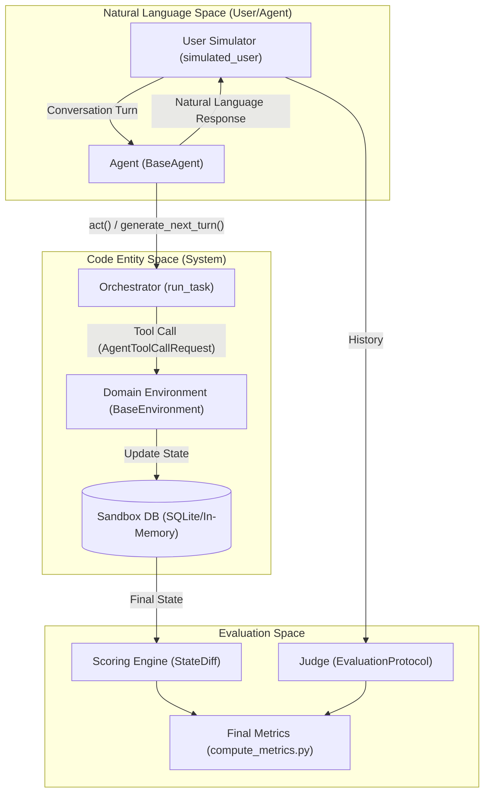
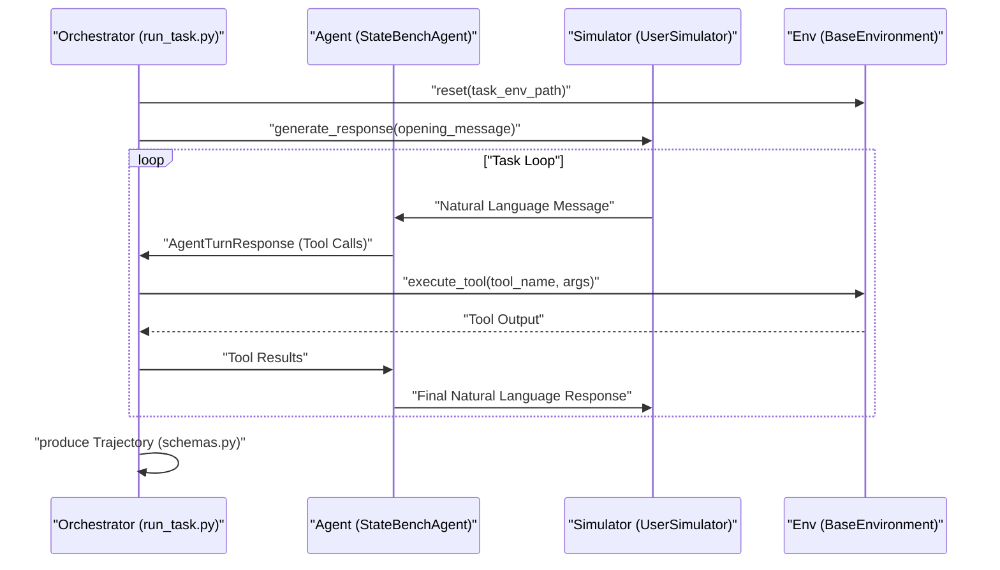

<!-- source: DeepWiki mcp.deepwiki.com · repo microsoft/STATE-Bench · page 1 STATE-Bench Overview · fetched 2026-10-26 -->

# STATE-Bench Overview

Relevant source files

The following files were used as context for generating this wiki page:

- [.env.example](.env.example)
- [CHANGELOG.md](CHANGELOG.md)
- [README.md](README.md)

STATE-Bench is a comprehensive benchmarking framework designed to evaluate AI agents on realistic, multi-step enterprise workflows. It simulates complex environments across three primary domains—**Travel**, **Customer Support**, and **Shopping Assistant**—to measure an agent's ability to reason through policies, manipulate state via tools, and maintain high-quality user interactions.

## What it Measures

The benchmark moves beyond simple question-answering by requiring agents to operate within a task-local sandbox database and interact with a simulated user. Success is determined by a combination of deterministic state validation and LLM-based qualitative assessment.

| Metric | Definition |
| :--- | :--- |
| **Task Completion pass@1** | The average task completion rate across five independent runs per task [README.md:59-59](). |
| **Task Completion pass^5** | The percentage of tasks that were successfully completed in all five out of five runs [README.md:60-60](). |
| **UX Score** | A qualitative measure (1-5 scale) of the conversation quality, judged by an LLM [README.md:61-61](). |
| **Cost Per Task** | The average financial cost incurred by the agent per task, based on token usage [README.md:62-62](). |

## High-Level Structure

STATE-Bench is structured to bridge the gap between natural language interaction and programmatic state management. The following diagram illustrates how the benchmark components translate natural language requirements into code-level entities and evaluations.

### From Natural Language to Code Entities

Sources: [README.md:18-21](), [state_bench/orchestrator.py:1-50](), [state_bench/agents/base.py:1-40]()

## Benchmark Tracks

STATE-Bench offers two distinct tracks depending on the research goal:

1.  **Main Track**: The default path for evaluating an agent or model's raw performance on enterprise tasks [README.md:38-38]().
2.  **Agent Learning Track**: Designed for evaluating agentic memory, skill acquisition, or prompt optimization. It provides 300 pre-generated "train" trajectories (100 per domain) that agents can use to "learn" before being tested [README.md:39-41]().

For a deep dive into these tracks, see **[Benchmark Tracks](#1.2)**.

## System Architecture

The core of the benchmark is the `state_bench` Python package. It manages the lifecycle of a task, from initializing the environment to the final scoring.

### Execution Flow and Data Mapping

Sources: [state_bench/orchestrator.py:1-100](), [state_bench/simulator.py:1-30](), [state_bench/agents/state_bench.py:1-50]()

## Navigation Guide

To explore the technical details of STATE-Bench, follow the links to the child pages below:

*   **[Getting Started](#1.1)**: Installation via `uv`, environment configuration (specifically the `STATE_BENCH_EVAL_*` variables for the locked GPT-5.4 judge), and running your first task [.env.example:1-29]().
*   **[Benchmark Tracks](#1.2)**: Detailed breakdown of the Main and Agent Learning tracks, including data splits and official run settings.
*   **Core Architecture**: Deep dive into the orchestrator, data models (`schemas.py`), and the LLM client layer that handles Azure/OpenAI authentication.
*   **Agent Interface**: How to implement the `BaseAgent` interface to plug your own agent into the benchmark.
*   **Evaluation Pipeline**: Technical details on the `EvaluationProtocol`, `StateDiff` logic, and the GPT-5.4 judge prompts [CHANGELOG.md:3-7]().
*   **Benchmark Domains**: Documentation for the Travel, Customer Support, and Shopping Assistant environments, including their specific tools and policies [README.md:26-31]().
*   **Datasets and Task Definitions**: Understanding the JSON schema for tasks and the pre-generated training trajectories.
*   **Leaderboard**: How results are processed and displayed on the public leaderboard.

Sources: [README.md:1-75](), [.env.example:1-29](), [CHANGELOG.md:1-7]()

---

