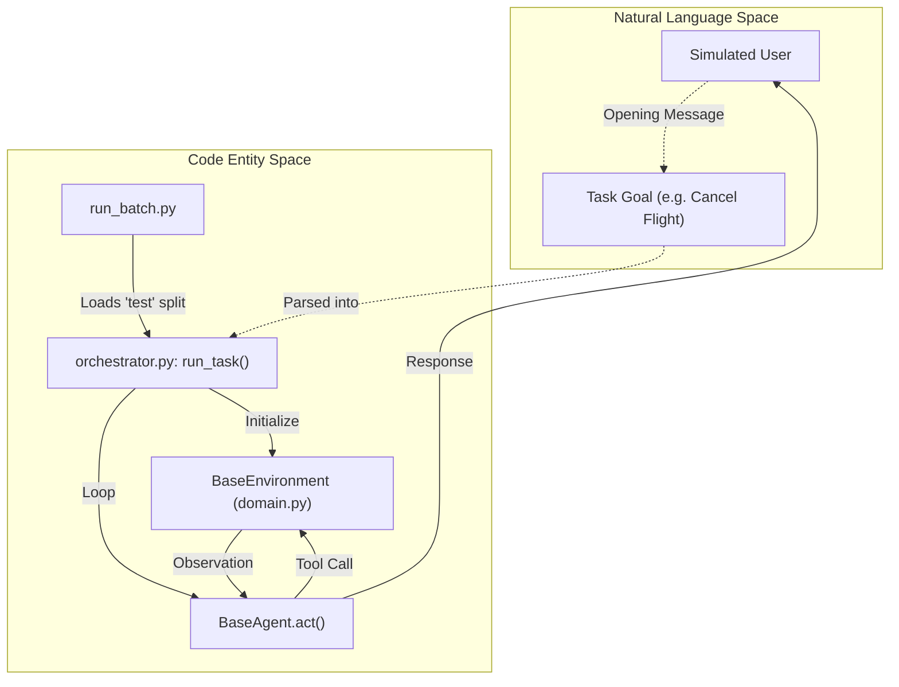
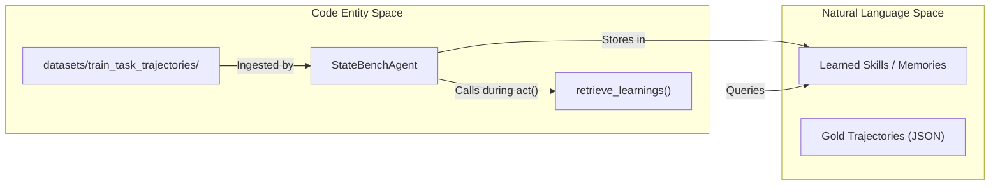

<!-- source: DeepWiki mcp.deepwiki.com · repo microsoft/STATE-Bench · page 1.2 Benchmark Tracks · fetched 2026-10-26 -->

# Benchmark Tracks

Relevant source files

The following files were used as context for generating this wiki page:

- [CHANGELOG.md](CHANGELOG.md)
- [README.md](README.md)

This page explains the two primary evaluation tracks in STATE-Bench: the **Main Track** and the **Agent Learning Track**. While both tracks share the same domain environments, tools, and evaluation metrics, they are distinguished by their data splits and the agent's ability to utilize historical trajectories for optimization.

## Track Overview

STATE-Bench is structured to evaluate agents in two distinct scenarios: direct task execution and iterative improvement through learning.

| Feature | Main Track | Agent Learning Track |
| :--- | :--- | :--- |
| **Goal** | Evaluate zero-shot or few-shot model performance on enterprise tasks. | Evaluate agentic memory, skill acquisition, or prompt optimization. |
| **Data Split** | `test` split (50 tasks per domain). | `train` split (100 tasks per domain) + `test` split. |
| **Learning Data** | None. | 300 pre-generated gold trajectories (100 per domain). |
| **Agent Interface** | Standard `act()` loop. | `act()` loop with `retrieve_learnings()` hook. |
| **Primary Metric** | `pass@1`, `pass^5`, UX Score, Cost. | `pass@1`, `pass^5`, UX Score, Cost. |

Sources: [README.md:32-41](), [docs/AGENT_LEARNING_TRACK.md:1-15]() (referenced in README)

---

## Main Track

The Main Track is the standard benchmark for assessing an LLM-based agent's ability to navigate multi-step workflows across the **Travel**, **Customer Support**, and **Shopping Assistant** domains [README.md:18-30]().

### Data Split and Official Run Settings
The Main Track utilizes the **Test Split**, which consists of 50 tasks per domain (150 total). To ensure statistical significance, the official leaderboard requires:
*   **5 runs per task**: To calculate both `pass@1` and the stricter `pass^5` (consistency) metrics [README.md:57-62]().
*   **Zero/Few-Shot**: The agent does not have access to task-specific training data or long-term memory across tasks.

### Code Entity Space: Execution Flow
In the Main Track, the `run_batch.py` script invokes the `Orchestrator` to execute tasks defined in the `test` manifest.

**Main Track Data Flow**

Sources: [state_bench/orchestrator.py:1-50](), [state_bench/domain.py:1-20](), [state_bench/agents/base.py:10-30]()

---

## Agent Learning Track

The Agent Learning Track is designed for agents that can learn from past experiences. It provides a set of "Train Trajectories" that agents can ingest to optimize their prompts, extract reusable skills, or populate a long-term memory store [README.md:39-41]().

### The Learning Data
STATE-Bench provides **300 pre-generated scored trajectories** (100 per domain) in the `datasets/train_task_trajectories/` directory. Each trajectory includes:
*   The full conversation history between the user and agent.
*   All tool calls and their results.
*   The final `StateDiff` and scores assigned by the judge.

### The Retrieval Hook
Agents participating in this track implement the `retrieve_learnings` method defined in the `StateBenchAgent` or custom `BaseAgent` subclasses. This allows the agent to fetch relevant context from its "memory" before generating a response [state_bench/agents/state_bench.py:40-60]().

**Agent Learning Track: Learning & Retrieval**

Sources: [state_bench/agents/state_bench.py:1-80](), [state_bench/agents/base.py:45-55]()

---

## Official Evaluation Protocols

Both tracks are governed by a specific versioned protocol to ensure comparability on the leaderboard. As of version `0.7.0`, the benchmark uses the `gpt54` protocol.

### Protocol Configuration
The protocol defines the judge models and prompt versions used to evaluate the agent's performance.

| Protocol Field | Value (v0.7.0) | Description |
| :--- | :--- | :--- |
| `protocol_id` | `gpt54` | The unique identifier for the evaluation logic [CHANGELOG.md:6-7](). |
| `judge_model` | `gpt-5.4` | The LLM used for Task Requirement and UX scoring [CHANGELOG.md:6-7](). |
| `ux_version` | `v2` | The updated prompt version for UX quality metrics [CHANGELOG.md:5](). |

### Scoring Pipeline
The evaluation pipeline converts raw agent trajectories into the four headline metrics:
1.  **State Requirements**: Deterministic check of database entities (e.g., "Is the booking status set to CANCELLED?") [state_bench/scoring.py:50-100]().
2.  **Task Requirements**: LLM-judged check of procedural adherence (e.g., "Did the agent inform the user about the $50 fee?") [state_bench/scoring.py:110-150]().
3.  **UX Score**: 1-5 rating of conversation quality [README.md:61]().
4.  **Efficiency**: Calculation of cost and token usage [README.md:62]().

Sources: [CHANGELOG.md:1-7](), [state_bench/scoring.py:1-200](), [state_bench/protocol.py:1-30]()

---

