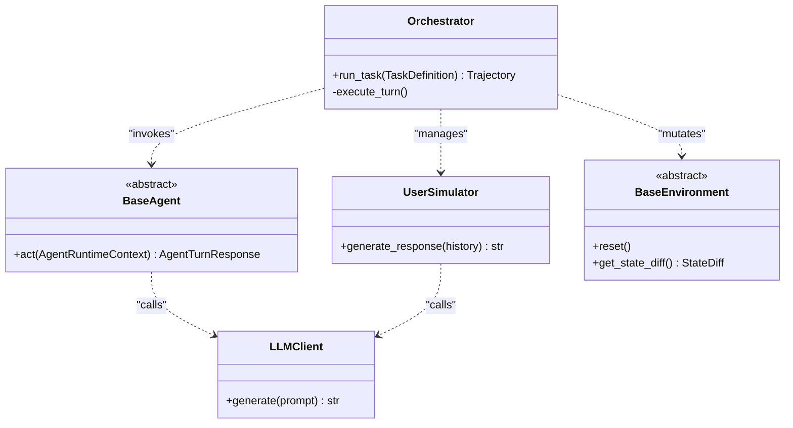

<!-- source: DeepWiki mcp.deepwiki.com · repo microsoft/STATE-Bench · page 2 Core Architecture · fetched 2026-10-26 -->

# Core Architecture

<details>
<summary>Relevant source files</summary>

The following files were used as context for generating this wiki page:

- [.gitignore](.gitignore)
- [README.md](README.md)

</details>


The `state_bench/` package is structured as a modular evaluation harness designed to test AI agents in high-fidelity enterprise simulations. The architecture decouples the task orchestration, the agent's internal logic, the user simulation, and the scoring pipeline. This allows for plug-and-play experimentation with different models, agentic strategies, and domain environments.

## System Overview

At a high level, the architecture facilitates a closed-loop conversation between an **Agent** and a **User Simulator**. The interaction is mediated by an **Orchestrator**, which manages the environment state, provides the agent with domain-specific tools, and records the interaction into a **Trajectory**.

### Core Components Interaction

The following diagram illustrates the relationship between the primary subsystems and their corresponding code entities.

**STATE-Bench System Flow**
```mermaid
graph TD
    subgraph "Execution Layer"
        [run_batch.py] --> [Orchestrator]
        [Orchestrator] -- "manages" --> [UserSimulator]
        [Orchestrator] -- "invokes" --> [BaseAgent]
    end

    subgraph "Environment & State"
        [Orchestrator] -- "resets" --> [BaseEnvironment]
        [BaseAgent] -- "calls tools" --> [BaseEnvironment]
    end

    subgraph "Data & Scoring"
        [Orchestrator] -- "produces" --> [Trajectory]
        [Trajectory] -- "input to" --> [ScoringPipeline]
        [ScoringPipeline] -- "outputs" --> [BinaryScore]
    end

    [BaseAgent] -- "uses" --> [LLMClient]
    [UserSimulator] -- "uses" --> [LLMClient]
```
Sources: [state_bench/orchestrator.py:1-20](), [state_bench/schemas.py:1-50](), [state_bench/client.py:1-30]()

---

## Major Subsystems

### 1. Orchestrator and Task Execution
The `Orchestrator` is the central engine of the benchmark. It is responsible for initializing the task environment, managing the turn-based loop between the agent and the simulated user, and ensuring all tool calls are executed against the correct `BaseEnvironment` instance. It handles the lifecycle of a single task run from the opening message to the final termination criteria.

For details, see [Orchestrator and Task Execution](#2.1).

### 2. Core Data Models and Schemas
The system relies on a strictly typed set of schemas defined in `state_bench/schemas.py`. These models ensure consistency across the different stages of the pipeline, from task definition to final metric reporting. Key entities include:
*   `TaskDefinition`: The static requirements and configuration for a benchmark task.
*   `Trajectory`: The complete log of an interaction, including conversation history, tool calls, and state changes.
*   `StateDiff`: A representation of how the environment's database changed during the run.

For details, see [Core Data Models and Schemas](#2.2).

### 3. LLM Client Layer
The client layer provides a unified interface for interacting with Large Language Models. It supports multiple authentication strategies (API Key, Azure CLI, Managed Identity) and features a `PooledLLMClient` to manage rate limits and throughput by distributing requests across multiple endpoints.

For details, see [LLM Client Layer](#2.3).

### 4. User Simulator
Unlike static benchmarks, STATE-Bench uses a dynamic `UserSimulator`. This component acts as the persona for the task, responding to the agent based on a specific configuration (`UserSimulatorConfig`). It uses an LLM to generate contextually relevant responses, ensuring that the agent must handle natural language variability and multi-turn clarifications.

For details, see [User Simulator](#2.4).

---

## Code Entity Mapping

The following diagram maps high-level architectural concepts to their specific implementation classes and files within the `state_bench/` directory.

**Class and Module Mapping**

Sources: [state_bench/orchestrator.py:25-80](), [state_bench/agents/base.py:10-50](), [state_bench/simulator.py:15-40](), [state_bench/environment.py:5-30]()

## Execution Workflow

1.  **Initialization**: The `run_batch.py` script loads a set of `TaskDefinition` objects from the `datasets/` directory.
2.  **Environment Setup**: For each task, the `Orchestrator` instantiates the domain-specific `BaseEnvironment` (e.g., Travel or Shopping) and resets it to the task's starting state.
3.  **Interaction Loop**: 
    *   The `UserSimulator` provides an initial message.
    *   The `BaseAgent` processes the message, optionally calls tools in the environment, and responds.
    *   This continues until the agent signals completion or a turn limit is reached.
4.  **Trajectory Recording**: Every turn, tool call, and state change is captured in a `Trajectory` object.
5.  **Scoring**: The `ScoringPipeline` evaluates the `Trajectory` against the `StateRequirements` and `TaskRequirements` defined in the task JSON.

Sources: [state_bench/orchestrator.py:100-250](), [state_bench/schemas.py:200-300]()

---

