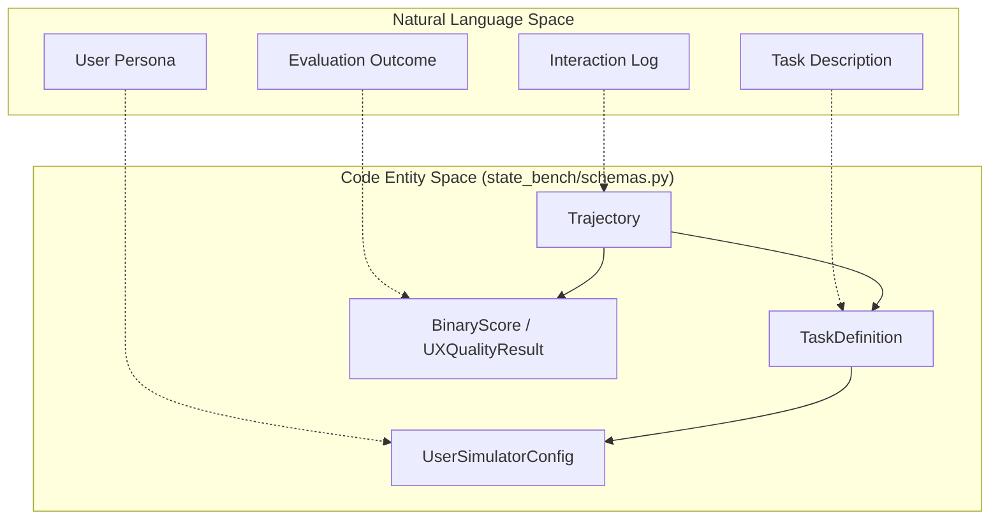
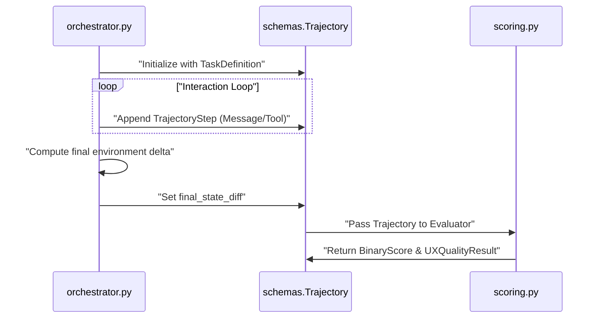

<!-- source: DeepWiki mcp.deepwiki.com · repo microsoft/STATE-Bench · page 2.2 Core Data Models and Schemas · fetched 2026-10-26 -->

# Core Data Models and Schemas

Relevant source files

The following files were used as context for generating this wiki page:

- [.gitignore](.gitignore)
- [CHANGELOG.md](CHANGELOG.md)

This page documents the domain-agnostic data structures that form the backbone of STATE-Bench. These schemas, primarily defined in `state_bench/schemas.py`, provide the standardized contracts for task definitions, execution trajectories, and evaluation results, ensuring interoperability between the orchestrator, user simulator, and scoring pipeline.

## Overview of Schema Architecture

The STATE-Bench data model is designed to decouple the benchmark engine from specific domain logic. It utilizes Pydantic for validation and serialization, facilitating consistent data flow from JSON task definitions to final performance metrics.

### Natural Language to Code Entity Mapping

The following diagram bridges high-level benchmark concepts to their specific implementations in the `state_bench/schemas.py` file.

**Diagram: Entity Mapping**

Sources: [state_bench/schemas.py:1-200]()

---

## Task and User Definitions

The execution of a benchmark starts with a `TaskDefinition`, which contains the ground truth requirements and the configuration for the user simulator.

### TaskDefinition
The `TaskDefinition` class [state_bench/schemas.py:102-114]() is the primary container for a benchmark instance.
*   **`task_id`**: A unique string identifier.
*   **`task_summary`**: A high-level description of the goal.
*   **`opening_message`**: The initial message sent by the simulated user to the agent.
*   **`user_simulator`**: An instance of `UserSimulatorConfig`.
*   **`state_requirements`**: A list of `StateRequirement` objects defining mandatory database/environment changes.
*   **`task_requirements`**: A list of strings defining semantic goals that must be met (judged by LLM).

### UserSimulatorConfig
The `UserSimulatorConfig` [state_bench/schemas.py:96-100]() defines the behavior of the `UserSimulator` during the `run_task()` loop.
*   **`system_prompt`**: The persona and instructions for the simulator.
*   **`max_turns`**: The maximum number of interaction cycles before the task is terminated.

Sources: [state_bench/schemas.py:96-114]()

---

## Execution and Trajectories

As an agent interacts with the environment, the system records every event into a `Trajectory`. This object is the source of truth for both debugging and scoring.

### Trajectory Structure
A `Trajectory` [state_bench/schemas.py:126-140]() captures the complete state of a task run.
*   **`task_id`**: Link to the original task.
*   **`steps`**: A list of `TrajectoryStep` objects, each containing the `Message` (agent or user) and any `ToolCall` or `ToolResult`.
*   **`final_state_diff`**: A `StateDiff` representing the delta between the environment's initial and final states.
*   **`efficiency_metrics`**: A summary of resource usage.

### StateDiff and Entity Changes
The `StateDiff` [state_bench/schemas.py:84-88]() and `EntityChange` [state_bench/schemas.py:76-82]() classes track deterministic changes in the environment.
*   **`created`**: New entities added during the task.
*   **`updated`**: Changes to existing entities (storing `old_value` and `new_value`).
*   **`deleted`**: Entities removed from the environment.

**Diagram: Trajectory Data Flow**

Sources: [state_bench/schemas.py:76-140]()

---

## Metrics and Evaluation Schemas

Evaluation results are divided into deterministic performance, semantic correctness, and user experience quality.

### Efficiency and Usage
*   **`TokenUsage`** [state_bench/schemas.py:10-15](): Tracks `prompt_tokens`, `completion_tokens`, and total `cost`.
*   **`EfficiencyMetrics`** [state_bench/schemas.py:116-124](): Aggregates `total_turns`, `total_tool_calls`, and `TokenUsage` for a specific run.

### Scoring Results
*   **`BinaryScore`** [state_bench/schemas.py:142-146](): A simple boolean `passed` flag with an accompanying `reason`. Used for both State and Task requirements.
*   **`UXQualityResult`** [state_bench/schemas.py:148-154](): A multi-dimensional assessment of the agent's interaction quality:
    *   `user_control`: Did the agent respect user preferences?
    *   `user_effort`: Did the agent minimize unnecessary user input?
    *   `response_density`: Was the information provided concise and relevant?
    *   `score`: A normalized float value (0.0 to 1.0).

Sources: [state_bench/schemas.py:10-15](), [state_bench/schemas.py:116-154]()

---

## Serialization Contracts

All schemas inherit from Pydantic's `BaseModel` (or are standard dataclasses), ensuring that they can be serialized to JSON via `.model_dump()` or `.json()`. The orchestrator uses these contracts to save the output of every run into the `outputs/` directory, which is later consumed by the `compute_metrics.py` script.

| Class | JSON File Target | Purpose |
| :--- | :--- | :--- |
| `Trajectory` | `trajectory.json` | Full log of the agent-user interaction. |
| `StateDiff` | Part of `trajectory.json` | Detailed environment changes for state validation. |
| `UXQualityResult` | `ux_score.json` | LLM-judge assessment of interaction quality. |

Sources: [state_bench/schemas.py:1-160]()

---

