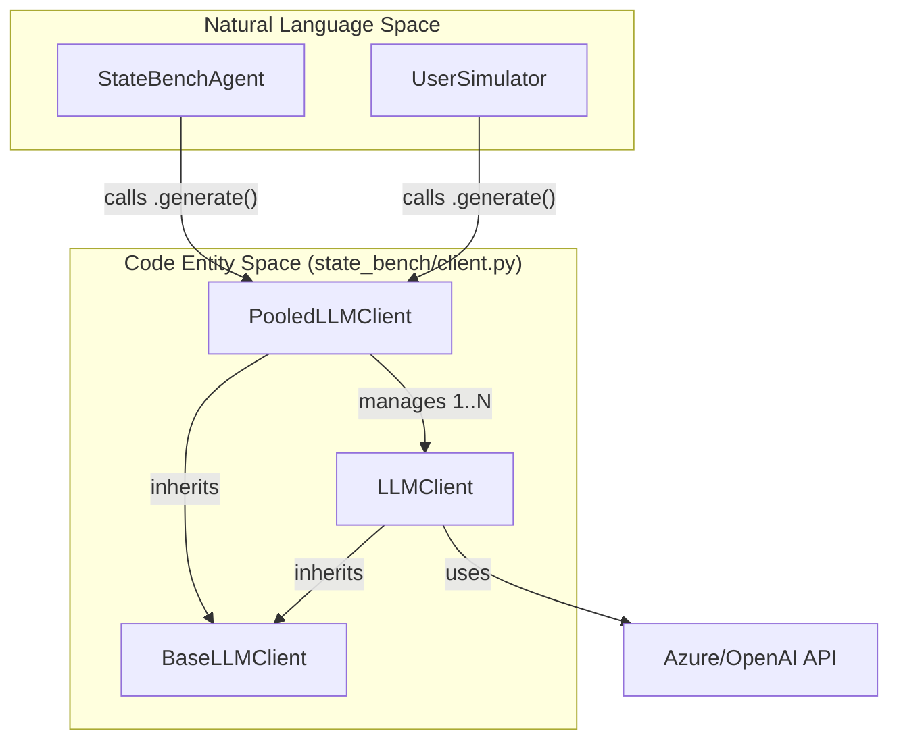
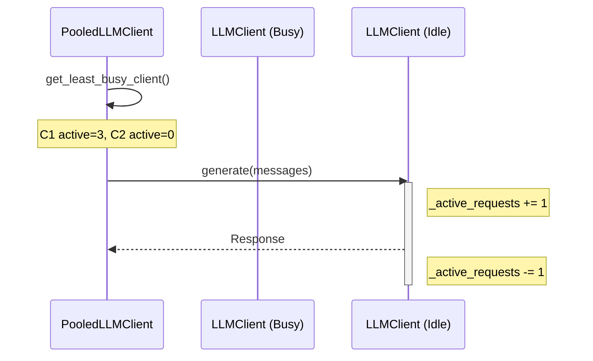

<!-- source: DeepWiki mcp.deepwiki.com · repo microsoft/STATE-Bench · page 2.3 LLM Client Layer · fetched 2026-10-26 -->

# LLM Client Layer

Relevant source files

The following files were used as context for generating this wiki page:

- [.env.example](.env.example)
- [.gitignore](.gitignore)

The LLM Client Layer provides a unified interface for interacting with Large Language Models (LLMs) across different providers and authentication schemes. It is designed to handle the complexities of benchmarking, such as rate limiting, content filtering, and load balancing across multiple deployments.

## Purpose and Scope

The LLM Client Layer, primarily implemented in `state_bench/client.py`, abstracts the underlying API calls to OpenAI and Azure OpenAI. It ensures that the benchmark orchestrator and agents can interact with models using a consistent interface while providing robust error handling and resource management.

### Key Responsibilities
- **Authentication**: Supports API keys, Azure CLI tokens, and `DefaultAzureCredential`.
- **Resilience**: Implements exponential backoff and retry logic for transient failures and rate limits.
- **Load Balancing**: Distributes requests across a pool of model deployments using a "least-busy" routing strategy.
- **Content Filtering**: Detects and handles provider-specific content filter triggers.

---

## Class Hierarchy and Core Entities

The client layer follows an inheritance-based structure to support both single-endpoint and pooled-endpoint configurations.

### BaseLLMClient
`BaseLLMClient` is the abstract base class that defines the contract for all LLM clients within STATE-Bench. It requires subclasses to implement the `generate()` method.

[state_bench/client.py:27-44]()

### LLMClient
`LLMClient` is the concrete implementation for interacting with a single LLM endpoint. It encapsulates the OpenAI/Azure OpenAI client initialization and the core generation logic.

[state_bench/client.py:47-213]()

### PooledLLMClient
`PooledLLMClient` manages a collection of `LLMClient` instances. It is used to overcome rate limits by spreading requests across multiple Azure OpenAI deployments or OpenAI models.

[state_bench/client.py:216-291]()

### LLM Client Entity Relationship
The following diagram illustrates how these entities relate to the `StateBenchAgent` and the `UserSimulator`.

**Client Architecture Overview**

Sources: [state_bench/client.py:27-291](), [state_bench/simulator.py:12-14](), [state_bench/agents/state_bench.py:35-40]()

---

## Authentication Strategies

The client layer supports flexible authentication to accommodate different environment setups. Authentication is handled during the initialization of `LLMClient`.

| Strategy | Implementation Detail | Source |
| :--- | :--- | :--- |
| **API Key** | Uses `api_key` provided in constructor or environment variables like `STATE_BENCH_EVAL_API_KEY`. | [state_bench/client.py:76-80]() |
| **Azure CLI Token** | Attempts to fetch a token via `AzureCliCredential` if no key is provided. | [state_bench/client.py:84-90]() |
| **Default Azure Credential** | Fallback to `DefaultAzureCredential` for managed identities or other environment-based auth. | [state_bench/client.py:91-96]() |

Sources: [state_bench/client.py:73-100]()

---

## LeastBusyPool Routing Mechanism

`PooledLLMClient` implements a routing strategy to optimize throughput and minimize 429 (Too Many Requests) errors. 

1. **Tracking**: Each `LLMClient` within the pool maintains an internal `_active_requests` counter.
2. **Selection**: When `generate()` is called on the pool, it selects the client with the lowest number of active requests.
3. **Execution**: The request is dispatched to the chosen client, incrementing its counter, and decrementing it upon completion (success or failure).

**Routing Logic Flow**

Sources: [state_bench/client.py:216-285]()

---

## Retry Logic and Content Filters

The `LLMClient.generate()` method contains a robust retry loop wrapped in a `tenacity` decorator.

### Retry Behavior
- **Retriable Errors**: It retries on `RateLimitError` and generic `APIError`.
- **Backoff**: Uses exponential backoff with a maximum of 10 attempts.
- **Content Filters**: If a request is blocked by Azure OpenAI's content management system, the client catches the exception and returns a specific string: `"I cannot answer that due to content filters."`. This prevents the benchmark from crashing when encountering sensitive generated content.

[state_bench/client.py:126-213]()

### Token Usage Tracking
The client tracks token consumption (prompt, completion, and total) for every call. These metrics are returned as part of the `generate` response and are eventually aggregated into the `EfficiencyMetrics` schema.

[state_bench/client.py:195-202]()

Sources: [state_bench/client.py:126-213](), [state_bench/schemas.py:145-155]()

---

## Configuration via Environment Variables

The clients are typically instantiated using values from the `.env` file. The `STATE-Bench` uses two primary client configurations:

1.  **Evaluation Client**: Locked to the GPT-5.4 protocol for the user simulator and judges.
    -   `STATE_BENCH_EVAL_ENDPOINT`
    -   `STATE_BENCH_EVAL_DEPLOYMENTS` (Comma-separated for pooling)
2.  **Agent Client**: The model being benchmarked.
    -   `STATE_BENCH_AGENT_ENDPOINT`
    -   `STATE_BENCH_AGENT_DEPLOYMENTS`

Sources: [.env.example:6-28]()

---

