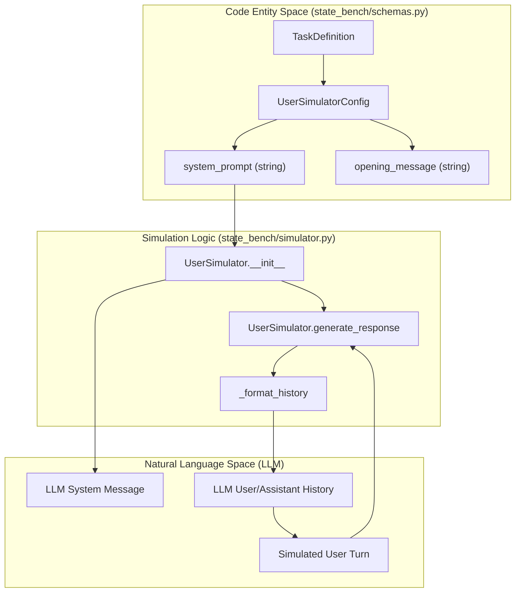
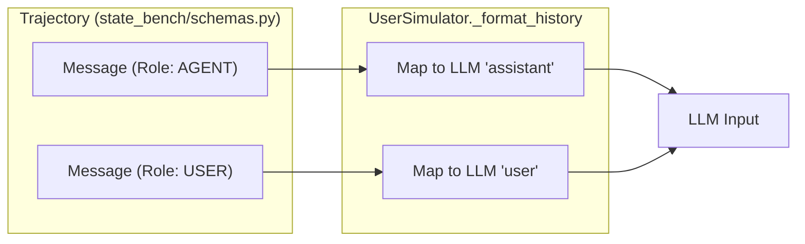

<!-- source: DeepWiki mcp.deepwiki.com · repo microsoft/STATE-Bench · page 2.4 User Simulator · fetched 2026-10-26 -->

# User Simulator

Relevant source files

The following files were used as context for generating this wiki page:

- [.env.example](.env.example)
- [CHANGELOG.md](CHANGELOG.md)

The **User Simulator** is a critical component of the STATE-Bench orchestration loop. It acts as the conversational counterpart to the agent under test, simulating a human user based on a specific persona, goal, and set of constraints defined in the task configuration. Unlike static datasets, the User Simulator generates responses dynamically, allowing it to react to the agent's specific questions, tool outputs, and conversational style.

### Purpose and Implementation

The `UserSimulator` class, defined in `state_bench/simulator.py`, encapsulates the logic for interacting with a Large Language Model (LLM) to simulate user behavior. It maintains the persona of the user and ensures that the simulated dialogue remains grounded in the task's requirements.

#### Key Responsibilities:
1.  **Context Management**: Constructing a system prompt that combines domain-specific instructions with task-specific user goals [state_bench/simulator.py:15-38]().
2.  **History Formatting**: Converting the growing conversation trajectory into a format compatible with the LLM client [state_bench/simulator.py:40-52]().
3.  **Response Generation**: Invoking the LLM to produce the next user turn while adhering to the "persona" [state_bench/simulator.py:54-72]().

---

### System Architecture and Data Flow

The User Simulator bridges the gap between the static **Task Definition** (Code Entity Space) and the dynamic **Conversation** (Natural Language Space). It transforms structured JSON configurations into a prompt-driven LLM persona.

**Diagram: User Simulator Data Flow**

**Sources:** [state_bench/simulator.py:15-72](), [state_bench/schemas.py:45-60]()

---

### Implementation Details

#### 1. Initialization and System Prompting
When the `Orchestrator` initializes a `UserSimulator`, it passes a `UserSimulatorConfig`. The simulator constructs a permanent system prompt that defines the user's personality and objective. This prompt typically includes:
*   The user's specific goal (e.g., "Change my flight to London").
*   Constraint information (e.g., "I cannot travel before 10 AM").
*   Behavioral instructions (e.g., "Be polite but firm").

#### 2. History Formatting
The `UserSimulator` must present the conversation to the LLM from the user's perspective. This involves a "role reversal" where the Agent's messages are treated as "Assistant" turns and the Simulator's own previous messages are treated as "User" turns.

| Function | Role | Logic |
| :--- | :--- | :--- |
| `_format_history` | Context Builder | Iterates through the `Trajectory` and maps `Message` objects to LLM roles. |
| `generate_response` | Execution | Calls the `BaseLLMClient` with the formatted history and system prompt. |

**Diagram: Role Mapping in state_bench/simulator.py**

**Sources:** [state_bench/simulator.py:40-52](), [state_bench/schemas.py:80-95]()

---

### Configuration and Environment

The User Simulator is governed by the **Locked Evaluation Protocol**. To ensure reproducibility and fair comparison across different agents, the simulator must run on a specific model version defined by the benchmark.

*   **Model Requirement**: As of version `0.7.0`, the canonical evaluation protocol requires **GPT-5.4** for the User Simulator [CHANGELOG.md:6-7]().
*   **Environment Variables**: The simulator uses the `STATE_BENCH_EVAL_ENDPOINT` and `STATE_BENCH_EVAL_DEPLOYMENTS` to route requests to the locked evaluation resource [.env.example:9-10]().

### Key Functions

#### `UserSimulator.generate_response(trajectory: Trajectory) -> str`
This is the primary entry point used by the `run_task` loop in `orchestrator.py`.
1.  It takes the current `Trajectory` containing all turns so far [state_bench/simulator.py:54]().
2.  It calls `_format_history` to prepare the messages [state_bench/simulator.py:56]().
3.  It invokes the `LLMClient` to generate the next string of text [state_bench/simulator.py:58-65]().
4.  It returns the raw string which is then wrapped in a `Message` object by the orchestrator [state_bench/simulator.py:72]().

**Sources:** [state_bench/simulator.py:1-75](), [.env.example:1-12](), [CHANGELOG.md:1-8]()

---

