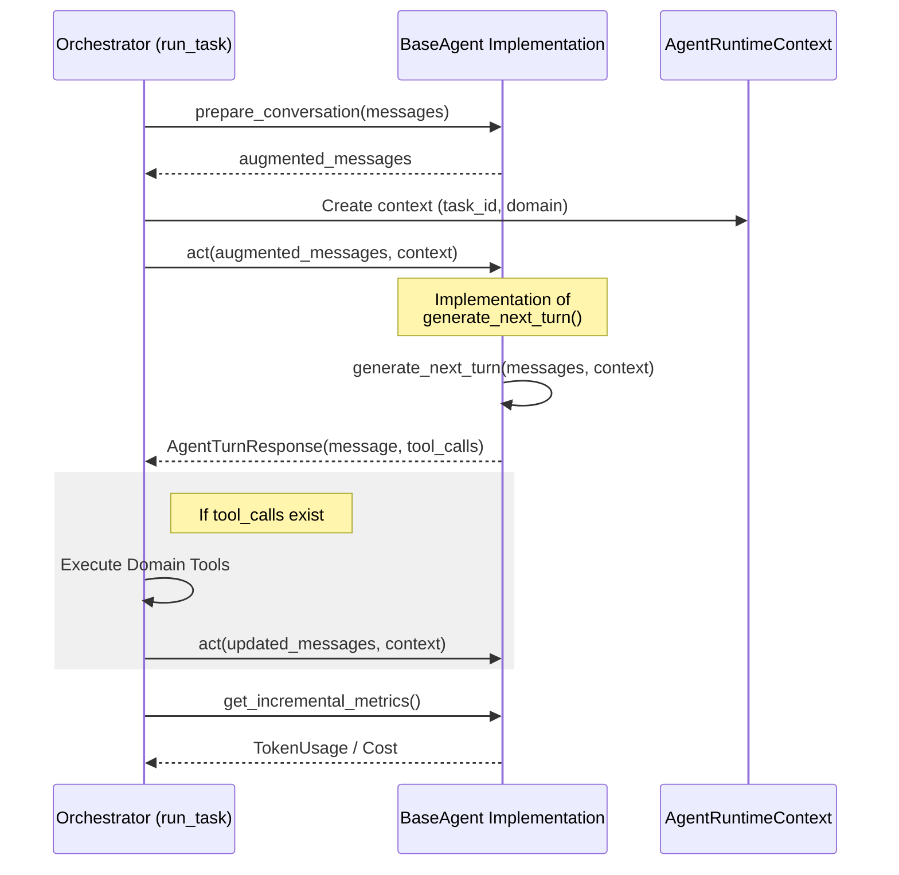
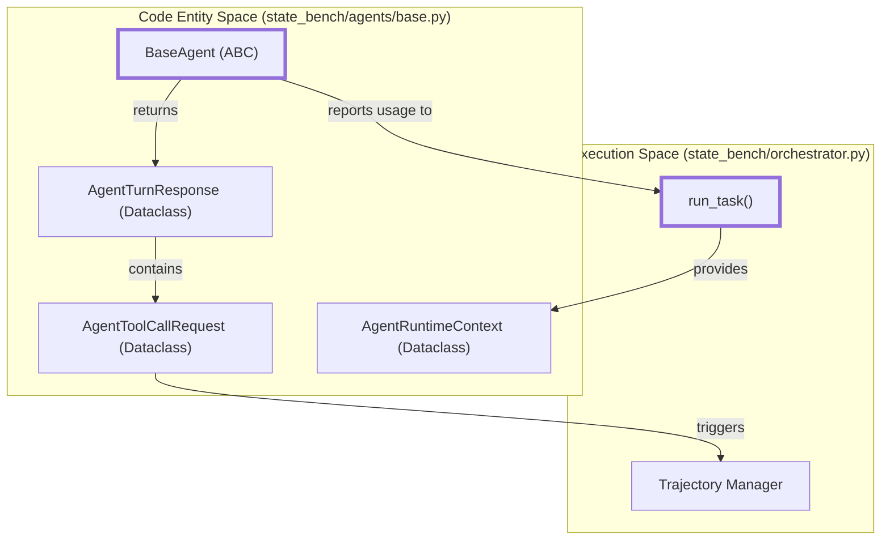

<!-- source: DeepWiki mcp.deepwiki.com · repo microsoft/STATE-Bench · page 3.1 BaseAgent Interface · fetched 2026-10-26 -->

# BaseAgent Interface

Relevant source files

The following files were used as context for generating this wiki page:

- [.env.example](.env.example)
- [.gitignore](.gitignore)

The `BaseAgent` interface defines the standard contract for all agent implementations within STATE-Bench. It provides a structured way for the orchestrator to interact with agents, manage conversation state, handle tool calls, and report performance metrics such as token usage and costs.

## Core Data Structures

The interface relies on several key dataclasses and TypedDicts to ensure type safety and consistent data flow between the agent and the `state_bench.orchestrator.run_task` loop [[state_bench/agents/base.py:11-75]]().

### AgentToolCallRequest
Represents a request from the agent to execute a tool.
- `id`: A unique identifier for the tool call.
- `name`: The name of the tool to be invoked.
- `arguments`: A JSON-encoded string or dictionary of arguments.

### AgentTurnResponse
The object returned by the agent after a turn.
- `message`: The natural language response to the user (optional if tool calls are present).
- `tool_calls`: A list of `AgentToolCallRequest` objects.
- `thought`: Internal reasoning or "chain of thought" from the agent (optional).

### AgentRuntimeContext
Provides the agent with metadata about the current execution environment.
- `task_id`: The unique ID of the task being executed.
- `domain`: The domain name (e.g., `travel`, `shopping_assistant`).
- `session_id`: A unique identifier for the specific run session.

Sources: [[state_bench/agents/base.py:11-75]]()

---

## The BaseAgent Abstract Class

The `BaseAgent` class is an abstract base class (ABC) that every agent must inherit from. It defines the lifecycle and execution methods required by the benchmark [[state_bench/agents/base.py:78-220]]().

### The act() vs generate_next_turn() Duality
The interface provides two ways to generate responses, allowing for different levels of control over the tool-calling loop:

1.  **`act()`**: The high-level entry point called by the orchestrator [[state_bench/agents/base.py:118-135]](). By default, it calls `generate_next_turn()`. Agents can override `act()` if they wish to manage their own internal loops (e.g., multi-step reasoning before returning to the orchestrator).
2.  **`generate_next_turn()`**: The core abstract method that must be implemented by subclasses [[state_bench/agents/base.py:137-151]](). it receives the current conversation history and the `AgentRuntimeContext`.

### Memory and Learning Hooks
To support the **Agent Learning Track**, `BaseAgent` includes hooks for memory management and trajectory ingestion:

| Method | Purpose |
| :--- | :--- |
| `prepare_conversation` | Modifies or augments the conversation history (e.g., injecting RAG context) before it is sent to the LLM [[state_bench/agents/base.py:153-164]](). |
| `ingest_trajectory` | Allows the agent to learn from a completed task trajectory, storing successful patterns or correcting failures [[state_bench/agents/base.py:166-177]](). |
| `memory_tool_schemas` | Returns JSON schemas for tools the agent uses to manage its own memory [[state_bench/agents/base.py:100-107]](). |
| `memory_tool_handlers` | Provides the callable implementations for the memory tools [[state_bench/agents/base.py:109-116]](). |

### Token and Cost Reporting
Agents are responsible for tracking their own resource consumption. The orchestrator calls these methods at the end of a task to compile `EfficiencyMetrics` [[state_bench/agents/base.py:183-220]]().

- `get_total_tokens()`: Returns total tokens used.
- `get_total_cost()`: Returns total USD cost.
- `get_incremental_metrics()`: Returns usage since the last reset.
- `reset_metrics()`: Clears the internal counters.

Sources: [[state_bench/agents/base.py:78-220]]()

---

## Interaction Flow: Orchestrator to Agent

The following diagram illustrates how the `Orchestrator` (Natural Language Space) interacts with the `BaseAgent` implementation (Code Entity Space) during a single task turn.

**Agent Execution Logic Flow**

Sources: [[state_bench/agents/base.py:118-151]](), [[state_bench/agents/base.py:183-200]]()

---

## Data Mapping: Interface to Orchestrator

This diagram maps the code entities defined in `base.py` to the data flow within the benchmarking environment.

**Code Entity to Data Flow Mapping**

Sources: [[state_bench/agents/base.py:11-75]](), [[state_bench/agents/base.py:78-98]]()

---

## Implementation Requirements

When implementing a custom agent (e.g., in `state_bench/agents/custom_agent.py`), the following rules apply:

1.  **Context Awareness**: The agent should use the `AgentRuntimeContext` to adjust behavior based on the `domain` (e.g., applying different system prompts for `travel` vs `shopping_assistant`) [[state_bench/agents/base.py:65-75]]().
2.  **Statelessness vs. Statefulness**: While the `BaseAgent` instance can maintain state (like token counts), the conversation history is passed explicitly in every `act()` call. Agents using long-term memory should use the `ingest_trajectory` hook to persist data between tasks [[state_bench/agents/base.py:166-177]]().
3.  **Tool Handling**: Agents do not execute domain tools themselves. They return `AgentToolCallRequest` objects, and the orchestrator handles the execution and appends the results to the conversation history [[state_bench/agents/base.py:34-47]]().

Sources: [[state_bench/agents/base.py:11-75]](), [[state_bench/agents/base.py:166-177]]()

---

