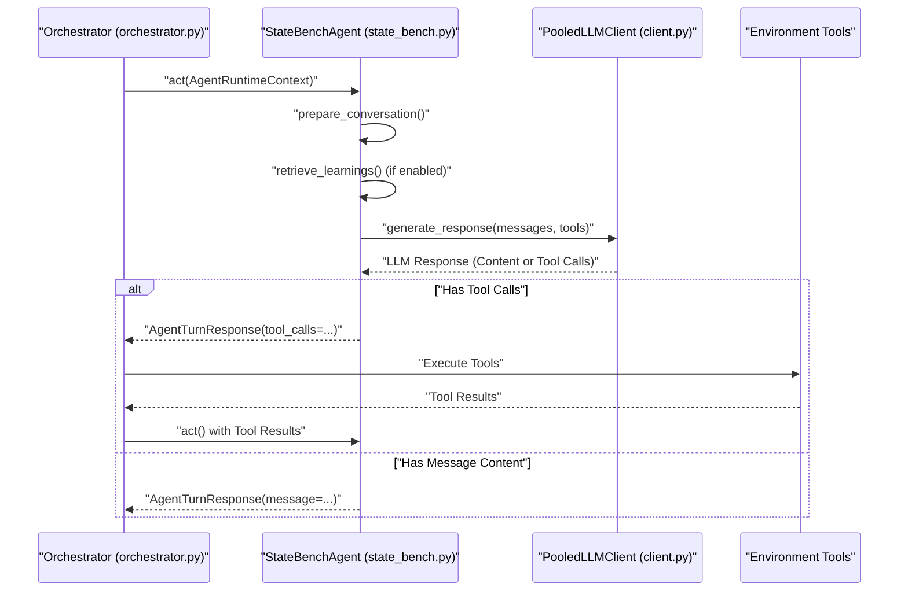

<!-- source: DeepWiki mcp.deepwiki.com · repo microsoft/STATE-Bench · page 3.2 Built-in StateBenchAgent · fetched 2026-10-26 -->

# Built-in StateBenchAgent

<details>
<summary>Relevant source files</summary>

The following files were used as context for generating this wiki page:

- [.env.example](.env.example)
- [CHANGELOG.md](CHANGELOG.md)

</details>


The `StateBenchAgent` is the default agent implementation provided by STATE-Bench. It is designed as a versatile, "no-memory" agent that interacts with the benchmark environment using a tool-calling loop. It serves as the primary baseline for the **Main Track** and can be extended with retrieved learnings for the **Agent Learning Track**.

## Overview and Purpose

The `StateBenchAgent` implements the `BaseAgent` interface to provide a standard execution flow for benchmark tasks. Unlike custom agents that might maintain internal state across different tasks, this agent is stateless by default, relying entirely on the conversation history provided during a single task execution.

Key capabilities include:
- **Tool-Calling Loop**: Native support for the LLM "Responses API" to handle multi-step reasoning and tool invocation.
- **Learning Integration**: Ability to inject domain-specific "learnings" (e.g., policy summaries or few-shot examples) into the system prompt.
- **Model Pinning**: Uses a `PooledLLMClient` to manage API requests, supporting both Azure OpenAI and OpenAI providers.
- **Reasoning Control**: Supports the `agent_reasoning_effort` parameter for models that utilize internal reasoning chains (e.g., o1-series).

Sources: [state_bench/agents/state_bench.py:1-25](), [state_bench/agents/base.py:12-45]()

---

## Architecture and Data Flow

The `StateBenchAgent` operates within the `Orchestrator`'s task loop. When `act()` is called, the agent determines whether to send a message to the user or invoke a tool provided by the domain environment.

### Tool-Calling Logic

The agent utilizes a loop to process tool calls. If the LLM generates `tool_calls` in its response, the agent returns an `AgentTurnResponse` containing these requests. The orchestrator executes the tools and passes the results back to the agent in the next turn.

### Retrieval of Learnings

For the Agent Learning Track, the agent can be configured to retrieve "learnings" from a provided dataset or memory store. These learnings are typically formatted as text and prepended to the system prompt to guide the agent's behavior based on past trajectories.

### Logic Flow Diagram

The following diagram illustrates the interaction between the `StateBenchAgent`, the `PooledLLMClient`, and the `Orchestrator`.

"StateBenchAgent Logic Flow"

Sources: [state_bench/agents/state_bench.py:40-110](), [state_bench/orchestrator.py:50-85]()

---

## Key Components and Implementation

### 1. Initialization and Configuration
The agent is initialized via the `StateBenchAgent` class. It requires a `PooledLLMClient` and configuration parameters defined in the environment or task metadata.

- **LLM Client Pinning**: The agent is bound to a specific `LLMClient` instance (configured via `STATE_BENCH_AGENT_ENDPOINT` or `STATE_BENCH_AGENT_PROVIDER`).
- **Reasoning Effort**: The `agent_reasoning_effort` parameter (low, medium, high) is passed to the LLM client to control the computational budget for reasoning-heavy models.

### 2. System Prompt Construction
The agent constructs its identity using a combination of:
1. **Domain Policy**: The specific rules of the environment (e.g., travel cancellation policies).
2. **Task Instructions**: The high-level goal provided in the `TaskDefinition`.
3. **Learnings**: Optional context retrieved from the `retrieve_learnings` method.

### 3. State Management
The `StateBenchAgent` is "no-memory" in the sense that it does not persist information *between* different benchmark tasks unless the `ingest_trajectory` hook is explicitly used to update a learning database. Within a single task, the full `AgentRuntimeContext.history` is used to maintain context.

"Class Relationships"
```mermaid
classDiagram
    class "BaseAgent" {
        <<abstract>>
        +act(context: AgentRuntimeContext)
    }
    class "StateBenchAgent" {
        -client: PooledLLMClient
        -reasoning_effort: str
        +act(context: AgentRuntimeContext)
        +retrieve_learnings(task_id: str)
    }
    class "AgentRuntimeContext" {
        +history: List[Message]
        +tools: List[ToolDefinition]
        +metadata: Dict
    }
    
    "BaseAgent" <|-- "StateBenchAgent"
    "StateBenchAgent" ..> "AgentRuntimeContext" : "consumes"
    "StateBenchAgent" --> "PooledLLMClient" : "uses"
```
Sources: [state_bench/agents/state_bench.py:15-60](), [state_bench/agents/base.py:50-75](), [state_bench/client.py:100-130]()

---

## Configuration via Environment Variables

The behavior of the `StateBenchAgent` is largely governed by environment variables defined in the `.env` file. These settings determine which model the agent uses and how it authenticates.

| Variable | Description |
| :--- | :--- |
| `STATE_BENCH_AGENT_ENDPOINT` | The Azure OpenAI resource URL for the agent. |
| `STATE_BENCH_AGENT_DEPLOYMENTS` | Comma-separated list of deployment names for the agent's LLM. |
| `STATE_BENCH_AGENT_PROVIDER` | Set to `openai` to use the standard OpenAI API instead of Azure. |
| `STATE_BENCH_AGENT_MODEL` | The model name (e.g., `gpt-4o`) when using the OpenAI provider. |
| `STATE_BENCH_AGENT_REASONING_EFFORT` | Sets the `reasoning_effort` parameter for compatible models. |

Sources: [.env.example:14-29](), [state_bench/agents/state_bench.py:30-45]()

---

## Integration with Learning Track

In the **Agent Learning Track**, the `StateBenchAgent` is extended to utilize the `retrieve_learnings` method. 

1. **Ingestion**: After a training task completes, `ingest_trajectory()` is called to process the resulting trajectory.
2. **Retrieval**: During a test task, `retrieve_learnings()` queries the stored data to find relevant experiences.
3. **Augmentation**: The retrieved content is injected into the `AgentRuntimeContext` before the first call to `act()`, allowing the agent to "learn" from previous mistakes or successful patterns.

Sources: [state_bench/agents/state_bench.py:120-150](), [state_bench/agents/base.py:80-95]()

---

