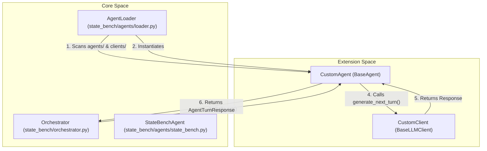
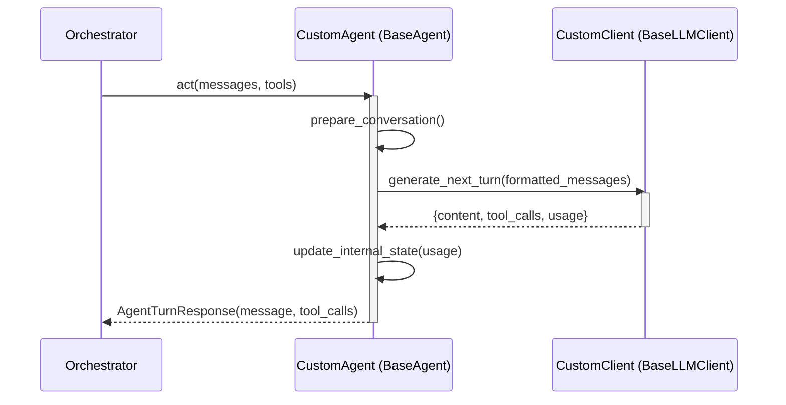

<!-- source: DeepWiki mcp.deepwiki.com · repo microsoft/STATE-Bench · page 3.3 Custom Agents and Clients · fetched 2026-10-26 -->

# Custom Agents and Clients

<details>
<summary>Relevant source files</summary>

The following files were used as context for generating this wiki page:

- [.env.example](.env.example)
- [CONTRIBUTING.md](CONTRIBUTING.md)

</details>


The STATE-Bench framework is designed to be extensible, allowing researchers and developers to evaluate any agentic system or LLM provider. This is achieved through two primary extension points: **Custom Clients** (subclassing `BaseLLMClient`) for connecting to new model providers, and **Custom Agents** (subclassing `BaseAgent`) for implementing complex agent logic, memory systems, or specialized tool-calling loops.

### Extension Architecture

The framework supports a modular directory structure for extensions. While core implementations reside within the `state_bench/` package, users can provide custom implementations via the `agents/` and `clients/` directories at the project root.

#### Data Flow and Component Interaction

The following diagram illustrates how the `AgentLoader` instantiates custom components and how they interact during a task execution.

**Component Loading and Interaction Flow**

Sources: `[state_bench/agents/loader.py:1-50]()`, `[state_bench/orchestrator.py:1-100]()`

---

### Custom Clients (`BaseLLMClient`)

To support a third-party LLM provider (e.g., Anthropic, Cohere, or a local Llama instance), you must implement a subclass of `BaseLLMClient`.

#### Implementation Contract
A custom client must implement the `generate_next_turn` method. This method is responsible for:
1.  **Format Conversion**: Translating the `list[dict[str, Any]]` conversation history into the provider's specific schema.
2.  **API Invocation**: Sending the request to the provider.
3.  **Token/Cost Reporting**: Extracting usage metadata from the provider's response and returning it in a standardized format.

#### Key Methods and Properties
*   `generate_next_turn(...)`: The primary execution hook. It receives the conversation, tools, and sampling parameters.
*   `cost_per_1k_tokens`: A property used by the orchestrator to calculate the financial efficiency of the agent.

Sources: `[state_bench/client.py:1-80]()`

---

### Custom Agents (`BaseAgent`)

Custom agents allow for the evaluation of architectures that go beyond simple prompting, such as those involving RAG, long-term memory, or multi-step reasoning.

#### The `BaseAgent` Interface
Every agent must inherit from `BaseAgent` and implement the core interaction loop.

| Method | Role |
| :--- | :--- |
| `act()` | The high-level entry point called by the Orchestrator for every turn. |
| `generate_next_turn()` | The low-level LLM call, often wrapping a `BaseLLMClient`. |
| `ingest_trajectory()` | (Optional) Used in the **Agent Learning Track** to update agent state from previous runs. |
| `prepare_conversation()` | (Optional) Hook to inject system prompts or memory before a task starts. |

#### Agent Runtime Context
Agents receive an `AgentRuntimeContext` during initialization. This object provides access to:
*   **Environment Metadata**: The current domain and task ID.
*   **Client Pool**: Access to the configured `LLMClient` instances.
*   **Memory Configuration**: Settings for learning and retrieval.

**Agent-Client Interaction Logic**

Sources: `[state_bench/agents/base.py:1-120]()`, `[state_bench/agents/state_bench.py:1-60]()`

---

### Loading and Registration

The `AgentLoader` dynamically imports custom classes based on the configuration provided in the CLI or environment variables.

1.  **Directory Discovery**: The loader looks into the `agents/` and `clients/` directories at the root of the repository.
2.  **Naming Convention**: Files should be named descriptively (e.g., `my_custom_agent.py`). The loader identifies classes that inherit from the base types.
3.  **Environment Configuration**: To use a custom agent, set the `STATE_BENCH_AGENT_TYPE` environment variable or use the `--agent-type` flag in `run_task.py`.

#### Example `.env` for Custom Components
```bash
# Point to a custom agent implementation in agents/my_agent.py
STATE_BENCH_AGENT_TYPE="MyCustomAgent"

# Point to a custom client implementation in clients/my_client.py
STATE_BENCH_AGENT_PROVIDER="custom_provider"
STATE_BENCH_AGENT_MODEL="my-model-v1"
```
Sources: `[.env.example:1-29]()`, `[state_bench/agents/loader.py:20-45]()`

---

### Cost and Token Reporting

To ensure fair comparison on the leaderboard, custom agents must accurately report their resource consumption.

1.  **Usage Extraction**: Inside `generate_next_turn`, capture `completion_tokens` and `prompt_tokens`.
2.  **Metric Aggregation**: The `BaseAgent` maintains an internal tally of these tokens.
3.  **Final Reporting**: At the end of a trajectory, the Orchestrator calls the agent's reporting methods to populate the `EfficiencyMetrics` schema, which includes:
    *   `total_tokens`
    *   `total_cost` (calculated via `cost_per_1k_tokens`)
    *   `inference_time_s`

Sources: `[state_bench/schemas.py:100-150]()`, `[state_bench/agents/base.py:80-100]()`

---

