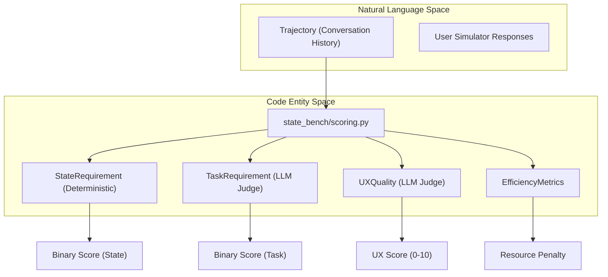
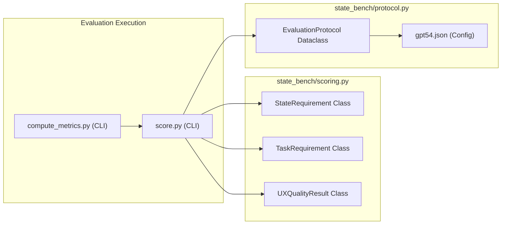

<!-- source: DeepWiki mcp.deepwiki.com · repo microsoft/STATE-Bench · page 4 Evaluation Pipeline · fetched 2026-10-26 -->

# Evaluation Pipeline

Relevant source files

The following files were used as context for generating this wiki page:

- [.env.example](.env.example)
- [CHANGELOG.md](CHANGELOG.md)

The **Evaluation Pipeline** in STATE-Bench is a multi-stage process designed to rigorously score agent performance across three dimensions: functional state correctness, task requirement fulfillment, and user experience (UX) quality. Unlike simple string-matching benchmarks, STATE-Bench utilizes a combination of deterministic state diffing and LLM-based judging to evaluate complex, multi-turn trajectories.

The pipeline is governed by a strict **Evaluation Protocol** that locks the judge models and prompt versions to ensure reproducibility across different research environments.

### Pipeline Overview

The evaluation process typically follows the execution of a task batch and proceeds through three main phases:

1.  **Trajectory Scoring**: Individual trajectories are processed to identify state changes and evaluate qualitative requirements.
2.  **Judge Invocation**: The "Locked Evaluation Client" (configured via `STATE_BENCH_EVAL_ENDPOINT` [.env.example:9-10]()) uses a high-reasoning model (GPT-5.4) to assess task success and UX.
3.  **Metrics Aggregation**: Scores from individual tasks are aggregated into benchmark-wide metrics like Pass@1 and Pass^N.

#### The Scoring Workflow
The following diagram illustrates the transition from the **Natural Language Space** (agent/user dialogue) and **Code Entity Space** (state requirements and scoring logic).

**Sources:** [state_bench/schemas.py:1-200](), [state_bench/scoring.py:1-100]()

---

### Evaluation Protocol
The `EvaluationProtocol` is the configuration backbone of the pipeline. It ensures that every evaluation run uses the exact same split manifests, judge models, and prompt hashes. This prevents "evaluator drift" where changes to the judge model or its instructions might artificially inflate scores.

*   **Locked Judge**: The protocol currently mandates GPT-5.4 as the judge model [CHANGELOG.md:6-7]().
*   **Manifests**: Defines which tasks belong to the `train`, `val`, and `test` splits for each domain.
*   **Validation**: The protocol validates the hashes of the prompts used by the User Simulator and the Judges.

For details, see [Evaluation Protocol](#4.1).

**Sources:** [state_bench/protocol.py:1-50](), [.env.example:6-12]()

---

### Scoring Components
Scoring is handled by the `state_bench/scoring.py` module, which decomposes an agent's performance into specific, measurable criteria.

| Component | Method | Description |
| :--- | :--- | :--- |
| **State Requirements** | Deterministic | Compares the final environment state against `StateDiff` assertions (e.g., "Was a booking created with the correct email?"). |
| **Task Requirements** | LLM Judge | Evaluates qualitative goals that aren't captured in the database, such as "Did the agent mention the cancellation fee?". |
| **UX Quality** | LLM Judge | Scores the interaction on a 0-10 scale based on `user_control`, `user_effort`, and `response_density`. |
| **Efficiency** | Formulaic | Calculates resource usage and applies penalties for excessive tool calls or token consumption. |

For details, see [Scoring: State Requirements, Task Requirements, and UX](#4.2).

**Sources:** [state_bench/scoring.py:120-250](), [state_bench/schemas.py:80-120]()

---

### Metrics Computation and Reporting
Once trajectories are scored, the `compute_metrics.py` script aggregates these results into a standardized `metrics.json` file. This script handles the statistical heavy lifting required for the leaderboard.

*   **Pass@1 and Pass^N**: Calculates the probability of success over single or multiple attempts.
*   **Cost Analysis**: Aggregates token usage and estimated API costs across the entire run.
*   **Domain Breakdown**: Provides per-domain (Travel, Shopping, Support) performance metrics.

For details, see [Metrics Computation and Reporting](#4.3).

**Sources:** [state_bench/scripts/compute_metrics.py:1-150]()

---

### System Integration Diagram
This diagram maps the evaluation concepts to the specific code entities that execute them.

**Sources:** [state_bench/scoring.py:1-50](), [state_bench/protocol.py:1-30](), [state_bench/scripts/compute_metrics.py:20-60]()

---

