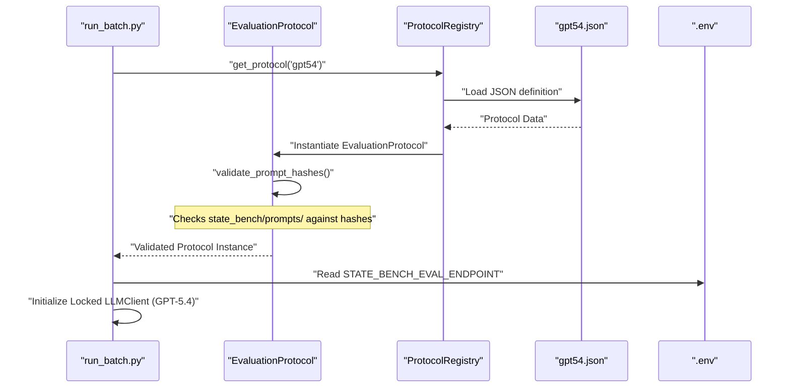

<!-- source: DeepWiki mcp.deepwiki.com · repo microsoft/STATE-Bench · page 4.1 Evaluation Protocol · fetched 2026-10-26 -->

# Evaluation Protocol

<details>
<summary>Relevant source files</summary>

The following files were used as context for generating this wiki page:

- [.env.example](.env.example)
- [CHANGELOG.md](CHANGELOG.md)

</details>


The **Evaluation Protocol** defines the standardized configuration for running benchmarks within STATE-Bench. It ensures reproducibility by locking the versions of the user simulator, the scoring judge, and the specific task splits used for evaluation. The protocol is managed through the `EvaluationProtocol` dataclass and a JSON-based configuration system.

## Overview

To maintain a level playing field on the public leaderboard, all submissions must adhere to a specific `EvaluationProtocol`. This protocol dictates:
1.  **Model Locking**: The specific LLM deployment used for the `UserSimulator` and the `ScoringJudge` [state_bench/protocol.py:16-18]().
2.  **Split Manifests**: The exact list of `task_ids` included in the `train` and `test` splits for each domain [state_bench/protocol.py:19-20]().
3.  **Prompt Integrity**: SHA-256 hashes of the system prompts to ensure the evaluation logic hasn't been tampered with [state_bench/protocol.py:21-22]().

### Data Flow: Protocol Initialization
The following diagram illustrates how the `EvaluationProtocol` is loaded and applied during a benchmark run.

**Protocol Loading and Validation Sequence**

Sources: [state_bench/protocol.py:10-35](), [.env.example:6-12]()

---

## The EvaluationProtocol Dataclass

The `EvaluationProtocol` is a structured container for the benchmark's ground-truth settings.

| Field | Type | Description |
| :--- | :--- | :--- |
| `protocol_id` | `str` | Unique identifier (e.g., `"gpt54"`) [state_bench/protocol.py:15](). |
| `eval_model_id` | `str` | The model version required for the judge/simulator [state_bench/protocol.py:16](). |
| `domain_splits` | `Dict[str, DomainSplit]` | Maps domain names to their specific `train`/`test` task IDs [state_bench/protocol.py:19](). |
| `prompt_hashes` | `Dict[str, str]` | SHA-256 hashes of system prompts for validation [state_bench/protocol.py:21](). |

### DomainSplit
Each domain within a protocol is defined by a `DomainSplit` object, which explicitly lists the tasks available for that version of the benchmark.
*   **`train_tasks`**: Tasks intended for agent training/learning [state_bench/protocol.py:8]().
*   **`test_tasks`**: The official held-out set used for leaderboard scoring [state_bench/protocol.py:9]().

Sources: [state_bench/protocol.py:7-25]()

---

## GPT-5.4 Protocol Configuration

The current canonical protocol is defined in `state_bench/configs/eval_protocols/gpt54.json`. As of version `0.7.0`, the benchmark transitioned from GPT-5.1 to GPT-5.4 to improve the reliability of the UX scoring judge [CHANGELOG.md:3-7]().

### Implementation Details
The protocol requires the following environment variables to be set to a GPT-5.4 compatible endpoint:
*   `STATE_BENCH_EVAL_ENDPOINT`: The base URL for the evaluation LLM [ .env.example:9]().
*   `STATE_BENCH_EVAL_DEPLOYMENTS`: The specific deployment name [ .env.example:10]().

### Entity Relationship: Protocol to Code
This diagram maps the protocol configuration entities to the internal Python classes and file system paths.

**Protocol Entity Mapping**
```mermaid
classDiagram
    class EvaluationProtocol {
        +protocol_id: "gpt54"
        +eval_model_id: "gpt-5.4"
        +domain_splits: Dict
        +validate_prompt_hashes()
    }

    class DomainSplit {
        +train_tasks: List~str~
        +test_tasks: List~str~
    }

    class ProtocolRegistry {
        +get_protocol(id: str)
    }

    EvaluationProtocol "1" *-- "many" DomainSplit : "defines"
    ProtocolRegistry ..> EvaluationProtocol : "loads from gpt54.json"
    
    EvaluationProtocol --> "state_bench/prompts/" : "validates hashes"
    DomainSplit --> "datasets/tasks/" : "references IDs"
```
Sources: [state_bench/protocol.py:10-50](), [state_bench/configs/eval_protocols/gpt54.json]()

---

## Registering a New Domain or Protocol

To extend the benchmark with a new domain or a custom evaluation protocol, follow these steps:

### 1. Define Domain Splits
Add the new domain and its task IDs to the `domain_splits` section of a protocol JSON file.
```json
"my_new_domain": {
    "train_tasks": ["task_001", "task_002"],
    "test_tasks": ["task_003", "task_004"]
}
```

### 2. Prompt Hash Validation
The `EvaluationProtocol` class includes a `validate_prompt_hashes()` method. This method iterates through the files in `state_bench/prompts/` and compares their SHA-256 checksums against the `prompt_hashes` dictionary [state_bench/protocol.py:21-22](). If you modify a system prompt (e.g., the UX judge prompt), you must update the hash in the protocol configuration, which effectively creates a new protocol version.

### 3. Loading via Registry
The `ProtocolRegistry` (implemented as a helper in `protocol.py`) is responsible for discovering JSON files in `state_bench/configs/eval_protocols/` and providing them to the `Orchestrator`.

Sources: [state_bench/protocol.py:30-60](), [CHANGELOG.md:5-6]()

---

