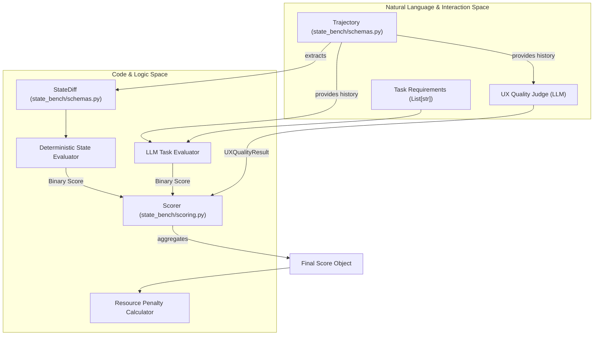
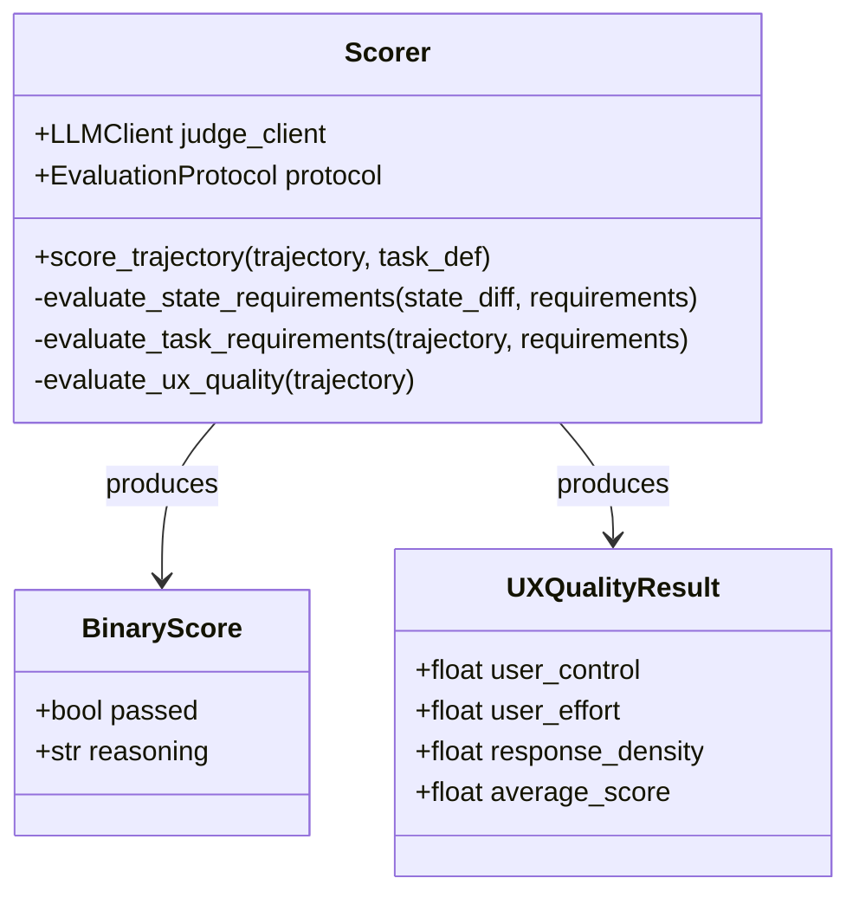

<!-- source: DeepWiki mcp.deepwiki.com · repo microsoft/STATE-Bench · page 4.2 Scoring: State Requirements, Task Requirements, and UX · fetched 2026-10-26 -->

# Scoring: State Requirements, Task Requirements, and UX

<details>
<summary>Relevant source files</summary>

The following files were used as context for generating this wiki page:

- [.gitignore](.gitignore)
- [CHANGELOG.md](CHANGELOG.md)

</details>


This page provides a deep dive into the scoring mechanisms of STATE-Bench, primarily implemented in `state_bench/scoring.py`. The evaluation pipeline combines deterministic state validation, LLM-based task fulfillment assessment, and a multi-dimensional UX quality judge to produce a comprehensive performance profile for an agent.

### Scoring Architecture Overview

The scoring process is triggered after a trajectory is completed. It evaluates three primary dimensions:
1.  **State Requirements**: Deterministic check of side effects in the environment's database [state_bench/scoring.py:175-182]().
2.  **Task Requirements**: LLM-based verification of natural language goals [state_bench/scoring.py:202-207]().
3.  **UX Quality**: LLM-based assessment of the interaction quality (effort, control, and density) [state_bench/scoring.py:228-232]().

#### Data Flow: From Trajectory to Score
The following diagram illustrates how the `Scorer` class processes the output of a task execution.

**Figure 1: Scoring Pipeline Data Flow**

**Sources:** [state_bench/scoring.py:155-256](), [state_bench/schemas.py:228-278]()

---

### 1. Deterministic State Requirements

State requirements represent the "ground truth" side effects that must occur in the environment for a task to be considered successful (e.g., a flight must be canceled, or a specific item must be added to a cart).

#### Implementation Details
The `Scorer` uses a `StateDiff` object, which captures the delta between the environment's initial state and its final state [state_bench/schemas.py:228-237]().

*   **Entity Primary Keys**: The evaluator identifies entities (e.g., `bookings`, `orders`) by their primary keys to track changes across the state delta [state_bench/scoring.py:26-34]().
*   **Assertion Matching**: Requirements are defined as a list of assertions. The scorer iterates through these, checking if the final state matches the expected values for specific entity attributes [state_bench/scoring.py:36-153]().

**Sources:** [state_bench/scoring.py:175-182](), [state_bench/schemas.py:228-237]()

---

### 2. LLM-based Task Requirements

Some task objectives cannot be verified through database state alone (e.g., "Inform the user about the cancellation fee"). These are evaluated by a "Judge" LLM.

*   **Mechanism**: The `Scorer.evaluate_task_requirements` method sends the task summary, the list of requirements, and the full conversation trajectory to the LLM [state_bench/scoring.py:202-226]().
*   **Output**: The judge returns a boolean `pass` or `fail` for each requirement, which is then aggregated into a `BinaryScore` [state_bench/schemas.py:258-261]().
*   **Protocol**: The specific judge model and prompt are defined in the `EvaluationProtocol` [state_bench/protocol.py:14-25]().

**Sources:** [state_bench/scoring.py:202-226](), [state_bench/protocol.py:14-25]()

---

### 3. UX Quality Judge

The UX score measures the efficiency and "human-centricity" of the agent's interaction. It is calculated by the LLM judge across three dimensions:

| Metric | Definition | Implementation Reference |
| :--- | :--- | :--- |
| **User Control** | Does the agent respect user preferences and ask for confirmation? | `UXQualityResult.user_control` |
| **User Effort** | Does the agent minimize the number of turns the user must take? | `UXQualityResult.user_effort` |
| **Response Density** | Is the agent's communication concise and relevant? | `UXQualityResult.response_density` |

The judge provides a score from 1-5 for each dimension, which is then averaged into a final `ux_score` [state_bench/schemas.py:264-278]().

**Sources:** [state_bench/scoring.py:228-256](), [state_bench/schemas.py:264-278](), [CHANGELOG.md:5-7]()

---

### 4. Resource Penalty Formula

To discourage inefficient agents that achieve success through brute force or excessive token usage, STATE-Bench applies a resource penalty to the final score.

#### The Formula
The `EfficiencyMetrics` class tracks `total_tokens`, `total_cost`, and `total_turns` [state_bench/schemas.py:239-247](). The penalty is calculated during the metrics aggregation phase:

```python
# Conceptual logic in state_bench/scripts/compute_metrics.py
final_score = base_pass_rate * (1 - resource_penalty)
```

The penalty scales based on how far the agent exceeds the "baseline" resource consumption established by the gold trajectories provided in the dataset [state_bench/scripts/compute_metrics.py]().

**Sources:** [state_bench/schemas.py:239-247](), [state_bench/scripts/compute_metrics.py]()

---

### 5. CLI Usage: `score.py`

The `score.py` script is the entry point for evaluating a directory of completed trajectories.

**Command Structure:**
```bash
python -m state_bench.scripts.score --input_dir ./outputs/my_run --protocol gpt54
```

**Execution Logic:**
1.  **Load Protocol**: Loads the judge configuration (e.g., `gpt54.json`) [state_bench/protocol.py:40-50]().
2.  **Iterate Trajectories**: Loads each `trajectory.json` from the input directory.
3.  **Invoke Scorer**: Calls `Scorer.score_trajectory()` [state_bench/scoring.py:155]().
4.  **Save Results**: Writes a `scores.json` file back into the task's output directory.

**Figure 2: Scorer Class Structure**


**Sources:** [state_bench/scoring.py:155-256](), [state_bench/protocol.py:14-25]()

---

