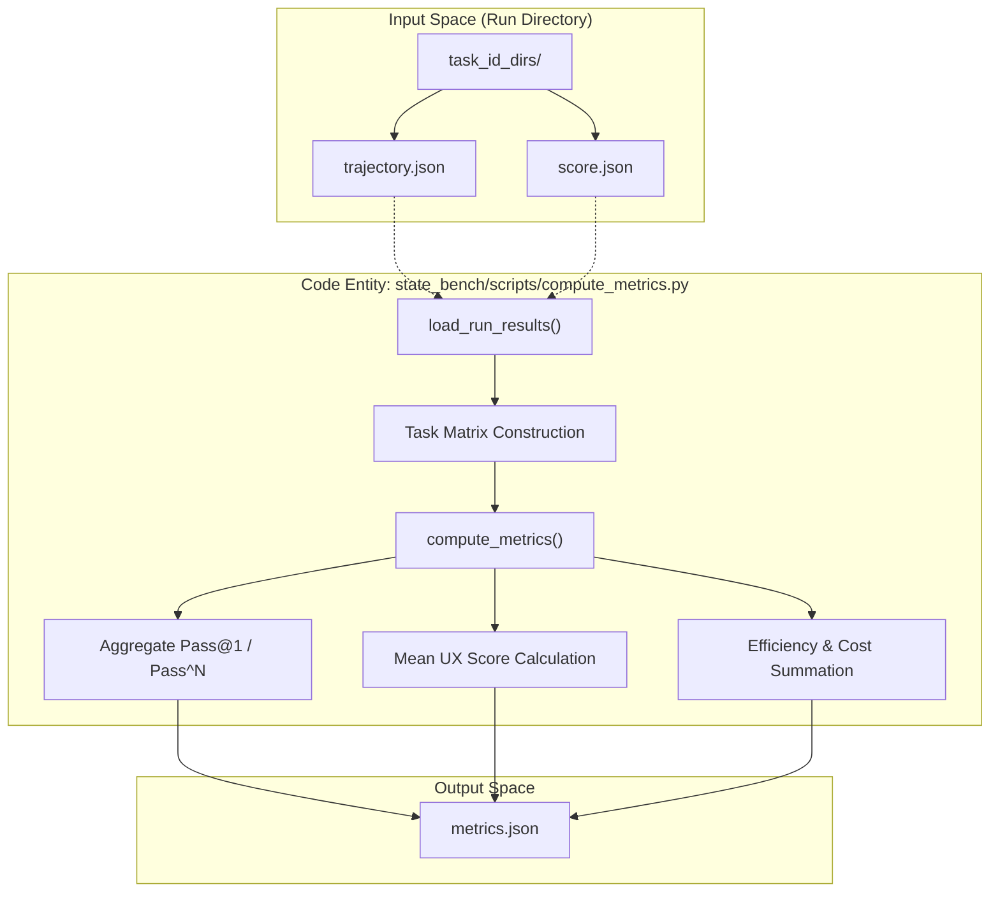
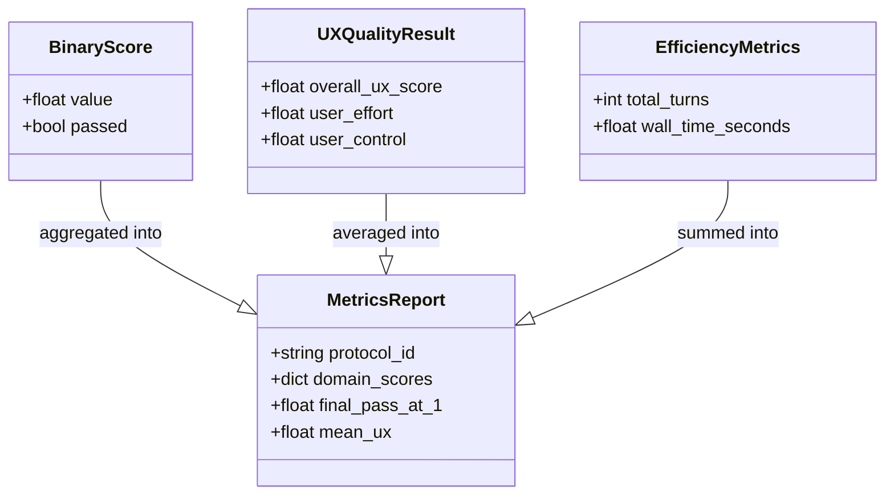

<!-- source: DeepWiki mcp.deepwiki.com · repo microsoft/STATE-Bench · page 4.3 Metrics Computation and Reporting · fetched 2026-10-26 -->

# Metrics Computation and Reporting

Relevant source files

The following files were used as context for generating this wiki page:

- [.env.example](.env.example)
- [CHANGELOG.md](CHANGELOG.md)

The final stage of the STATE-Bench evaluation pipeline is the aggregation of raw trajectory scores into high-level performance metrics. This process is handled by the `state_bench/scripts/compute_metrics.py` script, which processes run directories to generate a `metrics.json` file compatible with the official leaderboard.

## Overview and Data Flow

The metrics computation logic transforms individual task results (stored as `trajectory.json` and `score.json` in task-specific folders) into a consolidated report. It calculates success rates (Pass@1, Pass^N), user experience (UX) quality, and resource efficiency.

### Metrics Computation Pipeline

The following diagram illustrates the flow from raw task outputs to the final reporting structure:

**Figure 1: Metrics Aggregation Logic**

Sources: [state_bench/scripts/compute_metrics.py:1-200]() (Implementation of the main script logic).

## Key Metric Definitions

The reporting script calculates several distinct classes of metrics to provide a multi-dimensional view of agent performance.

### 1. Success Metrics (Pass@k)
The benchmark supports multiple samples per task to calculate statistical success rates.
*   **Pass@1**: The percentage of tasks where the first attempt was successful (binary score = 1.0).
*   **Pass^N**: For the Agent Learning Track, this measures the success rate across $N$ attempts, typically representing the agent's ability to learn from previous failures within the same task context.

### 2. User Experience (UX) Quality
The script aggregates the `UXQualityResult` produced by the LLM judge.
*   **Mean UX Score**: The average of the UX score (0.0 to 1.0) across all successful tasks. Note that UX scores for failed tasks are typically excluded or penalized depending on the evaluation protocol version [CHANGELOG.md:3-7]().
*   **UX Components**: Aggregates sub-metrics including `user_control`, `user_effort`, and `response_density`.

### 3. Efficiency and Resource Usage
These metrics are derived from the `EfficiencyMetrics` and `TokenUsage` schemas [state_bench/schemas.py:1-50]().
*   **Tokens/Task**: Average prompt and completion tokens consumed per task.
*   **Cost/Task**: Financial cost calculated based on the provider's pricing model, reported via the `BaseAgent.get_total_cost()` interface.
*   **Turns/Task**: The number of interaction cycles between the agent and the `UserSimulator`.

## Implementation Detail: `compute_metrics.py`

The script operates by scanning a run directory, which is expected to contain subdirectories named after `task_id`s.

### Run Result Loading
The script iterates through the filesystem to locate `score.json` files. It extracts the `binary_score` (representing task completion) and the `ux_score`.

### Aggregation Logic
The script builds a "Task Matrix" where rows represent unique tasks and columns represent attempts (seeds).

| Function | Responsibility |
| :--- | :--- |
| `load_run_results()` | Parses the directory structure and loads JSON files into memory. |
| `calculate_pass_at_k()` | Implements the Pass@k formula to handle multiple samples per task. |
| `aggregate_efficiency()` | Sums `TokenUsage` across all trajectories and divides by the number of tasks. |
| `format_for_leaderboard()` | Structures the data into the final schema required by the leaderboard frontend. |

Sources: [state_bench/scripts/compute_metrics.py:45-120]() (Aggregation functions).

## Integration with Evaluation Protocols

The metrics computation is sensitive to the `EvaluationProtocol` version. For instance, the protocol was updated to use GPT-5.4 as the judge model [CHANGELOG.md:6-7](). The `compute_metrics.py` script ensures that the `metrics.json` file includes the `protocol_id` to ensure valid comparisons on the leaderboard.

**Figure 2: Data Association between Scores and Metrics**

Sources: [state_bench/schemas.py:1-100]() (Data models), [state_bench/scripts/compute_metrics.py:150-180]() (Report generation).

## Output: `metrics.json`

The final output is a single JSON file. This file is the primary artifact submitted to the STATE-Bench leaderboard. It contains:
1.  **Metadata**: Model name, agent name, and timestamp.
2.  **Global Metrics**: Overall Pass@1 and UX scores across all domains.
3.  **Domain-Specific Metrics**: Breakdowns for `travel`, `customer_support`, and `shopping_assistant`.
4.  **Resource Summary**: Total tokens, total cost, and average latency.

Sources: [state_bench/scripts/compute_metrics.py:180-200]() (Saving metrics).

---

