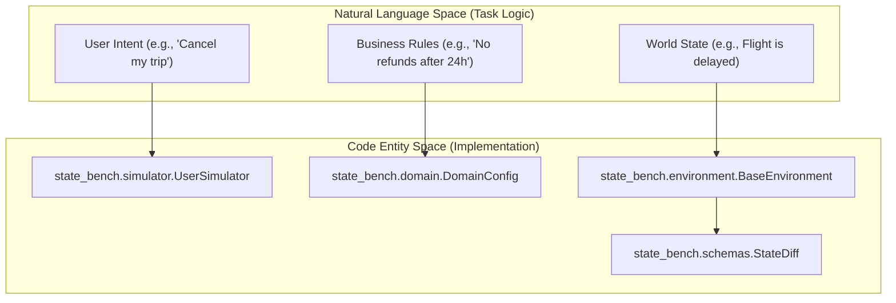
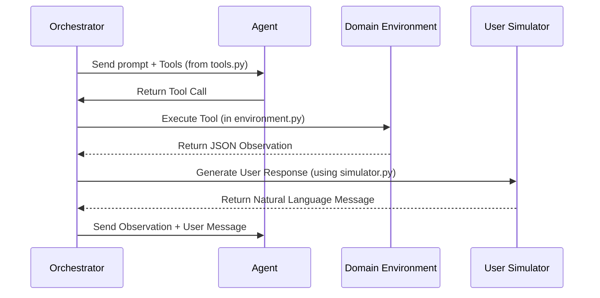

<!-- source: DeepWiki mcp.deepwiki.com · repo microsoft/STATE-Bench · page 5 Benchmark Domains · fetched 2026-10-26 -->

# Benchmark Domains

Relevant source files

The following files were used as context for generating this wiki page:

- [.gitignore](.gitignore)
- [README.md](README.md)

STATE-Bench evaluates AI agents across three distinct enterprise domains: **Travel**, **Customer Support**, and **Shopping Assistant**. Each domain is designed to test multi-step reasoning, tool usage, and policy adherence within a realistic sandbox environment.

While the business logic varies, all domains share a common technical architecture. This consistency allows the benchmark orchestrator to execute tasks across different domains using a unified interface.

### Domain Architecture Overview

Every domain in STATE-Bench is implemented as a structured package that follows a strict interface defined by the `DomainConfig` and `BaseEnvironment` abstractions. This structure ensures that whether an agent is booking a flight or processing a retail return, the underlying interaction loop remains consistent.

For details on the technical implementation of these abstractions, see [Domain Architecture](#5.1).

#### Shared Structure
Each domain directory (e.g., `state_bench/domains/travel/`) contains the following standard components:

| Component | File | Description |
| :--- | :--- | :--- |
| **Configuration** | `config.py` | Defines domain-specific constants and metadata. |
| **Environment** | `environment.py` | Manages the sandbox state and database interactions. |
| **Tools** | `tools.py` | Defines the JSON-RPC style tools available to the agent. |
| **Policies** | `policies.py` | Encapsulates the business rules (e.g., refund windows). |
| **Schemas** | `schemas.py` | Pydantic models for domain entities (Users, Orders, etc.). |
| **Simulator** | `simulator.py` | Domain-specific logic for the LLM-based user simulator. |

**Sources:** [README.md:18-21](), [README.md:24-31]()

### High-Level Domain Comparison

The benchmark includes 450 tasks (150 per domain) designed to evaluate different agentic capabilities.

| Domain | Entities | Key Tools | Core Challenge |
| :--- | :--- | :--- | :--- |
| **Travel** | Flights, Hotels, Rentals, Bookings | `search_flights`, `cancel_booking` | Complex constraints and multi-product coordination. |
| **Customer Support** | Orders, Warranties, Returns | `process_return`, `get_order` | Strict adherence to deterministic business policies. |
| **Shopping Assistant** | Carts, Products, Promos | `apply_promo`, `search_products` | Personalized recommendations and inventory management. |

**Sources:** [README.md:26-30]()

### Conceptual Architecture: Natural Language to Code Entities

The following diagram illustrates how high-level domain concepts map to specific code entities within the `state_bench` package.

**Domain Mapping: Logic to Code**

**Sources:** [state_bench/domain.py:1-20](), [state_bench/environment.py:1-15](), [state_bench/simulator.py:1-10]()

### Domain-Specific Details

#### Travel Domain
The Travel domain focuses on the complexity of itinerary management. It requires the agent to navigate 17 different tools to manage flights, hotels, and car rentals. Agents must reason about loyalty tiers, baggage policies, and cancellation fees.
For details, see [Travel Domain](#5.2).

#### Customer Support Domain
The Customer Support domain tests an agent's ability to follow deterministic logic. Tasks involve processing returns, exchanges, and warranty claims based on specific order dates and product categories. The agent must verify eligibility using the policy engine before executing state-changing tools.
For details, see [Customer Support Domain](#5.3).

#### Shopping Assistant Domain
The Shopping Assistant domain emphasizes search and discovery. Agents help users find products, manage shopping carts, and apply promotional codes. This domain tests the agent's ability to handle user preferences and inventory constraints effectively.
For details, see [Shopping Assistant Domain](#5.4).

### Task Execution Flow

The interaction between the agent and the domain environment is managed by the orchestrator. The following diagram shows how domain-specific code is invoked during a single turn.

**Domain Interaction Loop**

**Sources:** [state_bench/orchestrator.py:1-50](), [state_bench/environment.py:10-30]()

---

