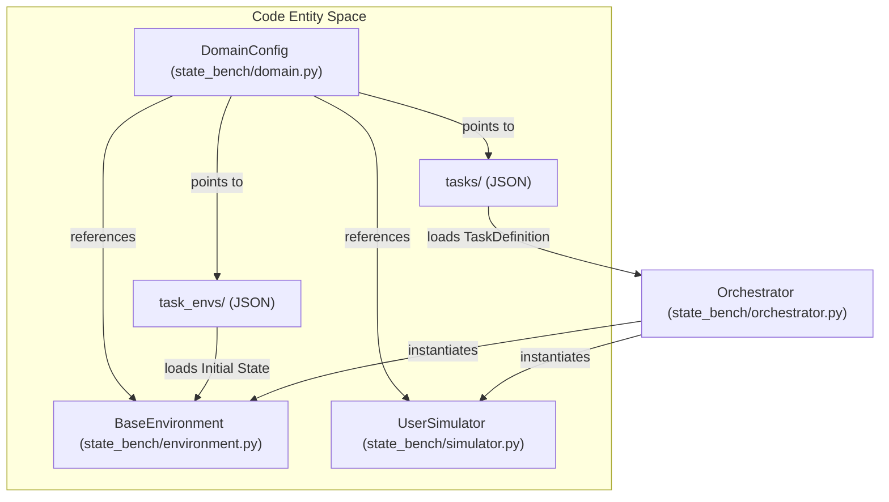
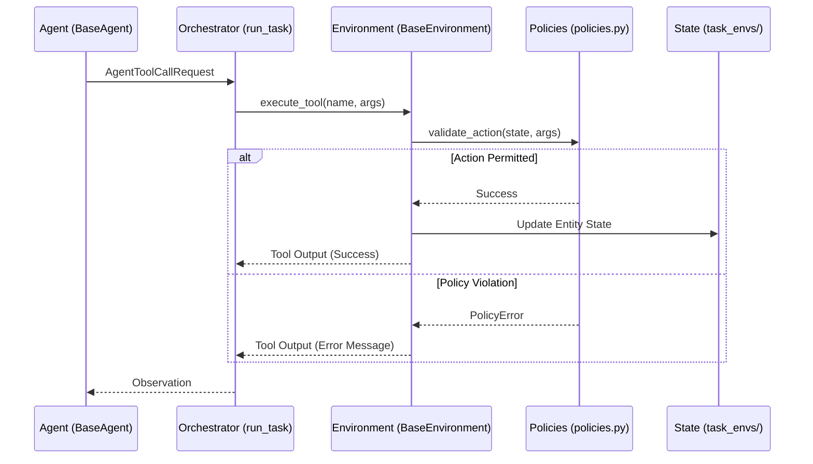

<!-- source: DeepWiki mcp.deepwiki.com · repo microsoft/STATE-Bench · page 5.1 Domain Architecture · fetched 2026-10-26 -->

# Domain Architecture

Relevant source files

The following files were used as context for generating this wiki page:

- [.gitignore](.gitignore)
- [CHANGELOG.md](CHANGELOG.md)

The STATE-Bench architecture is built around a standardized domain abstraction that decouples task execution from domain-specific logic. Each domain (e.g., `travel`, `customer_support`) follows a strict structural contract, allowing the core orchestrator to interact with diverse environments through a unified interface defined in `state_bench/domain.py` and `state_bench/environment.py`.

## Domain Abstraction Layer

The `DomainConfig` class is the central registry for a domain's components. It encapsulates the paths to data directories, the simulator class, and the environment implementation.

### DomainConfig
Defined in `state_bench/domain.py`, this class provides the metadata necessary to instantiate a domain's runtime environment. It includes:
*   **Identity**: Name and versioning for the domain.
*   **Resources**: Paths to prompts, task definitions, and initial state environments.
*   **Class Mapping**: References to the specific `BaseEnvironment` and `UserSimulator` subclasses used by the domain.

### BaseEnvironment
The `BaseEnvironment` class in `state_bench/environment.py` defines the interface for state management and tool execution. Every domain must implement this class to provide:
*   **State Persistence**: Loading and saving the environment state (usually a collection of JSON-serializable entities).
*   **Tool Execution**: A dispatch mechanism that maps agent tool calls to internal Python functions.
*   **State Differencing**: The ability to calculate `StateDiff` objects to track changes made by the agent during a task.

### Data Flow: Domain Initialization
The following diagram illustrates how the `DomainConfig` is used to bootstrap a task execution environment.

**Domain Initialization Flow**

**Sources:** `state_bench/domain.py`, `state_bench/environment.py`, `state_bench/orchestrator.py`

---

## Standard Domain Structure

Every domain in STATE-Bench (located under `state_bench/domains/`) implements a shared directory and file structure. This uniformity ensures that the scoring pipeline and orchestrator can process any domain without modification.

| File/Directory | Purpose |
| :--- | :--- |
| `config.py` | Contains the `DomainConfig` instance and domain-specific constants. |
| `environment.py` | Implements the `BaseEnvironment` subclass, managing domain entities (e.g., flights, orders). |
| `tools.py` | Defines the Python functions exposed to the agent as tools. |
| `policies.py` | Encapsulates business logic and constraints (e.g., refund windows, baggage rules). |
| `schemas.py` | Pydantic models for domain entities and tool arguments. |
| `simulator.py` | Custom `UserSimulator` logic if domain-specific behavior is required. |
| `prompts/` | System prompts for the agent and the user simulator. |
| `tasks/` | JSON files defining task goals and success requirements. |
| `task_envs/` | JSON files representing the initial state of the world for each task. |
| `splits/` | Manifests defining which tasks belong to `train`, `val`, or `test` sets. |

### Component Interaction: Tool Execution
When an agent calls a tool, the request is routed through the environment to the domain's policy engine.

**Tool Execution and Policy Enforcement**

**Sources:** `state_bench/environment.py`, `state_bench/orchestrator.py`, `state_bench/agents/base.py`

---

## Domain Components Detail

### 1. State Management (`environment.py` & `schemas.py`)
Domains represent their world as a set of relational entities. For example, in the `travel` domain, entities include `Flight`, `Booking`, and `User`. 
*   **Primary Keys**: Every entity must have a unique identifier used by the `StateDiff` engine to track modifications.
*   **Serialization**: Environments must be able to export their full state to a JSON format to allow the scoring engine to compare the final state against `state_requirements`.

### 2. Policy Engine (`policies.py`)
The policy engine is the "brain" of the environment. It contains deterministic logic that simulates real-world constraints.
*   **Validation**: Checks if a tool call is valid (e.g., "Is this flight cancellable according to the 'Economy' tier policy?").
*   **Calculations**: Computes dynamic values like refund amounts or loyalty point accruals.

### 3. Task Definitions (`tasks/` & `task_envs/`)
Tasks are decoupled from the environment logic.
*   **`tasks/*.json`**: Defines the `TaskDefinition`, including the `opening_message`, `state_requirements` (deterministic checks), and `task_requirements` (LLM-judged criteria).
*   **`task_envs/*.json`**: Contains the specific subset of the world state needed for that task. This allows multiple tasks to run against different starting conditions within the same domain.

### 4. Scoring Protocol
As of version `0.7.0`, the evaluation protocol uses `GPT-5.4` as the judge model for evaluating UX quality and task requirement fulfillment across all domains. This is configured in the global `EvaluationProtocol`.

**Sources:** `CHANGELOG.md:3-7`(), `state_bench/environment.py`, `state_bench/domain.py`

---

